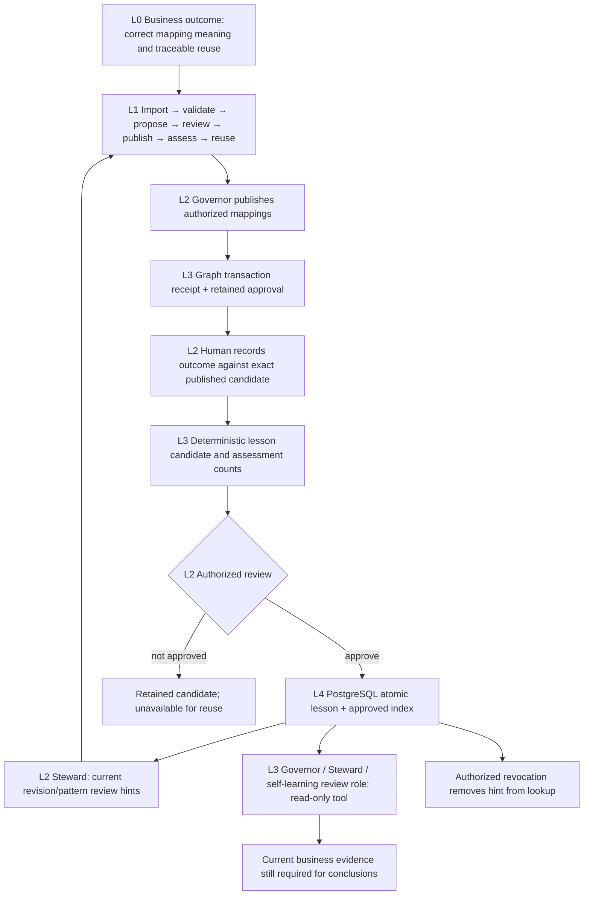

# Governed learning from mapping reviews

This is a bounded feedback loop for instance-to-ontology mappings. It retains human outcomes against verified publication receipts, prepares deterministic lesson candidates and promotes authorized review hints for the same ontology revision. It does not train a model, prove engineering correctness, change matching scores or grant mapping approval. Automatic policy/model promotion remains unsupported.

## Business workflow

In Ontology Junction → Semantic Bridge, publish the reviewed mappings through the existing Governor/Steward workflow. Expand **Learning from reviewed mappings**:

1. Select a published mapping and enter your review name, observed result and supporting note. Choose business meaning confirmed, rejected or not yet established.
2. Choose **Save mapping feedback**. The server verifies the retained approval and graph receipt. Retrying the same feedback returns its retained record. A revised assessment appends a new record, supersedes the old assessment and removes approved hints supported by that old assessment, in one PostgreSQL transaction. Old notes remain in the audit trail; revisions do not inflate sample counts.
3. Choose **Prepare review hint**. Uncertain feedback alone cannot create a reusable lesson. Preparation is distinct from approval.
4. Review the generated hint and counts, enter a reason and choose **Approve review hint** using existing agent approval access.
5. Future Steward assessments can show the approved hint when both model revision and mapping pattern match. Existing confidence, semantic, ambiguity and authorization rules remain authoritative. A rejected historical pattern is a warning for review, not a new logical axiom or an automatic policy rewrite.
6. Revoke obsolete hints with a recorded reason. Revocation removes them from the approved lookup while preserving outcomes and review history. Use **Record another assessment** to review a different mapping or revise an uncertain/changed assessment. Only the current assessment can support a new lesson.

Counts describe retained human assessments and distinct publications. They are not calibrated confidence, measured model accuracy or independent verification of business correctness. Notes are retained for human audit; agent hints are generated from fixed templates rather than replaying arbitrary review text as instructions.

Rejecting a mapping in feedback does not delete or alter its published link or earlier approved mapping memory. Correct that mapping through the normal authorized review/publication workflow. Revoking a lesson affects advisory reuse, not the historical graph receipt.

## L0–L4 connection

PostgreSQL namespace `agentic_learning_reviews_v1` owns outcomes, lesson lifecycle and the approved index. Existing `(namespace,key)` indexing supports direct bounded lookup; no full-history scan, schema drop or new database is required. Lesson and index updates commit through existing transactional `put_many`. The graph remains the authority for publication receipts and mapped entities; feedback operations do not mutate it. Source changes prevent approval of a stale lesson, and a changed ontology snapshot prevents reuse of old hints. This namespace participates in the existing explicit vanilla reset; ordinary deployment preserves it.

## API and agents

All routes are on the existing agentic API. No new microservice, broker, LLM key or feature flag is required.

| Operation | Endpoint | Access |
|---|---|---|
| Capability boundaries | `GET /api/v1/learning/status` | Existing graph reader |
| Current approved hints | `GET /api/v1/learning/lessons?ontology_id=...&import_task_id=...` | Existing graph reader; ontology owner's revision receipt checked; not instance conformance |
| Retained outcome/lesson | `GET /api/v1/learning/records/{id}` | Existing graph reader |
| Record outcome | `POST /api/v1/learning/outcomes` | Existing agent approval contract |
| Prepare candidate | `POST /api/v1/learning/lessons` | Existing agent approval contract |
| Approve/revoke | `POST /api/v1/learning/lessons/{id}/review` | Existing agent approval contract and review reason |

The `learning.lessons` read tool is available to the existing Governor, Steward and `dt-self-learning-review` role. These agents have no lesson-write or promotion tool. Read-goal completion cannot cite only review hints as evidence for a business conclusion. Normal owning-service permissions, source scope, deadlines and tool validation apply. Human assessment notes are excluded from the reusable agent hint.

Hint reads use the ontology owner's lightweight artifact/lifecycle/foundation revision receipt, rather than materializing every graph term or loading the imported instance. Their context does not certify the imported instance or graph conformance. Full original source snapshots are still checked on approval. Standalone reads have a 25-second operation deadline; writes allow up to 120 seconds for source/receipt verification. An existing parent deadline is preserved. A timeout or lost response is not success: refresh/retry the same review, without replaying graph publication. The UI blocks duplicate clicks and discards late results after source selection or access changes.

Large ontology target reads use version-bound pages instead of rejecting every model above 10,000 terms. The complete read retains a 100,000-term / 64 MiB budget and the configured graph-query deadline. Changed revisions, repeated targets and malformed continuation are rejected; a partial target set is never treated as complete. Legacy small single-response peers remain compatible, but deploy the full graph/ingestion/control-plane release together for large models.

## Customer acceptance and limits

Verify this workflow with customer review data on the target deployment before relying on it in operations. Deliberately test a missing graph receipt, a changed source, an uncertain outcome, duplicate submission, access reconnect, revocation and a stale ontology revision. No LLM is required for these deterministic controls. Live agent language quality, large-scale source snapshot latency, customer APIM/Windows behavior and backup restoration remain separate release gates in [customer acceptance](../infra/deployment/CUSTOMER_RELEASE.md).

General outcome-based model tuning and automated policy promotion are not implemented. Expanding beyond mapping review hints requires domain-specific outcome measures, an independent evaluation set, versioned promotion and rollback criteria.
