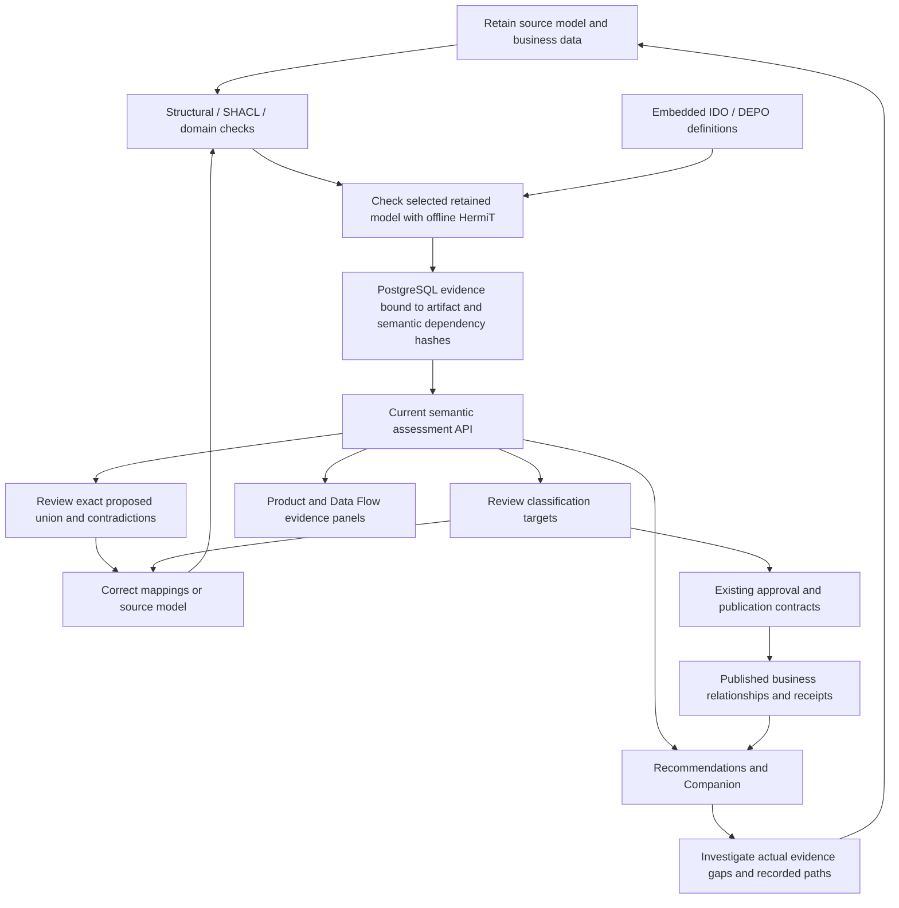

# Semantic evidence in engineering work

DEPO uses a versioned reference vocabulary, structural/data validation, scoped OWL-DL reasoning and recorded business relationships together. These serve different purposes. A part design, a manufactured part, its requirement document and a manufacturing operation must not become one entity merely because their names match.

## The operational loop

The loop is evidence-driven. It does not silently rewrite source models, promote model-generated descriptions to facts, or automatically publish inferred statements. Model consistency, instance conformance, graph delivery and engineering approval remain separate states.

## How to use it

1. Import/register the model and retain its dependencies. Remote ontology imports used by the reasoner need an approved offline closure; an unresolved import remains **unknown**.
2. In Ontology Junction, inspect the embedded vocabulary and run the selected model's consistency check. Review both the consistency verdict and unsatisfiable classes. `consistent` with unsatisfiable named classes still requires model correction.
3. For a merge, leave **Check the proposed union for logical contradictions** enabled. This checks the exact proposed union, including reviewed mappings; two independently consistent models need not form a consistent union. The background review retains the result with the preview. Established contradictions block applying that union. An unverified result holds automatic union approval; existing manual review remains a separate operation and does not turn unknown into verified consistency.
4. For instance linking, Steward reads current target-model evidence. An inconsistent model holds new classification publication. A known unsatisfiable target class holds that target; an unrelated unsatisfiable class does not automatically hold every candidate. Existing domain/range, identity, ambiguity and confidence checks remain in force. Missing reasoning evidence is disclosed and does not create a new blanket publication requirement.
5. In Recommendations, select a specific business object and ontology scope. Results retain graph evidence plus a **Model evidence** panel. Change-impact paths and similar-part scores are not replaced by a consistency score. A conflict signals that the model needs correction; consistency alone does not prove interchangeability or requirement satisfaction.
6. Ask the Companion a business question to retrieve names, descriptions, values and recorded connections. When an ontology is selected, its current semantic assessment accompanies that evidence. Ask an explicit logical-consistency question to read the retained verdict without querying lexical schema matches. Ask about the embedded foundation to read actual term definitions. These paths work with the LLM disabled; generated interpretations, when enabled, remain advisory.
7. Select a Data Product to inspect current model evidence beside its immutable package evidence. At most two referenced ontology IDs are checked on a detail read. No ontology ID is guessed from a product name or release asset ID.
8. Select a Data Flow run to inspect its current publication-model evidence beside job validation and delivery receipts. A completed job is not proof of graph publication. A model assessment does not revalidate the run's output or rewrite an immutable package.
9. Correct source or mapping issues, produce a new artifact, and rerun checks. Evidence for old artifact/foundation/worker revisions is not presented as a current check. Resume of an agent investigation verifies semantic dependencies as well as source revision/lifecycle.

## Industry decision examples

| Business question | Value added by this integration | Evidence still required |
|---|---|---|
| Can a replacement bearing be reused? | Distinguish a design specification from a physical serial instance; expose model contradictions alongside typed property comparisons. | Dimensions, units, tolerances, operating conditions and engineering review. Consistency is not interchangeability. |
| What is affected by a requirement change? | Keep requirement documents, product designs and manufacturing activities distinct; combine recorded dependency paths with model-quality warnings. | Actual requirement-to-design/process links, configuration/effectivity and verified path coverage. |
| Can AP242 and QIF concepts be consolidated? | Check the exact proposed union and identify logical conflict/unsupported/unknown outcomes before relying on it. | Reviewed concept/property mappings, domain/range and units. Similar names or importing IDO do not establish equivalence. |
| Which parts have PMI? | Keep logical model health separate from the business answer; avoid substituting schema property descriptions for product facts. | Retained part-to-PMI ownership/reference paths from the source. |
| Is this data product fit for a downstream analysis? | Show job quality, retained artifacts, model evidence and publication/delivery status as separate evidence. | Approved semantic release, product contract, current source lineage, quality criteria and delivery receipts. |

## API and persistence

- `GET /api/v1/ontologies/foundation?query=Physical%20part&limit=3` returns bounded labels, definitions, types and parent IRIs with bundle/version metadata.
- `GET /api/v1/ontologies/{ontology_id}/consistency` performs the existing explicit bounded reasoning operation and retains its evidence.
- `GET /api/v1/ontologies/{ontology_id}/semantic-evidence` reads only current evidence; it never launches reasoning. No matching current evidence returns `not_checked`, not success.
- `GET /api/v1/ontologies/{ontology_id}/revision` includes semantic dependency revisions for retained agent investigations.
- The existing agents have the read-only `ontology.semantic.evidence` tool. Scope must be explicitly selected for both evidence reads and execution. Completion must supply the exact semantic disposition; the controller renders the semantic verdict, preventing model prose from replacing an unknown result with a success claim.
- PostgreSQL uses the existing indexed `(namespace, key)` registry storage (`ontology_dl_evidence_v1`), not a new SQL schema/table. The original reasoning evidence remains distinct from graph transaction receipts. Deterministic unresolved-import results can be reused as **unknown** for identical dependencies; transient busy/unavailable/timeout results do not become successful cache entries.
- Existing approval, write-ahead publication, graph receipts and reconciliation remain authoritative. Model evidence alone does not verify the graph or an immutable product package. When mapping publication uses verified model evidence, its artifact hash must match the current ontology projection inside the graph transaction; the committed mapping receipt records `graph_projection_verified=true` with the semantic binding. Standalone model assessments retain `graph_projection_verified=false` and never establish instance conformance or product fitness.

See [L0–L4 remediation and database ownership](audits/l0-l4-remediation-2026-10-28.md) for durable conflict holds, bounded exact-class checks, selected-record Companion/agent contracts and remaining qualification.

## Limits and qualification

This improves traceable decision support rather than training the model or automatically enriching business facts. Full materialization of inferred graph assertions, proof of engineering suitability, minimal inconsistency explanations and complete external-import support are not implemented by this change. Local tests exercise real HermiT and isolated API/persistence boundaries. Live LLM answer quality, customer-network behavior and realistic large-model resource limits still need qualification. No live LLM calls are required to check deterministic semantic evidence.
