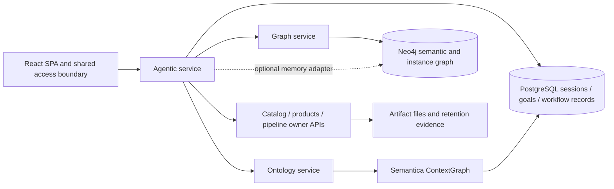

# DEPO architecture audit

Review date: 24 October 2026. Scope: repository working tree on `codex/windows-setup-audit-fixes`, baseline HEAD `2f3f8c8e42f4947f2423cf6b4e873ad3741caff2`. Existing uncommitted frontend refactoring is part of this baseline. This is a source review and isolated regression check, not deployment certification.

## Conclusion

The brief is applicable, but its stateless premise is inaccurate for this codebase. DEPO already has persistent sessions, read-goal observations, durable workflow execution, semantic mapping memory, Semantica business context and artifact retention. Extend those owners; do not introduce five new databases or a replacement orchestration framework. Phase 4 application changes require review and approval under the supplied brief.

## Evidence inventory

Paths below are relative to repository root; links resolve to inspected source.

| Evidence | Owner / source | Observed behavior | Classification |
|---|---|---|---|
| E01 | [sessions.py](../../backend/agentic_service/sessions.py), `open_session`, `owner`, `prune` | PostgreSQL `agentic_sessions`; identity ownership, fixed expiry, advisory lock; shared API keys share a principal | Implemented; individual-user isolation depends on credential topology |
| E02 | [goal_runner.py](../../backend/agentic_service/goal_runner.py), `drive`, `validate_action`; [goal_routes.py](../../backend/agentic_service/goal_routes.py) | Scoped read-only planning; persist observations before dispatch; deadline, decision/revision budgets, evidence-bound completion; PostgreSQL goal/heartbeat namespaces | Implemented; live recovery unverified |
| E03 | [durable_workflows.py](../../backend/agentic_service/durable_workflows.py), `enqueue`; [router.py](../../backend/agentic_service/router.py) | Retains workflow definition/digest, actor, credential fingerprints, deadline and traces in PostgreSQL; rejects arbitrary persisted credential fields; worker mode requires token identities | Implemented; Entra durable delegation explicitly unsupported here |
| E04 | [agent_memory_service.py](../../backend/Services/agent_memory_service.py), `status`, `_query`, `recent_context` | Optional scoped Neo4j sessions/messages/traces/facts; bounded queries; failures degrade best-effort | Implemented optional memory; unsuitable as sole mandatory audit sink |
| E05 | [companion_context.py](../../backend/agentic_service/companion_context.py); [companion_memory.py](../../backend/agentic_service/companion_memory.py) | Authenticated owner-service evidence projections; page/ontology follow-up boundaries; compact bounded retrieval | Partial shared working-context layer |
| E06 | [companion.py](../../backend/agentic_service/companion.py), `ask` | Scoped graph search plus retained mappings/page evidence; bounded shapes and identities; unavailable retrieval is explicit | Implemented retrieval path; semantic answer quality unverified |
| E07 | [business_context.py](../../backend/ontology_service/business_context.py), `BusinessContextService` | Semantica ContextGraph persisted in PostgreSQL with cooperating-writer locking; summary explicitly reports `neo4j_synchronized: False` | Implemented distinct representation, not automatic graph synchronization |
| E08 | [workflow_registry.py](../../backend/Services/workflow_registry.py); [catalog.json](../../backend/agentic_service/catalog.json) | Existing capability/tool/workflow definitions | Partial procedural-memory foundation; not a demonstrated learned-skill promotion system |
| E09 | [artifact_retention.py](../../backend/data_catalog_service/artifact_retention.py), `purge` | Legal hold, expiry, durable purge intent and completion evidence around filesystem deletion | Implemented artifact governance; not a universal memory lifecycle |
| E10 | [decision_policy.py](../../backend/depo_platform/decision_policy.py) | Existing Semantica/PostgreSQL policy adapter; matching score explicitly not calibrated probability | Implemented adapter; outcome calibration unverified |
| E11 | [postgres_migrations.py](../../backend/postgres_migrations.py) | Ordered SQL migrations, transaction advisory lock, immutable-history/checksum validation | Implemented schema-upgrade mechanism; deployed schema not inspected |
| E12 | [AI_AGENTS.md](../AI_AGENTS.md) | Earlier local permission/MCP audit: no generic file-edit guard or mandatory local lint hook; stdio environment filtering is not OS sandboxing | Separate developer-tool boundary; do not confuse with domain approval |

## Current service and state boundaries

The diagram describes logical source boundaries, not a verified running topology. ContextGraph persistence and Neo4j publication are different representations. PostgreSQL records remain authoritative for durable execution; graph memory enrichment must not determine whether a write actually succeeded.

## Priority findings

G01: Common context policy is distributed across sessions, goal scope, companion projections and workflow bindings. A single tested envelope and boundary adapter is preferable to a new network service.

G02: Optional graph memory suppresses query failures into health/degraded results. Keep operational execution evidence mandatory in its current PostgreSQL owner and expose enrichment availability independently.

G03: The inspected mapping-fact retrieval selects recent scoped facts but does not explicitly filter supersession, revocation or validity windows. This is a source-level lifecycle gap; no stale live mapping was reproduced.

G04: Artifact retention, session pruning and graph conversation pruning are separate policies. No universal deletion completion across these stores was established.

G05: Business context is explicitly not synchronized to Neo4j. UI and answers must name representation and source version instead of implying a single complete graph.

G06: Catalogs provide procedural definitions, but evidence-backed skill promotion/version compatibility needs an explicit contract before calling this self-improvement.

G07: No live retrieval relevance, answer accuracy, privacy isolation under customer identity topology, or performance benchmark was established. Passing unit tests cannot substantiate those claims.

No newly reproduced application defect is claimed from the 42 passing checks. These gaps require design and acceptance work; they are not proof that every existing workflow fails.

See [gap matrix](DEPO_MEMORY_GAP_ANALYSIS.md), [target](DEPO_TARGET_ARCHITECTURE.md), [backlog](DEPO_ENHANCEMENT_BACKLOG.md) and [validation](DEPO_TEST_VALIDATION_REPORT.md).
