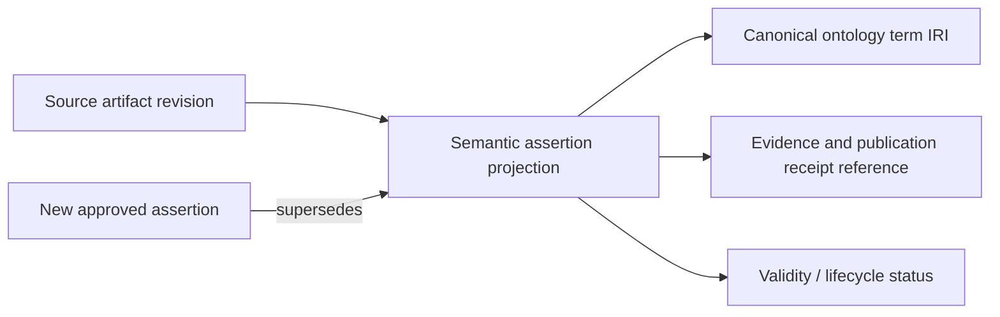

# DEPO ontology and provenance design — proposed extension

Keep domain ontology terms, source instance identities and execution-memory records distinct. Reuse existing namespace/prefix derivation and lifecycle controls. Do not hardcode `splm`, AP242 or QIF as the universal namespace. Preserve source UID/UUID as source identity attributes; an execution ID is not a replacement for a source identifier or canonical IRI.

## Existing representation

E04 stores `AgentMemorySession`, `AgentMemoryMessage`, `AgentMemoryTrace`, `AgentMemoryFact`, `HAS_MESSAGE` and `HAS_REASONING_TRACE`. Mapping facts include scope, ontology ID, source/target, target IRI, confidence, task/import IDs and update time. E07 stores business context separately through Semantica in PostgreSQL.

The following read-only query matches the inspected fact schema; it is an example, not executed against customer data:

```cypher
MATCH (f:AgentMemoryFact {kind: 'semantic_bridge_mapping'})
WHERE f.scope = $scope AND f.ontology_id = $ontology_id
RETURN f.source, f.target_iri, f.confidence, f.updated_at
LIMIT 100
```

## Proposed lifecycle metadata

Add an explicit schema version, authoritative source reference/revision, approval or publication receipt reference, valid-from/until, status and superseded-by reference to semantic memory projections. Candidate statuses: proposed, approved, superseded, revoked. Migrate missing metadata to `unknown`, never infer approval from age or a high score.



This diagram proposes relationships; it does not claim these labels/edges currently exist. Prefer references to owning-service evidence over copying private payloads into the graph.

## Alignment and inference

Keep equivalence, subclass, relatedness and instance typing distinct. Labels/ngrams/property compatibility may generate candidates; their scores are not permission to merge. Expose source and target IRIs, relation kind, structural constraints, evidence, conflicts and score basis before approval. Domain/range or subclass inferences must be distinguished from asserted source facts and tied to an ontology revision and inference rule version.

If source or ontology revision changes, mark dependent candidate mappings stale and require review. Preserve the previous publication until a new approved publication succeeds. Do not delete historical evidence to resolve contradictory current assertions.

Acceptance: AP242–QIF fixture includes an exact lexical false friend, a valid property match, incompatible domains, subclass versus equivalence, duplicate labels across namespaces and a revoked mapping. Only approved, current, authorized evidence enters reusable semantic context.
