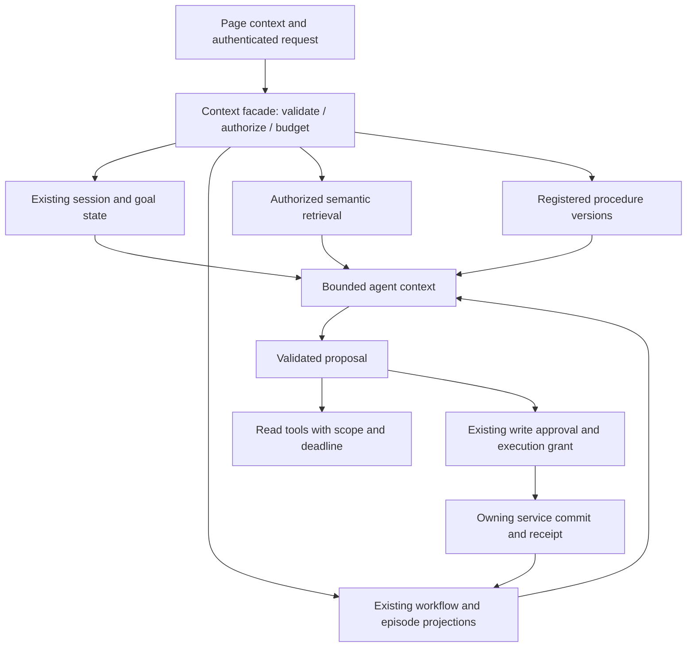
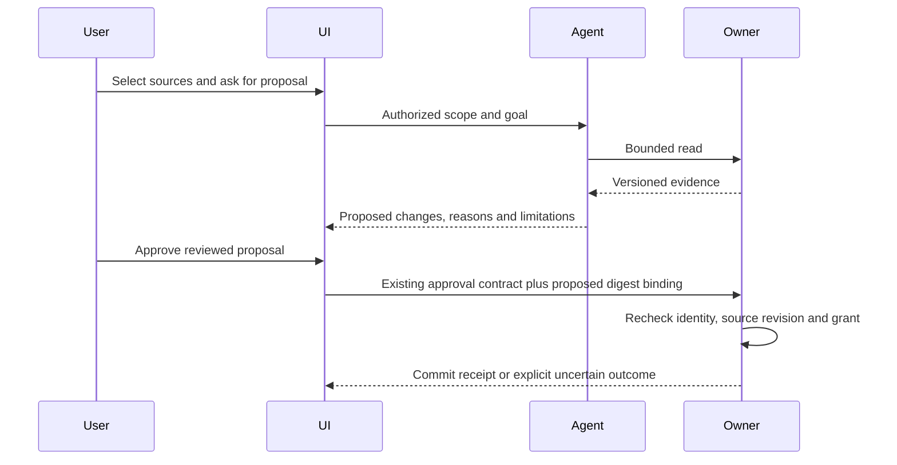

# DEPO target architecture — proposed

This is a design, not an implemented release. Extend existing service owners; keep the React SPA, PostgreSQL execution registry, Neo4j graph and Semantica adapters.

## Context management facade

Implement a logical facade inside the agentic service first. Reuse `sessions`, `companion_context`, `goal_runner`, durable workflow grants and owner-service APIs. Do not create a new HTTP microservice or duplicate authoritative stores without measured need.

## Contract and API boundaries

The internal facade should accept server-established principal, tenant/project, purpose, selected source/version IDs, run/session IDs, deadline and budget. Return evidence plus coverage, freshness, availability and omissions. Caller-supplied page hints or model text must not establish authorization.

Reuse current public APIs until contracts are tested. Proposed internal operations are `assemble_context`, `record_observation`, `resolve_procedure_version`, and `request_invalidation`; these names are design contracts, not existing endpoints. Avoid a universal writable memory API that bypasses the ontology, catalog or workflow owner.

## Deployment and migration

Retain existing Windows setup/manage launchers and service boundaries. Add only additive, DBA-reviewable SQL through the current migration mechanism when fields cannot fit existing versioned records. Do not rewrite recorded migrations, rotate credentials, auto-approve corrected ontologies or republish graphs during install.

Roll out in stages: context adapters disabled by default; shadow evidence/coverage comparison; read-only enablement; approval-bound writes; separately authorized retention. New readers tolerate old records with explicit unknown version/freshness. Rollback disables adapters while preserving additive records and existing run recovery.

## Approval flow

The digest binding is proposed hardening; do not represent every current write as having this exact contract. Never replay an uncertain write merely because the UI timed out.

## Observability and UX

Display source/version, evidence coverage, unavailable providers, unresolved conflicts and the next user decision. Show concise explanations rather than raw agent traces in chat. Keep diagnostic traces behind authorized diagnostics. Separate session expiry, service unavailability and workflow failure; refreshing a page must not create a new business operation.
