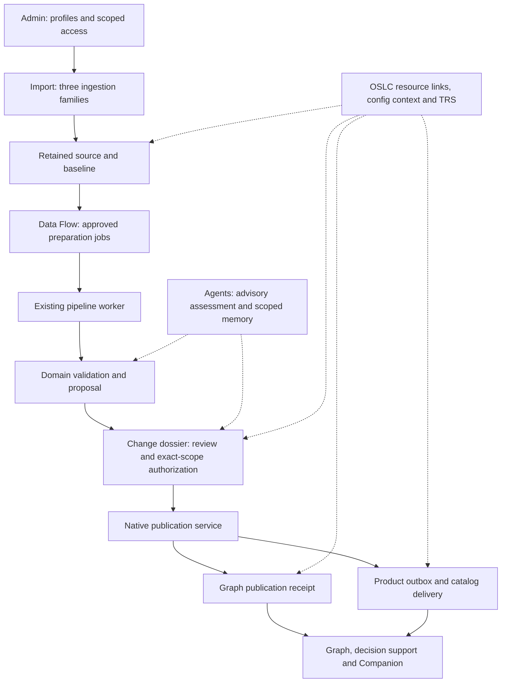

# NEXUS short-release improvement tracker

Updated: 2026-11-16

## Master list of open actions — reconciled 2026-11-16

This is the single current action register. It consolidates the original OPEN items, later functional findings and unfinished proposals. Detailed evidence below is retained; an older dated OPEN statement does not override a later verified fix. **Code fixed**, **live acceptance**, **external acceptance** and **proposed enhancement** are different states. Priorities do not imply a delivery date.

| ID | Priority / state | Open action | Evidence required to close |
|---|---|---|---|
| OPEN-01 | P1 · Partial fix; model remediation open | Finish source/import-profile and full logical-model remediation. Cardinality and Dublin Core crashes are fixed; regenerate a reviewed version, preserve source statements/imports and resolve remaining RDF/OWL profile issues. | Exact artifact/dependency fingerprints; parse/profile/SHACL/inference evidence; an actually executed applicable reasoner result. No unsupported OWL-DL result reported as consistent. |
| OPEN-03 | P1 · Local coordinated parent release verified; broader analytics open | UI acceptance completed for existing mBOM graph: snapshot WF-2026-000005 enabled through CR-2026-000015; RUN-2026-000018 retained 8648 RDF statements; product induction-motor-mbom-source-evidence:1.0.0 reviewed and published through CR-2026-000016. Package/catalog delivery verified and ZIP downloaded through the frontend; ZIP integrity passed. | This proves the native snapshot-to-evidence-product branch only. The linked parent CR-2026-000020 / CO-2026-000016 is completed with both native receipts verified; broader analytics acceptance remains open. Actor was deployment-bootstrap under the existing credential-bound matrix; Paritosh is owner/steward, not a substituted approver. Product quality remains requires_review; no business KPI/completeness certification. |
| OPEN-04 | P1 · Coverage review open | Verify CR/CO and configuration ownership for every remaining ontology/document/preparation task; finish remaining owner-workspace/registered-source/template parity before removing old inline commands. | Dispatch-by-dispatch matrix, denied execution without matching authority, exact task/deliverable lineage and equivalent owner commands, including graph-chunk handoff. No independent approval bypass. |
| OPEN-05 | P1 · Regression and UI acceptance open | Latest full frontend suite is green: 180 files / 1223 tests passed in 326.76s, recorded in grounding-full-frontend-final.log outside application code. Three obsolete recommendation test expectations were corrected to verify visible business results and explicitly expanded Supporting report evidence. Finish page/field/button/link acceptance, including multi-tab credentials, Back/Forward, refresh, stale response, cancellation, interruption and restart. Both Data Flow handoffs were activated during the coordinated release journey; wider page/recovery acceptance remains open. | Current suite receipt plus page/component/element acceptance results. Last full frontend run before the reporting-scope increment: 181 files / 1,225 tests passed (447.73s), recorded in action-register-frontend-tests.log outside the application. Subsequent reporting increment: 8 frontend and 13 backend checks passed. Product flow increment: duplicate XML loader removed from retained-evidence publication; new direct publication and manual approver removed, legacy uncertain-outcome reconciliation preserved; raw product JSON removed, readable provenance and authenticated download added. Retired unused PageTaskWorkspace component, stylesheet and component-only tests. The subsequent complete run passed after the report/export and three test-contract corrections. Wider page/recovery acceptance remains open. Targeted passing tests do not certify all pages. |
| OPEN-06 | P1 · Cross-domain acceptance open | Finish remaining vocabulary/source-family intake, AP242 alignment and reviewed requirements–CAD–MBSE–BOM–manufacturing–quality links. Six separate source publications and 30 graph analyses already passed locally. | Reviewed cross-source identity/relationship mappings, recorded values and forward/backward paths. Separate source graphs, name similarity and reference links must not be presented as a complete digital thread. |
| OPEN-07 | P1 · External acceptance open | Verify installed IIF orchestration, actual agent GraphQL/tool invocation, optional MCP handshake and customer architecture interoperability. | Real authenticated requests, scoped tool/evidence/latency records, failures and restart recovery. Repository adapter/unit tests and direct graph calls are not external orchestration acceptance. |
| OPEN-08 | P1 · Customer acceptance deferred | Prove customer install/previous-version upgrade, packaging/configuration, restart, restore and rollback; validate enterprise identity/project authorization and separation of duty in that environment. | Named deployment and agreed recovery targets, upgrade/restore receipts, preserved configuration/credentials and denied unauthorized cases. Customer testing was deferred by the user; local startup is not customer acceptance. |
| OPEN-09 | P1 · Continuous take delivered; user acceptance open | NEXUS-Continuous-Live-Walkthrough.mp4 is a single uninterrupted 5:43, 1920×1080/30 fps desktop-capture stream: no cuts, still-image insertions, captions or audio. Actual typing, navigation, live Companion follow-up, agent CO investigation, graph interaction, Where Used and saved memory were operated through the frontend. The existing executive transcript was aligned to this take; the screenshot deck has 20 refreshed page captures / 21 slides. | File decoding passed; capture receipt is outputs/engineering-ods-20261116/continuous-live-receipt.json outside application code. User acceptance and complete executive problem/demo/outcome coverage remain open. This supersedes earlier capture-blocker/cut-ready status; the old rejected edited video is not final acceptance. |
| OPEN-10 | P1 · mBOM case verified; other historical imports open | Corrected mBOM source re-import RUN-2026-000017 / FILE-2026-000011 completed CR-2026-000014 / CO-2026-000012 review, authorization and publication through the UI. Graph readback returned product 000886 and its scoped OSLC resource returned 200. Audit/reprocess other affected historical imports with their own governed baselines. | Verified new scope ceim-plmxml-055d8179a44b752b9979a442; source master id1224 and revision id1222/A remain distinct. Old publication/approval retained. Readback receipt: outputs/golden-id-publication-readback.json outside app code. Replay RUN-2026-000016 reused immutable normalized input and remains an unpublished diagnostic; fresh source intake was required. No manual value injection or baseline rewrite. |
| OPEN-11 | P1 · Lifecycle discovery fixed; interoperability open | TRS, Configuration Management and Automation are now discoverable and visible as platform-wide lifecycle capabilities, separate from selected-ontology RM/AM/CM/QM coverage. Automation reuses retained workflow plans/requests/results and native execution authority. Configuration exposes paginated frozen baselines and standard selects links; no streams, branching or global composition. | 67 backend tests + 3 subtests and 9 frontend tests passed. Live authenticated reads: TRS position 43; 5 plans, 17 requests/results; 0 release and 0 analytics baselines; all lifecycle endpoints returned 200. Managed restart completed with index-vs8_IKw0.js; live UI displays the same counts. Automation, Configuration and TRS links and browser return were verified; exact mBOM scope remains 1543 resources / 5248 links. External provider/domain/configuration interoperability and full conformance acceptance remain open. |
| OPEN-12 | P1 · Requirement ownership fixed locally; wider routing open | Requirement paths now follow declared composition direction and an explicit requirement association, or a direct inverse allocation. Parent-to-sibling traversal, archived identities and name-only requirement classification are excluded. Live inner-race follow-up returned only REQ-BRG-001; the assembly-wide query correctly retained child-part requirements. | 84 affected backend checks passed; live requirements then PMI topic-switch checks passed with exact source binding. Unknown named property/product requests now return unresolved identity; initial or post-failure pronouns request a record instead of substituting an older part. Live negative → clarification → valid revision → PMI recovery passed. Manufacturing routing, complete requested-property coverage and ambiguous initial names still need broader acceptance. No claim of complete cross-domain ownership or all Companion cases. |
| OPEN-14 | P1 · Grounding retention fixed locally; wider memory acceptance open | Typed and generic business evidence now retain actual resource/source/publication identities, relationship evidence and a unique proven subject separately from user search scope. Same-scope pronoun follow-ups re-read the exact authenticated graph identity; ambiguous or truncated evidence does not invent a selected subject. Memory insights shows the evidence record. | Browser and PostgreSQL readback verified root identity, source scope, publication revision, PMI identity and path/relationship evidence; page reload retained the record. Context/retention regressions passed. Unknown-subject boundaries and valid-subject recovery now pass through the UI and HTTP route. Initial ambiguous named typed reads, multi-user live isolation, expired/superseded evidence, changed-source baselines and broader graph/report drill-through remain open. Historical records are preserved, not backfilled with guessed identities. |
| OPEN-15 | P1/P2 · Scope/coverage verified locally; other report work open | Reporting selector now merges exact published graph sources with registrations; OSLC scope resolver recognizes active graph identities missing from the legacy registry. Report and OSLC page/count queries prevent shared prefixes from mixing identified versions. Existing filters now have accessible names. Activated index-DapsaIEv.js. UI verified Sugar plant MBSE 883 records / 3,863 links and corrected mBOM 1,543 / 5,248, with matching full totals and no coverage 422 or alerts. Back/Forward and reload retain exact source selection. Declared RDF types now replace generic resource labels in report rows, using one shared normalization path. CSV exports preserve nested evidence and protect formula-like text. Live filtered export returned 1200 rows with consistent columns; current-page export also downloaded and parsed as 25 rows. Final complete frontend run: 180 files / 1222 tests passed. Build index-C7hPxELH.js activated; no new package or service was added. Opaque source labels and empty-feed/refresh guidance remain open. | 13 backend checks (plus 3 subtests) and 8 frontend tests passed; build/managed restart passed. Published CAD, requirements, manufacturing, mBOM and SysML choices appear with names/dates. Screenshots: reports-mbse-coverage-fixed.jpg and reports-mbom-scope-fixed.jpg in working outputs. RDF classifier defect corrected: shared report/query classification now checks explicit standard RDF types, supported CEIM Requirement and supported XMI instance types. Read-only graph verification: requirements scope 14 RM / 91 records; Sugar plant MBSE 39 AM / 883 records. The mBOM scope remains 1543 unmapped domain records because Part/Product/Assembly alone is not an RM/AM/CM/QM mapping. Zero bars now show explicit unmapped-scope guidance; Automation Management, TRS and Configuration Management stay in their service-wide section. Targeted increment: 61 backend tests + 3 subtests and 12 frontend tests passed; Managed restart completed with index-DNU7RRN2.js. Live browser verified RM requirements 14 and AM architecture resources 39, and selected-mBOM unmapped guidance. Lifecycle table visibly shows Automation Management 6 plans / 18 requests / 18 results, TRS position 49, and Configuration Management available with 0 release/analytics baselines. Scope changes retained separate ontology versus platform totals. Screenshot evidence is in working outputs; no graph data or classifications were written. Declared-type rendering and CSV download are verified locally; source-label remediation and feed-refresh acceptance remain open. An absent selector option is not an empty graph. |
| OPEN-16 | P1 · QIF/PLMXML defects fixed locally; wider identity acceptance open | Finish cross-format golden-ID and reference fixtures, QIF now has document-qualified identities (root QPId, otherwise explicit artifact scope), source provenance and entity-resolution separation; wrong-type and unresolved references require review. PLMXML parser releases its file on rejection and exposes unresolved declared references. Remaining: vendor/source-family coverage and source-to-canonical cross-version mappings. | Per-family source ID, UID/GUID, product number, revision/master, artifact and canonical-IRI receipts. Latest targeted identity suites: 58 passed, 3 fixture-dependent skips, 9 subtests; skipped/vendor coverage is not a 100% parser certification. |
| OPEN-17 | P1 · Connector/provider acceptance open | Prove worker acquisition for the intended release connectors: registration versus dependency readiness versus tested access; freshness, deletion, credential rotation and restart behavior. | Real operator profile/test source, persisted checkpoints and results; explicit failed/untested states. No enterprise source/profile was supplied for the earlier live acceptance request. |
| OPEN-18 | P1 · Business quality/performance acceptance open | Establish agreed domain question/recommendation benchmarks, alternative/constraint and effective-baseline checks, actual outcome feedback, representative concurrency/data-volume limits. | Reproducible business-approved cases and measured quality/latency/capacity. Structural PageRank/Jaccard/triangles do not establish interchangeability, satisfaction or outcome improvement. SVD++ remains an unimplemented proposal without an accepted interaction/outcome training set. |
| UX-01 | P1 · Product shared controls fixed; all-page review open | Remove proven duplicate actions and status conflicts without radical page redesign. Catalog and Products share business evidence details and CR/CO submission. Raw Technical record JSON is removed; provenance has readable source links. Catalog registration is not presented as missing delivery status; absent catalog artifact counts are omitted. The same immutable ZIP was downloaded from both Products and Catalog and passed ZIP integrity checks. Admin overview shows 1 catalog version and 1 package, matching destination pages. Shared menu navigation now emits the route event after pushState; breadcrumbs reject foreign view parameters. 83 focused tests across 10 suites passed; active build index-CNlzJAPV.js. Live menu navigation no longer retains the previous page view label. Snapshot definition review now links directly to Change Control; snapshot-only analysis no longer claims zero portfolio records. | Finish page/component/action inventory for remaining Import, Data Flow, Ontology Junction/Bridge, Dictionary, Quality, Modeling, ReqIF, QIF, Graph Explorer, Recommendations, Memory insights and Admin. Review legacy QIF inline publication against central ownership before removal; preserve command parity. Availability, execution, quality and publication must remain separate states. No claim that all page duplication is fixed. |
| SCOPE-01 | P1/P2 · Proposed / incomplete; not all confirmed bugs | Verify remaining original delivery-register enhancements: service/access/readiness summaries, task/attempt/QoS evidence, replay/reacquisition distinctions, asset-linked memory, freshness, consumer product readiness and catalog discovery, task presets and reusable KPI/time-aware analytics. | Map SES-02, JOB-01/02, MEM-01/02, CON-01/03, FRESH-01, PROD-01/02, CAT-01 and DEC-01–05 to actual implementation and user acceptance before claiming closure or starting new work. Use current services/pages and avoid duplicate stores or unnecessary packages. |
| SCOPE-02 | P1 · Governance extension / identity prerequisite | Complete agreed project/team directory, named principal assignments, acknowledgement/observer/notification and task/deliverable acceptance criteria. User named Paritosh; current local authenticated actor remains deployment-bootstrap. | Actual existing principal assignments and multi-person/quorum/separation tests. Do not relabel the bootstrap credential as Paritosh or claim separate-person approval from one session. |
| SCOPE-03 | P2 · Cleanup and operational follow-up | Review retained compatibility/unused UI code after owner parity; reconcile stale test expectations; reproduce the intermittent startup endpoint-validation timeout. | Remove only proven obsolete paths with caller/package checks; preserve supported compatibility and useful details. PageTaskWorkspace and its component-only stylesheet/tests were removed after confirming no application consumers; that cleanup is closed locally. The ambiguous-XML test expectation and default pytest temp permission issue are recorded; no blanket deletion or security bypass. |

**Already closed locally:** OPEN-13 provider generation recovered after API credits were updated: gpt-5-nano generation, structured outputs and native tool calls verified, and two live cited Companion answers completed through the landing UI. The preceding 429 was credit_balance_exhausted / insufficient_quota; changing models was unnecessary. Other Companion accuracy/memory acceptance remains OPEN-12/14.  OPEN-02 import CR/CO lifecycle (CR-2026-000006 / CO-2026-000004 and receipt verified), taxonomy scope counts, native central publication commands, source-to-release coordinator implementation, workflow maintenance/import-load CR/CO implementation, known false Steward-pending state and previously recorded local identity/receipt fixes. Their broader customer/business acceptance remains in the rows above; they are not new implementation defects.

### Grouped execution plan

Each action retains its existing ID and detailed evidence. These groups share fixes and acceptance tests; they do not create new independent trackers. Resolve common causes once, then verify each affected workspace. No extra packages or service consolidation are assumed.

| Order / group | Existing actions | Shared work and closure gate | Current state |
|---|---|---|---|
| G1. UI consistency and regression | OPEN-05, OPEN-15, UX-01, SCOPE-03 | One page/action matrix; remove proven obsolete controls, fix route/status ownership and readable report rows/exports. Run the current full frontend suite, then UI history/session/recovery checks. | Active: shared product/navigation fixes passed 83 targeted tests. The first full run found 3 failures / 1220 tests: invalid XSD fixture timing, obsolete direct-publish expectation and incomplete telemetry mock. Corrected contracts plus report normalization/export passed 33 targeted tests. Final full regression passed: 180 files / 1222 tests (398.90s), group-1-full-frontend-final.log. Live mBOM reporting shows declared Part/Assembly/Product types and exports 1200 filtered rows / 25 page rows with uniform CSV columns. Active build index-C7hPxELH.js. Remaining G1 work is wider live page/field/recovery acceptance, opaque source labels and operational timeout follow-up. |
| G2. Governed lifecycle | OPEN-03, OPEN-04, OPEN-11, SCOPE-02 | One CR/CO/configuration authority for all task families; retained baseline and approval matrix; one linked parent source-to-release acceptance. Verify OSLC Automation/TRS/configuration subsets and deny unmatched authority. | Agent-mode acceptance exposed a legacy namespace URI sent to the registered-ontology revision endpoint (404). Fixed through an authenticated exact-node owning-graph source fingerprint, bounded to 10000 records / 40000 relationships with change detection; no fallback on authentication or availability failures. 31 revision/goal tests passed and a real shaft-revision fingerprint was verified; managed activation and three agent use-case runs are next. Native product branch verified. Grouped release/pipeline/product/definition/import/Automation backend checks: 78 passed, 1 skipped. Parent configuration journey, remaining dispatch parity and distinct named-principal acceptance open. Depends on G1 handoffs; multi-person approval requires existing distinct identities. |
| G3. Identity, grounding and memory | OPEN-01, OPEN-10, OPEN-12, OPEN-14, OPEN-16 (OPEN-13 closed locally) | Shared source/canonical identity fixtures and exact scoped retrieval; reasoner profile validation; restore live model generation; verify stored grounding and three memory cases. Reuse the same governed induction-motor source baseline. | Partial fixes exist. Reprocess only affected sources through governance; never rewrite old receipts or replace unavailable model output with claimed AI success. |
| G4. Decision and analytics acceptance | OPEN-06, OPEN-18, SCOPE-01 | Use the G3 baseline for reviewed requirements/CAD/MBSE/BOM/process/quality paths, KPI/alternative/constraint tests, outcome feedback and measured performance. | Open. Agree business formulas/benchmarks where absent; graph structure and similarity alone do not certify business conclusions. |
| G5. External integration | OPEN-07, OPEN-17 | Reuse source registration, authentication, checkpoint/freshness and restart contracts for connectors, IIF, MCP and agent tools. | External acceptance open. Requires actual test provider/operator profiles; do not invent a live enterprise connection. |
| G6. Deployment and final demo | OPEN-08, OPEN-09 | Customer upgrade/restore/identity evidence, followed by readable continuous demonstrations using accepted G1-G5 outcomes. | Customer testing deferred. Demo completion follows verified Companion/memory/business use cases; current review cut is not final acceptance. |

**Execution order:** G1 shared corrections and current regression first; G2 governance and G3 data/grounding establish the reusable baseline; G4 business acceptance follows; G5 external contracts and G6 customer/demo acceptance retain explicit prerequisites. Independent checks may proceed within the current session. No closure based solely on a renamed status or passing smoke test.

### Customer demo preparation — Engineering ODS data (16 November)

- Reused the existing contextual-data generator outside application code. The new Engineering ODS artifact has 257 RDF statements; individual business records are typed against declared ontology classes and retain values, units and provenance. Generated values remain identified in the provenance receipt, not claimed as customer facts.
- Published the isolated fixture through authenticated lifecycle review and central CR/CO commands. Native graph receipt verified: `engineering_ods_75bee75639384857`.
- Live source-data acceptance for BRG-2001-IR/A: two assembly usages (bearing assembly and manufacturing BOM), REQ-BRG-001, bearing bore finish machining, and a comparable bearing candidate. The recorded bore is 25.0 mm, limits 24.99–25.01 mm and inspection 25.006 mm, matching the aligned sales slides 6–9.
- RCA of the earlier zero result: the selected legacy shaft exposed reference-carrier links excluded by the dependency engine, rather than a valid negative impact finding. This legacy traversal remains open; do not describe it as corrected by the fixture.
- Added explicit `hasRequirement` dependency support. Changed agent completion text to named CO review recommendations; empty evidence holds scope instead of presenting zero counts as useful impact. Policy/provenance/model details moved into the collapsed supporting report. Agent investigation is the default in Recommendations.
- Verification: 49 backend recommendation tests and 30 focused frontend tests passed; actual fixture graph analysis returns the stated linked records. Frontend built; managed restart and agent-mode live acceptance/continuous recording are pending. No new video is claimed complete.

### Live agent acceptance update — Engineering ODS (16 November)

- Activated the concise CO recommendation UI and agent-first Recommendations. Main results keep technical policy/model panels in a collapsed supporting report.
- Fixed two related context failures: complete recommendation results exceeding 32 KB were reduced to excerpts before reasoning, and the model received oversized result envelopes. Selected recommendation observations now retain up to a bounded 256 KiB; the model receives a compact typed projection while the full evidence stays retained. Oversize/partial results remain explicit and cannot establish completion.
- Regression evidence: 31 read-goal/recommendation tests pass, including a >32 KB retained-result completion case; 23 focused frontend tests pass. Managed restart completed and frontend bundle `index-D0sX6jBV.js` is active.
- Live UI: the bearing agent investigation completed and produced a named CO review recommendation using the bearing assembly, manufacturing BOM, bore requirement and machining operation. Earlier zero-count shaft output is not used as demo success. Comparison/process/memory demo acceptance remains pending.
- Recording blocker: browser DOM interactions and page screenshots work; native Windows continuous-capture observations repeatedly time out even after the user confirmed the desktop visible. No replacement video has been generated or claimed complete.

### Grounding, ownership and regression closure — 16 November 2026

- Fixed the two demonstrated causes in existing modules: unrestricted requirement-path direction and omitted typed-answer grounding. The permissive path logic and duplicate inline grounding projection were replaced, not retained as parallel fallbacks. No package, service, schema migration or new approval path was introduced.
- Live graph: the inner race returns its bore requirement and excludes the sibling shaft requirement. An assembly query legitimately includes requirements belonging to its recorded child parts. A direct inverse requirement allocation remains supported; arbitrary reference proximity and class hierarchy are not ownership evidence.
- Live frontend after supported managed restart: fresh part details → requirement follow-up → PMI follow-up retained the same bearing. Memory insights and reload showed the stored evidence identity. Read-only PostgreSQL verification confirmed exact resource IDs, source ontology, publication revision and the PMI relationship evidence. The user's unselected search scope remains explicitly separate.
- Verification: final affected backend regression 84 passed (grounding-final-backend-b.log); MemoryRecords 3 passed; recommendation/graph contract checks 40 passed; final complete frontend 180 files / 1223 tests passed in 326.76 seconds (grounding-full-frontend-final.log). These runs overlap and must not be added. Frontend build passed; index-DMRiUilu.js activated; managed backend restart and all readiness checks completed. Existing React test deprecation warnings and the build's chunk-size warning remain.
- Deliverables: the actual uninterrupted 5:43 take is NEXUS-Continuous-Live-Walkthrough.mp4; the existing NEXUS-Executive-Voiceover.txt now follows that recording. The screenshot PPT was refreshed separately. No user acceptance of the recording is assumed. Earlier capture-blocker notes below describe historical attempts.
- Remaining gates are unchanged except for the scoped fixes above: broader Companion/memory cases, agent Similar Parts/Process Context acceptance, coordinated parent CR/CO/configuration journey, parser/profile remediation, all-page/recovery acceptance, external connector/IIF/OSLC interoperability, benchmarks and deferred customer deployment. No blanket closure is claimed.

### Unknown-subject recovery and agent comparison/process acceptance — 16 November 2026

- Unknown explicitly named part/property and product-detail queries now return an unresolved-identity result. Unrelated indexed excerpts cannot substitute business-instance values. The result invalidates the older conversational subject. A following pronoun requests a part/revision without calling graph retrieval or generation; an initial orphan pronoun does the same. A new explicit valid part restores normal current-evidence retrieval.
- Reused one scoped reference guard. Scoped history includes completed unresolved records so a pre-filter cannot erase the boundary; failed and unrelated turns still do not consume the successful recall limit. The retained clarification preserves the actual question, not a rewritten older-part question. Owner filtering and authenticated downstream reads remain unchanged.
- Live native Agent Control acceptance: Similar Parts returned BRG-2002-IR/A as the bearing comparison candidate, with the recorded 50.31 heuristic indicator and inspected property evidence. Three shaft candidates carried material/revision conflicts. The agent summary already excluded conflicted alternatives; corrected the CO task table to hold their substitution consistently rather than suggesting ordinary reuse comparison. Conflicting candidates remain inspectable in the detailed evidence.
- Live Process Context agent returned Bearing bore finish machining and one recorded direct association. The direct/instance table's misleading Type column was corrected to Source because it renders provenance, not an engineering process classification. Instances and related processes remain Not assessed rather than falsely showing zero. Removed an unreachable empty-state branch in the existing recommendation-action component.
- Wider tests uncovered two existing defects, now fixed: the valid graph-analytics navigation page was absent from the chat request enum (422), and home prompts omitted explicit quality/lineage coverage. Canonical-page validation, invalid-page rejection and six-prompt domain coverage pass. No new package, microservice or database store was introduced.
- Verification: complete affected Companion suite 118 passed plus 5 subtests (companion-all-final-b.log); 44 focused frontend tests passed (comparison-process-tests-final.log); frontend production build passed. These overlap earlier counts. The preceding full frontend run was 180 files / 1223 tests passed; it predates this incremental UI correction and is not a new full-suite claim. Managed restart completed with index-COZqKqwY.js and all service/worker readiness checks.
- Live UI after activation: unresolved part → orphan-pronoun clarification → valid named bearing → correct PMI values; agent comparison conflict holds; fresh process investigation and correct Source column. Captured visual evidence: outputs/verified-comparison-holds-1116.jpg outside the application. Existing generated demo records were reused; no new graph data, approval or publication was created.
- This closes those demonstrated local defects and the two native agent smoke cases only. Business-approved alternative/constraint benchmarks, broader cross-domain acceptance, parent CR/CO/configuration acceptance, external IIF/provider tests and deferred customer deployment remain open. No new video or screenshot deck was created in this increment.

### Coordinated source-to-release acceptance - 16 November, completed

- Completed the actual frontend journey from RUN-2026-000017 replay to RUN-2026-000019 (e18b12b0-dfb1-53cc-9587-d6f92ee0bd2e). Source CR-2026-000018 was reviewed, authorized and published within the parent release. The UI blocked product execution until the preceding source receipt was verified.
- Parent CR-2026-000020 / CO-2026-000016, `release-db07ce28279994d7a7d16dc0bba5cac8`, is completed. Native product CR-2026-000019 published `induction-motor-mbom-coordinated-evidence:1.0.0`; both graph publication and package/catalog delivery receipts verified. Reload retained the completed state.
- Frozen configuration: `0c7033ebfdfb3f0fc3f89d913d207c99a8de1fc25f6340c08afda42a83ce049d`. Accepted artifact checksum: `9f3fede96e080b24a4f75ac9792584e400571a44c5d5ecaf377f2c5ba0d1b9c5`.
- Data Catalog displays the new published version alongside the preserved earlier product. The authenticated UI download produced a ZIP with valid CRCs, a manifest referencing RUN-2026-000019 and approved semantic release 1.0.0, and the retained accepted-semantic-partition artifact. Quality remains requires_review and analytics readiness evidence-only. This is not KPI/completeness certification.
- Actual authenticated actor is deployment-bootstrap under the existing credential-bound matrix; Paritosh remains business owner/steward. Distinct-person separation-of-duty acceptance is not established by this local journey.
- Fixed planner eligibility and readable RUN/CR labels, excluded terminal/unprepared requests, enforced selected-source and final-product ordering. Fixed false empty guidance while loading, completed-parent reauthorization/final-verification messages, and replay result navigation leaving its review dialog open. Existing components reused; no packages, services or schema additions.
- Validation: 67 backend tests passed, 1 isolated PostgreSQL test skipped because DEPO_TEST_DATABASE_URL is not configured. Latest targeted frontend regression: 41 tests across 4 files passed. Production build and frontend lifecycle activation passed; live completed parent and product receipts verified after reload. No current full-suite or external OSLC conformance claim.
- Proof: outputs/completed-coordinated-release-1116.jpg; release-ui-regression-final.log and release-ui-build-final.log outside application code. Broader analytics, remaining dispatch-family ownership, provider interoperability, customer recovery and wider page acceptance remain open.

### Ontology and identity defect remediation - 16 November

- QIF numeric ids are document-local. The adapter now qualifies new normalized ids with the root QPId UUID, or an explicitly identified artifact-hash scope if QPId is absent. Nested external-document QPIds cannot substitute for the current document; original source ids and artifact fingerprints remain retained. Same QPId/local id remains stable across content revisions; no-QPId revisions require a reviewed crosswalk rather than guessed equivalence.
- Closed the related entity-resolution and RDF provenance collisions: different QIF documents sharing external numeric ids remain separate records and separate source evidence. Existing unscoped legacy provenance references remain supported; no historical ids, approvals, releases or graph records were rewritten.
- QIF wrong-type references, missing mapped ids, unknown identified elements and unresolved links now produce review-required diagnostics. Bounded external-document and unresolved-reference details are retained. Only declared mappings create relationships.
- PLMXML duplicate-ID rejection exposed a Windows file-handle leak: cleanup masked the validation error with WinError 32. Parser stream ownership is now explicit and closes on success or exception; duplicate checking stays centralized in the existing parser. Adapter diagnostics expose unresolved declared references that aggregate emitted-link counts previously concealed.
- Actual SPLM source reads: mBOM 325 unique emitted records / 549 resolved emitted links; requirements 20 / 19; manufacturing 667 / 929. The manufacturing file additionally has 11 unresolved declared references, now requiring review. These are parser/identity receipts, not new graph publication or cross-domain completeness acceptance.
- Generator-owned XSD hasSchemaFile and provenance predicates now receive explicit metadata declarations. OWL-DL property-kind conflicts now retain bounded offending IRIs and declared types. No source/import statements were removed and no logical guard relaxed.
- Full original PLMXML schema regenerated outside application source and its complete pinned closure checked: still unsupported/unparsed_rdf_statements (2), consistency_verified=false, deductive_reasoner_executed=false. Offending imported statements are dcterms:creator owl:equivalentProperty foaf:maker and sh:this rdf:type rdfs:Resource. Full-closure OWL-DL/model remediation remains OPEN-01; do not describe this as consistency or source-data certification. Detailed receipt: outputs/ontology-identity-1116/full-closure-assessment.json.
- Tests: broader affected run 97 passed / 3 customer-fixture skips / 6 subtests (includes actual bundled reasoner tests); parser/adapters regression 66 passed / same 3 skips; final entity-resolution/contract checks 47 passed. Counts overlap and must not be added. Three historical external PLMXML fixture files are absent; the actual SPLM files were separately read and fingerprinted. Test artifacts isolated outside app.
- Managed restart completed successfully: all service readiness/deployment checks passed, browser authentication and ontology reads verified; frontend index-D5DDGTOH.js remains active. Existing database servers and credentials preserved. Final centralized PLMXML parser check: 4 passed / 3 absent historical customer fixtures skipped.
- Remaining OPEN-16 acceptance: all vendor/unmapped QIF families, reviewed external document resolution and cross-version canonical crosswalks; historical reprocessing must use native CR/CO and preserve old evidence. No blanket identity closure or automatic merging is claimed.

### Manufacturing reference completion and full profile visibility - 16 November

- RCA of the 11 manufacturing unresolved references: seven source WorkAreaOccurrence records were excluded by the CEIM mapping pack. Their linked WorkArea, WorkAreaRevision, WorkAreaInstance and PlantRevisionView records also needed explicit resource mappings. Added only those declared source families to plmxml-teamcenter-core 0.5.0, with exact master/revision/instance/parent/occurrence references; no name-based links or fabricated records.
- Re-read the unchanged supplied manufacturing file: 702 unique emitted records / 975 links / 0 unresolved declared references. All endpoints resolve; work areas and plant views remain Resources, not Parts or Processes. The mBOM remains 325 / 549 and requirements 20 / 19, also zero unresolved references. Counts are accepted-profile parser results, not proof of whole-source semantic completeness. Receipt: outputs/ontology-identity-1116/splm-identity-receipt.json outside app.
- This closes the demonstrated 11-reference code defect. Existing published graphs/CR/CO receipts remain unchanged; new normalized batches use mapping 0.5.0. Historical reprocessing/publication requires its own native reviewed request; old mapping evidence cannot silently pass the new pack digest.
- Reasoner now runs the bounded OWL2 profile inspection on parsed axioms even when some RDF is unparsed. It retains grouped counts/samples and marks profile_complete_for_input=false, with owl2_dl_profile=null, preventing a partial profile from being presented as complete. HermiT deduction remains blocked. The existing validation-details report carries that scope. Offline worker rebuilt and checksum/source manifest refreshed with bundled dependencies only.
- Regenerated full PLMXML dependency closure now exposes additional actual parsed-profile findings: IllegalPunning 16; reserved class vocabulary 51; reserved individual vocabulary 756; undeclared annotation properties 5185; classes 9; data properties 1695; datatypes 45; object properties 4242. Counts are occurrences in the parsed closure, not unique invalid business entities. Two imported unparsed statements remain. Full RDF/imported vocabulary closure is not certified OWL2-DL; source-specific logical-model remediation remains OPEN-01. No import deletion, annotation downgrade or blanket guessed declaration was used.
- Standards distinction checked against W3C OWL2 structural specification and SHACL Recommendation: ontology import closure and shapes validation have different semantics. References: https://www.w3.org/TR/owl2-syntax/ and https://www.w3.org/TR/shacl/ . Next model remediation must preserve the complete RDF/vocabulary evidence and explicitly define a reviewable domain logical module; it must not label a reduced diagnostic as a full-source consistency pass.
- Tests: 64 backend passed / 3 historical customer-fixture skips, including actual reasoner and partial-profile regressions; 3 frontend passed. Production frontend build and managed restart passed; all API readiness/deployment checks and browser authentication/ontology reads verified. Frontend index-D2FisB3d.js is active. Verified-worker customer packaging test also passed. Broader vendor-format/cross-version identity acceptance remains open.

### Admin sources and integration acceptance checkpoint - 16 November

- Admin REST workspace now uses one source register/detail form with generated internal IDs, aligned controls and Additional settings. Duplicate REST source dropdown removed. Existing OpenAPI preview parser reused for supported GET source drafts; authenticated registration retains the specification artifact and selected operation alongside the PostgreSQL source. Operator instructions updated.
- Actual frontend import/select/edit/save/reload passed for DS-2026-000001 (OpenAPI registration check). Endpoint, records path data.items, selected GET /parts and specification title survived reload. Host policy remains unconfigured; the source correctly shows Host setup needed and preview/fetch are disabled. Registration does not grant outbound access. Proof: outputs/admin-openapi-source-saved-1116.jpg outside app.
- Verification: 65 frontend tests across six suites, 59 backend REST/submission tests and subsequent 23 field/form tests passed (overlapping counts). Build and managed activation passed. This closes the demonstrated REST entry/layout/import-storage defects, not live connector acquisition acceptance.
- Supplied provider http://127.0.0.1:8015 is the local NEXUS server. Live OSLC client catalog discovery passed. Configuration baseline collection/resource, Automation discovery and plan/request/result collections returned 200. Turtle/JSON-LD representations parsed; unauthenticated TRS read returned 403. This is loopback interoperability, not third-party provider acceptance.
- Live TRS base GET failed with request 81aa2667-dcc4-4aff-ad52-b9be543b280c: _DeadlineCursor was not iterable. Added streaming iteration with deadline fences and delegated itersize. Regression suites passed: 91 tests across database, MCP, IIF, connectors, Automation and TRS. Managed activation and live TRS base/pagination rerun remain OPEN-11.
- Configured Semantica MCP server live initialization/tools/list passed (15 tools). Read-only get_graph_summary initially failed because Windows home-directory environment was omitted. Whitelisted only runtime home/profile paths, preserving unrelated-secret exclusion; real call now passed against an isolated empty graph. This does not establish shared business-memory connectivity. Service activation/recovery acceptance remains open.
- Installed IIF graph adapter made a real authenticated Graph API call, returned Neo4j GDS PageRank evidence with matching publication/intent/projection identities. Credential and intent were process-local; no permanent IIF credential configuration or IIF orchestration execution is claimed. Installed stale adapter synchronized with the reviewed source and backed up outside app.
- Optional IIF MCP bridge replaced its unavailable SDK dependency with a bounded standard-library stdio wrapper around the same no-argument fixed-intent tool. This last bridge increment still needs its own protocol regressions and a live tools/call acceptance; do not include it in the earlier 91-test receipt.
- External integration prerequisites still missing: enterprise connector profiles/test sources and a distinct customer OSLC provider; IIF permanent operator intent/credential setup and orchestrated workflow acceptance. Keep OPEN-07/OPEN-17 and third-party portions of OPEN-11 open. No credentials were printed or host permissions expanded.

### Decision intelligence and analytics validation checkpoint - 16 November

- Fixed malformed KPI role/formula selections returning internal type errors: non-string values now produce normal definition validation errors. Reporting-unit conversion cannot alter its own unit (scale 1, offset 0 required when present).
- Fixed baseline comparison treating case-distinct revision/configuration identifiers as identical. Added both micro-sign and Greek-mu micrometre support for engineering dimensions.
- Regression evidence: `outputs/decision-validation-tests.log`: 100 passed, 1 skipped; includes constrained alternatives, unit conversion input validation, policy integration, pinned configurations and scope tests. The skipped test is the real PostgreSQL mart materialization/rollback test; no isolated DEPO_TEST_DATABASE_URL is configured. No live database calculation acceptance is claimed.
- Controlled ranking benchmark: 200 alternatives, 30 iterations; top 50 contained zero known dimensional-conflict alternatives; no automatic substitutions. Median 93.783 ms, p95 155.326 ms. Receipt: `outputs/decision-ranking-benchmark.json` (local workspace). This is an in-memory graph adapter, excluding Neo4j, network and LLM latency; it is not production capacity or customer quality acceptance.
- OPEN-18 / SCOPE-01 remain open: effective-date interval/baseline evaluation (current comparison is declared text, not applicability), explicit objectives/trade-off optimization, reusable ratio/weighted KPI formulas beyond the existing four aggregates, period comparisons/historical dimensions, domain-approved quality benchmarks and representative concurrency/data-volume tests. Existing snapshot pinning is not time-aware business reporting. Existing data products remain implemented; these gaps concern their analytics semantics.
- Installation/upgrade checks: release-package validation passed (87 PowerShell scripts, 10 services, 3 workers, 19 migrations); isolated upgrade-flow regression passed after refreshing its missing process-control and configuration/runtime stubs. Package preflight now requires the analytics definition/materialization modules. No new migration or package dependency required.
- Source changes tested; running services have not been restarted for this checkpoint. No customer model approved or product published.

## Consolidated review: current status and detailed evidence

### Taxonomy count correction — 2026-11-16

Root cause: browser summary cards counted the current server slice, so changing Classes/Properties/Axioms changed the apparent inventory. The API now computes class/property totals before table, query and page filtering; existing complete relationship/term totals are retained. The UI uses those scope totals and names relationships accurately as “Axiom relationships” (not a full OWL logical-axiom count). Incomplete inventories show an unknown marker rather than a false zero. Page rows remain distinct from scope totals. Removed the requested Taxonomy guidance/search/step blocks and obsolete hidden search debounce/state. Four backend paging/count tests and 17 affected frontend tests pass. Live testing additionally exposed a property_of edge incorrectly treating a typed non-property as a property and dereferencing a missing declaration; corrected with regression coverage. Activated index-DrP8xowg.js after managed backend/frontend restart. Live Classes → Properties → Axioms → Classes retained 251 classes, 160 properties, 5,335 relationships and 1,818 terms for Sugar plant MBSE. Current table/displayed rows remain separate and update appropriately. Screenshot: outputs/taxonomy-counts-verified-1116.jpg in the working evidence folder.

**Closed locally, not pending implementation:** MR-01 selected-identity memory consumer contract; UR-05 workflow capability parity; source-to-release coordinator implementation; central native publication commands; import-load and workflow-definition CR/CO implementation; duplicate direct import/merge approval UI; known false Steward-pending state; report deep-link scope; import register identity/receipt projection. Preserve the recorded limitations and customer acceptance gates.

This is the single maintained tracker for the related reviews. Full findings, reasoning, alternatives, reproduction steps, file/line references, test evidence, plans and inventories are preserved below in expandable sections. Summaries do not replace details.

**Earlier source-to-release checkpoint (historical):** The prepared source-to-release CR, frozen release baseline, ordered native operation guards and broader lifecycle/TRS changes are implemented locally and tested. One coordinated CR links 2–8 prepared native requests, including the retained source-run publication and its final product release. Native owners retain their own approval and execution authority. Mapping, merge, ontology publication, imported-record publication and product-release transitions retain atomic TRS notices. Stream generations now identify resets even after counters regrow; release rebase preserves old configurations/orders and requires reapproval. Production activation and live read-only UI checks passed on 2026-11-15. Live business approval/publication acceptance remains open: loaded history has no prepared product-release request to pair with its source run. Customer-provider/upgrade acceptance and full OSLC Config provider conformance are not claimed. Earlier detailed findings and dated evidence remain historical, not current open-item statements.

**Earlier source-to-release verification (historical):** 298 combined backend tests plus three subtests passed; two database cases were skipped in that environment-free run. Eight separate real-PostgreSQL acceptance tests passed in disposable UUID schemas, including the native source-to-release chain with lost-response recovery, physical packaging, catalog delivery, reset/rebase and Base membership after event pruning. 104 frontend tests passed; production build and package validation passed. A final bounded-read/context propagation adjustment passed another 22 focused tests; these overlap and should not be added. No application change was approved or published. Final activation follows below.

**Earlier workflow verification:** 63 focused regression tests passed for the workflow fixes. After refining partial-count handling, all 26 DataFlowPage tests passed. AP-01/AP-02 reproductions are now permanent passing regressions. Build and browser checks passed. These runs overlap; do not add their counts.

**Historical baselines:** full frontend run 1,113 passed / 3 failed; the three ambiguous-selector failures were corrected and the affected 22 tests passed (full suite not rerun). Domain backend 128 tests plus 6 subtests passed. The earlier agent audit's two failing reproductions describe the pre-fix state. Memory/library audit: 27 passed / 1 unresolved contract conflict.

Detailed sections:

- [Data Sources: initial audit](#source-initial-audit)
- [Data Sources: all fields and corrections](#source-field-audit)
- [Source-to-release architecture review](#source-release-review)
- [Three workflow families and OSLC change plan](#three-family-plan)
- [Modular services, libraries and review method](#modular-library-review)
- [Unified lifecycle findings and release gates](#unified-lifecycle-review)
- [Data Flow agents: detailed state audit](#agent-state-audit)
- [Backend route and persistence inventory](#backend-static-inventory)
- [Frontend component and control inventory](#frontend-static-inventory)

## Purpose and boundaries

Improve business continuity, trusted evidence and operational reliability using existing capabilities. This is a delivery tracker, not a claim that every listed capability has passed customer acceptance. OpenMetadata provides design references only; no code is copied and no replacement platform is proposed.

Owners are unassigned and dates are unscheduled. R1 means proposed next short release, not a committed release date. P1/P2 are delivery priorities, not confirmed defect severities.

Status: **Partially implemented** = scoped fixes delivered while broader criteria remain open; **Verified locally** = bounded checks recorded; **Needs acceptance** = existing implementation needs the stated end-to-end evidence; **Proposed** = enhancement not implemented by this review; **Deferred** = excluded from R1.

## Mandatory architecture and packaging constraints

These constraints apply to every tracker item. Reuse the current service boundaries, deployment manifest, runtime profiles and frontend components. Do not introduce additional packages except dependencies demonstrably required for selected connectors. Existing installed libraries and standard-library facilities should implement the remaining improvements.

| Responsibility | Existing architectural home | Required boundary |
|---|---|---|
| Session, cancellation and reconnect | Frontend service auth/client and existing workspace state | No second auth client, cache framework or state-management package |
| Navigation and business presentation | Existing route/navigation definitions, shared components and page styles | Reuse current visual patterns; avoid parallel component systems |
| Acquisition and scheduling | Data Pipeline service, registered-source adapters and existing workers | APIs validate/enqueue; bounded acquisition runs in workers; no new scheduler or message broker |
| Memory and agent execution | Existing agentic service, durable workflow and memory modules | Reuse current Semantica/LangChain integrations; no new agent framework or memory database |
| Durable operational records | Existing PostgreSQL registry, migrations, run records and outbox | Preserve transactions, leases, receipts and idempotency; use versioned migrations |
| Published relationships and traversal | Existing graph service and graph projection contracts | Keep authoritative workflow/approval state in PostgreSQL; preserve graph source/version identity |
| Product retention and discovery | Data Product service and Catalog service | Preserve durable delivery/outbox separation; no cross-service database shortcuts |

### Connector dependency exception

- Add a package only when an explicitly selected connector cannot work with current dependencies. Record connector, package, version, purpose, transitive footprint and required runtime profile.
- Keep optional vendor SDKs out of unrelated service environments and the default installation. Preserve the existing shared/isolated runtime selection and dependency-lock generation process.
- Check package compatibility and licenses, pin through the existing dependency inputs/locks, and test both installation with the connector enabled and baseline startup without its optional dependencies.
- Missing optional SDKs must produce an actionable connector-unavailable result, not prevent unrelated APIs or workers from starting.
- Preserve current frontend page layouts, navigation and visual style. Append or adjust content within existing pages where useful. Limit changes to targeted corrections within existing controls and components; no radical redesign or new mminteraction patterns. No frontend dependency additions for this release. No new services, databases, brokers, orchestration frameworks or duplicated adapters.

### Packaging acceptance gate: PKG-01

Before R1 acceptance, inspect the complete dependency diff and confirm every added distribution belongs to a selected connector. Use `infra/deployment/services.json`, `service-dependencies.py`, `build-service-locks.py`, `build-release-package.py` and existing installation/package validation scripts as the packaging path; do not create a competing installer.

Verify clean installation and in-place customer upgrade, including retained configuration/credentials, versioned PostgreSQL migrations, graph compatibility, existing service runtime profiles, worker readiness and frontend asset activation. Validate unavailable optional connectors, rollback guidance and absence of secrets, local environments, build caches or demo-generation artifacts in the release package. Record the exact package/revision and test evidence. This gate remains **Needs acceptance**; adding these constraints does not claim installation testing has been completed.

## Original delivery register — historical planning baseline

Statuses in this original register are preserved for traceability. Use the current action register above for outstanding work; later dated checkpoints supersede older OPEN statements.

| ID | Area / business outcome | Priority | Status | Target | Depends on |
|---|---|---|---|---|---|
| PKG-01 | Architecture alignment, connector-only dependency additions and upgrade packaging | P1 | Needs acceptance | R1 | All implemented R1 changes |
| BASE-01 | Home scope, graph selection and exact retained-record navigation | P1 | Verified locally | Local baseline | None |
| SES-01 | Preserve selected asset/version/run through reconnect, refresh and Back/Forward | P1 | Needs acceptance | R1 | BASE-01 |
| SES-02 | Explain access, API readiness and worker readiness independently | P1 | Proposed | R1 | None |
| JOB-01 | Show actual execution stages, attempts, queue time and actionable errors | P1 | Proposed | R1 | SES-02 |
| JOB-02 | Explain retained-input replay versus live reacquisition versus tracked-change refresh | P1 | Needs acceptance | R1 | SES-01, CON-02 |
| MEM-01 | Show relevant retained questions, reviewed lessons and processing outcomes for an exact asset/version | P2 | Proposed | R1 | SES-01 |
| MEM-02 | Keep memory scoped, bounded, attributable and advisory | P1 | Needs acceptance | R1 | MEM-01 |
| CON-01 | Show configured, dependency-ready and tested connector status separately | P1 | Partially implemented | R1 | SES-02 |
| CON-02 | Prove the selected release connectors acquire data safely through workers | P1 | Needs acceptance | R1 | CON-01 |
| CON-03 | Expose last successful acquisition, source baseline and refresh failure | P2 | Proposed | R1 | CON-02, FRESH-01 |
| FRESH-01 | Display baseline, freshness, validation and publication independently | P1 | Proposed | R1 | JOB-01 |
| PROD-01 | Present a consumer-readable product readiness summary | P1 | Proposed | R1 | FRESH-01 |
| PROD-02 | Prove retained package, approval and catalog delivery survive partial failure | P1 | Needs acceptance | R1 | PROD-01, SES-01 |
| CAT-01 | Discover named sources/products with owner, version and usable access method | P2 | Proposed | R1 | PROD-01 |
| DEC-01 | Change Impact: return traceable dependency paths and honest coverage | P1 | Needs acceptance | R1 | SES-01, FRESH-01 |
| DEC-02 | Similar Parts: explain comparable properties, units, conflicts and ranking | P1 | Needs acceptance | R1 | SES-01, FRESH-01 |
| DEC-03 | Process Context: show recorded manufacturing context and missing links | P1 | Needs acceptance | R1 | SES-01, FRESH-01 |
| DEC-04 | Where Used: distinguish forward/backward paths and revision scope | P1 | Needs acceptance | R1 | SES-01, FRESH-01 |
| DEC-05 | Agent and Companion: contextual answers grounded in the same retained evidence | P1 | Needs acceptance | R1 | DEC-01..04, MEM-02 |
| ACC-01 | Complete one business journey and the interruption/failure matrix | P1 | Needs acceptance | R1 | All R1 P1 items |

## Acceptance criteria and implementation anchors

### Baseline and session handling

**BASE-01:** The recent local verification recorded 173 frontend tests across 25 suites and 30 backend tests passing, a production build, restarted APIs/workers, and browser checks for graph selection, exact conversation/change links and scope navigation. This does not certify all application pages or a customer deployment. The verification reports are local artifacts outside this repository.

**SES-01:** Start an asset-scoped request; change selection or reconnect before it returns. The late response must not overwrite the new selection. Test logout/rotation in two tabs, expiry during GET backoff, refresh and browser history. Retained runs remain inspectable; reconnect never automatically repeats a write. Anchors: `frontend/src/services/serviceAuth.js`, `apiClient.js`, Data Flow and workspace state.

**SES-02:** A reachable API with rejected credentials must show access rejected, not offline or zero records. Worker/scheduler/Spark failures must not imply all services are down. Every unavailable count remains unknown rather than zero; show a specific next action without credentials or internal stack traces in business views.

### Jobs, Data Flow and freshness

**JOB-01:** Render only stages supported by actual run evidence. Show queued/start/completion timestamps, attempt, worker heartbeat, input version, validation, retained output and publication outcome. Unknown stages remain unknown. Anchors: `backend/data_pipeline_service/run_records.py`, `execution.py`, `worker_status.py`, `scheduler.py`, `frontend/src/pages/DataFlowPage.js`.

**JOB-02:** Before execution, explain whether the operation reuses frozen artifacts, reacquires the current remote resource, or consumes newer tracked changes. Verify duplicate clicks, slow acknowledgement and restart do not create unintended duplicate writes; preserve the original run and provenance.

**FRESH-01:** Show source baseline and last acquisition separately from validation and delivery. Exercise fresh, stale, refreshing, refresh failed and never initialized. Anchors: `reporting_store.py`, `semantic_configuration.py`, `ReportingReplica.js`. Extend existing reporting freshness rather than introducing another status store.

### Contextual memory

**MEM-01:** In existing Companion/Reports surfaces, retrieve relevant retained results and reviewed lessons for the selected entity and revision. Include source, timestamp and link to exact evidence; distinguish historical answers from current graph facts. Avoid adding another memory database. Existing durable storage includes PostgreSQL session, short memory, traces, facts and learning-review records; request-local semantic recall is not itself durable memory.

**MEM-02:** Test another user/scope, ambiguous pronouns, changed revision, superseded lesson, expired fact, missing history and oversized content. No cross-scope recall; bounded retrieval; safe fallback. Memory never grants approval or turns a prior suggestion into current evidence. Anchors: `backend/Services/agent_memory_service.py`, `backend/agentic_service/companion_memory.py`, `learning_review.py`, `memory_maintenance.py`.

### Connectors and Admin

Current source inventory contains **17** names, not a verified count of working customer integrations:

- Native workflows: File, XML, Ontology.
- Configurable adapter paths: Web, Parquet, REST, PublicAPI, DB, Databricks, Snowflake, Email, Feed, MCP, Repo, Stream, Arrow, CloudStorage.

Anchors: `backend/depo_platform/semantica_ingestors.py`, `backend/data_pipeline_service/ingestor_catalog.py`, `connector_sources.py`, `connector_adapters.py`, connector worker/router and REST source handling. Configurations use existing PostgreSQL registry namespaces (`connector_sources`, `rest_sources`); library availability does not prove dependency readiness, source access or successful acquisition.

**CON-01:** Admin distinguishes registered configuration, required SDK availability, credential reference, connectivity test and successful worker acquisition. Test results need timestamp and failure reason. Do not present every catalog entry as tested.

**CON-02:** Explicitly name the R1 supported/tested set before release. For each selected connector, test authorized HTTP/HTTPS where supported, missing/rejected credentials, timeout, pagination/limits, malformed records, schema drift, retries and duplicate requests. Preserve acquisition provenance and bounds. Secrets remain server-side references and are excluded from exported metadata, logs and responses. Platform-specific SDK/source acceptance remains open until real access is available.

**CON-03:** Display last success, source identity, current attempt and failed refresh without removing the prior retained baseline. A failed acquisition must not create a successful empty product.

### Products and catalog

**PROD-01:** Summarize business purpose, owner, source version, available records/tables/KPIs, units/denominators where applicable, quality, freshness, approval and consumption method. Prefer named selectors over manually entered artifact IDs. Structural records alone do not establish a business KPI model.

**PROD-02:** Simulate catalog unavailability after package creation, worker interruption and duplicate delivery. Approval and retained package survive; delivery shows pending/failed and later reconciles to one intended version. Do not collapse processing, validation, approval and catalog delivery into one Complete flag. Anchors: `backend/data_product_service/router.py`, `worker.py`, catalog `router.py` and `product_contract.py`.

**CAT-01:** Search by business name/domain; inspect owner, exact version, lineage, freshness and available access. Distinguish ingested sources, prepared analytics and published products. Failed reads show unavailable, not zero. Link failures to the corresponding workflow or retained delivery record.

### Decision intelligence: each tab

**DEC-01 — Change Impact:** Use a selected bearing/shaft revision; show supported dependency paths to assemblies, requirements, manufacturing and quality evidence. Test cycles, high fan-out, truncated traversal, missing scope and disconnected records. Explain bounds and missing evidence; absence of returned paths is not proof of no impact.

**DEC-02 — Similar Parts:** Compare known alternatives with compatible and conflicting properties. Show why each ranks where it does, measured versus missing attributes, units and source versions. Test ambiguous names, identical labels with different identities and incompatible units. Name similarity alone must not imply engineering interchangeability.

**DEC-03 — Process Context:** Show recorded part/process/operation relationships and their evidence. Test no process links, mixed revisions and partial manufacturing data. Do not claim process approval or manufacturability from linkage alone.

**DEC-04 — Where Used:** Demonstrate both upstream usage and downstream dependencies with clear direction, path source and selected revision/configuration. Test cycles, duplicate edges, pagination and effectivity gaps. Unknown effectivity must remain explicit.

**DEC-05 — Agents/Companion:** Direct graph analysis is already the recommendation workspace default. Compare direct and agent results on the same selected object and evidence baseline. Answers use business names, descriptions and property values with navigable evidence. Test model unavailable, tool failure, stale memory, prompt injection in source descriptions and interrupted workflows. No fabricated claims, silent write replay or technical orchestration transcript in the business answer. Live model acceptance is separate from mocked tests.

Anchors: `frontend/src/features/recommendations/RecommendationsWorkspace.js`, `frontend/src/pages/WhereUsedPage.js`, graph context APIs, decision-policy assessment and retained agent workflows.

## Integrated release gate: ACC-01

1. Select a named product/part revision and confirm its baseline.
2. Inspect requirements, CAD/PMI, MBSE, manufacturing and quality links where recorded.
3. Ask a contextual follow-up; inspect the retained answer and applicable reviewed lesson.
4. Run Change Impact, Similar Parts, Process Context and Where Used; compare their evidence and scope.
5. Acquire/refresh through an explicitly supported connector and approved worker workflow.
6. Inspect validation and resulting analytics; review the intended product version and its consumption method.
7. Interrupt a worker, reconnect access, navigate away/back, issue duplicate clicks and delay a response. Preserve state and inspect receipts before retrying.
8. Fail catalog delivery, recover it, then change the source baseline. Original evidence remains retained; each page reports the correct independent state.

Record run IDs, source/version, expected/actual outcome, test environment and evidence link for every pass/fail. Customer acceptance is not complete until these checks run in the intended deployment with agreed business formulas, units and configuration scope.

## Deferred from R1

- Replacing the current platform or deploying OpenMetadata.
- Adding a generic DAG editor, another memory database or a new agent framework.
- Claiming all 17 ingestors are production accepted without SDK/source tests.
- Broad zero-copy federation, new connector families and unbounded historical backfills.
- Automatic approval, autonomous publication or model training from unreviewed memory.

## Design references

- [OpenMetadata platform capabilities](https://github.com/open-metadata/OpenMetadata#core-platform-capabilities)
- [Context Center](https://docs.open-metadata.org/v2.0.x/how-to-guides/context-center)
- [Data contracts](https://docs.open-metadata.org/v2.0.x/how-to-guides/data-contracts)
- [Quality and observability](https://docs.open-metadata.org/v2.0.x/how-to-guides/data-quality-observability)
- [Lineage](https://docs.open-metadata.org/v2.0.x/how-to-guides/data-lineage)

## Maintenance rule

Update an item to Verified locally only with a dated test result and evidence. Record implementation changes separately from customer acceptance. Keep owners and target dates explicit when assigned; do not mark proposed work complete based solely on source inspection.

## Packaging checkpoint — 2026-11-13

- No dependency inputs, lockfiles, frontend package manifests or service-manifest changes were present in the current uncommitted diff. No packages were added during this review.
- Existing offline installation validator passed: 88 PowerShell scripts, 38 documented paths, 10 services, 3 workers, 190 locked Python distributions and 19 PostgreSQL migrations.
- Focused packaging, ingestor inventory, connector source/semantic and release-code checks: **39 passed**. Connector dispatch includes mocked SDK tests; this does not certify live access to every vendor/source.
- Fixed a stale packaging regression fixture that omitted required offline OWL import resources. The packager checks remain intact, and the test now verifies those assets are included.
- Initial test setup encountered an inaccessible default pytest temporary directory; reran successfully with an isolated writable test directory.
- No frontend page redesign, database changes, service restart, product publication or dependency installation performed in this checkpoint.
- PKG-01 remains open for clean-machine installation, actual in-place customer upgrade and final release ZIP validation after the complete reviewed change set is committed.

## Connector state correction — 2026-11-13

Partial progress on SES-02 / CON-01: the existing Admin enterprise-source panel no longer represents failed reads as an empty configuration. Failed refresh clears stale connection/source/job selections and disables acquisition, registration and job-draft creation until a successful reload. Access changes reset paging and stale success messages. Refresh remains available. Existing page structure and dependencies are preserved.

Verification: 12 connector-panel/inventory frontend tests passed, including unavailable-versus-empty and failed-refresh regressions; production frontend build passed with existing large-chunk warnings; focused diff whitespace checks passed. Tests emitted React act/deprecation warnings. Live browser/customer connector acceptance and the broader tracker items remain open. No new packages, database writes or service restarts were performed.

## Connector registration and recovery correction — 2026-11-13

Further partial progress on SES-01 / CON-01: preserve operation success messages through automatic inventory refresh; retain the just-registered server-returned source in the selector even when outside the current page; reject an unconfirmed/mismatched registration identity. Retained acquisition receipt inspection is independent of unrelated inventory availability and does not replay execution. Access changes and failed inventory refresh still invalidate the pinned source.

Verification: 13 focused connector-panel/inventory tests passed, including source selection across automatic refresh and receipt inspection during inventory failure. Production build passed with existing large-chunk warnings; diff checks passed. No dependencies or service manifest changes. These are local code/test fixes; live browser and customer deployment acceptance remain open.

## Connector contract and changed-profile correction — 2026-11-13

Partial progress on CON-01 / SES-01: validate profile/resource/source/job record shapes before rendering existing controls; reject malformed boolean flags, duplicate profile/source identities and invalid/non-advancing continuation offsets. Refreshing a profile clears resources that are no longer allowed and disables registration until the user selects a current resource. No backend authorization rules are weakened.

Verification: 20 focused connector/inventory frontend tests passed, including malformed records, invalid offsets and removed-resource refresh. Production build and targeted whitespace checks passed; existing chunk-size and React test warnings remain. No packages, new page patterns or database changes. Live connector/customer acceptance remains open.

## Acquisition receipt integrity correction — 2026-11-13

Partial progress on JOB-02 / SES-01: REST and enterprise connector panels reuse one small local receipt validator. Missing run identity/status, conflicting envelope status, changed confirmed run identity and mismatched submission references cannot overwrite retained recovery state. REST pending-enqueue recovery checks the exact saved submission before any execution request. Enterprise pending-enqueue inspection remains read-only.

Verification: 35 focused frontend tests across four suites passed, including malformed/conflicting receipts, retained-state preservation and no execution on a mismatched pending receipt. Existing React test warnings remain. No additional dependencies, new services or redesigned pages. Customer/live connector acceptance remains open.

Production build passed for the receipt-integrity changes; existing large-chunk warnings remain. Targeted diff whitespace checks passed.

## Backend retained-acquisition integrity — 2026-11-13

Partial progress on JOB-02 / SES-01: the existing shared REST/enterprise submission service now verifies retained receipt structure and referenced run identity, owner, source, job/version and status before returning evidence or retrying execution. Malformed/empty records return controlled HTTP 409 conflicts rather than leaking another run, causing unhandled errors or being treated as missing. Shared-intent runs are verified before another tab's request reference is allocated. A genuinely absent run remains pending-enqueue on read-only inspection, with no execution replay.

Verification: 74 acquisition/source/connector backend tests passed, plus 15 adjacent release-code, ingestor-runtime and memory-summary tests. Coverage includes corrupted records, identity/version/source mismatch, duplicate tabs and interrupted enqueue recovery. Tests use isolated temporary/in-memory state; live customer PostgreSQL and worker interruption acceptance remains open. Targeted diff checks passed. No dependencies, migrations, frontend redesign or service restart were required; running services have not yet loaded this backend change.

## Cross-tab acquisition reference correction — 2026-11-13

Partial progress on SES-01 / JOB-02: both existing connector panels share reference checks before initial retention, delayed-result persistence, clearing and recovery execution. An existing different reference or malformed saved JSON is not silently replaced. REST no longer automatically submits an older stored intent when the user attempts a new fetch. Backend receipt/locking authority remains unchanged: localStorage checks are advisory, not atomic cross-tab locks.

Verification: 40 focused frontend tests across four suites passed, including delayed REST/enterprise results after another tab changes the saved reference, stale clearing, malformed storage and valid same-reference updates. Production build and targeted diff checks passed; existing chunk-size and React test warnings remain. No packages, schema changes or page redesign. Two-live-tab customer acceptance and activation of rebuilt frontend/backend remain open.

## Local activation and acceptance checkpoint — 2026-11-13

### Completed locally

- Activated the backend recovery fixes using `manage-depo.ps1 -Action Restart -SkipBaselineProvisioning`; 10 APIs and 3 workers reached readiness and endpoint validation passed. Databases were not stopped or reset.
- Corrected an additional acceptance finding: REST Refresh retained submission is now read-only for missing/pending receipts. Explicit Recover same submission reuses the saved key and execution authorization.
- Corrected live-observed REST availability: no zero count before loading, no empty-job claim or draft creation from unavailable reads, and distinct not-loaded/loading/unavailable/ready states.
- Final frontend acceptance regressions: **134 passed across 10 suites**, covering session renewal/read authorization, client session handling, Data Flow timing/replay and both connector panels.
- Environment-aware frontend build passed and was activated using existing stop/start scripts. Active asset: `index-DiB-xpsb.js`. Existing chunk-size and React test warnings remain.
- Existing central browser-session diagnostic accepted temporary read-only authentication at all 10 APIs and delegated ontology health/registry reads; diagnostic session was disconnected.
- Real in-app browser: both tabs showed verified access to 10 services; source refresh worked; not-loaded REST count changed to confirmed zero only after a successful read; enterprise registration/acquisition remained disabled with no profiles; Data Flow and Back navigation retained the Admin source route.
- Real Data Flow status distinguished responding API, disabled Spark, disabled scheduler and one idle pipeline worker. This does not certify active Spark/scheduler execution.
- Existing installation validator passed with the new shared receipt module required: 88 PowerShell scripts, 38 documented paths, 10 services, 3 workers, 190 locked distributions and 19 migrations.
- No dependencies were added. No acquisition, approval or publication was initiated by these acceptance interactions.

### Still open; do not report complete

- Real source acquisition/failure/recovery: enterprise profiles and registered REST sources are absent, and no approved acquisition job for these sources is loaded. The browser also reports no lifecycle-resource grant for provider snapshot access. Supply the intended configured source/access and test an approved acquisition workflow before closing CON-02 or OSLC source acceptance.
- Actual two-tab concurrent acquisitions and interrupted-worker persistence against real sources; deterministic frontend/backend regressions cover these hazards but do not replace live execution.
- Customer clean install/in-place upgrade and a final release ZIP from a complete committed change set. Local activation does not close PKG-01.
- Remaining Proposed items in the delivery register (asset-linked memory presentation, richer execution evidence, consumer product/freshness summaries and discovery enhancements) remain proposals, not completed fixes.

### Local evidence

- Frontend regressions: `C:/Users/Admin/Documents/Codex/2026-10-18/in/outputs/local-acceptance-regressions-2026-11-13.log`
- Restart: `C:/Users/Admin/Documents/Codex/2026-10-18/in/outputs/local-acceptance-restart-2026-11-13.log`
- Environment-aware build: `C:/Users/Admin/Documents/Codex/2026-10-18/in/outputs/local-acceptance-build-2026-11-13.log`
- Authentication diagnostic: `C:/Users/Admin/Documents/Codex/2026-10-18/in/outputs/local-browser-session-2026-11-13.log`
- Browser capture: `C:/Users/Admin/Documents/Codex/2026-10-18/in/outputs/nexus-connector-local-acceptance-2026-11-13.png`

These are workstation evidence locations, not customer installation paths or packaged runtime dependencies.

## Data Sources alignment and REST inventory — 2026-11-13

Implemented within the existing Admin page: capabilities are now 17 selectable source-type values rather than a table, with one selected type's guidance/action shown below. Registered REST endpoints are separate searchable inventory rows, with name/ID, endpoint, credential-reference presence and Select action. The inventory loads automatically, supports the existing 50-record pagination, and explicitly limits search to the loaded page. Registrations remain independent PostgreSQL `rest_sources` records; no new database/schema or package was introduced.

Scoped styling aligns registration fields and acquisition controls, with matching heights, border weights and grid spacing. Real browser measurements verified all visible REST inputs/selects/buttons at 44 CSS pixels, uniform border weight and no section horizontal overflow at the current viewport. The capabilities section has zero tables and 17 selectable values. No live API registrations or fetches were created for presentation.

Verification: 58 frontend tests (including Admin and ten-API search/select behavior) and 75 backend tests (including ten independent registrations/listing) passed. Backend tests use isolated in-memory registries; they do not claim ten live APIs exist. Installation validator and production build passed; existing React-test/chunk-size warnings remain. Frontend activated through existing build/stop/start scripts with asset `index-CtDrQLWL.js`. Operator reference updated; optional dependency manifests and locks unchanged.

Screenshots: `C:/Users/Admin/Documents/Codex/2026-10-18/in/outputs/nexus-data-source-capabilities-list-2026-11-13.png` and `C:/Users/Admin/Documents/Codex/2026-10-18/in/outputs/nexus-rest-source-alignment-2026-11-13.png`.

## Follow-up audit — 2026-11-14

See [Data Sources: initial audit](#source-initial-audit). Existing 58 frontend and 75 backend tests and structural installation checks pass, but three new adverse-case tests confirm open P2 defects: malformed REST inventory rows can crash rendering; registration after an unavailable registry read fabricates a total of one; delayed registration success erases newer form edits. Layout measurements still pass. No application code was changed during this audit. Do not close the Data Sources acceptance gate until these defects are fixed and regression cases pass.

## All-field audit extension — 2026-11-14

[Data Sources: all fields and corrections](#source-field-audit) inventories all 18 editable/select fields plus capability values, display evidence and actions. Total confirmed findings now 12 (including the prior three): nine P2 response/state/timing issues and three P3 field-limit/readiness-message issues. Existing 60 frontend tests, 52 additional field-boundary checks and 52 OSLC backend checks pass; the expanded fault matrix has four positive passes and 12 reproduced failures. No application logic changed. Keep acceptance open until fixes and permanent regressions cover these field-level failures.

## Lifecycle source setup and field corrections — 2026-11-14

Corrected all five lifecycle-specific findings from the all-field audit: DS-06/07/08/09/12. The panel now distinguishes denied lifecycle access, unavailable reads, empty retained sources and missing approved workflows. Failed/refreshing reads cannot expose stale preparation actions; removed workflows clear selected execution state; completeness is a strict boolean; readiness derives from the same retained provenance/stage/count checks as action eligibility; missing/mismatched execution receipts show an explicit unknown outcome using the existing receipt utility.

Root configuration review confirmed no `OSLC_LIFECYCLE_READ_GRANTS`, no enabled remote provider and no configured provider base URL in the selected local environment. No access policy, API key or provider setting was changed. Missing grants now show setup guidance and an existing services-page link, with raw request details collapsed; creating workflows is not offered as a remedy for denied access.

Verification: 17 focused lifecycle regressions, 75 broader frontend tests and 54 backend/authorization checks passed. Installation validation and production build passed; existing test deprecation/chunk-size warnings remain. Existing frontend scripts activated asset `index-CxZImYFh.js`; real browser verified setup guidance and absence of snapshot/draft/preparation controls under denied access. Screenshot: `C:/Users/Admin/Documents/Codex/2026-10-18/in/outputs/nexus-lifecycle-source-setup-2026-11-14.png`.

Operator guidance now explains read versus execution identities, permission versus provider/workflow setup, and restarting OSLC plus Data Pipeline API/worker together for policy changes. No new packages, migrations or page navigation were introduced. Seven REST audit findings remain open; customer/provider acceptance is still pending.

### REST source correction closure — 14 November 2026

The remaining seven confirmed Data Sources findings (DS-01–05, DS-10–11) are corrected with permanent regressions. Combined frontend validation: 82 tests across six suites pass. All twelve confirmed findings in the all-fields audit are now corrected locally; real-provider and customer acceptance remain separate and pending. No resource grants or provider settings were changed.

### Source-to-release architecture review — 14 November 2026

See [Source-to-release architecture review](#source-release-review). Reviewed Import, connector acquisition (including Databricks), durable workers, submission receipts and Change Control. Confirmed shared execution already exists; prioritize common source/journey descriptors, small shared UI operation handling, worker-owned file preparation and owning-service review links. Change Control remains read-only today. Contract validation: 59 backend tests passed; real-provider acceptance pending. Review only; no application architecture changes applied.

### Three workflow families / OSLC change plan — 14 November 2026

See [Three workflow families and OSLC change plan](#three-family-plan). Confirmed five primary choices and ten mixed catalog entries. Plan WU-01–06: three ingestion families, ArchiMate as adapter, contextual advanced settings, common journey links, central change dossier/authorized commands, configuration/TRS alignment and browser acceptance. Review/plan only; not implemented. Existing import/tracking tests:22 passed. Preserve current pages, parser contracts, credentials, native authorization and historical links.

### Modular/library review method —14 November2026

See [Modular services, libraries and review method](#modular-library-review) for10-service ownership,3-worker boundaries, LangChain/Semantica placement, coverage statuses and incremental gates. Targeted library/memory tests:27 passed,1 failed. MR-01 open: PMI follow-up test expects remembered display name while implementation intentionally uses selected node context; consumer-level scope/retrieval verification required before classifying behavior or fixing. No full-app100% certification or architecture implementation claimed.

### Unified lifecycle evidence checkpoint —14 November2026

Created [Unified lifecycle findings and release gates](#unified-lifecycle-review) plus static inventory and frontend component/control impact inventory. Enumerated425 production Python modules/541 decorated routes/18 pages/10 workflow identities with no Python parse failures. Executed128 backend tests plus6 subtests successfully. Packaging validator passed. Browser confirmed Import workflow mixing, invalid definitions deep link and pipeline publication evidence disparity. UR-01–06 are open findings/recommendations, including conditional P1 environment-token actor fallback reproduced with dummy isolated credentials. Full frontend run pending at this checkpoint. No production workflow/approval rearchitecture applied.

### Final unified-review execution result

Full frontend baseline:1113 passed/3 failed across170 suites; all3 failures were ambiguous Parts text in one old REST test helper. Changed helper to select the role=option, preserving all recovery/preview assertions; targeted22 tests passed. Full suite not rerun after selector-only correction. Backend domain contracts128 passed plus6 subtests; packaging validator passed. UR-01–06 and MR-01 remain open. See [Unified lifecycle findings and release gates](#unified-lifecycle-review), [Backend route and persistence inventory](#backend-static-inventory) and [Frontend component and control inventory](#frontend-static-inventory). No blanket100% behavioral or release certification.

### Data Flow agent audit check —14 November2026

See [Data Flow agents: detailed state audit](#agent-state-audit). AP-01/02 P2 confirmed with failing adversarial tests: session-replaced preserves proposal/review consent; changed permitted agent list preserves old selection. AP-03 P3 business review exposes technical tool/JSON as main content. Existing8 panel tests pass;2 new audit reproductions fail. Browser agent catalog loads4 eligible entries, live dependencies remain unverified. No model execution or application code changes. UR-01–06/MR-01 remain open.

## Detailed review evidence and inventories

Complete related reviews follow; historical checkpoints show how conclusions evolved.

## Data Sources: initial audit

Full findings, reasoning, evidence and implementation detail

### Data Sources audit — 14 November 2026

#### Verdict

**Changes require further correction.** The improved layout, capability list, normal ten-API inventory path and packaging checks pass. Three additional adverse-case tests reproduce defects that the existing suites do not cover. This is a targeted audit of Admin > Data sources and its registration/recovery integration, not a claim of complete application or customer-environment coverage.

No application logic was modified during this audit. A temporary reproduction test was executed and removed from application source; its original and execution log remain in local audit evidence.

#### Executed checks

| Check | Result | Boundary |
|---|---|---|
| Admin, capabilities, REST/enterprise panels and receipt frontend suites | 58 passed, 5 suites | Mocked API and DOM tests; existing React test warnings remain |
| REST source registration, retained submissions and connector backend suites | 75 passed | Isolated test/in-memory registries; not customer PostgreSQL acceptance |
| New malformed-response/count/timing tests | 3 failed as expected | Each failure reproduces a confirmed gap below |
| Installation package validator | Passed | 88 PowerShell scripts, 38 documented paths, 10 services, 3 workers, 190 locked distributions, 19 migrations |
| Live browser layout | Passed at current viewport | 17 selectable capability values, no capability table; visible REST controls all 44 CSS px with matching border widths; no section horizontal overflow |
| Live service access | Verified in browser | Connected to 10 services; no live REST sources registered |
| Live external connector / lifecycle resource acquisition | Not accepted | No real REST source configured; provider snapshot area reports no lifecycle resource grant |

#### Confirmed defect register

##### DS-01 — P2: malformed inventory records can crash the REST panel

- **Component/element:** REST source loading and Registered REST APIs inventory.
- **Exact locations:** `frontend/src/Components/RestSourcesPanel.js:53` (response accepted without validating row shape), `:90` (source filtering), `:102` (name/endpoint rendered directly as React children).
- **Root cause:** The component validates neither the source list nor individual source field types before putting the API result in rendering state. The enterprise connector panel has explicit shape validation; the REST panel does not.
- **Reproduction:** Return HTTP 200 with `sources: [{source_id: "bad-api", name: {unexpected: "object"}, endpoint: "https://api.example.com"}], total: 1, next_offset: null`. Render the panel inside a test error boundary. The boundary catches the panel render failure instead of a controlled inventory error.
- **Impact:** A malformed/mixed-release API response can replace the Data Sources workspace with its error boundary. This is confirmed through fault injection, not observed in the current valid live response. It does not demonstrate script injection or a database write failure.
- **Recommended fix:** Validate arrays, row identities/names/endpoints and pagination fields at the API boundary before updating state; reject malformed records with the existing unavailable/error UI. Add permanent regression tests for null rows, object-valued display fields, duplicate identities and invalid page metadata.
- **Status:** Open; reproduction confirmed.

##### DS-02 — P2: successful registration converts an unknown registry total into a false total of one

- **Component/element:** Registered REST APIs count and source pagination.
- **Exact locations:** `frontend/src/Components/RestSourcesPanel.js:110` (optimistic total increment and forced ready state), `:100` and `:125` (displayed totals).
- **Root cause:** Registration increments the local `page.total` even when a prior source-list request failed, then marks the source inventory ready. A created record proves that record exists; it does not establish the total population.
- **Reproduction:** Make the initial source-list GET fail. Complete a valid registration POST successfully. The UI changes from Source count unavailable to `1 shown on this page · 1 registered API(s)` without any successful registry read.
- **Impact:** Existing APIs can be hidden behind a false authoritative count. An administrator registering several endpoints can misunderstand which registrations already exist. The registered record itself is not lost by this defect.
- **Recommended fix:** Retain the returned record as locally confirmed evidence, but keep the global total unknown until a successful authoritative list read. Refresh/reconcile the page after registration; do not fabricate a zero/one total from unavailable state. Cover both successful and failed post-registration refreshes.
- **Status:** Open; reproduction confirmed.

##### DS-03 — P2: delayed registration success erases a newer form draft

- **Component/element:** Register a REST source form.
- **Exact locations:** `frontend/src/Components/RestSourcesPanel.js:112` (editable inputs while busy), `:113` (authentication selector and submit button), `:110` (unconditional form reset).
- **Root cause:** Only the submit button is disabled while the POST is pending. Fields remain editable; the eventual success handler resets the whole form regardless of intervening edits.
- **Reproduction:** Fill and submit Original API while delaying the registration response. Type Next API draft into Source name before the response returns. Resolve the original request successfully. Source name is cleared, losing the next draft.
- **Impact:** User-entered draft values are lost during multi-API registration. The successful server registration still corresponds to the originally submitted values; this test does not show corruption of that stored record.
- **Recommended fix:** Disable the registration fieldset while its request is active, or reset only if a captured form revision still matches the submitted revision. Preserve late-response session guards. Add a delayed-submit/edit regression case.
- **Status:** Open; reproduction confirmed.

#### Verified behavior and design limits

- Capability selection is a list of source-type values and selected-type guidance, distinct from registered endpoint inventory.
- Ten independent API registrations/listing and ten-row frontend search/selection pass their existing dedicated tests. These are test fixtures; ten live APIs have not been created.
- Registered REST references use the existing PostgreSQL registry namespace `rest_sources`; actual outbound secrets remain dedicated server references. No new persistence mechanism or packages were introduced by the UI changes.
- Search is explicitly limited to the loaded page. The 50-record page boundary is a documented design limit, not proof of cross-page/global search.
- Connection registration, connection testing, approved acquisition and product publication remain separate operations. No live registration, acquisition, approval or publication was initiated in this audit.
- Provider snapshot access is unavailable under the current lifecycle grant. This is a configuration/permission acceptance limitation, not enough evidence to declare an OSLC implementation defect.
- The release working tree includes uncommitted changes/new source files. A final customer ZIP and in-place customer upgrade are not certified by structural package validation.

#### Root-cause assessment

The new presentation is better structured, but REST registration state still mixes independently authoritative facts: returned registration, current form draft and full registry snapshot. The normal-path tests cover a successful load followed by selection/acquisition; they do not vary response shape, unavailable reads followed by successful writes, or edits during delayed registration. Fix these boundaries using the current components/client/state mechanisms; no new framework, service or package is needed.

#### Local reproduction evidence

- Existing frontend suite: `C:/Users/Admin/Documents/Codex/2026-10-18/in/outputs/data-sources-audit-baseline-2026-11-14.log`
- Fault-injection reproduction source: `C:/Users/Admin/Documents/Codex/2026-10-18/in/outputs/DataSources.audit-repro.test.js`
- Three failing adverse-case results: `C:/Users/Admin/Documents/Codex/2026-10-18/in/outputs/data-sources-audit-repro-2026-11-14.log`

The reproduction file imports the REST panel relative to the Components test location. To rerun, copy it temporarily into `frontend/src/Components`, run it with the existing Vitest configuration, capture the expected failures, then remove only that temporary copy. Do not include it in a release package or treat the expected failures as passing regressions.

## Data Sources: all fields and corrections

Full findings, reasoning, evidence and implementation detail

### Data Sources — all-field and action audit

Date: 14 November 2026 (Asia/Calcutta)

#### Scope and verdict

**Not ready to close the Data Sources acceptance gate.** All **18 editable/select fields** in Admin > Data sources were inventoried in the live DOM and traced to their frontend handlers, API input contracts and persistence boundaries. The **17 source-type buttons**, read-only evidence values and associated actions were also reviewed.

This extends the earlier three findings; the total is **12 confirmed findings, not 15**: nine P2 functional/response/state issues and three P3 validation/message issues. Some are confirmed by injected malformed responses rather than by a normal live server response; that distinction is stated below. No authentication bypass, unauthorized publication or corruption of a successfully stored registration is established by these tests.

The original audit phase did not modify application logic; the follow-up correction checkpoint above records subsequent fixes. Temporary audit tests were removed from application source after execution; copies and results remain in local outputs. External providers, customer deployment, all vendor SDKs, all browser breakpoints and assistive technologies are not certified by this audit.

#### Correction checkpoint — 14 November 2026

DS-06, DS-07, DS-08, DS-09 and DS-12 are corrected and regression-tested locally in the lifecycle source panel. **All twelve confirmed findings are corrected locally**: the seven remaining REST findings DS-01 through DS-05, DS-10 and DS-11 now have permanent regression coverage. Real-provider acceptance remains pending. The original finding locations/reproductions below describe the pre-fix audit state.

The current local root configuration has no lifecycle grant policy or enabled/configured remote provider. The panel now presents setup-required guidance, hides snapshot/preparation controls on denied or unavailable reads, and retains raw request diagnostics in a collapsed section. It does not confuse denied access with absent jobs or create a workflow to resolve a permission error. No grant, credential or provider configuration was changed automatically.

Verification: 17 focused lifecycle tests; 75 broader frontend tests; 54 OSLC backend/authorization tests; installation validation and production build passed. Browser verification confirmed the setup message, zero snapshot/draft/prepare controls while access is denied, and collapsed request diagnostics. Final asset: `index-CxZImYFh.js`. Actual provider acquisition remains unaccepted until intended provider access is configured.

#### Execution evidence

| Check | Result | What it establishes |
|---|---|---|
| Existing Admin/capabilities/REST/enterprise/OSLC/receipt frontend suites | **60 passed**, six suites | Existing normal and selected adverse flows still pass |
| New field boundary checks | **52 passed** | Request schemas and server registration logic reject tested invalid values; isolated registries, no remote requests |
| Existing OSLC sync/service/audit/function suites | **52 passed** | Sampled backend lifecycle/snapshot behavior, using existing test isolation |
| Expanded UI field/fault matrix | **4 passed, 12 failed**, 16 cases | Three authentication choices and escaped text pass; 12 findings reproduce |
| Earlier same-source-state registration/submission/connector backend run | **75 passed** | Refer to the prior targeted audit; not a fresh live PostgreSQL acceptance run |
| Live DOM field inventory | **18 fields** | Native required flags, maxlength, field types, option counts and disabled state checked without reading credential values |
| Layout and packaging | Prior checks remain valid | Capability table removed, 17 selectable values, equal 44px controls at checked viewport, required assets included structurally |

Passing backend validation does not mean the client correctly reports every failure. Several findings arise after a valid POST or from stale/malformed read responses.

#### Field-by-field matrix

| # | Section / field | Required, default and constraints | API/persistence and behavior | Result |
|---|---|---|---|---|
| F01 | Capabilities / Show connectors | Optional; All source types; four options | Filters existing integration categories locally. Selection falls back to a visible source type | Normal filtering passes; no library availability is presented as a tested connection |
| F02 | REST / Find registered APIs | Optional; empty search; case-insensitive, trimmed | Searches name, ID and endpoint on the loaded page; never executes a fetch | Ten-record search/selection passes. Cross-page search is not implemented and is explicitly excluded by the page wording |
| F03 | REST / Source ID | Native required; empty; UI maxlength 500 | Request/server allow 3–63 lowercase letters/digits/hyphens, starting with a letter; immutable PostgreSQL registry key | Server boundaries pass; **DS-10** client limit mismatch; **DS-03** edit/reset timing |
| F04 | REST / Source name | Native required; empty; UI/server maxlength 500 | Server trims and rejects whitespace-only names; stored business display text | Boundary/Unicode checks and escaped markup pass; **DS-03** draft loss |
| F05 | REST / HTTP(S) endpoint | Native required; plain text; maxlength 500 | Server allows HTTP/HTTPS, standard ports, configured hosts, no URL credentials/query/fragment. Acquisition additionally rejects non-public DNS addresses | Tested registration policy passes. Private intranet hosts, custom ports, URL query parameters and redirects are not supported by this contract |
| F06 | REST / Records path | Optional; blank means root; maxlength 500 | Dot-separated object keys. Array-index syntax and malformed separators rejected; stored as source configuration | Positive/negative boundary checks pass. This is not unrestricted JSONPath |
| F07 | REST / Server secret reference | Optional; blank means no source credential; UI maxlength 500 | Request maxlength 100; server also requires `DEPO_REST_SECRET_` plus 1–64 uppercase/digit/underscore characters. Actual secret is server-side | Dedicated-reference rejection passes; **DS-11** client limit mismatch |
| F08 | REST / Target model reference | Optional; empty; maxlength 500 | Stored/provenance reference only. No existence lookup or automatic ontology mapping is established by this value | Length checks pass; an arbitrary reference can be stored by design. Treat it as a reference, not validated semantic alignment |
| F09 | REST / Authentication header | Default Authorization/Bearer; three choices | Authorization, X-API-Key, api-key. With no credential reference the fetch does not send source authentication | All three UI payload choices pass; unknown headers rejected by server |
| F10 | REST / Registered source | Empty placeholder; select a retained source | Selectors and inventory actions use source ID; selection clears preview; source and job required before fetch | Normal selection and paging pass; **DS-01** malformed inventory and **DS-05** response identity mismatch |
| F11 | REST / Approved acquisition job | Empty placeholder; approved/enabled definitions only | Retains exact job ID/version; explicit worker submission needs execution scope and saved request identity | Existing approval/recovery tests pass. Malformed definition rows are not comprehensively validated by this panel |
| F12 | Enterprise / Connection | Empty placeholder; operator-profile choices | Public profile metadata only; credentials/configuration stay server-side. Configured flag indicates secret presence, not SDK/source success | Existing strict inventory validation passes; live profiles absent in this installation |
| F13 | Enterprise / Resource | Empty; values from selected connection | Profile/resource alias allowlist; stale removed resource cleared; no arbitrary SDK argument is accepted | Boundary and changed-resource regressions pass |
| F14 | Enterprise / Source display name | Required through button guard; trimmed; maxlength 200 | Server requires nonblank name up to 200; generated ID and profile digest retained in PostgreSQL | Matching limits and busy-disable behavior pass, unlike REST's mutable pending form |
| F15 | Enterprise / Registered source | Empty placeholder; current source ID | Existing 50-record paging and pinned just-registered source reference | Normal registration/selection/recovery tests pass; post-registration response display metadata has less validation than list reads (risk below) |
| F16 | Enterprise / Approved acquisition job | Empty; approved/enabled version | Inventory validator checks enabled is a boolean; stale selections cleared on refresh | Current tests pass. No source acquisition was initiated during this audit |
| F17 | Lifecycle / Provider snapshot | Empty; retained snapshot choices | Displays resource type/count/time/completeness; requires digest for button enablement. Snapshot contents use the existing OSLC retained snapshot store | **DS-06**, **DS-08**, **DS-12** stale/typed/readiness gaps |
| F18 | Lifecycle / Approved preparation workflow | Empty; approved/enabled definitions | Selected string contains job ID/version; execution API separately checks definition authorization | **DS-07** selected workflow not invalidated when removed; **DS-09** missing execution acknowledgement |

The live DOM confirms Source ID, Source name and HTTP(S) endpoint are the three native-required REST fields. Authentication has three selectable options. Enterprise Source display name is limited to 200. All fields are wrapped by labels. This is not a complete screen-reader/keyboard-device acceptance certification.

#### Confirmed findings

##### DS-01 — P2 — malformed REST inventory can crash rendering

- **Location:** `frontend/src/Components/RestSourcesPanel.js:53`, `:90`, `:102`.
- **Root cause:** Source rows/display field types enter rendering state without validation.
- **Reproduce:** Inject an HTTP-200 inventory with an object-valued `name`. The error boundary catches a render crash.
- **Impact:** Data Sources becomes unavailable for malformed/mixed-release responses; not a demonstrated XSS or normal live-response failure.
- **Fix:** Validate list, identities, display strings and page metadata before state updates; show the existing unavailable/error state.

##### DS-02 — P2 — unknown registry total becomes a false total after registration

- **Location:** `frontend/src/Components/RestSourcesPanel.js:110`, `:100`, `:125`.
- **Root cause:** Registration increments an unverified local total and forces availability to ready.
- **Reproduce:** Fail the source-list GET, then succeed a registration POST. UI claims one total API without a successful list read.
- **Impact:** Existing sources may be hidden behind an incorrect count. The newly saved server record is not lost.
- **Fix:** Keep total unknown and reconcile an authoritative list; distinguish a locally confirmed returned record from the full registry.

##### DS-03 — P2 — delayed registration clears newer draft input

- **Location:** `frontend/src/Components/RestSourcesPanel.js:110`, `:112`, `:113`.
- **Root cause:** Submit is disabled while pending, but form fields remain editable and success resets the whole form unconditionally.
- **Reproduce:** Submit Original API, delay its response, type Next API draft in Source name, then resolve the original request. New draft is cleared.
- **Impact:** User-entered draft loss during multi-API entry; original registration still uses its submitted values.
- **Fix:** Disable the pending registration fieldset or reset only the unchanged submitted form revision.

##### DS-04 — P2 — malformed connection preview can crash the panel

- **Location:** `frontend/src/Components/RestSourcesPanel.js:116` and `:132`.
- **Root cause:** Preview response is accepted before checking count/list/record shapes; rendering calls `preview.records.flatMap` unconditionally.
- **Reproduce:** Select a valid source and return `record_count: 1, records: null` from preview. Panel reaches the test error boundary.
- **Impact:** A bad preview acknowledgement makes the source page unavailable rather than reporting a controlled preview error.
- **Fix:** Validate preview envelope, nonnegative count and object-record list before reporting success; cap displayed data using existing limits.

##### DS-05 — P2 — registration acknowledgement can select an unintended source

- **Location:** `frontend/src/Components/RestSourcesPanel.js:109`, `:110`.
- **Root cause:** Returned ID/name are checked only for string type, not correspondence with the submitted source ID.
- **Reproduce:** Submit `new-api`; inject a successful response with `source_id: unexpected-api`. UI reports success and selects unexpected-api.
- **Impact:** The next preview/acquisition can target a different registration after a malformed/misrouted response. The current normal backend returns matching IDs; no live wrong-ID incident was observed.
- **Fix:** Verify returned source ID against the submitted intent and validate display metadata before changing selection. Reuse the enterprise panel's identity-check principle.

##### DS-06 — P2 — failed lifecycle refresh leaves unmarked stale preparation choices actionable

**Follow-up status: corrected locally; real-provider acceptance remains pending.**

- **Location:** `frontend/src/Components/OslcSourcesPanel.js:18`, `:22`, `:23`, `:56`.
- **Root cause:** Refresh failure changes the error message but retains prior snapshot/job data without freshness state or an execution guard tied to that state.
- **Reproduce:** Select a complete snapshot/approved workflow, fail the next snapshot refresh. Error appears; Prepare remains enabled using old values.
- **Impact:** User cannot distinguish current choices from the retained prior snapshot. This alone does not prove unauthorized execution; the API still validates the retained snapshot and workflow.
- **Fix:** Explicitly label retained data stale/unverified. Disable preparation until refresh succeeds, or define an explicit retained-baseline review path with backend revalidation. Do not silently present retained choices as current.

##### DS-07 — P2 — a removed approved workflow remains selected in execution state

**Follow-up status: corrected locally; real-provider acceptance remains pending.**

- **Location:** `frontend/src/Components/OslcSourcesPanel.js:22`, `:35`, `:53`, `:56`.
- **Root cause:** Refresh replaces `jobs` but does not reconcile the selected job string; button checks only that the string is nonempty.
- **Reproduce:** Select a complete snapshot and workflow. Refresh definitions to an empty list. Native selector has no matching option but Prepare remains enabled.
- **Impact:** Displayed selection and submitted job identity can diverge. Backend approval checks remain authoritative and may reject the stale job; no approval bypass was established.
- **Fix:** Clear missing selections and gate the action on membership in the current approved/enabled workflow list.

##### DS-08 — P2 — string false is treated as complete snapshot metadata

**Follow-up status: corrected locally; real-provider acceptance remains pending.**

- **Location:** `frontend/src/Components/OslcSourcesPanel.js:21`, `:51`, `:52`, `:56`.
- **Root cause:** Only the outer snapshot array is checked; truthiness is used instead of a typed completeness contract.
- **Reproduce:** Return a snapshot with `complete: "false"` and a digest. The UI treats it as Complete and enables preparation.
- **Impact:** Malformed snapshot responses can mislead eligibility. This test does not alter the server-owned snapshot or establish a write authorization bypass.
- **Fix:** Validate snapshot IDs, counts, timestamps/provenance and strict boolean completeness; use `complete === true` for eligibility.

##### DS-09 — P2 — missing preparation receipt is silently accepted

**Follow-up status: corrected locally; real-provider acceptance remains pending.**

- **Location:** `frontend/src/Components/OslcSourcesPanel.js:42`, `:43`, `:57`.
- **Root cause:** Response extraction falls back to an empty run string without a controlled unknown-outcome error.
- **Reproduce:** Submit a valid selected snapshot/workflow; return a successful response with an empty body object. No result link and no error are displayed.
- **Impact:** User cannot tell whether work was queued and may retry without being told to inspect retained state. Existing backend idempotency reduces duplicate execution risk; silence remains a recovery defect.
- **Fix:** Validate and retain the execution receipt, support the agreed run envelope, display an explicit unresolved outcome, and preserve the original request key. Reuse the existing receipt utility where contracts align.

##### DS-10 — P3 — Source ID input limit differs from the API

- **Location:** `frontend/src/Components/RestSourcesPanel.js:112`; `backend/depo_platform/request_bodies.py:23`; `backend/data_pipeline_service/rest_sources.py:45`.
- **Root cause:** All six REST text fields use generic maxlength 500.
- **Reproduce:** Inspect live Source ID: maxlength is 500; schema/server reject IDs longer than 63 and enforce a lowercase pattern.
- **Impact:** Avoidable rejected submissions and unclear field guidance, not a server validation bypass.
- **Fix:** Apply field-specific minlength/maxlength/pattern/help text consistent with the server contract.

##### DS-11 — P3 — secret-reference input limit differs from the API

- **Location:** `frontend/src/Components/RestSourcesPanel.js:112`; `backend/depo_platform/request_bodies.py:26`; `backend/data_pipeline_service/rest_sources.py:51`.
- **Root cause:** Secret reference receives maxlength 500 despite a request limit of 100 and a narrower dedicated-prefix pattern.
- **Reproduce:** Inspect live field: maxlength 500. Dedicated-prefix and suffix boundary tests correctly reject invalid values on the server.
- **Impact:** Client permits values the server can never accept. No actual key disclosure was demonstrated.
- **Fix:** Align the field with request length and dedicated-reference format; continue accepting only a reference, not the actual external key.

##### DS-12 — P3 — legacy snapshot is described as ready when provenance blocks preparation

**Follow-up status: corrected locally; real-provider acceptance remains pending.**

- **Location:** `frontend/src/Components/OslcSourcesPanel.js:52`, `:56`.
- **Root cause:** Readiness text uses only completeness; button eligibility additionally requires a content digest.
- **Reproduce:** Return `complete: true` with no content digest. UI says Ready for preparation review while Prepare is disabled.
- **Impact:** Contradictory guidance for legacy/incomplete-provenance records.
- **Fix:** Derive readiness message and action eligibility from the same current completeness/provenance checks; state which evidence is missing.

#### Action audit

| Action | Assessment |
|---|---|
| Capability filtering/type selection | Normal behavior passes. Native buttons expose pressed state; existing import/configuration actions are distinct |
| Refresh connector inventory | Existing cancellation/session invalidation tests pass; no connection success claim is inferred |
| Register REST source | Server rejects invalid fields; client still has DS-02/03/05 and DS-10/11 |
| Select API / source search / paging | Ten-record search/select and existing paging tests pass. Search is local to the loaded page. Malformed rows remain DS-01 |
| Test connection and preview | Existing standard success/access checks pass; DS-04 bad-envelope handling remains open |
| Fetch records with worker | Existing selected-source/approved-job, duplicate-submit and retained-reference safeguards pass in tests; no live vendor fetch performed |
| Refresh retained REST submission | Read-only for missing/pending receipts after the earlier fix; existing tests pass |
| Recover same REST submission | Explicit execution using the saved key; missing/mismatched reference checks covered by existing tests |
| Prepare another fetch/acquisition | Terminal-only clearing and shared reference checks covered; browser checks are advisory, backend locks/receipts remain authoritative |
| Enterprise registration/acquisition | Profile/resource/name validation, selected-job membership, changed-profile rules and isolated acquisition adapter tests pass in existing suites |
| Create acquisition/preparation job draft | Creates a draft only; it does not grant approval. Real execution still requires approved/enabled job and execution access |
| Refresh lifecycle snapshots | DS-06 corrected locally; real-provider acceptance pending |
| Prepare lifecycle records | DS-07/08/09/12 remain open. Server checks of approval, grants, snapshot identity/digest and worker handoff still apply |
| Open retained run/Data Flow links | Existing routing/id links retained; no new navigation was introduced |

#### Persistence and security boundaries

- REST fields are unsaved React draft state until registration succeeds. Registered records use existing PostgreSQL namespace `rest_sources`; source ID is the durable key.
- Enterprise records use `connector_sources` with source/profile/resource/digest references. Profiles and actual outbound credentials remain operator/server configuration.
- Browser acquisition state stores references, not external API keys. REST/enterprise receipt namespaces and run records provide durable reconciliation.
- Lifecycle provider snapshots use the existing OSLC retained snapshot store (`OSLC_SYNC_STORAGE`); preparation receipts use PostgreSQL namespace `oslc_preparation_submissions`. Snapshot contents are not editable fields on this page.
- API source registration is separate from connection success, semantic validation, approval and product publication.
- The three authentication header choices passed payload tests. Injected markup in a business name rendered as text; no image element was created in the test DOM.
- No external endpoint was contacted, no new keys were entered, and no live registrations, acquisitions, approvals or publications were created during this audit.

#### Potential risks / unaccepted limits, not additional confirmed findings

- Enterprise list records are validated more thoroughly than the post-registration response's name/kind metadata; malformed post-registration display metadata needs dedicated fault testing.
- REST definition rows also lack comprehensive field validation. The current confirmed malformed-response case targets inventory; other bad row shapes should be added to the permanent regression set.
- Duplicate business names can produce ambiguous source option/button labels despite distinct IDs. Include the ID/endpoint in accessible selection text when implementing that enhancement.
- Capability guidance for a hypothetical not-integrated type should not suggest an existing import route if none exists. Current live inventory contains native/configurable types, so this is not a live unsupported-type failure.
- Real private-network COTS access, vendor SDKs, provider grants, worker interruption and concurrent live acquisitions still need configured-source acceptance. Passing boundary tests is not proof of those integrations.
- No full responsive-breakpoint, screen-reader or customer-install acceptance is claimed.

#### Recommended correction order

1. Share typed response validation across REST inventory, preview and lifecycle snapshot/receipt consumers using existing code facilities; reject bad shapes before rendering.
2. Reconcile current selections and stale/readiness state, especially lifecycle workflow membership and snapshot completeness/provenance.
3. Protect registration drafts and retain authoritative-versus-unknown count semantics.
4. Align field-specific limits with existing backend schemas.
5. Convert reproduced expectations into permanent regressions, then repeat the complete page acceptance journey.

No new packages, services, databases or page redesign are needed for these corrections.

#### Local evidence

- Live inspection: all 18 labels/control attributes checked; field values/credentials were not extracted.
- Normal frontend run: `C:/Users/Admin/Documents/Codex/2026-10-18/in/outputs/data-source-all-fields-baseline-2026-11-14.log`
- Field boundaries: `C:/Users/Admin/Documents/Codex/2026-10-18/in/outputs/data-source-field-boundaries-2026-11-14.log`
- OSLC backend checks: `C:/Users/Admin/Documents/Codex/2026-10-18/in/outputs/oslc-field-backend-tests-2026-11-14.log`
- UI positive/adverse cases: `C:/Users/Admin/Documents/Codex/2026-10-18/in/outputs/data-sources-all-fields-repro-2026-11-14.log`
- Reproduction sources: `C:/Users/Admin/Documents/Codex/2026-10-18/in/outputs/DataSources.all-fields-audit.test.js` and `test_data_source_fields_audit.py` in the same outputs folder. Copies were temporarily executed under the normal frontend/backend test directories, then removed.

#### REST correction checkpoint — 14 November 2026

DS-01–05 and DS-10–11 corrected: validate inventory metadata and preview records before state/rendering; verify registration receipt source identity; freeze form fields during registration; refresh authoritative inventory after registration rather than invent a count; align identifier/secret limits and patterns with backend contracts. Approved definition rows receive shape validation. Eighteen REST tests and the combined six-suite, 82-test Data Sources/Admin regression run pass. No grants, providers, dependencies or database contracts changed. Real configured-provider acceptance remains pending.

## Source-to-release architecture review

Full findings, reasoning, evidence and implementation detail

### Source-to-release simplification review — 14 November 2026

#### Decision

Unify contracts, correlations and the user journey; preserve domain adapters and owning-service authorization. Do not add Airflow, OpenMetadata, a new scheduler, a generic workflow language or a new source database for this short release. Do not put every ingestion operation behind an individual change approval.

This is a targeted architecture/code review with contract-test execution, not full application or real-vendor acceptance. No application code, permissions, schemas or provider settings were changed by this review.

#### Verified current architecture

| Area | Present implementation | Boundary to preserve |
|---|---|---|
| Admin Data Sources | REST registrations and profile-bound enterprise registrations; OSLC retained snapshot selection | Credentials stay server-side; resource grants remain separate from sign-in |
| File import | GovernedImportService retains source evidence, converts declared engineering formats, submits approved pipeline jobs | Standard-specific parsing and validation |
| Execution | HandlerRegistry selects trusted handlers; one durable Data Pipeline worker claims jobs and renews leases | Distinct input/output contracts and retry safety |
| Enterprise connectors | Databricks and other adapters run in a bounded child process; pipeline worker retains output | SDK isolation, timeout and resource limits |
| REST/enterprise submission | rest_submissions.submit is already reused with different source/receipt stores | Authenticated identity, durable idempotency and run verification |
| OSLC | Snapshot preparation uses the same handler registry, with lifecycle resource authorization | Complete retained snapshot and permission checks |
| Change Control | Central read-only aggregation of proposals, run evidence, publications and product delivery | Owning services retain mutation authority |
| Catalog/products | Downstream governed outputs, not synonymous with acquired records | Source baseline, approval and publication evidence |

Databricks is implemented as a bounded read adapter, not Unity Catalog synchronization or remote compute orchestration. Adapter tests use a fake SDK; they are not proof of a live Databricks workspace connection.

#### Confirmed design gaps and proposed corrections

##### A1 — P2 — expensive file normalization precedes durable queue ownership

Evidence: backend/ingestion_service/governed_import.py:79 normalizes in a request-owned thread before the pipeline request at line 113. Unlike enterprise acquisition, this preparation is not owned by the pipeline worker at that point.

Impact: large imports occupy request lifetime; disconnect/timeout can obscure preparation outcome. Duplicate upload behavior requires dedicated acceptance testing; no duplicate execution defect is asserted here.

Recommendation: retain the upload and declared profile, then queue a versioned preparation handler referencing the retained artifact. Worker performs parsing and returns the same evidence contract. Keep current endpoints compatible during transition. Verify parser output equivalence, interrupted preparation recovery and exact submission idempotency before switching.

##### A2 — P2 — central Change Control is visibility, not a central approval process

Evidence: frontend/src/pages/ChangeControlPage.js:39 explicitly states read-only; backend/oslc_service/change_control.py aggregates independent registries.

Impact: users still return to owning pages to act. A claim that all approvals are already centrally managed would be incorrect.

Recommendation: first provide consistent change references and links from run/proposal/product. Then allow Change Control to invoke existing owning-service actions through their existing scoped authorization. Never infer approval from run completion, a populated actor field or a policy verdict. Approvals must bind exact proposal digest/version and authenticated identity; delivery is a separate state.

##### A3 — P2 — repeated frontend operation/session state machinery

Evidence: RestSourcesPanel.js:42/56/79, ConnectorSourcesPanel.js:26/32/49 and OslcSourcesPanel.js:38/43/77 each manage generation, busy state, read failures and submission state. acquisitionReceipt.js already shares receipt validation.

Impact: fixing one panel does not automatically fix siblings; refresh and cancellation behavior can drift. The twelve recent field findings illustrate the maintenance cost, but do not prove every duplicate is faulty.

Recommendation: incrementally extract one small source-operation hook for abortable reads, session generation invalidation, action locking and retained-receipt reconciliation. Keep panel-specific field validation and lifecycle grants outside it. No state-management package needed. Migrate one panel at a time using current regression tests.

##### A4 — P3 — fragmented source metadata and limits

Evidence: rest_sources.py:21 and connector_sources.py:17 use separate PostgreSQL namespaces; connector_sources.py:25 reads operator profiles from environment. OSLC snapshots are another source family. REST and enterprise registrations deliberately have different security models.

Impact: no single source selection/readiness model across Import/Admin; duplicated labels and endpoint-specific handling.

Recommendation: add an additive read-only source descriptor projection over existing stores: source reference, kind, display name, baseline/digest, readiness, allowed operations and owning-service link. Do not merge storage or move secrets into this projection. Return separate access, configuration, connection, evidence and approval states; never collapse them into one green status.

##### A5 — P3 — business stages lack a shared presentation contract

Evidence: handler registry has distinct acquisition contracts (handlers.py:48–54); Change Control separately exposes review/execution/delivery. These distinctions are valid but users must interpret different labels.

Recommendation: expose a common journey summary with acquisition, validation, semantic review, authorization, publication and delivery as separate stages, each with native record/run references and timestamps. Absent evidence means not assessed/unknown, not failed or zero. Preserve original domain results and never force one global status enum on all services.

##### A6 — P2 acceptance gap — Databricks support is not live integration acceptance

Evidence: connector_adapters.py selects Databricks configuration and ingest_table; test_connector_sources.py substitutes a fake adapter for dispatch tests.

Recommendation: prove one least-privilege table/view read using an operator profile, approved job and real worker. Test denied table, expired credential, timeout, empty table, over-limit results and reconnection. No secrets in browser/logs. Bulk analytics should stay in Databricks; existing 1,000-record/2-MiB acquisition limits are not a bulk replication service.

#### Minimal target flow

Admin connection -> Import source selection/upload -> retained source baseline -> approved Data Flow preparation -> semantic validation/proposal -> scoped change review -> authorized publication -> catalog delivery.

All pages remain. Import is the entry point; Data Flow owns execution; Change Control owns cross-workspace review visibility and later delegates authorized actions; Admin owns setup; Catalog owns discovery. Approval of a reusable job is distinct from approval of its resulting semantic/product release.

#### Storage and runtime boundaries

- PostgreSQL: source descriptors/registrations, job versions, submissions, leases, approval evidence, publication receipts and product metadata.
- Artifact store: immutable source/result payloads with digests; use existing storage implementation rather than duplicating payloads into a new registry.
- Graph: published engineering entities and relationships with source/version lineage. Do not use it as the job queue or secret store.
- Existing worker: acquisition and preparation handlers; specialized child processes only where isolation requires them.
- Agents: advisory mapping/context/assessment through existing tools; not mandatory for deterministic reads or authority for publication.

#### Short-release sequence and acceptance

1. Add common read-only source/journey descriptors and direct links, using existing pages and records. Test file/REST/OSLC/enterprise journeys and unknown-versus-empty states.
2. Share the small frontend operation lifecycle, preserving all grant differences and receipt semantics. Test rapid clicks, session changes, two tabs, late replies and unknown outcomes.
3. Move governed file preparation behind existing worker ownership with backward-compatible result contracts. Test queue/lease loss, source digest mismatch and parser equivalence.
4. Connect review actions to existing Change Control evidence without duplicating authority. Test approver identity, version changes, stale approval and catalog delivery failure.
5. Complete one live Databricks acceptance before production integration claims.

No defensible code-reduction percentage follows from this targeted review. Measure removed duplicate operation paths and maintenance surfaces after extraction; do not replace mature parsers with a generic adapter solely to reduce line count.

#### Executed verification

59 tests passed across test_connector_sources.py, test_connector_semantics.py, test_rest_submissions.py and test_change_control.py. Initial attempt hit the existing Windows pytest temporary-directory permission issue; a fresh writable basetemp resolved all 24 fixture setup errors. Final run has one nonfunctional pytest-cache permission warning. Earlier same-session frontend validation: 82 tests across six Data Sources/Admin suites passed. No live Databricks/provider operation or end-to-end customer release was performed.

## Three workflow families and OSLC change plan

Full findings, reasoning, evidence and implementation detail

### Three workflow families and centralized lifecycle change — review and UI plan

Date: 14 November 2026
Status: reviewed; implementation plan, not implemented behavior
Extends: [Source-to-release architecture review](#source-release-review)

#### Architectural decision

Present exactly three ingestion workflow families: Import instances, Create ontology, Process documents. Keep specific adapters, approved processing jobs, semantic review activities, publication and reporting capabilities underneath or alongside these families. Three entry workflows does not mean only three backend handlers or removal of independent release/change activities.

OSLC is the lifecycle integration backbone: stable resource links, change context, configuration baselines and tracked changes. It must not become a second job executor, authorization database or duplicate product repository. Existing native services continue enforcing their own writes; the existing Data Pipeline worker owns processing.

#### Confirmed current inconsistencies

| Finding | Source | Impact |
|---|---|---|
| Five primary entries mix ingestion and post-import alignment | ImportWorkspace.js:47 PRIMARY_WORKFLOW_IDS | User selects an activity as if it were a source workflow |
| Ten catalog entries mix file ingestion, merge, validation, dictionary, taxonomy and export | workflows/workflowEngine.js:68–229 | Advanced selector is a command menu presented as workflow taxonomy |
| ArchiMate has its own primary entry | workflowEngine.js:118; ImportWorkspace.js format branches | A format-specific adapter is promoted above other engineering formats |
| Upload workflow copy lists graph loading as a step | workflowEngine.js pipelineStages and instance.import stages | Needs route-specific check: must not imply preparation alone authorizes publication |
| Multiple source selectors and field requirements depend on selected pseudo-workflow | ImportWorkspace.js:1658 onward and advanced selector at about 1920 | Unrelated settings compete for attention and increase accidental scope selection |
| Central Change Control is read-only and aggregates independent service evidence | ChangeControlPage.js:39; oslc_service/change_control.py | No centralized command/approval lifecycle today |
| OSLC lifecycle interfaces are read-only extensions | oslc_service/lifecycle.py; Services/oslc_service.py capability declaration around232 | Existing OSLC exposure is not evidence of complete CM/Configuration write compliance |

These are confirmed code/design observations. No browser usability study or Teamcenter/Dassault feature-parity audit was performed.

#### Classification: what belongs where

| Current item | Target location | Preserve |
|---|---|---|
| instance.import | Import instances | Source IDs, revision context, records and relationships |
| architecture.archimate | Instance import -> ArchiMate source adapter | Model Exchange XML detection, typed elements/relationships and process views |
| ontology.create | Create ontology | Schema dependencies, namespaces, ontology preview and registry version |
| document.unstructured | Process documents | Original documents, extraction, citations, optional embedding and review-only proposals |
| instance.link | Instances -> Review mappings; also Ontology Junction | Retained instance/ontology scope and approved mapping execution |
| ontology.merge | Ontology Junction -> Compare and merge -> Change Control | Exact source/target versions, proposal digest, matching evidence |
| ontology.validate | Ontology preparation/review activity | Validation report, structural versus logical consistency distinction |
| dictionary.generate | Vocabulary/metadata activity or generated output | Provenance and term identity |
| taxonomy.generate | Ontology Junction activity | Hierarchy evidence, no automatic logical equivalence |
| graph.chunk | Export operation | Source baseline, format and bounded output |
| REST/Databricks/OSLC | Source method/profile; not additional business workflow families | Scoped resource authorization and connector-specific limits |
| Analytics/reporting jobs | Data Flow jobs and Data Products activities | Existing governed preparation/publication; do not force these into a file import family |
| QIF/SysML workspaces | Domain views and specialized review tools | Keep existing diagnostics/viewers, route ingestion to the applicable family |

ArchiMate is a format/domain adapter, analogous to a connector in routing terms. It is not literally a remote connector: acquisition and parsing remain separate capabilities. Ambiguous XML/XMI must use content inspection plus explicit declared purpose, not extension-only dispatch. SysML XMI can supply instance model records or ontology generation depending on purpose; retain this choice explicitly.

#### UI/UX within existing pages

##### Import

Replace the five primary choices with three clearly labeled family choices. Keep current shell and layout. Replace Advanced workflow selector with task-specific settings and links to the owning workspace. Existing links/bookmarks continue resolving through compatibility aliases.

Common compact stages: Source -> Inspect -> Prepare -> Review. Show publication as a separate authorized outcome, not an implied final step of every preparation.

Source step: Upload files or Registered source, selected inside the chosen family. List only compatible registered sources; explain unsupported/unknown formats without claiming an unavailable adapter exists. Multi-XSD companions remain one schema set when appropriate. Show retained names and versions, not editable artifact identifiers.

Review area: concise counts/findings, input baseline and next action. One primary action at a time. Optional agent assessment is supplementary; deterministic parsing/validation must not require an LLM.

##### Field review

| Field category | Treatment |
|---|---|
| Workflow family | Visible, three choices |
| Source/profile | Select existing source or upload; detect adapter and allow correction when ambiguous |
| Ontology name/prefix/namespace | Only in ontology creation; propose from source, validate conflicts |
| Target ontology/source baseline | Only when mapping/merge requires it; named version selectors |
| Job type/quality profile/contracts | Selected by approved template; technical details read-only under Details |
| Retry/timeout/batch size | Operator-owned definition settings, bounded; not routine importer inputs |
| Credentials/secret references | Admin configuration; never re-enter per workflow |
| Execution/approver identity | Derived from verified credential; never a free-text authority field |
| Artifact IDs/digests/correlation IDs | Retained automatically; inspect/copy in Details |
| Mapping, dictionary, taxonomy, export | Named activities in owning page, not Advanced workflow choices |
| Schedule/freshness | Data Flow; distinguish reacquisition of changing source from replay of immutable input |

##### Data Flow

Keep the execution monitor. Group runs by family/business activity while preserving native handler identity in Details. A journey summary links source, run, proposal, change, publication and delivery. Keep preparation, validation, review, authorization and delivery states separate. Missing evidence shows unknown/not assessed. Display service, worker and source readiness separately.

##### Change Control

Evolve the existing page into one change dossier per proposed release, not one row interpreted as a change for every pipeline execution. Initial tabs: My reviews, Active changes, Released changes. Detail area uses existing page space for Summary, Affected items/baseline, Evidence, Reviews, Execution/delivery and History. This is a proposal, not a new standalone page.

Each dossier links to native proposal/run records. Actions invoke existing owning-service boundaries through a central command endpoint, with server-side identity checks. Existing pages use the same action contract and show the same dossier state; they must not each implement a competing approval process.

#### Proposed central lifecycle, application-owned

Request: Draft -> Submitted -> In review -> Accepted or Rejected/Returned.

An accepted request can authorize an exact change order/release plan: Prepared -> Awaiting authorization -> Authorized -> Executing -> Delivery pending -> Released. Execution failure enters Needs recovery, not automatic reapproval or blind replay. Cancelled/superseded records retain history. 'Accepted request' alone never permits arbitrary publication.

For short release, a dossier with request and release-authorization phases may suffice; do not create separate CR and CO entities merely for terminology. Add separate records when independent scheduling, ownership or multiple release orders require them.

Required retained scope: dossier ID, title/reason, owner, affected resource URIs, source and target versions, baseline/configuration context, exact proposal/plan digest, linked execution runs, authenticated decisions, timestamps and publication/delivery receipts. Scope changes invalidate authorization; edits do not silently reuse old approval. Use optimistic concurrency/ETag and idempotency for transitions. Persist decisions in PostgreSQL; graph stores published traceability, not authoritative approvals. Cross-service execution needs durable recovery/outbox receipts, not a pretend distributed transaction.

#### OSLC alignment

- Change Management: expose linked request resources and relationships. Native change orders/release plans may require Nexus extension vocabulary; do not assert they are standard OSLC types without verification.
- Configuration Management: bind the dossier to exact resource versions and immutable baseline membership; a configuration URI string alone is insufficient.
- TRS: publish/consume tracked resource changes to assess freshness. A TRS event is notification/evidence, never release approval. Deduplicate and retain cursor/checkpoint state; deleted resources and expired bases require defined recovery.
- Provider links: retain authoritative external PLM identity/configuration context. Avoid competing internal/external approval authorities; select which system owns a change and retain the external receipt.
- Existing lifecycle grants remain enforced; a central screen does not grant access to all linked resources.
- This plan does not claim current OSLC extensions are fully CM/Config conformant or that all external providers support these operations.

Reference: https://open-services.net/specifications/ and https://open-services.net/specifications/vocabularies/ . OSLC defines interoperability resources/vocabularies; Nexus must implement its own business transition policy and authorization.

#### Delivery plan and acceptance gates

1. WU-01: three-family presentation and adapter classification. Preserve legacy workflow IDs as aliases; no deletion of parser, endpoint or retained task data. Test ArchiMate/XML/XMI detection, XSD companions, all three families, old links and refresh/navigation.
2. WU-02: contextual settings and named source/version selectors. Remove the Advanced command menu from Import after all activities have owning-page links. Test required/hidden field combinations, keyboard access, no typed internal IDs and disabled-reason clarity.
3. WU-03: common source/journey projection and central dossier linkage. Additive migration only; old history remains evidence, never retroactively approved. Test unavailable service, partial linkage and duplicate submissions.
4. WU-04: centralized request/release commands backed by existing native validators, authenticated identity, exact scope and durable receipts. Test two reviewers, stale version, conflicting decisions, revoked permission, crash after approval and delivery failure.
5. WU-05: OSLC representation/configuration/TRS integration for the dossier. Test stable URI, representation round-trip, ETag conflicts, baseline mismatch, repeated/out-of-order events, deletion and base recovery.
6. WU-06: browser business acceptance for file/ArchiMate, connector acquisition, ontology merge and document evidence. Demonstrate that successful processing is not approval; authorized publication and final catalog delivery are traceable in one dossier.

No extra runtime packages, scheduler, broker or radical navigation redesign. Migrations must be additive, applied by existing install/upgrade scripts, and validated against pre-existing customer records. Defer deletion of compatibility routes until usage and migration evidence establish they are obsolete.

#### Verification

Current contract tests executed for this follow-up: workflowAudit, importPresentation, runTracking and ImportPage: 22 passed. Existing React act warnings remain in tests. Previous architecture review:59 backend tests passed. These establish current behavior/regression baselines, not implementation of this plan or PLM feature parity.

## Modular services, libraries and review method

Full findings, reasoning, evidence and implementation detail

### Modular workflow review coverage and development method

Date:14 November 2026
Status: targeted verified review plus remaining coverage plan; not a 100% certification
Related: [Three workflow families and OSLC change plan](#three-family-plan) and [Source-to-release architecture review](#source-release-review)

#### Definition of complete review

100% means every in-scope route, UI action, transition, persistence record and service dependency is inventoried and assigned evidence. A sampled code read, grep result, package import or passing unit suite does not close a row. This review covers the source/workflow/change architecture and selected library contracts. Full application line-by-line and live-provider acceptance remain open.

#### Service ownership matrix

| Existing module/service | Responsibility after simplification | Must not take over | Remaining acceptance |
|---|---|---|---|
| qif/schema-sets | QIF schema-set inspection and domain validation | Generic workflow executor | Dependencies, large inputs, errors, domain UI |
| ingestion | Retain upload, detect/confirm profile, submit preparation | Long-lived request-owned processing or approvals | Three families, mixed files, reconnect, interrupted upload |
| ontology | Registry/version, taxonomy, merge proposal, validation/reasoning | Job scheduler or identity authority | Offline imports, scope changes, reasoning limits, merge lifecycle |
| agentic | Tool-scoped advisory assessment, Companion and memory | Direct uncontrolled writes or approval | Prompt injection, tools, cancellation, scope/revision isolation |
| graph | Published projection queries and evidence | Durable queue, credentials, authoritative approval ledger | Projection freshness and forward/back traceability |
| oslc | Lifecycle links, change dossier coordination, config/TRS interoperability | Another execution engine or bypass of native authorizers | Central commands, baseline membership, provider grants, TRS recovery |
| catalog | Discovery and delivered product references | Treating imports as approved products | Delivery failure, partial inventory, source links |
| data-products | Reviewed product packaging and release receipts | Implicit approval from successful processing | Exact model/source version, outbox recovery |
| ceim | Shared semantic record contract/validation | Arbitrary format parsing or independent workflow state | Mapping evidence and unknown versus invalid |
| data-pipeline | Approved job definitions, leased runs, worker handlers and recovery | Domain approval decisions | Worker loss, idempotency, schedules, replay/reacquisition |

Keep three existing workers: pipeline execution, agentic workflows and product outbox. Different durable responsibilities justify separation. Reuse source adapters and handlers, not a new worker per file type/vendor.

#### LangChain and Semantica placement

| Capability | Current evidence | Target use |
|---|---|---|
| LLM/provider abstractions | core/llm.py, llm_providers.py, guarded_ollama.py | LangChain runnable/message/provider interfaces inside agentic/model boundary; retain deadlines, cancellation and provider selection |
| Provenance-carrying context | agentic_service/companion_memory.py:51 Documents | LangChain Documents for bounded evidence with identifiers, source and scope metadata |
| Memory retrieval | companion_memory.py:61 AgentMemory; skip_vector/skip_graph true | Semantica request-local scoped recall; durable PostgreSQL records remain authoritative; do not introduce a second memory database |
| Connector acquisition | connector_adapters.py; depo_platform/semantica_ingestors.py | Semantica allowlisted adapters behind typed, bounded source contracts; SDK dependencies only in required runtime |
| Ontology operations | ontology_service/semantica_adapter.py | Semantica structural/SHACL/generation/evaluation adapters behind service APIs |
| RDF parsing and export | ontology_semantic_runtime.py; semantica_adapter RDF backend | Retain RDFLib; Semantica presence is not a reason to discard complete RDF semantics |
| OWL-DL | SemanticaAdapter.capabilities external owl_dl | Keep isolated reasoner contract; structural/SHACL success is not logical consistency |
| Approval, leases, replay, outbox | existing PostgreSQL service modules | Deterministic application services, not LLM chains or library memory |

Confirmed nuance: ontology service requires Semantica, while ontology_semantic_runtime inspection can fall back to asserted RDF inspection if it is absent. Preserve explicit capability/validation scope in outputs; document which deployment paths require which package. Do not flatten fallback into a false 'validated' result.

Semantica and LangChain must not leak into business response wording or UI brand labels. Return business evidence, not library internals. Library exceptions are normalized at adapter boundaries while protected diagnostics retain actionable cause/correlation without source secrets.

#### Modular design rules

1. Thin API boundary: strict request schema, authenticated identity, scoped authorization, correlation/deadline, application command.
2. Application command: immutable source/version reference, approved definition, durable idempotency, enqueue or transition. No parsing/LLM work before durable ownership when costly.
3. Worker handler: typed input -> domain adapter/tool -> typed result and retained evidence. Use existing HandlerRegistry. Never accept executable handler names/code from user input.
4. Shared modules: pure contracts, serialization, receipt validation and scoped client helpers. Do not share live registries, arbitrary model clients or mutable global workflow state across services.
5. Runtime communication: owning-service API/command boundary for mutations. Existing cross-module Python references need call-site review before extraction; colocated deployment is not proof of independent microservice ownership.
6. Data authority: PostgreSQL control plane; artifact store payloads; graph published relationships. No duplicate approval authority in graph, OSLC representation and frontend.
7. Keep package locks/service runtime isolation. No new LangGraph, broker, state library or orchestration platform is required by this plan.

#### Methodical delivery increments

Each increment: inventory -> contract/proposal -> implementation in one owning module -> adverse tests -> browser journey -> upgrade regression -> update tracker. Do not change all pages or services in one commit.

| Increment | Change | Evidence required before closure |
|---|---|---|
| 1 | Three entry families and compatibility adapter classification | Existing IDs/routes preserved, ArchiMate parser unchanged, source/profile ambiguity tests |
| 2 | Contextual fields; common source descriptor/journey read model | No copied IDs; no invalid hidden-required fields; unknown/access/unconfigured differentiated |
| 3 | Small shared frontend operation lifecycle | Session invalidation, abort, race, two-tab and uncertain submission tests; existing UX preserved |
| 4 | Worker-owned file preparation | Immutable artifact input, parser equivalence, lease loss/recovery and bounded memory/latency |
| 5 | Central dossier and command contract | Scope digest, authenticated decision, concurrent reviewers, stale approval and native-service checks |
| 6 | OSLC config/TRS and product delivery linkage | Baselines, checkpoints, duplicates, deletion, pending delivery and final receipt |
| 7 | Agent/memory contextual assistance integrated into review | Cross-scope exclusion, advisory-only output, citations, unavailable model and prompt-injection tests |

No broad physical code relocation until dependency ownership and caller compatibility are established. Avoid replacing specialized engineering parsers with generic package calls without output equivalence tests.

#### Required evidence matrix per journey

For each of Import instances, Create ontology and Process documents, track UI fields/buttons, route/deep link, API schema/auth, source adapter, submission record, worker lease, output artifact, validation, proposal/change, authorization, projection/publication, catalog delivery, logs and install/upgrade packaging. Mark each cell Not reviewed, Inspected, Unit verified, Integration verified or Browser accepted. A live vendor cell cannot be closed by a fake SDK test.

Cross-cutting fault cases: slow/failed service, stale response, session expiry/reconnect, source change, denied grant, duplicate click/two tabs, cancel, worker interruption, corrupt receipt, missing artifact, stale baseline, unavailable reasoner/LLM and interrupted catalog delivery. Collect exact request/run/change IDs, observed result and test/log path. No secrets in evidence.

#### Current verified scope and open work

Observed actual library call sites and manifest of10 services/3 workers. Existing architecture contracts:59 backend tests pass. Import/tracking baseline:22 frontend tests pass. Data Sources/Admin baseline:82 frontend tests pass. Library/memory contract results are recorded in the tracker after execution. None proves all application pages or customer deployments accepted. WU-01–06 are planned, not implemented by these review documents.

#### Executed library check and unresolved contract

The five-suite library/memory run completed:27 passed,1 failed. Failure: test_semantic_memory_continuity.py::test_followup_keeps_resolved_subject_across_three_turns expects the string Housing. companion_memory.py intentionally returns 'Show PMI for it' when scope.node_id is present to avoid importing the previous requirements task into a PMI request. This confirms a code/test contract disagreement, not yet wrong-entity retrieval. Do not weaken scope isolation or merely change the assertion: add a consumer-level test proving PMI retrieval uses the selected node identity and that a changed selection cannot inherit old context, then decide whether the retrieval contract should carry resolved subject as structured metadata. Track as MR-01, open. No application code changed in this review.

## Unified lifecycle findings and release gates

Full findings, reasoning, evidence and implementation detail

Historical audit detail is retained below. The current-status summary and implementation checkpoint take precedence for corrected findings; old failing reproductions are not current failures.

### Unified lifecycle design: complete scope, findings and release gates

Date:14 November2026
Decision status: revised architecture proposal; implementation not started
Coverage status: complete static scope inventory; targeted deep inspection and executed contract suites; full behavioral acceptance not complete

#### What this review establishes

The earlier three-family proposal survives review as a user-entry taxonomy, not a universal engine taxonomy. The application also needs domain review, analysis, change/release, operational recovery and administration processes. These must remain first-class activities even though they are not additional ingestion families.

Inventory evidence:425 production Python modules parsed without syntax failures;541 decorated route handlers;18 navigation entries;10 workflow identities. Frontend impact inventory covers232 production JS/TS modules,218 reachable from the18 page entries. Static routes are decorator-local and dependency reachability is not a claim that every module is independently deployed or mounted. See [Backend route and persistence inventory](#backend-static-inventory) and [Frontend component and control inventory](#frontend-static-inventory).

#### Corrected process classification

| Process class | Examples | Owner |
|---|---|---|
| Ingestion families (3) | Import instances; Create ontology; Process documents | Import UI, ingestion boundary, existing pipeline handlers |
| Acquisition adapters | Upload, ArchiMate parser, REST, Databricks, OSLC snapshot | Existing source adapters and domain parsers |
| Domain activities | Mapping, merge, validation, taxonomy, dictionary, reasoning, QIF/MBSE inspection | Ontology/CEIM/QIF/agentic owning services |
| Decision activities | Impact, where-used, similarity, contextual explanation | Graph and agentic services |
| Change/release lifecycle | Request, assess, review, authorize, execute, verify delivery | OSLC-hosted dossier coordinator; native services enforce mutations |
| Data consumption | Analytics preparation, KPI model, product packaging, reporting | Pipeline, products, catalog |
| Operations | Schedule, retry, reconcile, cancel, health, cleanup | Existing workers/service control planes and Admin |

Do not classify analytics, reporting, merges or approvals as file types. Do not remove specialized domain validation just because the entry UI is simplified.

#### Page-by-page impact decision

| Page | Proposed change within existing design | Preserve / acceptance |
|---|---|---|
| Home | Source-to-release summaries link to exact journey | Live counts, source/version scope, unknown states |
| Import | Three family choices, contextual source/profile settings | All format parsers, multi-file schemas, retained histories/legacy aliases |
| Data Flow | Common stage/evidence summary and dossier link | Native run status, workers, retry/replay semantics, schedules |
| Ontology & Vocabularies | Own mapping/merge/validation activities removed from Import menu | Taxonomy, reasoning evidence, exact proposal scope |
| Data Dictionary | Generated vocabulary activity/result | Canonical IRI, annotations, provenance, version |
| Data Catalog | Published/delivered versus merely ingested sources | Exact source/product identity and access |
| Data Products | Link preparation/model/release dossier | KPI definitions, units, approved baseline, delivery receipt |
| Graph Explorer | Carry selected node/version into investigation and dossier | Asserted versus inferred links, graph scope |
| Code Dependencies | Remain independent analysis | No forced ingestion-family classification |
| Modeling | Reuse instance ingestion but retain model canvas/inspector | SysML identity, views, CAD/PLM evidence links |
| ReqIF | Reuse import entry; retain requirement-specific inspection | Requirement collections, revisions and links |
| QIF | Reuse source entry; retain schema, BOC/PMI and quality checks | Domain validation and evidence |
| Where Used | Named decision activity with optional change request link | Direction, exact identities and baseline |
| Data Quality | Aggregate typed assessments, not implied approval | Assessment scope and unknown coverage |
| Recommendations | Direct graph analysis plus optional governed agent | Evidence-based ranking and scope |
| Reports | Consume retained analytics and delivered products | Freshness and source/baseline receipts |
| Change Control | One dossier linking native proposals, runs and release decisions | Existing read evidence stays historical, never retroapproved |
| Admin | Source profiles, credentials, capability and service readiness | No source secrets per run; grant != health != approval |

The static page/component matrix is complete. This table is architectural disposition, not proof every field/action has passed end-to-end acceptance.

#### OSLC coverage: every area considered, support deliberately bounded

Current external reference: https://open-services.net/specifications/ (checked14 November2026). OSLC has multiple domains and supporting specifications. Supporting an engineering domain internally does not automatically implement its OSLC specification.

| Area | Code evidence / current assessment | Unified design disposition |
|---|---|---|
| Core/discovery/shapes/representations | Services/oslc_service.py and routes/oslc_routes.py; partial read profile | Reuse stable URIs/discovery; exact version conformance remains separate |
| Query | oslc_query_service; typed parsing/paging tested | Reuse constrained query contract, not arbitrary query execution |
| Architecture Management | AM Resource projection | Keep architecture models linked, including ArchiMate |
| Requirements Management | Requirement/Collection projection | Retain requirement identities and collections |
| Quality Management | TestCase/TestResult projection | Preserve domain evidence, not infer test success |
| Change Management | ChangeRequest projection; central evidence is read-only | Implement consistent application transition/authorization contract before claiming centralized CM |
| Configuration Management | semantic_configuration.py explicitly says not a full OSLC Config provider | Retain immutable analytics baseline; add true dossier baseline membership/context deliberately |
| TRS | PostgreSQL ordered events, paging, snapshots, reporting consumer/checkpoints | Reuse freshness notifications; event != approval; provider coverage partial |
| Asset Management | No declared provider in canonical domain list | Not supported by present provider; do not call Catalog an OSLC Asset provider |
| Automation | Native jobs exist; no declared OSLC Automation provider | Internal job execution is not OSLC Automation conformance; defer external projection |
| Performance Monitoring | Native telemetry exists, no declared OSLC PM provider | Keep operations telemetry; no standards claim |
| PROMCODE | No declared provider | Out of short-release scope |
| Link Discovery Management | Graph traversal exists, no declared LDM provider | Incoming link queries are not automatically compliant LDM |
| SysML-domain specification | SysML parsers/viewer exist, no declared domain provider | Keep native support; do not imply OSLC SysML conformance |
| Reconciliation / Estimation and Measurement / Actions | Considered separately; not declared supported domains | No blanket support claim; evaluate only against actual customer interoperability need |
| Historical Reporting/Product Definition specifications | Not a target for new implementation | Existing analytics remains native; do not implement obsolete standard simply because named |

Provider canonical domain declarations currently AM/RM/CM/QM; supportProfile explicitly excludes create/update/delete/workflow_transition. Config/lifecycle resources are Nexus extensions. No blanket 'all OSLC domains supported' claim is justified. All areas above are dispositioned; unsupported areas do not need implementation merely to finish a scope review.

#### Confirmed additional findings from this execution

##### UR-01 P2 — workflow-definition link opens wrong Data Flow tab

**Current status: Corrected locally; legacy and canonical links tested and browser-verified.** Original reproduction below records the pre-fix behavior.

Files: OslcSourcesPanel.js:104; ReportingReplica.js:44; DataFlowPage.js:18/91; app/useRouteView.js:7.
Cause: callers use view=definitions; accepted views contain pipelines, with no definitions alias. Browser reproduction: open #/data-flow?view=definitions. Breadcrumb says Definitions while Run monitor is selected.
Impact: operator cannot reach the requested workflow review directly, reinforcing setup/approval confusion.
Fix: canonicalize links to pipelines and add backwards-compatible definitions alias plus breadcrumb canonicalization. Test old links, refresh, back/forward and active tab. Not changed in this review.

##### UR-02 P2 — published pipeline receipt omitted from central change projection

Files: oslc_service/change_control.py:24–33 projection, normalize around65–90.
Cause: summary projection and receipt logic cover bridges/publications/products but not pipeline output_manifest publication evidence.
Reproduction: local Data Flow run f652443c-c930-4524-a646-a9cc06acb749 displays Published / Receipt Retained; its Change Control pipeline row displays Delivery Not verified. Browser confirmed both. Fixture data is historical, no new publication executed.
Impact: cross-page evidence inconsistency; central reviewer cannot distinguish no publication from omitted evidence.
Fix: project bounded pipeline receipt fields, verify identity/digest/scope against native publication contract and label graph publication versus catalog delivery explicitly. Never infer approval from completion. Add native-run/central-projection parity test.

##### UR-03 P2 — missing run-quality counts displayed as numeric zero

**Current status: Corrected locally; missing, partial and explicit-zero evidence covered by regression tests and browser checks.** Original reproduction below records the pre-fix behavior.

File: DataFlowPage.js:40–48 countFor, run table around512.
Cause: generic fallback Number(...:0) has no applicability/coverage distinction for materialization/snapshot jobs.
Reproduction: graph-source-snapshot and rdf-semantic-materialize rows in running app show0 accepted/0 rejected despite different native output contracts. This is confirmed display behavior; actual quality coverage requires native output interpretation.
Impact: zero failures can be mistaken for successful validation.
Fix: per-contract count projection; use Not assessed/not applicable when evidence absent, and separate materialized/acquired count from validation counts.

##### UR-04 P3 — typed reviewer identity still blocks job administration UX

File: DataFlowPage.js:manageDefinition, approval settings.
Cause: page requires replayApprover text before non-run definition actions; backend uses verified credentials.
Reproduction: Approval & publication shows editable Approver field and guidance to enter reviewer. No approval submitted during review.
Impact: identity UX inconsistent with source-panel execution and future central approvals. This is not evidence of a backend impersonation vulnerability.
Fix: display verified accountable identity; preserve explicit delegation only if supported by validated backend policy. Remove client-only text prerequisite after contract review.

##### UR-05 architecture P2 — frontend/backend catalog ownership duplicated

Files: frontend/workflows/workflowEngine.js:68 onward and backend/Services/workflow_registry.py.
Cause: same10 identities have independently maintained category, copy, capabilities and stage descriptions. Runtime metadata merges with frontend fallback.
Impact: reclassification can change one catalog but leave other consumers inconsistent.
Fix: keep canonical IDs/contracts server-owned; frontend owns labels/layout with exhaustive mapping tests and a compatible fallback. Classification is additive family/activity/adapter metadata, not ID renaming.

MR-01 remains open: memory follow-up code/test disagreement documented in [Modular services, libraries and review method](#modular-library-review). Cross-scope privacy must not be weakened to satisfy a display-name assertion.

#### Revised target: one dossier, multiple native records

Common references: source_ref, retained baseline/digest, workflow family/activity, approved job version, run_ref, proposal_ref, change_ref, publication_ref and delivery_ref. These are a read model plus links, not new duplicated payload storage.

Dossier request: Draft -> Submitted -> In review -> Accepted/Returned/Rejected. Release authorization separately binds the approved plan digest and exact versions. Execution and delivery have their own states; failure/recovery never manufactures new approval. One accepted request may yield multiple execution runs without counting them as independent changes.

PostgreSQL owns requests/decisions/leases/idempotency/outboxes. Native services validate and commit their mutations. Graph owns published relationships with provenance. Artifacts retain immutable source/results. OSLC represents links/context and TRS freshness. LangChain/Semantica assist within adapter boundaries; neither owns approval or durable queue state.

#### Implementation readiness and migration

Ready for a small first increment: fix UR-01/03, add family/activity metadata and three entry choices without removing IDs/parsers. Not ready for a broad centralized approval rewrite until command/digest/identity contracts and migration are specified/tested.

Sequence: stabilize current route/evidence parity -> classify catalogs -> contextual fields -> common journey/source projection -> worker-owned file preparation -> central change commands -> config/TRS/product parity -> end-to-end acceptance.

Existing19 migrations/install scripts passed structural validator. Future schema changes additive and resumable; customer histories retain native identity, old approvals are not converted into new dossier approval. Existing public API paths and bookmarks need aliases before deprecation. No package/service addition approved or necessary.

#### Executed evidence and honest closure

-128 backend tests and6 subtests passed across17 OSLC/config/TRS/governed-import/workflow/pipeline suites. Log: C:/Users/Admin/Documents/Codex/2026-10-18/in/outputs/unification-domain-contracts-2026-11-14.log.
- Browser inspected Import including Advanced, Data Flow monitor/settings, Change Control and the definitions deep link; no writes/publications performed.
- Structural release validator passed:88 PowerShell scripts,10 services,3 workers,19 PostgreSQL migrations.
- Full frontend suite executed separately; final result appended below after completion.
- Earlier targeted59 backend/22 import frontend/82 source frontend runs overlap other suites; do not add these counts as unique coverage.

Still not established: all541 routes semantically reviewed, every runtime field/button tested, actual vendor connectors, full OSLC conformance, physical customer upgrade and complete industry journeys. Complete inventories make these gaps explicit; they are not a 100% functional certificate. Architectural review covers every page/service/domain disposition, while element-level runtime acceptance remains open.

##### UR-06 P1 conditional — approval audit actor can be caller-selected in environment-token mode

File: backend/depo_platform/authorization.py, approval_identity/token_actor. When credential storage is not PostgreSQL, AUTH_MODE=token and TOKEN_ACTOR is absent, the verified token branch calls token_actor(token_env, payload.approved_by). Unless DEPO_REQUIRE_TOKEN_ACTOR is enabled, it returns the caller-supplied name. This does not bypass token verification, but allows a token holder to choose the recorded accountable identity. PostgreSQL verify_key returns its registered actor and does not use this fallback.

Reproduced locally with patch.dict(clear=True), a dummy test-only token, and mocked uses_postgres=False: environment_token_actor_falls_back_to_payload=true. No live credential used or modified. Current deployed profile impact not asserted.

Fix recommendation: require a server-assigned actor for approval tokens in secured environment-token deployments; fail configuration preflight if absent. If explicit delegated identity is needed, validate it against an authenticated delegation policy and retain both actors. Preserve only explicitly insecure local-development behavior. Coordinate UI removal of Approver with backend contract: current helper also requires a nonempty payload field even when PostgreSQL identity is authoritative. Do not remove it client-side alone. Test token, PostgreSQL and trusted-gateway modes plus setup/upgrade preflight.

#### Target dependency map

Arrows express responsibility and evidence linkage, not a new monolithic controller. Different native services remain authoritative for different writes.

#### Release gate register

| Gate | Required evidence | Current closure |
|---|---|---|
| Scope | All pages, services, workflow IDs, OSLC areas dispositioned | Complete static inventories and architectural disposition |
| Current parity | Routing, publication evidence, counts and identity consistency | UR-01/03 corrected locally; UR-02/04/05/06 open |
| Frontend baseline | Full existing suite plus targeted session/receipt cases | Full-run result recorded below; focused suites previously passed |
| Backend baseline | OSLC/config/TRS/import/pipeline suites |128 passed plus6 subtests |
| Memory | Selected identity/context versus display-name continuity | MR-01 open |
| Live integration | Configured provider/Databricks, denied access, timeout/recovery | Not accepted; no real source configured for this review |
| Upgrade | Structural package and actual prior-version data migration | Structural passed; actual customer migration not executed |
| Business journey | Source -> proposal -> approval -> publication -> consumption | Browser read review only; no central lifecycle implementation yet |

No unsupported domain needs to be built solely for a checklist. It must be explicitly unsupported and excluded from claims. Conversely, every advertised supported path requires contract and business acceptance before release.

#### Final frontend execution result

Full existing frontend run:170 suites,1116 tests;169 suites/1113 tests passed,1 suite/3 tests failed. All3 failures were TestingLibrary 'Found multiple elements with the text: Parts' in RestSourcesAudit.test.js selectSource helper, because registered source now appears in both inventory and native option. Corrected the helper to findByRole('option',{name:'Parts'}), preserving behavioral assertions. Targeted rerun of RestSourcesAudit and RestSourcesPanel:22/22 passed. Full suite was not repeated after this test-only selector correction. Log of original full run: C:/Users/Admin/Documents/Codex/2026-10-18/in/outputs/unification-full-frontend-2026-11-14.log. Existing React act warnings remain; they are not hidden failures.

Only application-adjacent edit in this review was the one-line regression selector correction. No workflow reclassification, security policy change, central approval implementation or data mutation was applied. UR-01–06 and MR-01 remain explicitly open.

## Data Flow agents: detailed state audit

Full findings, reasoning, evidence and implementation detail

Historical audit detail is retained below. The current-status summary and implementation checkpoint take precedence for corrected findings; old failing reproductions are not current failures.

### Audit check: Data Flow agent view and unification review

Date:14 November2026
Scope: current Data Flow Agent assistance view, AgentProposalPanel, shared agent transport and prior unification register. Targeted audit, not whole-app certification. No LLM requests, source ingestion, approvals or publication performed.

#### Confirmed findings

##### AP-01 — P2 — reviewed proposal survives session replacement

**Current status: Corrected locally; permanent session-replacement regression passes.** Original reproduction below records the pre-fix behavior.

Location: frontend/src/Components/AgentProposalPanel.js:34 (event list),30 (reset).
Root cause: local reset subscribes credentials-changed/cleared and session-expired, but omits depo:session-replaced. Shared requestSession cancels old in-flight traffic, but does not remove an already-rendered proposal or review consent.
Reproduction: load a valid saved proposal, check review consent, dispatch session-replaced. Proposal and execution controls remain. Added audit test fails expecting proposal removal.
Impact: stale review consent remains visible across identity/session replacement; newly authenticated execution can be attempted from old UI state. Backend permissions remain enforced; no authentication bypass demonstrated.
Recommended fix: use the shared invalidation event set, clear proposal/consent and accountable identity on replacement, and retain only a scoped durable reference for explicit recovery. Verify new session cannot execute without a fresh review.

##### AP-02 — P2 — obsolete agent remains selected after allowed list changes

**Current status: Corrected locally; permanent permitted-agent regression passes.** Original reproduction below records the pre-fix behavior.

Location: AgentProposalPanel.js:20,30–32,49.
Root cause: contextKey includes agentIds but its reset does not clear/filter agents or agent. Previously loaded options persist until manual Load agents.
Reproduction: render with agentIds=[old-agent], load catalog, rerender with agentIds=[new-agent]. Old agent option remains selectable. Added audit test fails.
Impact: UI can suggest an agent outside current workspace constraints. Server-side authorization is independent; no privilege escalation proven.
Recommended fix: invalidate catalog selection when allowed-agent identity changes; require selected ID membership at suggest/execute boundaries. Preserve catalog only when permitted set is unchanged. Context-only changes must invalidate proposal and consent regardless.

##### AP-03 — P3 — technical execution payload is primary review content

Location: AgentProposalPanel.js:132–133.
Root cause: ordinary user sees tool ID and raw JSON inputs; prompt snapshots/system instructions are exposed under details in the same business panel.
Impact: inconsistent with requested business-facing answers and approval clarity. A raw schema is not an understandable statement of affected items, proposed outcome or scope. No secret leak demonstrated; prompt exposure alone is not classified as one.
Recommended fix: show business action, affected source/version, expected result, evidence and required authority first. Keep escaped technical payload and diagnostic prompt snapshots in explicitly technical/admin review. Do not hide material execution scope from approvers.

#### Additional risks needing reproduction

- Stop waiting clears visible execution state while accepted writes may continue; backend page-task recovery exists, but the complete interruption/recovery journey was not executed here. Do not label duplicate writes confirmed from UI code alone.
- No synchronous ref lock in operate; test rapid clicks against actual submission/idempotency contract before asserting double execution.
- Data Flow offers recommendations plus read-only goal investigation in one panel. Distinguish 'Investigate' from 'Propose action' without rebuilding the page. Current source attachment is relevant to parser tasks, not every agent.

#### Actual browser observations

Current #/data-flow?view=agent loaded. Header showed10 connected services, pipeline worker1/0 busy, Spark disabled. Load agents returned Engineering Parser, Graph Analyst, CEIM Mapper and Data Quality Monitor. Catalog copy reports 'registered; live dependencies unverified'. Registry visibility is not successful model/tool execution. No task or file was submitted.

#### Test evidence

Ran existing AgentProposalPanel.test.js plus two temporary adversarial tests:8 existing tests passed,2 audit reproductions failed as expected. Log: C:/Users/Admin/Documents/Codex/2026-10-18/in/outputs/agent-panel-audit-2026-11-14.log.
Reproduction source retained: C:/Users/Admin/Documents/Codex/2026-10-18/in/outputs/AgentProposalPanel.auditcheck.test.js. Temporary test removed from frontend test tree after execution; application code unchanged.

#### Prior review status verified

UR-01–06 and MR-01 remain open; three-family restructuring and central change commands have not been implemented. Previous full frontend result remains1113 passed/3 failed before selector correction; targeted22 tests passed after correction. It must not be restated as a fresh all-green full run. Earlier128 backend tests plus6 subtests and package validation remain scoped evidence, not full runtime acceptance. No new claim of all-domains conformance or100% behavioral coverage.

## Backend route and persistence inventory

Full findings, reasoning, evidence and implementation detail

### Unification inventory —14 November2026

Generated static inventory, not semantic code review or runtime route enumeration. Route paths below are decorator-local; router/mount prefixes must be resolved against live OpenAPI before endpoint acceptance. Import reachability is not proof of router mounting or database ownership. No credentials/config values collected.

Parsed production Python modules: 425. Parse failures: 0. Decorated route handlers: 541.

#### Service and worker dependency scope

| Component | Entry module | Reachable Python modules | Reachable route handlers |
|---|---|---:|---:|
| schema-sets | backend.qif.app | 131 | 49 |
| ontology | backend.ontology_service.app | 161 | 126 |
| agentic | backend.agentic_service.app | 178 | 100 |
| graph | backend.graph_service.app | 148 | 68 |
| ingestion | backend.ingestion_service.app | 152 | 83 |
| oslc | backend.oslc_service.app | 120 | 55 |
| catalog | backend.data_catalog_service.app | 114 | 37 |
| data-products | backend.data_product_service.app | 115 | 38 |
| ceim | backend.ceim_service.app | 120 | 43 |
| data-pipeline | backend.data_pipeline_service.app | 158 | 87 |
| data-product-outbox | backend.data_product_service.worker | 94 | 9 |
| data-pipeline-worker | backend.data_pipeline_service.worker | 120 | 0 |
| agentic-workflow-worker | backend.agentic_service.worker | 165 | 65 |

#### Decorated routes: complete static enumeration

| Module:line | Verb | Local path | Function |
|---|---|---|---|
| backend/Services/documents_api.py:310 | POST | `/plan` | plan_document_pipeline |
| backend/Services/documents_api.py:336 | POST | `/jobs` | submit_document_job |
| backend/Services/documents_api.py:403 | GET | `/jobs/{task_id}` | get_document_job |
| backend/Services/documents_api.py:413 | POST | `/jobs/{task_id}/cancel` | cancel_document_job |
| backend/Services/documents_api.py:423 | GET | `/jobs/{task_id}/artifacts` | get_document_job_artifacts |
| backend/Services/documents_api.py:433 | GET | `/jobs/{task_id}/artifacts/{artifact_path:path}` | download_document_job_artifact |
| backend/Services/documents_api.py:442 | GET | `/supported-formats` | get_supported_formats_endpoint |
| backend/Services/documents_api.py:487 | POST | `/upload` | upload_documents |
| backend/Services/documents_api.py:499 | POST | `/upload-single` | upload_single_document |
| backend/Services/documents_api.py:511 | GET | `/health` | health_check |
| backend/Services/unified_import_router.py:97 | POST | `/upload` | upload_ontology_file |
| backend/Services/unified_import_router.py:269 | GET | `/registered` | list_registered_ontologies |
| backend/Services/unified_import_router.py:293 | GET | `/{ontology_id}` | get_registered_ontology |
| backend/Services/unified_import_router.py:340 | POST | `/merge` | merge_ontologies |
| backend/Services/unified_import_router.py:417 | POST | `/cleanup-old-xsd` | cleanup_old_xsd_schemas |
| backend/agentic_service/bridge_router.py:47 | POST | `/bridge/previews` | preview |
| backend/agentic_service/bridge_router.py:52 | GET | `/bridge/jobs/{job_id}` | status |
| backend/agentic_service/bridge_router.py:57 | POST | `/bridge/previews/{preview_id}/publish` | publish |
| backend/agentic_service/bridge_router.py:63 | GET | `/bridge/previews/{preview_id}/policy` | policy |
| backend/agentic_service/bridge_router.py:68 | POST | `/bridge/previews/{preview_id}/publish-automatic` | automatic |
| backend/agentic_service/bridge_router.py:74 | GET | `/bridge/jobs/{job_id}/artifact` | artifact |
| backend/agentic_service/bridge_router.py:82 | GET | `/artifacts/{task_id}/{artifact_path:path}` | legacy_artifact |
| backend/agentic_service/goal_routes.py:84 | POST | `/agents/{agent_id}/goals` | create_goal |
| backend/agentic_service/goal_routes.py:169 | GET | `/goals/{run_id}` | goal_status |
| backend/agentic_service/goal_routes.py:183 | POST | `/goals/{run_id}/cancel` | cancel_goal |
| backend/agentic_service/learning_router.py:58 | GET | `/status` | status |
| backend/agentic_service/learning_router.py:65 | GET | `/lessons` | lessons |
| backend/agentic_service/learning_router.py:70 | GET | `/records/{identifier}` | record |
| backend/agentic_service/learning_router.py:75 | POST | `/outcomes` | outcome |
| backend/agentic_service/learning_router.py:81 | POST | `/lessons` | prepare |
| backend/agentic_service/learning_router.py:87 | POST | `/lessons/{identifier}/review` | review |
| backend/agentic_service/page_tasks.py:45 | GET | `` | list_tasks |
| backend/agentic_service/page_tasks.py:59 | GET | `/{kind}/{run_id}` | task_detail |
| backend/agentic_service/router.py:64 | GET | `/memory/status` | memory_status |
| backend/agentic_service/router.py:70 | GET | `/memory/maintenance` | memory_maintenance_status |
| backend/agentic_service/router.py:106 | GET | `/memory/records` | memory_records |
| backend/agentic_service/router.py:184 | GET | `/agent-registry` | agent_registry |
| backend/agentic_service/router.py:190 | GET | `/agents` | agents |
| backend/agentic_service/router.py:196 | GET | `/agent-architecture` | agent_architecture |
| backend/agentic_service/router.py:200 | GET | `/tools` | tools |
| backend/agentic_service/router.py:205 | GET | `/mcp-servers` | mcp_servers |
| backend/agentic_service/router.py:207 | GET | `/workflows` | workflows |
| backend/agentic_service/router.py:211 | POST | `/integrations/dt-requirements-design/compatibility` | dt_requirements_design_compatibility |
| backend/agentic_service/router.py:220 | GET | `/integrations/dt-requirements-design/capabilities` | dt_capability_bindings |
| backend/agentic_service/router.py:225 | POST | `/integrations/dt-requirements-design/runs` | dt_run |
| backend/agentic_service/router.py:266 | GET | `/integrations/dt-requirements-design/runs/{run_id}` | dt_run_status |
| backend/agentic_service/router.py:278 | POST | `/oslc/graph-rag` | oslc_graph_rag_route |
| backend/agentic_service/router.py:295 | GET | `/workflows/options` | workflow_options |
| backend/agentic_service/router.py:302 | POST | `/workflows/execute` | execute_semantic_workflow |
| backend/agentic_service/router.py:317 | POST | `/ontology-agents/orchestrate` | orchestrate_ontology_agents |
| backend/agentic_service/router.py:338 | POST | `/ontology-agents/intake` | ontology_agent_intake |
| backend/agentic_service/router.py:344 | POST | `/ontology-agents/review` | ontology_agent_review |
| backend/agentic_service/router.py:350 | POST | `/ontology-agents/bridge-plan` | ontology_agent_bridge_plan |
| backend/agentic_service/router.py:356 | GET | `/chat/sample-queries` | companion_sample_queries |
| backend/agentic_service/router.py:362 | POST | `/chat/validate` | companion_validate |
| backend/agentic_service/router.py:372 | POST | `/chat` | companion_chat |
| backend/agentic_service/router.py:399 | GET | `/chat/sessions/{session_id}/history` | companion_history |
| backend/agentic_service/router.py:508 | POST | `/chat/jobs` | companion_job |
| backend/agentic_service/router.py:520 | GET | `/chat/jobs/{job_id}` | companion_job_status |
| backend/agentic_service/router.py:532 | GET | `/chat/health` | companion_health |
| backend/agentic_service/router.py:532 | GET | `/chat/status` | companion_health |
| backend/agentic_service/router.py:537 | GET | `/llm/health` | local_llm_health |
| backend/agentic_service/router.py:543 | GET | `/chat/capabilities` | companion_capabilities |
| backend/agentic_service/router.py:550 | POST | `/chat-stream` | companion_stream |
| backend/agentic_service/router.py:593 | POST | `/agents/{agent_id}/suggest` | suggest_agent_tool |
| backend/agentic_service/router.py:654 | GET | `/agent-recommendations/{recommendation_id}` | saved_recommendation |
| backend/agentic_service/router.py:666 | POST | `/plans` | plan |
| backend/agentic_service/router.py:680 | POST | `/workflow-plans` | workflow_plan |
| backend/agentic_service/router.py:818 | POST | `/llm/probe` | probe_llm_capabilities |
| backend/agentic_service/router.py:868 | GET | `/mcp-servers/{server_id}/tools` | discover_mcp_tools |
| backend/agentic_service/router.py:964 | POST | `/runs` | run |
| backend/agentic_service/router.py:1015 | GET | `/runs/{run_id}` | tool_run |
| backend/agentic_service/router.py:1025 | POST | `/workflow-runs` | run_workflow |
| backend/agentic_service/router.py:1218 | POST | `/workflow-runs/{run_id}/reconcile` | reconcile_workflow |
| backend/agentic_service/router.py:1235 | POST | `/workflow-runs/{run_id}/reconcile-receipt` | reconcile_workflow_receipt |
| backend/agentic_service/router.py:1252 | GET | `/workflow-runs/{run_id}/compensation-plan` | workflow_compensation_plan |
| backend/agentic_service/router.py:1260 | POST | `/workflow-runs/{run_id}/compensate` | compensate_workflow |
| backend/agentic_service/router.py:1295 | POST | `/workflow-runs/{run_id}/recover` | recover_workflow |
| backend/agentic_service/router.py:1339 | POST | `/workflow-runs/{run_id}/control` | control_workflow |
| backend/agentic_service/router.py:1374 | GET | `/workflow-runs/{run_id}` | workflow_run |
| backend/agentic_service/router.py:1393 | GET | `/workflow-runs` | list_workflow_runs |
| backend/agentic_service/router.py:1412 | GET | `/observability/summary` | observability_summary |
| backend/agentic_service/router.py:1417 | GET | `/observability/runs` | observability_runs |
| backend/agentic_service/router.py:1423 | GET | `/metrics` | prometheus_metrics |
| backend/agentic_service/router.py:1428 | GET | `/catalog/validate` | validate_openapi_catalog |
| backend/agentic_service/router.py:1464 | GET | `/code-audit` | code_audit |
| backend/aoi_gateway/app.py:116 | GET | `/healthz` | health |
| backend/aoi_gateway/app.py:120 | GET | `/readyz` | ready |
| backend/aoi_gateway/app.py:124 | GET | `/v1/models` | models |
| backend/aoi_gateway/app.py:130 | GET | `/v1/capabilities` | capabilities |
| backend/aoi_gateway/app.py:137 | POST | `/v1/chat/completions` | chat |
| backend/aoi_gateway/app.py:162 | POST | `/v1/embeddings` | embeddings |
| backend/ceim_service/router.py:34 | GET | `/contract` | read_contract |
| backend/ceim_service/router.py:44 | GET | `/mapping-packs/{standard}` | read_mapping_pack |
| backend/ceim_service/router.py:52 | POST | `/normalize/entity` | normalize_entity |
| backend/ceim_service/router.py:60 | POST | `/normalize/relationship` | normalize_relationship |
| backend/ceim_service/router.py:68 | POST | `/normalize/batch` | normalize_batch |
| backend/ceim_service/router.py:101 | GET | `/entity-resolution/cases` | resolution_cases |
| backend/ceim_service/router.py:106 | POST | `/entity-resolution/cases/{case_id}/resolve` | resolve_entity_case |
| backend/ceim_service/router.py:117 | POST | `/validate/batch` | validate_batch |
| backend/ceim_service/router.py:126 | POST | `/adapters/reqif/normalize` | normalize_reqif |
| backend/ceim_service/router.py:145 | POST | `/adapters/qif/normalize` | normalize_qif |
| backend/ceim_service/router.py:168 | POST | `/adapters/plmxml/normalize` | normalize_plmxml |
| backend/ceim_service/router.py:186 | POST | `/adapters/qif/validate` | validate_qif |
| backend/ceim_service/router.py:197 | POST | `/projection/turtle` | turtle_projection |
| backend/ceim_service/router.py:217 | POST | `/publications/graph` | publish_graph |
| backend/data_catalog_service/router.py:50 | GET | `/products` | products |
| backend/data_catalog_service/router.py:61 | GET | `/products/{product_id}` | product |
| backend/data_catalog_service/router.py:72 | PUT | `/products/{product_id}/versions/{version}` | register |
| backend/data_catalog_service/router.py:110 | GET | `/artifacts/retention` | retention_policies |
| backend/data_catalog_service/router.py:116 | GET | `/artifacts/retention/due` | retention_due |
| backend/data_catalog_service/router.py:122 | GET | `/artifacts/{artifact_id:path}/retention/history` | retention_history |
| backend/data_catalog_service/router.py:128 | POST | `/artifacts/{artifact_id:path}/retention` | register_retention |
| backend/data_catalog_service/router.py:137 | POST | `/artifacts/{artifact_id:path}/purge` | purge_artifact |
| backend/data_pipeline_service/analytics_catalog.py:125 | GET | `` | available_analytics |
| backend/data_pipeline_service/analytics_catalog.py:133 | GET | `/{run_id}` | analytics_details |
| backend/data_pipeline_service/analytics_catalog.py:141 | GET | `/{run_id}/data` | analytics_preview |
| backend/data_pipeline_service/connector_router.py:10 | GET | `/profiles` | profiles |
| backend/data_pipeline_service/connector_router.py:16 | GET | `` | registered |
| backend/data_pipeline_service/connector_router.py:24 | POST | `` | register |
| backend/data_pipeline_service/connector_router.py:33 | GET | `/submissions/{submission_id}` | submission |
| backend/data_pipeline_service/reporting_router.py:22 | GET | `/feeds` | feeds |
| backend/data_pipeline_service/reporting_router.py:30 | POST | `/feeds` | create_feed |
| backend/data_pipeline_service/reporting_router.py:44 | POST | `/feeds/{feed_id}/approve` | approve_feed |
| backend/data_pipeline_service/reporting_router.py:53 | GET | `/feeds/{feed_id}` | reporting_data |
| backend/data_pipeline_service/rest_router.py:10 | GET | `/capabilities` | ingestor_capabilities |
| backend/data_pipeline_service/rest_router.py:16 | GET | `/submissions/{submission_id}` | submission_status |
| backend/data_pipeline_service/rest_router.py:23 | GET | `` | sources |
| backend/data_pipeline_service/rest_router.py:33 | POST | `` | register |
| backend/data_pipeline_service/rest_router.py:46 | POST | `/{source_id}/preview` | preview |
| backend/data_pipeline_service/router.py:35 | GET | `/jobs/execution-identity` | execution_identity |
| backend/data_pipeline_service/router.py:63 | GET | `/health` | health |
| backend/data_pipeline_service/router.py:68 | GET | `/execution-ready` | execution_ready |
| backend/data_pipeline_service/router.py:77 | GET | `/telemetry` | telemetry |
| backend/data_pipeline_service/router.py:88 | POST | `/jobs/transform` | transform |
| backend/data_pipeline_service/router.py:101 | POST | `/workflows/document-evidence/run` | run_document_evidence_workflow |
| backend/data_pipeline_service/router.py:240 | GET | `/jobs/definitions` | list_job_definitions |
| backend/data_pipeline_service/router.py:252 | GET | `/jobs/definitions/{job_id}/{version}` | get_job_definition |
| backend/data_pipeline_service/router.py:263 | POST | `/jobs/definitions` | create_job_definition |
| backend/data_pipeline_service/router.py:276 | POST | `/jobs/definitions/{job_id}/{version}/approve` | approve_job_definition |
| backend/data_pipeline_service/router.py:289 | POST | `/jobs/definitions/{job_id}/{version}/disable` | disable_job_definition |
| backend/data_pipeline_service/router.py:302 | POST | `/jobs/definitions/{job_id}/{version}/schedule` | configure_job_schedule |
| backend/data_pipeline_service/router.py:319 | POST | `/jobs/definitions/{job_id}/{version}/schedule/disable` | disable_job_schedule |
| backend/data_pipeline_service/router.py:337 | POST | `/jobs/definitions/{job_id}/{version}/run` | run_configured_job |
| backend/data_pipeline_service/router.py:385 | GET | `/jobs/runs` | list_job_runs |
| backend/data_pipeline_service/router.py:400 | GET | `/jobs/runs/{run_id}` | get_job_run |
| backend/data_pipeline_service/router.py:422 | POST | `/jobs/runs/{run_id}/publish` | publish_job_run |
| backend/data_pipeline_service/router.py:511 | POST | `/jobs/runs/{run_id}/replay` | replay_job_run |
| backend/data_pipeline_service/router.py:563 | POST | `/jobs/runs/{run_id}/reconcile-analytics` | reconcile_analytics_evidence |
| backend/data_pipeline_service/semantic_catalog.py:44 | GET | `/sources` | sources |
| backend/data_pipeline_service/semantic_catalog.py:50 | GET | `/datasets` | datasets |
| backend/data_pipeline_service/semantic_catalog.py:62 | GET | `/datasets/{dataset_id}` | schema |
| backend/data_pipeline_service/semantic_catalog.py:82 | GET | `/datasets/{dataset_id}/fields` | fields |
| backend/data_pipeline_service/semantic_catalog.py:90 | GET | `/configurations/{configuration_id}` | configuration |
| backend/data_pipeline_service/semantic_catalog.py:101 | GET | `/datasets/{dataset_id}/change-assessment` | change_assessment |
| backend/data_pipeline_service/semantic_catalog.py:114 | GET | `/runs/{run_id}/result` | analysis_result |
| backend/data_pipeline_service/semantic_catalog.py:154 | GET | `/models` | analytics_models |
| backend/data_pipeline_service/semantic_catalog.py:160 | POST | `/models` | save_analytics_model |
| backend/data_pipeline_service/semantic_catalog.py:170 | POST | `/models/{model_id}/approve` | approve_analytics_model |
| backend/data_pipeline_service/semantic_catalog.py:178 | GET | `/marts/{mart_id}` | analytics_mart |
| backend/data_pipeline_service/semantic_catalog.py:190 | GET | `/marts/{mart_id}/rows` | analytics_mart_rows |
| backend/data_pipeline_service/semantic_catalog.py:204 | GET | `/datasets/{dataset_id}/members` | analytics_members |
| backend/data_pipeline_service/semantic_catalog.py:215 | GET | `/datasets/{dataset_id}/values` | analytics_values |
| backend/data_pipeline_service/speed_router.py:20 | GET | `/sources` | list_sources |
| backend/data_pipeline_service/speed_router.py:23 | POST | `/sources` | create_source |
| backend/data_pipeline_service/speed_router.py:31 | POST | `/sources/{source_id}/approve` | approve_source |
| backend/data_pipeline_service/speed_router.py:37 | GET | `/events` | list_events |
| backend/data_pipeline_service/speed_router.py:40 | POST | `/events` | capture_event |
| backend/data_pipeline_service/speed_router.py:47 | POST | `/reconciliations` | reconcile |
| backend/data_pipeline_service/speed_router.py:55 | POST | `/reconciliations/{reconciliation_id}/publish` | publish |
| backend/data_pipeline_service/speed_router.py:91 | GET | `/reconciliations/{reconciliation_id}` | reconciliation_evidence |
| backend/data_pipeline_service/speed_router.py:97 | GET | `/reconciliations` | reconciliation_list |
| backend/data_product_service/router.py:235 | POST | `/preview` | preview |
| backend/data_product_service/router.py:252 | POST | `/publish` | publish |
| backend/data_product_service/router.py:295 | POST | `/{product_version}/retry-catalog` | retry_catalog |
| backend/data_product_service/router.py:309 | POST | `/reconcile` | reconcile |
| backend/data_product_service/router.py:318 | POST | `/{product_version}/revoke` | revoke |
| backend/data_product_service/router.py:341 | GET | `` | list_products |
| backend/data_product_service/router.py:351 | GET | `/{product_version}/manifest` | manifest |
| backend/data_product_service/router.py:359 | GET | `/{product_version}/download` | download |
| backend/data_product_service/router.py:374 | GET | `/{product_version}` | get_product |
| backend/depo_platform/odata.py:83 | GET | `` | service_document |
| backend/depo_platform/odata.py:83 | GET | `/` | service_document |
| backend/depo_platform/odata.py:90 | GET | `/$metadata` | metadata |
| backend/depo_platform/odata.py:94 | GET | `/ServiceCapabilities` | service_capabilities |
| backend/depo_platform/odata.py:122 | GET | `/ServiceCapabilities('{capability_id}')` | service_capability |
| backend/depo_platform/service_runtime.py:264 | GET | `/auth/credential-check` | credential_check |
| backend/depo_platform/service_runtime.py:276 | GET | `/auth/admin-access` | admin_access |
| backend/depo_platform/service_runtime.py:282 | POST | `/auth/credentials/{profile}` | rotate_credential |
| backend/depo_platform/service_runtime.py:297 | POST | `/auth/browser-session` | browser_session |
| backend/depo_platform/service_runtime.py:312 | DELETE | `/auth/browser-session` | disconnect_browser_session |
| backend/depo_platform/service_runtime.py:319 | POST | `/auth/browser-session/renew` | renew_browser_session |
| backend/depo_platform/service_runtime.py:330 | GET | `/auth/credentials` | credential_status |
| backend/depo_platform/service_runtime.py:341 | DELETE | `/auth/credentials/{profile}` | revoke_credential |
| backend/depo_platform/service_runtime.py:357 | GET | `/qos/metrics` | qos_metrics |
| backend/depo_platform/service_runtime.py:362 | GET | `/auth/access` | authenticated_access |
| backend/depo_platform/service_runtime.py:366 | GET | `/healthz` | liveness |
| backend/depo_platform/service_runtime.py:371 | GET | `/readyz` | readiness |
| backend/graph_service/bridge_router.py:24 | POST | `/bridge/publications` | publish_bridge |
| backend/graph_service/bridge_router.py:33 | GET | `/bridge/publications/{publication_id}` | bridge_receipt |
| backend/graph_service/context_router.py:74 | POST | `/recommendations/resolve` | resolve_recommendation_object |
| backend/graph_service/context_router.py:74 | POST | `/api/v1/recommendations/resolve` | resolve_recommendation_object |
| backend/graph_service/context_router.py:129 | GET | `/api/v1/graph/contextual-subgraph` | contextual_subgraph |
| backend/graph_service/context_router.py:180 | GET | `/api/v1/graph/business-context` | business_context |
| backend/graph_service/context_router.py:195 | GET | `/api/v1/graph/document-evidence` | document_evidence |
| backend/graph_service/context_router.py:206 | GET | `/api/v1/requirements` | list_requirements |
| backend/graph_service/context_router.py:246 | GET | `/recommendations/health` | recommendation_health |
| backend/graph_service/context_router.py:313 | POST | `/recommendations/change-impact` | change_impact |
| backend/graph_service/context_router.py:313 | POST | `/api/v1/recommendations/change-impact` | change_impact |
| backend/graph_service/context_router.py:319 | POST | `/recommendations/similar-parts` | similar_parts |
| backend/graph_service/context_router.py:319 | POST | `/api/v1/recommendations/similar-parts` | similar_parts |
| backend/graph_service/context_router.py:325 | POST | `/recommendations/manufacturing` | manufacturing_context |
| backend/graph_service/context_router.py:325 | POST | `/api/v1/recommendations/manufacturing` | manufacturing_context |
| backend/graph_service/context_router.py:337 | GET | `/api/v1/graph/business-answer` | business_answer |
| backend/graph_service/federation_router.py:13 | GET | `/peers` | peers |
| backend/graph_service/federation_router.py:16 | POST | `/peers` | register |
| backend/graph_service/federation_router.py:23 | POST | `/peers/{peer_id}/approve` | approve |
| backend/graph_service/federation_router.py:29 | POST | `/peers/{peer_id}/query` | query |
| backend/graph_service/graphql_router.py:142 | POST | `` | query |
| backend/graph_service/router.py:17 | GET | `/ontology-report/{ontology_id}` | loaded_ontology_report |
| backend/graph_service/router.py:29 | GET | `/health` | health |
| backend/graph_service/router.py:34 | GET | `/access` | access |
| backend/graph_service/router.py:39 | POST | `/ontologies/publish` | publish_ontology |
| backend/graph_service/router.py:60 | GET | `/ontologies/{ontology_id}/publications/{publication_id}` | publication_receipt |
| backend/graph_service/router.py:86 | GET | `/overview` | overview |
| backend/graph_service/router.py:94 | GET | `/metrics` | metrics |
| backend/graph_service/router.py:107 | GET | `/mapping-terms` | mapping_terms |
| backend/graph_service/router.py:117 | GET | `/explorer-search` | explorer_search |
| backend/graph_service/router.py:129 | GET | `/search` | search |
| backend/graph_service/router.py:140 | GET | `/ontologies/{ontology_id}/projection` | ontology_projection |
| backend/graph_service/router.py:149 | GET | `/view/architecture/{prefix}` | architecture_process_view |
| backend/graph_service/router.py:159 | GET | `/traversal/{iri:path}` | traversal |
| backend/graph_service/router.py:170 | GET | `/ontologies/{ontology_id}/analytics` | ontology_analytics |
| backend/graph_service/router.py:179 | GET | `/ontologies/{ontology_id}/neighborhood` | ontology_neighborhood |
| backend/graph_service/router.py:187 | GET | `/analytics/sources` | analytics_snapshot_sources |
| backend/graph_service/router.py:196 | GET | `/analytics/snapshot/{ontology_id}` | analytics_snapshot |
| backend/graph_service/sparql_router.py:17 | POST | `` | query |
| backend/ingestion_service/api/ontology_browser.py:21 | GET | `/{ontology_id}/export` | export_ontology |
| backend/ingestion_service/api/ontology_browser.py:63 | GET | `/{ontology_id}/reason` | reasoning |
| backend/ingestion_service/api/ontology_browser.py:75 | POST | `/{ontology_id}/inference/preview` | preview_inferences |
| backend/ingestion_service/api/ontology_browser.py:170 | GET | `/{ontology_id}/data-dictionary` | data_dictionary |
| backend/ingestion_service/api/ontology_browser.py:266 | GET | `/{ontology_id}/taxonomy` | taxonomy |
| backend/ingestion_service/api/ontology_browser.py:290 | GET | `/{ontology_id}/retained-inventory` | retained_inventory |
| backend/ingestion_service/router.py:56 | POST | `/bridge/source` | bridge_source |
| backend/ingestion_service/router.py:77 | GET | `/reports/xsd-relational` | xsd_relational_report |
| backend/ingestion_service/router.py:132 | POST | `/sysml-v2/import-commit` | import_sysml_commit |
| backend/ingestion_service/router.py:156 | GET | `/ingestion/health` | health |
| backend/ingestion_service/router.py:161 | GET | `/ingestion/graph-store` | graph_store_status |
| backend/ingestion_service/router.py:166 | GET | `/import/formats` | import_formats |
| backend/ingestion_service/router.py:177 | GET | `/governed-import/profiles` | governed_import_profile |
| backend/ingestion_service/router.py:185 | POST | `/governed-import` | run_governed_import |
| backend/ingestion_service/router.py:211 | GET | `/import/tasks` | import_tasks |
| backend/ingestion_service/router.py:224 | POST | `/schema-conversions/inspect` | inspect_engineering_schema |
| backend/ingestion_service/router.py:251 | POST | `/ap242/inspect` | inspect_ap242 |
| backend/ingestion_service/router.py:264 | GET | `/ap242/reference/validation` | validate_ap242_reference |
| backend/ingestion_service/router.py:279 | POST | `/ap242/mbd/extract` | extract_ap242_mbd |
| backend/ingestion_service/router.py:288 | POST | `/ap242/mbd/export-part28` | export_ap242_part28 |
| backend/ingestion_service/router.py:299 | POST | `/engineering-workflows` | run_engineering_workflow |
| backend/ingestion_service/router.py:359 | POST | `/source-profiles/inspect` | inspect_source_profile |
| backend/ingestion_service/router.py:370 | POST | `/analytics/xml-artifacts` | retain_analytics_xml |
| backend/ingestion_service/router.py:393 | GET | `/source-profiles` | list_source_profiles |
| backend/ingestion_service/router.py:399 | POST | `/source-profiles` | save_source_profile |
| backend/ingestion_service/router.py:407 | POST | `/source-profiles/{profile_id}/normalize` | normalize_source_record |
| backend/ingestion_service/router.py:415 | POST | `/source-profiles/{profile_id}/execute` | execute_source_profile |
| backend/ingestion_service/router.py:436 | POST | `/source-profiles/{profile_id}/workflow` | run_source_profile_workflow |
| backend/ingestion_service/router.py:478 | POST | `/ingest-data` | ingest_data |
| backend/ingestion_service/router.py:518 | GET | `/ontology-upload-options` | ontology_upload_options |
| backend/ingestion_service/tracked_import.py:22 | POST | `/upload` | upload |
| backend/ingestion_service/tracked_import.py:43 | GET | `/status/{task_id}` | status |
| backend/ingestion_service/tracked_import.py:47 | GET | `/preview/{task_id}` | preview |
| backend/ingestion_service/tracked_import.py:52 | GET | `/pre-commit/{task_id}` | pre_commit |
| backend/ingestion_service/tracked_import.py:65 | POST | `/commit/{task_id}` | commit |
| backend/ingestion_service/tracked_import.py:75 | POST | `/cancel/{task_id}` | cancel |
| backend/ingestion_service/tracked_import.py:84 | GET | `/owl/{task_id}/export` | export_ontology |
| backend/main.py:1041 | GET | `/health` | health |
| backend/main.py:1046 | GET | `/ready` | readiness |
| backend/main.py:1070 | GET | `/schema` | schema |
| backend/main.py:1088 | GET | `/chat/jobs/{job_id}` | chat_job_status |
| backend/main.py:1107 | GET | `/api/v1/agent-memory/status` | agent_memory_status |
| backend/main.py:1119 | GET | `/api/v1/agent-memory/sessions/{session_id}/context` | agent_memory_session_context |
| backend/main.py:1129 | DELETE | `/api/v1/agent-memory/sessions/{session_id}` | delete_agent_memory_session |
| backend/main.py:1165 | GET | `/health/neo4j` | check_neo4j_health |
| backend/main.py:1211 | GET | `/graphvis` | get_entire_graph |
| backend/main.py:1289 | GET | `/api/v1/graph/view` | get_graph_view |
| backend/main.py:1303 | GET | `/api/v1/code-audit` | get_code_audit |
| backend/main.py:1322 | GET | `/api/v1/graph/view/architecture/{prefix}` | get_architecture_process_view |
| backend/main.py:1344 | GET | `/api/v1/graph/view/ontology/{prefix}` | get_virtual_ontology_view |
| backend/main.py:1358 | GET | `/api/v1/graph/contextual-subgraph` | get_contextual_subgraph |
| backend/main.py:1406 | GET | `/api/v1/requirements` | get_normalized_requirements |
| backend/main.py:1578 | GET | `/graphvis/by-ontology/{prefix}` | get_graph_by_ontology |
| backend/main.py:1874 | GET | `/api/ontology/{ontology_id}/debug` | debug_ontology |
| backend/main.py:1874 | GET | `/api/v1/ontology/{ontology_id}/debug` | debug_ontology |
| backend/main.py:1879 | GET | `/api/v1/ontology/{ontology_id}/taxonomy` | get_uploaded_ontology_taxonomy |
| backend/main.py:1904 | GET | `/api/v1/ontology/{ontology_id}/reason` | get_uploaded_ontology_reasoning |
| backend/main.py:1932 | POST | `/api/v1/ontology/{ontology_id}/inference/preview` | preview_uploaded_ontology_inference |
| backend/main.py:1946 | GET | `/api/v1/ontology/{ontology_id}/data-dictionary` | get_registered_ontology_data_dictionary |
| backend/main.py:2005 | GET | `/api/v1/ontology/{ontology_id}/mappings/{mapping_type}` | get_registered_ontology_mapping_edges |
| backend/main.py:2024 | GET | `/ontology/registered` | list_ontologies_registered |
| backend/main.py:2030 | GET | `/ontologies/list` | list_ontologies |
| backend/main.py:2059 | GET | `/schema-graph` | get_schema_graph |
| backend/main.py:2191 | GET | `/instance-graph` | get_instance_graph |
| backend/main.py:2262 | POST | `/graphfilter` | filter_graph_nodes |
| backend/main.py:2598 | POST | `/comparative-search` | comparative_search |
| backend/main.py:2623 | POST | `/graphfilter-multi` | filter_graph_nodes_multi |
| backend/main.py:2681 | GET | `/graphtraverse/{node_id}` | traverse_node |
| backend/main.py:2697 | GET | `/ap242/rotor-shaft-pmi` | get_rotor_shaft_pmi_shape |
| backend/main.py:2825 | POST | `/ap242/search` | ap242_search |
| backend/main.py:2869 | GET | `/ontology/step/parts` | get_step_parts |
| backend/main.py:2894 | GET | `/ontology/step/{part_name}` | get_step_part_graph |
| backend/main.py:2927 | GET | `/ontology/options` | get_ontology_options |
| backend/main.py:3012 | GET | `/ontology/mbse-instances` | get_mbse_instance_graph |
| backend/main.py:3045 | GET | `/ontology/{ontology_type}` | get_ontology_graph |
| backend/main.py:3307 | GET | `/ontology/{ontology_type}/instances` | get_ontology_instances |
| backend/main.py:3346 | POST | `/embeddings/build` | build_graph_embeddings |
| backend/main.py:3359 | POST | `/reports` | get_reports |
| backend/main.py:3359 | POST | `/api/v1/reports` | get_reports |
| backend/main.py:3478 | GET | `/api/v1/reports/xsd-relational` | get_xsd_relational_report |
| backend/main.py:3519 | POST | `/recommendations/change-impact` | recommend_change_impact |
| backend/main.py:3536 | POST | `/recommendations/similar-parts` | recommend_similar_parts |
| backend/main.py:3553 | POST | `/recommendations/manufacturing` | recommend_manufacturing |
| backend/main.py:3569 | GET | `/recommendations/health` | recommendations_health |
| backend/main.py:3695 | GET | `/ontology-mapper/options` | get_mapping_options |
| backend/main.py:3708 | GET | `/ontology-mapper/{mapping_type}/mappings` | get_ontology_mapper_mappings |
| backend/main.py:3727 | GET | `/ontology-mapper/{mapping_type}/data-dictionary` | get_data_dictionary |
| backend/main.py:3746 | GET | `/ontology-mapper/{mapping_type}/vocabulary` | get_vocabulary_mappings |
| backend/main.py:3765 | GET | `/ontology-mapper/{mapping_type}/stats` | get_mapping_stats |
| backend/main.py:3775 | GET | `/graph-metrics` | get_graph_metrics |
| backend/main.py:3854 | GET | `/ontologies/available` | get_available_ontologies |
| backend/main.py:3973 | GET | `/ontology-mappings` | list_legacy_ontology_mappings |
| backend/main.py:4052 | POST | `/api/v1/import/upload` | upload_file |
| backend/main.py:4052 | POST | `/api/import/upload` | upload_file |
| backend/main.py:4052 | POST | `/data-import/upload` | upload_file |
| backend/main.py:4124 | GET | `/api/v1/import/status/{task_id}` | get_import_status |
| backend/main.py:4124 | GET | `/api/import/status/{task_id}` | get_import_status |
| backend/main.py:4124 | GET | `/data-import/status/{task_id}` | get_import_status |
| backend/main.py:4160 | POST | `/api/v1/import/cancel/{task_id}` | cancel_import |
| backend/main.py:4160 | POST | `/api/import/cancel/{task_id}` | cancel_import |
| backend/main.py:4160 | POST | `/data-import/cancel/{task_id}` | cancel_import |
| backend/main.py:4183 | GET | `/api/v1/import/formats` | get_import_formats |
| backend/main.py:4197 | GET | `/api/v1/import/owl/{task_id}` | get_import_owl |
| backend/main.py:4222 | GET | `/api/v1/import/owl/{task_id}/export` | export_import_owl |
| backend/main.py:4267 | GET | `/api/v1/ontology/{ontology_id}/export` | export_registered_ontology |
| backend/main.py:4322 | GET | `/api/v1/import/artifacts/{task_id}` | get_import_artifacts |
| backend/main.py:4338 | GET | `/api/v1/workflows/options` | get_workflow_options |
| backend/main.py:4346 | POST | `/api/v1/workflows/execute` | execute_workflow |
| backend/main.py:4359 | GET | `/api/v1/workflows/artifacts/{task_id}/{artifact_path:path}` | get_workflow_artifact_file |
| backend/main.py:4377 | GET | `/api/v1/import/tasks` | list_import_tasks |
| backend/main.py:4377 | GET | `/api/import/tasks` | list_import_tasks |
| backend/main.py:4377 | GET | `/data-import/tasks` | list_import_tasks |
| backend/main.py:4407 | GET | `/api/v1/import/ollama/health` | ollama_health |
| backend/main.py:4428 | POST | `/api/v1/import/ollama/query` | ollama_query |
| backend/main.py:4453 | GET | `/api/v1/import/preview/{task_id}` | get_import_preview |
| backend/main.py:4453 | GET | `/api/import/preview/{task_id}` | get_import_preview |
| backend/main.py:4453 | GET | `/data-import/preview/{task_id}` | get_import_preview |
| backend/main.py:4496 | GET | `/api/v1/import/pre-commit/{task_id}` | pre_commit_check |
| backend/main.py:4496 | GET | `/api/import/pre-commit/{task_id}` | pre_commit_check |
| backend/main.py:4496 | GET | `/data-import/pre-commit/{task_id}` | pre_commit_check |
| backend/main.py:4580 | POST | `/api/v1/import/commit/{task_id}` | commit_import |
| backend/main.py:4580 | POST | `/api/import/commit/{task_id}` | commit_import |
| backend/main.py:4580 | POST | `/data-import/commit/{task_id}` | commit_import |
| backend/main.py:4644 | POST | `/api/v1/webhooks/neo4j` | handle_neo4j_webhook |
| backend/main.py:4644 | POST | `/api/webhooks/neo4j` | handle_neo4j_webhook |
| backend/main.py:4721 | GET | `/api/v1/modeling/metamodel` | modeling_metamodel |
| backend/main.py:4726 | POST | `/api/v1/modeling/indexes` | modeling_indexes |
| backend/main.py:4731 | GET | `/api/v1/modeling/graph` | modeling_graph |
| backend/main.py:4736 | GET | `/api/v1/modeling/tree` | modeling_tree |
| backend/main.py:4741 | GET | `/api/v1/modeling/search` | modeling_search |
| backend/main.py:4746 | GET | `/api/v1/modeling/context/{element_id}` | modeling_context |
| backend/main.py:4751 | POST | `/api/v1/modeling/nodes` | modeling_create_node |
| backend/main.py:4756 | PUT | `/api/v1/modeling/nodes/{element_id}` | modeling_update_node |
| backend/main.py:4761 | DELETE | `/api/v1/modeling/nodes/{element_id}` | modeling_delete_node |
| backend/main.py:4766 | POST | `/api/v1/modeling/links` | modeling_create_link |
| backend/main.py:4771 | PUT | `/api/v1/modeling/links/{element_id}` | modeling_update_link |
| backend/main.py:4776 | DELETE | `/api/v1/modeling/links/{element_id}` | modeling_delete_link |
| backend/main.py:4781 | GET | `/api/v1/modeling/validation` | modeling_validation |
| backend/main.py:4786 | POST | `/api/v1/modeling/agent/proposals` | modeling_agent_create_proposal |
| backend/main.py:4794 | GET | `/api/v1/modeling/agent/proposals` | modeling_agent_list_proposals |
| backend/main.py:4799 | POST | `/api/v1/modeling/agent/proposals/{proposal_id}/approve` | modeling_agent_approve_proposal |
| backend/main.py:4810 | POST | `/api/v1/modeling/agent/proposals/{proposal_id}/reject` | modeling_agent_reject_proposal |
| backend/main.py:4819 | POST | `/api/v1/modeling/seed` | modeling_seed |
| backend/ontology_service/evidence_dossiers.py:74 | GET | `/{source}/{identifier:path}` | dossier |
| backend/ontology_service/modeling_router.py:37 | GET | `/metamodel` | metamodel |
| backend/ontology_service/modeling_router.py:40 | POST | `/indexes` | ensure_indexes |
| backend/ontology_service/modeling_router.py:43 | GET | `/graph` | graph |
| backend/ontology_service/modeling_router.py:47 | GET | `/tree` | tree |
| backend/ontology_service/modeling_router.py:50 | GET | `/search` | search |
| backend/ontology_service/modeling_router.py:54 | GET | `/context/{element_id}` | context |
| backend/ontology_service/modeling_router.py:58 | POST | `/nodes` | create_node |
| backend/ontology_service/modeling_router.py:61 | PUT | `/nodes/{element_id}` | update_node |
| backend/ontology_service/modeling_router.py:64 | DELETE | `/nodes/{element_id}` | delete_node |
| backend/ontology_service/modeling_router.py:67 | POST | `/links` | create_link |
| backend/ontology_service/modeling_router.py:70 | PUT | `/links/{element_id}` | update_link |
| backend/ontology_service/modeling_router.py:73 | DELETE | `/links/{element_id}` | delete_link |
| backend/ontology_service/modeling_router.py:76 | GET | `/validation` | validation |
| backend/ontology_service/modeling_router.py:79 | POST | `/seed` | seed |
| backend/ontology_service/modeling_router.py:83 | POST | `/agent/proposals` | create_proposal |
| backend/ontology_service/modeling_router.py:86 | GET | `/agent/proposals` | list_proposals |
| backend/ontology_service/modeling_router.py:90 | POST | `/agent/proposals/{proposal_id}/approve` | approve_proposal |
| backend/ontology_service/modeling_router.py:97 | POST | `/agent/proposals/{proposal_id}/reject` | reject_proposal |
| backend/ontology_service/modeling_router.py:104 | GET | `/xmi-diagrams/{ontology_id}` | xmi_diagrams |
| backend/ontology_service/modeling_router.py:117 | GET | `/xmi-context/{ontology_id}` | xmi_context |
| backend/ontology_service/router.py:43 | GET | `/{ontology_id}/releases` | ontology_release_history |
| backend/ontology_service/router.py:56 | POST | `/{ontology_id}/releases` | declare_ontology_release |
| backend/ontology_service/router.py:68 | GET | `/{ontology_id}/publication` | ontology_publication_status |
| backend/ontology_service/router.py:151 | POST | `/{ontology_id}/publish` | publish_registered_ontology |
| backend/ontology_service/router.py:171 | POST | `/{ontology_id}/publication-jobs/{job_id}/cancel` | cancel_publication_job |
| backend/ontology_service/router.py:273 | GET | `/health` | health |
| backend/ontology_service/router.py:278 | GET | `/capabilities` | capabilities |
| backend/ontology_service/router.py:283 | GET | `/foundation` | embedded_foundation |
| backend/ontology_service/router.py:292 | GET | `/{ontology_id}/semantic-evidence` | semantic_evidence |
| backend/ontology_service/router.py:304 | GET | `/{ontology_id}/consistency` | owl_dl_consistency |
| backend/ontology_service/router.py:315 | POST | `/generate` | generate_ontology |
| backend/ontology_service/router.py:329 | POST | `/validate-graph` | validate_graph |
| backend/ontology_service/router.py:338 | GET | `/namespaces` | list_namespaces |
| backend/ontology_service/router.py:343 | POST | `/namespaces` | register_namespace |
| backend/ontology_service/router.py:352 | POST | `/alignments` | create_alignment |
| backend/ontology_service/router.py:361 | GET | `/alignments` | list_alignments |
| backend/ontology_service/router.py:366 | POST | `/reason` | reason |
| backend/ontology_service/router.py:374 | POST | `/quality-gate` | quality_gate |
| backend/ontology_service/router.py:386 | POST | `/versions` | create_version |
| backend/ontology_service/router.py:395 | GET | `/versions` | list_versions |
| backend/ontology_service/router.py:400 | POST | `/versions/compare` | compare_versions |
| backend/ontology_service/router.py:408 | POST | `/analytics` | graph_analytics |
| backend/ontology_service/router.py:416 | GET | `/policies` | list_policies |
| backend/ontology_service/router.py:421 | POST | `/policies` | add_policy |
| backend/ontology_service/router.py:429 | POST | `/policies/evaluate` | evaluate_policies |
| backend/ontology_service/router.py:441 | POST | `/merges/preview` | preview_merge |
| backend/ontology_service/router.py:449 | GET | `/companion/mapping-evidence` | companion_mapping_evidence |
| backend/ontology_service/router.py:455 | GET | `/merges/{preview_id}/status` | merge_review_status |
| backend/ontology_service/router.py:464 | POST | `/merges/{preview_id}/apply` | apply_merge |
| backend/ontology_service/router.py:491 | GET | `/merges/{preview_id}/policy` | merge_policy |
| backend/ontology_service/router.py:499 | GET | `/merges/{preview_id}/receipt` | merge_receipt |
| backend/ontology_service/router.py:507 | POST | `/merges/{preview_id}/apply-automatic` | automatic_merge |
| backend/ontology_service/router.py:516 | GET | `/business-context` | business_context_summary |
| backend/ontology_service/router.py:521 | POST | `/business-context/objects` | upsert_business_context |
| backend/ontology_service/router.py:532 | GET | `/business-context/objects/{object_id}` | get_business_object |
| backend/ontology_service/router.py:540 | GET | `/business-context/objects/{object_id}/where-used` | business_object_where_used |
| backend/ontology_service/router.py:548 | GET | `/business-context/search` | search_business_context |
| backend/ontology_service/router.py:558 | GET | `/mcp` | mcp_contract |
| backend/ontology_service/router.py:567 | GET | `/vocabularies` | list_vocabularies |
| backend/ontology_service/router.py:573 | POST | `/vocabularies` | create_vocabulary |
| backend/ontology_service/router.py:584 | GET | `/vocabularies/{scheme_id}/{version}` | get_vocabulary |
| backend/ontology_service/router.py:592 | POST | `/vocabularies/{scheme_id}/{version}/transition` | transition_vocabulary |
| backend/ontology_service/router.py:603 | POST | `/vocabularies/{scheme_id}/{version}/publish` | publish_vocabulary |
| backend/ontology_service/router.py:618 | GET | `` | list_ontologies |
| backend/ontology_service/router.py:628 | POST | `/migrations/legacy` | migrate_legacy_ontologies |
| backend/ontology_service/router.py:666 | POST | `/migrations/legacy/analytics` | backfill_legacy_analytics |
| backend/ontology_service/router.py:680 | GET | `/{ontology_id}` | get_ontology |
| backend/ontology_service/router.py:689 | GET | `/{ontology_id}/revision` | ontology_revision |
| backend/ontology_service/router.py:702 | POST | `/register` | register_ontology |
| backend/ontology_service/router.py:730 | POST | `/{ontology_id}/transition` | transition_ontology |
| backend/oslc_service/change_control.py:133 | GET | `/api/v1/change-control/records` | records |
| backend/oslc_service/change_control.py:133 | GET | `/oslc/change-control/records` | records |
| backend/oslc_service/change_control.py:151 | GET | `/api/v1/change-control/records/{source}/{identifier}` | record |
| backend/oslc_service/change_control.py:151 | GET | `/oslc/change-control/records/{source}/{identifier}` | record |
| backend/oslc_service/lifecycle.py:36 | GET | `` | discovery |
| backend/oslc_service/lifecycle.py:46 | GET | `/shapes/{kind}` | shape |
| backend/oslc_service/lifecycle.py:63 | GET | `/{kind}/{identifier}` | resource |
| backend/oslc_service/lifecycle.py:103 | GET | `/{kind}` | query |
| backend/oslc_service/router.py:28 | GET | `/health` | health |
| backend/oslc_service/router.py:33 | GET | `/remote/catalog` | remote_catalog |
| backend/oslc_service/router.py:41 | POST | `/remote/query/{resource_type}` | remote_query |
| backend/oslc_service/router.py:50 | POST | `/remote/sync/{resource_type}` | pull_remote_sync |
| backend/oslc_service/router.py:61 | GET | `/remote/sync` | list_remote_syncs |
| backend/oslc_service/router.py:68 | GET | `/remote/sync/{sync_id}` | get_remote_sync |
| backend/qif/router.py:82 | GET | `/health` | health |
| backend/qif/router.py:87 | GET | `/catalog` | catalog |
| backend/qif/router.py:93 | GET | `/schema-sets/standards` | schema_set_standards |
| backend/qif/router.py:98 | GET | `/agents` | list_agents |
| backend/qif/router.py:104 | POST | `/agents/refresh` | refresh_agents |
| backend/qif/router.py:110 | POST | `/tasks/reference` | start_reference_task |
| backend/qif/router.py:118 | POST | `/schema-sets/upload` | start_schema_set |
| backend/qif/router.py:148 | POST | `/tasks/upload` | start_uploaded_task |
| backend/qif/router.py:173 | POST | `/instances/check` | check_qif_instance |
| backend/qif/router.py:214 | POST | `/instances/boc-check` | check_boc_pair |
| backend/qif/router.py:222 | POST | `/boc/export` | export_boc |
| backend/qif/router.py:237 | GET | `/tasks` | list_tasks |
| backend/qif/router.py:242 | GET | `/tasks/{task_id}` | task_status |
| backend/qif/router.py:247 | GET | `/tasks/{task_id}/preview` | task_preview |
| backend/qif/router.py:252 | POST | `/tasks/{task_id}/commit` | commit_task |
| backend/qif/router.py:258 | POST | `/tasks/{task_id}/cancel` | cancel_task |
| backend/qif/router.py:263 | POST | `/tasks/{task_id}/retry-graph` | retry_graph |
| backend/qif/router.py:269 | GET | `/tasks/{task_id}/artifacts/{artifact_path:path}` | task_artifact |
| backend/qif/router.py:279 | POST | `/ontology/reference` | build_reference_ontology |
| backend/qif/router.py:284 | POST | `/ontology/upload` | build_uploaded_ontology |
| backend/routes/admin_routes.py:519 | GET | `/health` | admin_health |
| backend/routes/admin_routes.py:525 | GET | `/registry` | get_admin_registry |
| backend/routes/admin_routes.py:612 | POST | `/clean-schema` | clean_neo4j_schema |
| backend/routes/admin_routes.py:723 | GET | `/cleanup-runs/{run_id}` | cleanup_run_status |
| backend/routes/admin_routes.py:736 | POST | `/delete-data` | delete_data_by_label |
| backend/routes/admin_routes.py:823 | GET | `/schema-stats` | get_schema_stats |
| backend/routes/admin_routes.py:876 | GET | `/ontology-duplicate-audit` | ontology_duplicate_audit |
| backend/routes/admin_routes.py:940 | POST | `/reset-database` | reset_database |
| backend/routes/admin_routes.py:994 | GET | `/reset-vanilla/preview` | preview_vanilla_reset |
| backend/routes/admin_routes.py:1013 | POST | `/reset-vanilla` | reset_vanilla |
| backend/routes/admin_routes.py:1036 | POST | `/clear-import-workflows` | clear_import_workflow_history |
| backend/routes/admin_routes.py:1051 | POST | `/clear-cache` | clear_cache |
| backend/routes/metadata_registry_routes.py:238 | POST | `/migrations/postgres` | adopt_metadata_postgres |
| backend/routes/metadata_registry_routes.py:265 | GET | `/assets` | list_metadata_assets |
| backend/routes/metadata_registry_routes.py:296 | GET | `/assets/{asset_id}` | get_metadata_asset |
| backend/routes/metadata_registry_routes.py:340 | POST | `/assets` | create_metadata_asset |
| backend/routes/metadata_registry_routes.py:368 | PATCH | `/assets/{asset_id}` | update_metadata_asset |
| backend/routes/metadata_registry_routes.py:411 | POST | `/assets/{asset_id}/transition` | transition_metadata_asset |
| backend/routes/metadata_registry_routes.py:459 | GET | `/assets/{asset_id}/history` | metadata_asset_history |
| backend/routes/metadata_registry_routes.py:488 | POST | `/rdf-sources` | register_rdf_source |
| backend/routes/ontology_routes.py:110 | GET | `/ap239/data-dictionary` | get_ap239_data_dictionary |
| backend/routes/ontology_routes.py:139 | GET | `/ap239/mappings/{source_format}` | get_ap239_mappings |
| backend/routes/ontology_routes.py:145 | GET | `/ap242/data-dictionary` | get_ap242_data_dictionary |
| backend/routes/ontology_routes.py:174 | GET | `/ap242/mappings/{source_format}` | get_ap242_mappings |
| backend/routes/ontology_routes.py:198 | POST | `/semantic/skos/validate` | validate_skos_taxonomy |
| backend/routes/ontology_routes.py:221 | POST | `/semantic/skos/search` | search_skos_taxonomy |
| backend/routes/ontology_routes.py:235 | POST | `/semantic/skos/traverse` | traverse_skos_taxonomy |
| backend/routes/ontology_routes.py:258 | POST | `/semantic/skos/storage-plan` | skos_storage_plan |
| backend/routes/ontology_routes.py:276 | POST | `/semantic/rules/validate` | validate_swrl_rule |
| backend/routes/ontology_routes.py:289 | POST | `/semantic/rules/execute-preview` | execute_swrl_rule_preview |
| backend/routes/ontology_routes.py:315 | POST | `/semantic/rules/materialization-plan` | swrl_materialization_plan |
| backend/routes/ontology_routes.py:438 | GET | `/{prefix}/data-dictionary` | get_generic_data_dictionary |
| backend/routes/ontology_routes.py:744 | GET | `/{prefix}/mappings/{source_format}` | get_generic_mappings |
| backend/routes/ontology_routes.py:858 | POST | `/ap239/map-entity` | map_entity_to_ap239 |
| backend/routes/ontology_routes.py:897 | POST | `/{prefix}/map-entity` | map_entity_generic |
| backend/routes/ontology_routes.py:940 | GET | `/ap239/domain-pipelines` | get_ap239_domain_pipelines |
| backend/routes/ontology_routes.py:972 | GET | `/pipelines/domains` | get_available_domains |
| backend/routes/ontology_routes.py:998 | GET | `/pipelines/domain/{domain_name}` | get_domain_configuration |
| backend/routes/ontology_routes.py:1041 | POST | `/pipelines/process` | process_data_through_pipeline |
| backend/routes/oslc_routes.py:20 | GET | `/catalog` | get_service_provider_catalog |
| backend/routes/oslc_routes.py:29 | GET | `/providers/{provider_id}` | get_service_provider |
| backend/routes/oslc_routes.py:39 | GET | `/shapes` | list_resource_shapes |
| backend/routes/oslc_routes.py:51 | GET | `/shapes/{shape_id}` | get_resource_shape |
| backend/routes/oslc_routes.py:78 | GET | `/query/{resource_type}` | query_resources |
| backend/routes/oslc_routes.py:104 | GET | `/resources/{element_id:path}` | get_resource |
| backend/routes/oslc_routes.py:120 | GET | `/trs` | get_trs_descriptor |
| backend/routes/oslc_routes.py:131 | GET | `/trs/base` | get_trs_base |
| backend/routes/oslc_routes.py:142 | GET | `/trs/changelog` | get_trs_changelog |
| backend/routes/oslc_routes.py:153 | GET | `/dictionaries/{prefix}` | get_oslc_dictionary |
| backend/routes/oslc_routes.py:175 | GET | `/taxonomies` | list_oslc_taxonomies |
| backend/routes/oslc_routes.py:185 | GET | `/taxonomies/{ontology_id}` | get_oslc_taxonomy |
| backend/routes/sysml_v2_routes.py:12 | GET | `/status` | sysml_v2_status |
| backend/routes/sysml_v2_routes.py:20 | GET | `/integration-plan` | sysml_v2_integration_plan |
| backend/routes/threedxml_routes.py:58 | POST | `/extract-3dxml` | extract_3dxml_ontology |
| backend/routes/threedxml_routes.py:105 | GET | `/3dxml/status/{task_id}` | get_extraction_status |
| backend/routes/threedxml_routes.py:114 | GET | `/3dxml/formats` | get_supported_formats |

#### PostgreSQL namespace call sites

These are static constructor references, not schema ownership verification.

| Module | Namespaces |
|---|---|
| backend/Services/oslc_trs_service.py | oslc_trs |
| backend/Services/workflow_artifact_service.py | workflow_artifact_manifests_v1 |
| backend/agentic_service/app.py | agentic_memory_maintenance |
| backend/agentic_service/bridge_jobs.py | agentic_learning_reviews_v1, semantic_bridge_holds_v1, semantic_bridge_jobs_v1 |
| backend/agentic_service/configuration.py | agentic_workflow_workers |
| backend/agentic_service/durable_workflows.py | agentic_workflow_workers |
| backend/agentic_service/goal_routes.py | agentic_goal_heartbeats_v1, agentic_goal_runs_v1 |
| backend/agentic_service/learning_review.py | agentic_learning_reviews_v1 |
| backend/agentic_service/recommendations.py | agentic_recommendations_v1 |
| backend/agentic_service/router.py | agentic_companion_jobs, agentic_memory_maintenance, agentic_workflow_controls, agentic_workflow_heartbeats, agentic_workflow_runs, dt_agent_runs |
| backend/agentic_service/sessions.py | agentic_sessions |
| backend/agentic_service/telemetry.py | agentic_observability |
| backend/ceim/resolution.py | ceim_entity_resolution_cases |
| backend/data_catalog_service/artifact_retention.py | artifact_retention |
| backend/data_catalog_service/router.py | catalog_products |
| backend/data_pipeline_service/analytics_catalog.py | data_job_runs, xml_analytics_schemas |
| backend/data_pipeline_service/analytics_models.py | analytics_models |
| backend/data_pipeline_service/business_analytics.py | semantic_business_analysis |
| backend/data_pipeline_service/business_mart.py | analytics_marts, analytics_models |
| backend/data_pipeline_service/connector_sources.py | connector_sources, connector_submissions |
| backend/data_pipeline_service/job_definitions.py | data_job_definitions |
| backend/data_pipeline_service/reporting_router.py | ontology_catalog |
| backend/data_pipeline_service/reporting_store.py | reporting_replica |
| backend/data_pipeline_service/rest_sources.py | rest_sources |
| backend/data_pipeline_service/rest_submissions.py | rest_source_submissions |
| backend/data_pipeline_service/run_records.py | data_job_runs |
| backend/data_pipeline_service/semantic_analysis.py | semantic_analysis |
| backend/data_pipeline_service/semantic_catalog.py | analytics_marts, analytics_members, catalog_products, semantic_dataset_projection, semantic_refresh_reviews |
| backend/data_pipeline_service/semantic_configuration.py | semantic_configurations, semantic_refresh_reviews |
| backend/data_pipeline_service/semantic_datasets.py | catalog_products, semantic_dataset_projection |
| backend/data_pipeline_service/speed_path.py | speed_path_events, speed_path_reconciliations, speed_path_sources |
| backend/data_pipeline_service/worker_status.py | data_pipeline_workers |
| backend/data_pipeline_service/xml_analytics.py | xml_analytics_loads |
| backend/data_product_service/router.py | data_product_approvals, data_products |
| backend/depo_platform/artifact_references.py | artifact_retention |
| backend/depo_platform/credentials.py | api_credentials |
| backend/depo_platform/graph_publication_lock.py | graph_publication_activity |
| backend/depo_platform/maintenance.py | maintenance_state |
| backend/depo_platform/metadata_repository.py | metadata |
| backend/depo_platform/ontology_maintenance.py | maintenance_state |
| backend/depo_platform/ontology_upgrade.py | data_job_runs |
| backend/graph_service/federation_service.py | sparql_federation_peers |
| backend/ingestion_service/profiles.py | ingestion_source_profiles |
| backend/ontology_service/business_context.py | ontology_business_context |
| backend/ontology_service/catalog.py | ontology_catalog |
| backend/ontology_service/intelligence.py | ontology_semantic_policies, semantic_decision_assessments |
| backend/ontology_service/merge_background.py | ontology_merge_jobs |
| backend/ontology_service/merge_service.py | ontology_merge_previews |
| backend/ontology_service/publication_jobs.py | ontology_publication_jobs_v1 |
| backend/ontology_service/releases.py | ontology_releases_v1 |
| backend/ontology_service/router.py | ontology_dl_evidence_v1, ontology_graph_publications_v1, ontology_merge_previews |
| backend/ontology_service/semantica_adapter.py | ontology_semantic_workspace |
| backend/ontology_service/vocabulary_service.py | skos_vocabulary_releases |
| backend/oslc_service/preparation.py | oslc_preparation_submissions |
| backend/qif/ownership.py | qif_shared_queue_v1 |
| backend/routes/admin_routes.py | admin_cleanup_runs_v1, maintenance_state |

#### All navigation entries

| Page | Label | Review acceptance |
|---|---|---|
| home | Home | Requires page/action/contract evidence; static inventory only |
| import | Import | Requires page/action/contract evidence; static inventory only |
| change-control | Change Control | Requires page/action/contract evidence; static inventory only |
| data-flow | Data Flow | Requires page/action/contract evidence; static inventory only |
| ontology | Ontology & Vocabularies | Requires page/action/contract evidence; static inventory only |
| catalog | Data Catalog | Requires page/action/contract evidence; static inventory only |
| data-products | Data Products | Requires page/action/contract evidence; static inventory only |
| registry | Data Dictionary | Requires page/action/contract evidence; static inventory only |
| graph | Graph Explorer | Requires page/action/contract evidence; static inventory only |
| code-audit | Code Dependencies | Requires page/action/contract evidence; static inventory only |
| modeling | Modeling | Requires page/action/contract evidence; static inventory only |
| requirements | ReqIF | Requires page/action/contract evidence; static inventory only |
| qif | QIF | Requires page/action/contract evidence; static inventory only |
| whereused | Where Used | Requires page/action/contract evidence; static inventory only |
| data-quality | Data Quality | Requires page/action/contract evidence; static inventory only |
| recommendations | Recommendations | Requires page/action/contract evidence; static inventory only |
| reports | Reports | Requires page/action/contract evidence; static inventory only |
| admin | Admin | Requires page/action/contract evidence; static inventory only |

#### Frontend workflow identities

| ID | Target classification |
|---|---|
| instance.import | instance family |
| ontology.create | ontology family |
| document.unstructured | document family |
| architecture.archimate | instance adapter |
| instance.link | domain activity; retain owning workflow |
| ontology.merge | domain activity; retain owning workflow |
| ontology.validate | domain activity; retain owning workflow |
| dictionary.generate | domain activity; retain owning workflow |
| taxonomy.generate | domain activity; retain owning workflow |
| graph.chunk | domain activity; retain owning workflow |

#### Parse failures

## Frontend component and control inventory

Full findings, reasoning, evidence and implementation detail

### Frontend page/component impact inventory —14 November2026

Static relative-import reachability. Includes shared modules; counts are not unique across pages. JSX control counts are syntax candidates, not runtime elements. Dynamic/generated controls require browser acceptance. No field values or secrets collected.

| Page | Entry | Reachable JS modules | Static control candidates |
|---|---|---:|---:|
| home | Components/LandingPage.js | 45 | 22 |
| import | pages/ImportPage.js | 68 | 122 |
| change-control | pages/ChangeControlPage.js | 19 | 7 |
| data-flow | pages/DataFlowPage.js | 32 | 50 |
| ontology | pages/OntologyJunctionPage.js | 77 | 119 |
| catalog | pages/DataProductsPage.js | 50 | 131 |
| data-products | pages/DataProductsPage.js | 50 | 131 |
| registry | pages/MetadataRegistryPage.js | 35 | 21 |
| graph | pages/GraphExplorerPage.js | 52 | 28 |
| code-audit | pages/CodeAuditPage.js | 21 | 1 |
| modeling | pages/ModelWorkbenchPage.js | 54 | 15 |
| requirements | pages/RequirementsPage.js | 23 | 6 |
| qif | pages/QifPage.js | 34 | 20 |
| whereused | pages/WhereUsedPage.js | 27 | 5 |
| data-quality | pages/QualityPage.js | 21 | 3 |
| recommendations | pages/RecommendationsPage.js | 38 | 14 |
| reports | pages/ReportsPage.js | 32 | 47 |
| admin | pages/AdminPage.js | 55 | 95 |

#### Shared component/control call sites

| File | Reachable pages | Controls (line:type) |
|---|---|---|
| frontend/src/app/ServiceAccessDiscovery.js | admin | 11:button, 17:input |
| frontend/src/Components/ActionReviewDialog.js | data-flow | 35:button, 40:input, 42:button, 46:button, 46:button |
| frontend/src/Components/AdminPanel.js | admin | 117:input, 541:button, 616:input, 625:input, 634:input, 643:input, 652:input, 669:button, 678:button, 698:button, 702:button, 718:button, 722:button, 725:button, 740:button |
| frontend/src/Components/AgentControlPanel.js | admin | 198:select, 208:input, 225:input, 226:textarea, 227:textarea, 236:textarea |
| frontend/src/Components/AgentProposalPanel.js | data-flow, catalog, data-products, admin | 116:button, 117:select, 122:textarea, 123:input, 124:button, 128:input, 129:button, 134:input, 135:input, 136:button, 138:button, 140:button |
| frontend/src/Components/AnalyticsMartTables.js | data-flow | 8:select, 8:button, 8:button |
| frontend/src/Components/AnalyticsViewBuilder.js | catalog, data-products | 67:select, 67:input, 68:button, 71:select, 74:select, 75:input, 76:input, 76:select, 79:input, 82:input, 85:input, 86:select, 87:select, 90:button |
| frontend/src/Components/AvailableAnalytics.js | catalog, data-products | 45:button, 49:button, 50:button, 50:button, 52:button, 57:button |
| frontend/src/Components/BusinessAnalyticsModel.js | catalog, data-products | 21:button, 22:select, 23:select, 24:input |
| frontend/src/Components/Chatbot.js | home | 485:button, 540:button, 616:button, 633:button, 639:textarea, 653:button, 655:button, 657:button |
| frontend/src/Components/ConnectorSourcesPanel.js | admin | 65:button, 67:select, 68:select, 69:input, 70:button, 74:select, 75:select, 76:button, 80:button, 81:button, 81:button, 81:button, 82:button, 82:button |
| frontend/src/Components/CredentialSettings.js | admin | 190:input, 191:input, 192:input, 193:button, 194:button, 199:input, 200:input, 201:input, 208:input, 210:button, 211:button, 212:button, 215:button |
| frontend/src/Components/DataWorkspace.js | data-flow, catalog, data-products | 24:button |
| frontend/src/Components/ErrorBoundary.js | home, ontology | 114:button, 130:button |
| frontend/src/Components/EventReviewPanel.js | data-flow | 11:button, 12:select, 15:button, 15:button |
| frontend/src/Components/EvidenceProductOptions.js | catalog, data-products | 18:button, 25:button, 33:button |
| frontend/src/Components/GovernedAnalyticsModel.js | catalog, data-products | 27:select, 27:button, 28:button, 29:input, 29:input, 30:textarea, 32:input, 32:select, 33:select, 34:select, 35:select, 35:input, 36:input, 37:button, 38:button, 39:input, 39:select, 39:button, 39:button, 40:button |
| frontend/src/Components/GraphSnapshotSource.js | catalog, data-products | 17:select, 17:input, 18:select, 19:button, 19:button, 19:button, 19:button |
| frontend/src/Components/HomeKnowledgeOverview.js | home | 31:button, 31:button, 31:button, 51:button, 51:button |
| frontend/src/Components/IngestedDataInventory.js | catalog, data-products | 30:button, 31:input |
| frontend/src/Components/IngestorCapabilities.js | admin | 31:button, 32:select, 37:button, 46:button |
| frontend/src/Components/LandingPage.js | home | 97:button, 230:button, 247:button, 248:button, 251:select, 252:button |
| frontend/src/Components/MemoryRecords.js | reports | 25:button, 28:input |
| frontend/src/Components/ontology/EmbeddedFoundationEntry.js | home | 25:button |
| frontend/src/Components/ontology/GovernedLearningPanel.js | import, ontology | 47:button, 48:input, 49:textarea, 49:button, 51:select, 52:select, 53:textarea, 54:button, 58:button, 62:button, 63:textarea, 63:button |
| frontend/src/Components/ontology/MappingReviewTable.js | import, ontology | 59:select, 62:select, 65:button, 65:button, 73:button, 77:button, 82:button, 82:button |
| frontend/src/Components/ontology/MergeMappingReview.js | ontology | 47:input, 48:button, 50:button, 50:button, 76:input, 76:input, 76:input, 76:button, 77:button, 78:button, 78:button |
| frontend/src/Components/ontology/MergeStewardReview.js | ontology | 34:button |
| frontend/src/Components/ontology/MergeWorkflowControls.js | ontology | 38:input, 41:button, 44:button, 55:button |
| frontend/src/Components/ontology/OntologyFoundationPanel.js | ontology | 41:button |
| frontend/src/Components/ontology/OntologyInferenceWorkbench.js | ontology | 47:button, 61:textarea, 73:input, 83:textarea, 91:button, 110:input |
| frontend/src/Components/ontology/OntologyReleasePanel.js | import, ontology | 52:input, 55:button, 69:select, 71:textarea, 72:button |
| frontend/src/Components/ontology/SemanticBridgeJobs.js | import, ontology | 194:button, 199:button, 207:button, 209:button, 216:button, 269:button, 323:input, 332:button, 333:button |
| frontend/src/Components/OntologyMetadataForm.js | import | 237:input, 277:input, 308:input, 330:select, 384:input, 407:input, 438:textarea, 487:button, 505:button |
| frontend/src/Components/OntologyPublicationPanel.js | import, ontology | 103:input, 117:button, 118:button, 119:button, 120:button, 121:button, 122:button |
| frontend/src/Components/OslcSourcesPanel.js | admin | 91:button, 100:select, 101:select, 104:button, 105:button |
| frontend/src/Components/RdfSourceUpload.js | catalog, data-products | 23:input, 24:input, 25:button |
| frontend/src/Components/ReadGoalPanel.js | data-flow, ontology, catalog, data-products, graph, modeling, recommendations, admin | 11:button, 12:button, 13:button, 15:button |
| frontend/src/Components/registry/RegistryAssetsSection.js | registry | 58:button, 88:input, 89:input, 90:input, 91:input, 92:input, 93:input, 94:input, 95:button, 99:input |
| frontend/src/Components/ReportingReplica.js | reports | 37:button, 38:select, 39:input, 39:input, 40:button, 42:button, 43:select, 44:button, 45:button, 48:button |
| frontend/src/Components/ReportsTab.js | reports | 656:select, 660:button, 701:button, 719:button, 750:button, 769:button, 790:button, 807:button, 826:button, 847:button, 906:select, 918:button, 947:input, 961:button, 1044:button, 1051:button, 1061:button, 1068:button, 1099:button, 1118:select, 1154:button, 1157:button, 1174:input, 1200:select, 1216:button, 1309:button, 1316:button, 1326:button, 1333:button, 1340:button, 1387:select, 1400:button |
| frontend/src/Components/RestSourcesPanel.js | admin | 105:button, 109:input, 114:button, 125:input, 126:select, 126:button, 128:select, 129:button, 130:select, 131:button, 138:button, 138:button, 139:button, 139:button, 139:button, 141:button |
| frontend/src/Components/SchemaProductPublisher.js | catalog, data-products | 139:input, 140:input, 142:textarea, 149:button, 150:select, 152:input |
| frontend/src/Components/SemanticDataWorkbench.js | catalog, data-products | 112:button, 113:button, 118:select, 121:button, 121:button, 122:select, 124:button, 124:button, 127:select, 127:select, 129:select, 130:input, 136:select, 137:button, 139:button, 139:button, 140:button, 143:input, 143:button |
| frontend/src/Components/WhereUsedView.js | whereused | 519:button, 580:button, 615:input, 631:button, 675:button |
| frontend/src/Components/WorkflowRecoveryActions.js | import, ontology | 36:input, 39:button, 40:button |
| frontend/src/Components/WorkflowTaskPanel.js | import, ontology | 110:button, 111:button, 114:input, 115:button, 125:button, 135:button |
| frontend/src/Components/WorkspaceTabs.js | import, ontology, modeling | 17:button |
| frontend/src/Components/XmlAnalyticsLoader.js | catalog, data-products | 178:select, 178:button, 179:button, 180:select, 180:button, 181:input, 182:button, 183:select, 189:input, 191:textarea, 193:input, 202:input, 204:textarea, 209:button, 211:button, 212:button, 216:input, 217:button, 218:input, 219:button, 222:button |
| frontend/src/Components/XsdDependencies.js | import | 50:input, 56:select, 60:button, 73:input, 80:textarea, 81:button |
| frontend/src/features/graph/GraphFilters.js | graph | 85:button, 136:input, 164:button, 192:button, 225:select, 262:select, 320:button, 329:button |
| frontend/src/features/graph/GraphInspector.js | graph | 11:button, 88:button |
| frontend/src/features/graph/GraphInvestigation.js | graph, modeling | 19:select, 26:textarea |
| frontend/src/features/graph/GraphSliceBar.js | graph | 14:button, 39:button |
| frontend/src/features/graph/GraphWorkspace.js | graph | 370:button, 708:button, 711:button, 712:button, 2487:button, 2528:button, 2619:button, 2619:button, 2619:button |
| frontend/src/features/import/ImportLoadReview.js | import | 34:button, 206:input, 219:button, 234:button |
| frontend/src/features/import/ImportWorkspace.js | import | 1791:input, 1859:button, 1898:button, 1933:select, 2127:select, 2151:select, 2170:button, 2197:select, 2242:button, 2260:button, 2642:button, 2714:button, 2734:input, 2780:button, 2791:button, 2812:button, 2890:button, 2984:button, 3202:button, 3203:input, 3220:button, 3274:button, 3295:button, 3320:button, 3361:button, 3382:select, 3424:button, 3444:button, 3483:button, 3490:button |
| frontend/src/features/ontology/OntologyBrowser.js | ontology | 325:button, 379:button, 533:button, 534:button |
| frontend/src/features/ontology/OntologyVocabularyPanel.js | ontology | 52:button, 54:button, 162:select, 168:button, 170:button |
| frontend/src/features/ontology/OntologyWorkspace.js | ontology | 1088:select, 1104:button, 1111:button, 1162:button, 1183:input, 1190:button, 1203:button, 1260:button, 1261:button, 1266:button, 1361:select, 1373:button, 1376:button, 1381:select, 1516:button, 1532:button, 1579:select, 1591:select, 1594:input, 1685:select, 1695:select, 1708:select, 1720:select, 1733:input, 1740:input, 1743:button, 1780:button, 1872:button, 1895:button, 1914:button |
| frontend/src/features/recommendations/RecommendationPrimitives.js | recommendations | 126:button |
| frontend/src/features/recommendations/RecommendationsWorkspace.js | recommendations | 262:button, 264:button, 268:select, 270:input, 271:input, 272:button, 273:button, 275:button, 280:button |
| frontend/src/features/traceability/RequirementsWorkbench.js | requirements | 99:select, 102:button, 103:button, 106:button, 157:button, 159:button |
| frontend/src/pages/AdminPage.js | admin | 280:button, 339:input, 341:button |
| frontend/src/pages/ChangeControlPage.js | change-control | 37:button, 41:select, 41:input, 45:button, 45:button, 45:button, 46:button |
| frontend/src/pages/CodeAuditPage.js | code-audit | 409:button |
| frontend/src/pages/DataFlowPage.js | data-flow | 464:button, 496:button, 501:input, 501:select, 509:button, 514:button, 514:button, 519:button, 519:button, 562:button, 563:input, 577:button, 578:button, 579:button, 580:button, 581:button, 595:input, 598:button, 599:select, 603:input, 606:button |
| frontend/src/pages/DataProductsPage.js | catalog, data-products | 219:button, 228:select, 230:input, 235:select, 242:button, 242:button, 243:button, 267:select |
| frontend/src/pages/GraphExplorerPage.js | graph | 17:button |
| frontend/src/pages/MetadataRegistryPage.js | registry | 49:select, 58:button, 61:button, 61:button, 298:textarea, 299:button, 300:button, 310:button, 326:select, 386:button, 387:button |
| frontend/src/pages/ModelWorkbenchPage.js | modeling | 318:button, 566:select, 580:select, 583:input, 608:button, 608:button, 608:button |
| frontend/src/pages/qif/QifAp242Mapping.js | import, qif | 70:select, 77:button, 79:button, 80:button |
| frontend/src/pages/qif/QifInstanceCheck.js | import, qif | 67:input, 69:input, 70:button |
| frontend/src/pages/QifPage.js | import, qif | 248:input, 251:button, 257:button, 265:input, 267:textarea, 276:button, 276:button, 277:button, 282:button, 282:button, 286:button, 286:button, 289:button |
| frontend/src/pages/QualityPage.js | data-quality | 55:button, 64:input, 64:select |
| frontend/src/pages/ReportsPage.js | reports | 12:button, 12:button, 12:button |
| frontend/src/pages/SysMLDiagram.js | modeling | 63:button |
| frontend/src/pages/SysmlRepositoryImport.js | import | 36:button, 38:button |
| frontend/src/widgets/RegistryWidget.js | catalog, data-products, admin | 27:input |

## Implementation checkpoint —14 November2026: small workflow corrections

Applied within existing frontend components; no new package, service, database schema or interaction system.

| Finding | Correction | Evidence / status |
|---|---|---|
| AP-01 P2 | Agent proposal, consent, actor, task, attachment and catalog selection clear on session replacement as well as credential expiry/clear/change. Requests are aborted through existing mechanism. | Permanent session-replacement regression passes; corrected locally |
| AP-02 P2 | Loaded options/selected agent are filtered when permitted IDs change. Suggest and execution paths reject an agent outside the current workspace list. | Permanent allowed-agent change regression passes; corrected locally |
| UR-01 P2 | OSLC/reporting links use view=pipelines. Legacy view=definitions remains supported through alias; breadcrumbs say Pipeline jobs for both. | Link compatibility and breadcrumb tests; real browser old URL selected Pipeline jobs correctly; corrected locally |
| UR-03 P2 | Missing/invalid validation counts remain unknown; explicit zero stays zero. Row and overview separate no-assessment from processing completion. Missing half of a count pair is shown as a dash; chart requires both values. | No-count, explicit-zero and partial-count tests; browser materialization/snapshot rows display Validation not assessed; corrected locally |

Files: frontend/src/Components/AgentProposalPanel.js, OslcSourcesPanel.js, ReportingReplica.js; frontend/src/pages/DataFlowPage.js; frontend/src/app/WorkspaceBreadcrumbs.js and corresponding existing tests. Regression additions remain in existing suites. Backend actor/approval contract is unchanged.

Verification:63 tests passed across6 focused suites (AgentProposalPanel, DataFlowPage, DataFlowTiming, OslcSourcesPanel, ReportingReplica, WorkspaceBreadcrumbs). Subsequent refinement of partial evidence passed29 Data Flow tests; an added partial-count case then passed all26 DataFlowPage tests. These runs overlap and must not be summed as unique tests. Initial test-double omissions in the new paths were corrected; final runs have no test failures. Existing React act warnings remain. No new whole-suite pass is claimed.

Build succeeded through existing build-depo-frontend.ps1; frontend stopped/started through existing scripts. Activated asset:index-WzOQK8kF.js. Existing large-chunk build warnings remain. A pre-restart browser capability was rejected, then normal page reload established current local access; header returned Online/API access verified/10 services. No permissions or credential settings were changed.

Browser verification: old definitions URL now opens Pipeline jobs with matching breadcrumb; Run monitor shows Validation not assessed for snapshot/materialization records and292 accepted / dash rejected where no rejection count is retained. Processing status stays Completed. Screenshot:C:/Users/Admin/Documents/Codex/2026-10-18/in/outputs/workflow-fixes-2026-11-14.png.

Remaining:UR-02 publication evidence parity;UR-04 approver UI/backend contract;UR-05 catalog ownership/classification;UR-06 secured environment-token actor fallback;AP-03 business-facing proposal presentation;MR-01 memory consumer contract;WU implementation and real-provider/customer upgrade acceptance. Historical finding sections above are preserved as original audit evidence; this checkpoint and current-status summary supersede their old open statuses. Not committed/pushed.

## Correction checkpoint — verified identity and retained publication (2026-11-14)

- **UR-02:** Change Control projects the retained pipeline publication receipt, intent and digest. It verifies run identity, ontology scope, published status and canonical receipt digest before showing “Graph publication receipt retained”. Processing completion remains evidence only, not product approval or catalog delivery. Wrong-run, wrong-scope and tampered receipts have regression coverage.
- **UR-04/06:** Data Flow resolves the applicable approval/execution identity before submission. Replay now uses the returned verified authorization instead of discarding it. Secured environment credentials use the configured actor or an explicit credential identity; JSON names cannot impersonate a person. PostgreSQL credentials retain their registered actor. Strict actor configuration remains enforceable.
- **AP-03:** Agent proposals show a business action summary first. Exact inputs, tool identity and prompts remain in collapsed technical review. Mutating proposals verify the approval credential through the existing credential-check endpoint; editable actor names are removed. Explicit review consent is retained.
- **Cleanup:** Removed superseded typed-approver fields and prerequisites, duplicate replay authorization construction, and the unused local-admin bypass helper. Admin maintenance still requires a verified credential. Updated API contract metadata and obsolete test expectations. No package, service, database or migration added.
- **Verification:** 72 backend pipeline/security/publication tests passed; a separate credential/API contract run passed 30 tests. Frontend AgentProposalPanel/DataFlowPage/DataFlowTiming passed 43 tests. These runs overlap and must not be added as unique coverage. React test act/deprecation warnings remain. Frontend production build passed; managed restart completed with ten APIs, three workers and local browser authentication/read checks. Browser reload verified connected access and read-only verified approval identity without the old typed name field. Active asset: index-DOxOC64J.js. Package validator passed (88 scripts, 10 services, 3 workers, 19 migrations). No customer acceptance claim.
- **Remaining:** UR-05 canonical catalog ownership/classification, MR-01 scoped memory consumer contract, WU-01–06 implementation, live provider and customer upgrade acceptance. Historical audit findings remain preserved above. No commit or push performed.

## Correction checkpoint — workflow catalog and memory consumer contract (2026-11-14)

- **UR-05:** The canonical workflow-options API now exports inputs, outputs and mutation/artifact capabilities. Import merges service-owned capabilities, including explicit false values, instead of retaining stale local flags. Local stage copy/icons remain presentation, with compatible fallback for older deployments. Exhaustive ID-parity tests cover all ten workflow identities; no workflow ID, endpoint, parser or execution family is renamed. This does not implement WU-01–06.
- **MR-01:** Resolved the code/test disagreement through the actual chat HTTP consumer with mocked downstream HTTP evidence. A prior successful requirements conversation is supplied, followed by PMI. The downstream request must retain the selected node identity, exclude the earlier requirements task, and reject foreign-node evidence. A changed selection cannot inherit the old subject. Retained result scope is asserted. The old display-name-only assertion is replaced by the selected-identity contract after consumer verification. No scope-isolation logic weakened and no live LLM/database call used in these tests.
- **Verification:** 34 backend registry/memory/contextual-consumer tests passed. 17 frontend workflow tests passed. React act warnings remain. Build and managed restart passed; active frontend asset index-Fo6JX_mj.js. Ten APIs and three workers passed launcher checks, local browser authentication/ontology reads verified. Browser import page displayed canonical server output descriptions and connected access. Package validation passed (88 scripts, 10 services, 3 workers, 19 migrations). Broader real-provider, memory persistence and customer-environment acceptance remain open.
- **Cleanup boundary:** The redundant typed approval path and unused local-auth helper were removed in the previous checkpoint. Workflow fallbacks remain intentionally compatible with older servers; deleting them would break supported mixed-version reads. No new package/service/migration or additional audit document introduced.

## Correction checkpoint — three import families (2026-11-14)

- **WU-01, scoped implementation:** Canonical workflow records and options now expose family, activity and adapter. Import has exactly three primary entry choices: instance import, ontology creation and unstructured document processing. ArchiMate remains the existing `architecture.archimate` parser/handler but is selected as a source format within instance import. Model Exchange .xml has an explicit adapter choice; .archimate files continue routing automatically. No extension-only XML reinterpretation introduced. Legacy history buttons still resolve original workflow IDs.
- **WU-02, partial:** Replaced the old five-primary/Advanced presentation with three family choices, a contextual source-format selector, and related review/preparation activities. Removed the obsolete five-entry primary ID list. Existing activity execution surfaces are preserved; owning-page links, remaining conditional fields and registered-source journey alignment still need work. This is not completion of WU-02.
- **Verification:** 32 frontend tests passed across import routing, workflow audit and ImportPage suites. They include explicit ArchiMate XML, automatic .archimate selection, three primary controls, no automatic submission, XSD companions, restored tasks, and retained bridge availability. Six backend catalog tests passed, including all ten IDs, canonical classification, adapter identity and API metadata. Production build and managed restart passed; active asset index-BlkFMeWr.js. Browser reload confirmed connected access, three primary family choices, contextual Source format and six related activities, with prior seven retained jobs still visible. All ten APIs and three workers passed launcher checks. Package validation passed. Full customer acceptance remains open.
- **Not changed:** Parser behavior, source facts, approval requirements, retained data, workflow IDs, service boundaries and dependencies. WU-03–06 centralized lifecycle command/configuration/TRS integration and full business acceptance remain open; no customer completion claim.

## Correction checkpoint — contextual review handoffs (2026-11-14)

- **WU-02, further partial implementation:** Import now links mapping/merge, taxonomy/validation and dictionary activities to existing owning workspaces. Links encode the selected source/target ontology and retained import task; they never submit or approve work. Existing inline commands remain for compatibility, including graph-chunk export, which has no equivalent owning-page command. Do not remove the menu until remaining commands have equivalent owners.
- Ontology publication settings appear only in ontology creation. ArchiMate selection no longer automatically expands related activities. Removed the obsolete primary-ID test from that expansion effect; source adapters are not advanced review tasks.
- Semantic Bridge accepts `import_task_id` on a review link, preserves manual selection in the URL and across remount, follows Back/Forward route events without refetching the registry, and refuses a missing linked task instead of substituting the first available source. Registry/selected-read errors remain visible; reconnect still clears evidence and revalidates task availability.
- Dictionary owner-page links accept `ontology_id` and load the exact requested source. Native API authorization remains authoritative. No new API, database migration, package or cross-service write.
- Verification: 55 frontend tests passed across import routing, workflow audit, ontology-task selection and Metadata Registry. Coverage includes encoded identifiers, missing linked source, manual selection/remount, late-response cancellation, reconnect, exact dictionary retrieval, XSD companions and existing bridge behavior. Final four-suite run passed 56 tests. The added same-task tab-navigation fix passed all 10 hook tests; rendered handoff-link and import tests passed all 24 cases after fixing an asynchronous test wait. Counts overlap. Production build passed and frontend-only restart activated index-Dx6AhM7y.js. Browser reload verified connected access and absence of ontology-publication fields in instance import. Backend services and database servers remained running. Existing React act/deprecation warnings remain.
- Remaining WU-02: graph-chunk owner command, removal of superseded inline activities after parity, registered-source/template alignment and wider browser acceptance. WU-03–06 remain open.

## Correction checkpoint — CM native change dossier (2026-11-14)

- **WU-03, initial read-model increment:** Existing exact-record Change Control/OSLC GET now includes a native change dossier. Merge proposals retain the existing OSLC CM ChangeRequest representation. The dossier separates request, recorded source baseline, native authorization/execution and delivery. Ordinary pipeline runs remain evidence, not automatically generated CRs. This is a projection of authoritative native records, not another approval store.
- Baseline members bind exact ontology IDs and artifact hashes; source count, uniqueness and order must match the native proposal. The reviewed-plan fingerprint binds the preview, retained RDF graph hash, selected mappings and native policy fingerprint. Partial/legacy scope stays incomplete. Current source validity is explicitly not revalidated by this read; native merge validators and source locks remain mandatory before execution.
- Native merge output is linked only when preview, source identities and actor agree with retained provenance. Linked output is not graph publication, catalog delivery or a declaration of current OWL consistency. No CO type is falsely advertised as standard OSLC; recorded baseline/execution summaries are Nexus extensions, not full OSLC Configuration Management conformance.
- Exact-record responses have representation-specific private/no-cache ETags. Summary lists remain bounded and do not retrieve full preview bodies. No RDF content or credential material is exposed in the dossier. Change Control fetches exact details on Inspect and aborts obsolete detail reads on selection, route, close, reconnect and unmount.
- Verification: 26 backend tests and 7 frontend tests passed. Cases cover incomplete/duplicate/mismatched baselines, changed mappings, foreign native result, missing authorization, no implied publication, JSON/RDF ETags, stale detail requests and read-only UI. No new write API, database namespace, migration, package or service introduced.
- **Remaining:** This completes native-evidence visibility only. WU-03 aggregation of independent records into one durable multi-step change, WU-04 central authorized commands, WU-05 configuration/TRS dossier transitions and WU-06 end-to-end customer acceptance remain open. Central CR acceptance/CO authorization has not been implemented or implied. Production build, package validation and managed restart passed; active asset index-B875AF1N.js. Browser Inspect on retained merge d1d101bd-ab6e-4777-a419-735d4240cad9 verified the two named source versions, exact retained baseline, linked native merge result and unverified delivery as separate states. Local browser authentication/ontology reads passed. All ten APIs/three workers completed launcher checks. No change was executed, approved or published during verification. Not committed/pushed.

## Audit checkpoint — native CM dossier adversarial review (2026-11-14)

Scope: new `change_dossier.py`, exact Change Control record GET, OSLC representations, ChangeDossier component and selected-detail request/navigation state. Executed tests, not code inspection alone. This is not a whole-application or customer-provider acceptance audit. **No production code or application data changed during this audit.** Temporary frontend audit tests were removed after capturing their results; isolated backend reproductions and logs remain under the local outputs directory, outside the release repository.

### Confirmed defects — open

| ID / severity | Exact source | Root cause and reproduction | Impact | Recommended correction |
|---|---|---|---|---|
| CM-A01 / P2 | backend/oslc_service/change_dossier.py:36 | The plan fingerprint binds RDF, sources, mappings and policy but omits output ontology name, prefix and description. Change only `prefix` on a retained preview; `release.plan_digest` remains identical. Executed reproduction fails the expected inequality. | The displayed plan identity does not distinguish different output-registration plans. It must not become an authorization digest in its current form. The current read-only dossier does not itself grant a write. | Define a versioned canonical plan schema including all execution-relevant output metadata. Bind it to the native plan rather than inventing a second approval fingerprint. Add one-field-at-a-time mutations. |
| CM-A02 / P2 | backend/oslc_service/change_dossier.py:52 | The parent record already has an identified OSLC CM ChangeRequest type; nested `request` repeats that type without a URI. Parse the merge response as RDF and count ChangeRequest subjects: two appear, one blank node. | RDF consumers see two request identities for one retained proposal; linking/counting/interoperability become inconsistent. | Give the request summary the existing canonical request URI, or type the nested object as a Nexus summary rather than another ChangeRequest. Assert exactly one identified CM request in all RDF representations. |
| CM-A03 / P2 | backend/oslc_service/change_control.py:188 | A strong ETag hashes semantic payload and media type before serialization. RDF/XML and JSON-LD serializers emit varying blank-node identifiers. Two responses have equal strong ETags but different bytes. Both format-specific reproductions fail; Turtle passed the same check. | Strong cache validators do not identify the bytes served. Conditional clients may treat byte-different representations as identical. | Use a weak semantic validator with correct conditional matching, or derive strong validators from stable/canonical serialized bytes. Test JSON, Turtle, RDF/XML and JSON-LD, including conditional reads. |
| CM-A04 / P2 | frontend/src/Components/ChangeDossier.js:10 | CR and CO headings are unconditional, even when request.type is an EvidenceRecord and the text explicitly says it is not a change request. Render an ordinary pipeline dossier; the CR heading remains. | Users can mistake processing/learning evidence for a formal CR/CO, contradicting the intended governance distinction. | Render lifecycle headings by actual resource kind: proposal/CR only for requests, evidence headings for processing/advisory records. Never label a CO as existing unless a native authorization/order contract exists. |
| CM-A05 / P3 | frontend/src/Components/ChangeDossier.js:14 | Nested members are assumed well-formed. Render baseline.members=[null]; the component throws TypeError reading workspace. This is a confirmed malformed-response robustness defect, not an observed failure from the current valid backend output. | A partial/corrupt/older service payload can crash the selected dossier instead of displaying unavailable evidence. | Validate/filter nested members, strings and digest shapes at the response boundary. Show explicit incomplete evidence rather than fabricating defaults or allowing a render exception. |
| CM-A06 / P2 | frontend/src/pages/ChangeControlPage.js:22 | Inspect updates React selection only; source/record are not retained in the URL. Click Inspect from the list: the route still has no `record`. The executed navigation assertion fails. | Refresh/share/navigation loses the selected audit context despite exact-record deep-link support. | Write the exact source/record to the route on selection and clear it on Close; handle Back/Forward without duplicate requests, stale-detail resurrection or losing source pagination. Add refresh/remount/history tests. |

### Verification evidence

- Normal backend Change Control suite: **26 passed**.
- Normal frontend ChangeControlPage suite: **7 passed**.
- Isolated backend adversarial harness: **4 failed / 1 passed**, confirming three distinct backend defects (ETag failure reproduced for two formats).
- Temporary frontend adversarial harness: **3 failed**, confirming three distinct frontend defects.
- Total: **six unique confirmed defects**, not seven. Ordinary passing suites did not cover these invariants.
- Backend reproductions: `C:/Users/Admin/Documents/Codex/2026-10-18/in/outputs/test_cm_dossier_adversarial_1114.py`.
- Logs: `cm-dossier-adversarial-backend-final-1114.log`, `cm-dossier-adversarial-frontend-1114.log`, `cm-dossier-audit-baseline-frontend-1114.log` in the same outputs directory.
- Existing read-only/API authorization baselines still pass. No new write permission, approval replay or production mutation was exercised. No blanket security clearance is claimed.

### Remaining scope, distinct from these defects

Central CR acceptance, durable multi-record dossier aggregation, CO authorization/execution orchestration and full configuration/TRS transition integration remain unimplemented. Current dossiers project native evidence and must not be marketed as that completed workflow. Large-preview detail-read/hash latency remains a performance risk requiring measurement with representative data; no latency defect was confirmed in this pass. Customer-provider acceptance remains open. Fix the confirmed representation/integrity/navigation issues before calling the new dossier feature accepted.

## Correction checkpoint — CM-A01–06 (2026-11-14)

- **CM-A01:** Added the owning ontology module's `nexus.native-merge-plan.v1` canonical fingerprint. It binds exact source IDs/artifact hashes, RDF graph hash, output name/prefix/description, selected mappings, changes/version recommendation and native policy fingerprint. Display-only source labels are not execution identity. The dossier exposes the plan schema. This remains evidence identity, not an approval token or new authority.
- **CM-A02:** The native record remains the sole identified OSLC CM ChangeRequest. The nested object is an identified Nexus NativeRequestSummary with an explicit resource_type, removing the additional blank-node request.
- **CM-A03:** Replaced the invalid strong semantic ETag with a weak representation-specific semantic validator. Conditional GET uses weak matching for single/list validators and wildcard; authorization and current-record retrieval occur before any 304. JSON/RDF media variants retain distinct validators.
- **CM-A04:** CR headings depend on actual request resource type. Ordinary processing/review records display Retained evidence / Execution evidence. Removed the unsupported CO-scope heading; merge records show Native authorization and execution, without claiming a separate CO exists.
- **CM-A05:** Dossier rendering validates object/member/digest shapes, limits source count, rejects duplicates and avoids external/invalid source links. Invalid or partial members show incomplete evidence; no substitute source is invented. Invalid digest objects cannot become React children.
- **CM-A06:** Source filter, exact record source/identity and history offset are URL-driven. Inspect preserves list scope, pagination and unrelated context. Close clears exact selection; remount and Back/Forward restore it. List/detail requests have independent cancellation and no duplicate fetch on Inspect. Removed redundant local filter/offset/selection navigation handlers.
- **Verification:** Final run: 35 backend tests passed, including a legacy-record scope guard (one upstream RDFLib JSON-LD deprecation warning); 15 frontend tests passed (existing React test-utils deprecation warning). The original external backend adversarial harness now passes all five cases. Permanent UI regressions cover the three original frontend findings plus source links, malformed evidence, selection/remount/history and stale responses. Test counts overlap and must not be added as total unique coverage.
- **Scope:** No write API, migration, credential change or additional package/service. Central CR acceptance/CO orchestration remains open; no claim of completion of WU-04/05. Production build and package validation passed (88 scripts, 10 services, 3 workers, 19 migrations). Managed restart completed; active asset index-ZgOmlovm.js. Launcher verified deployment endpoints, local browser authentication and ontology reads; database servers were not stopped. The final live UI recheck was not executed because automatic approval review could not complete: workspace out of credits. Do not claim live Inspect/Close/refresh acceptance for this corrected build. Historical audit failures above describe the pre-fix state. Not committed/pushed.

## Fix checkpoint — central native merge CR–CO (2026-11-14)

Supersedes the earlier statement that all central commands are unimplemented: WU-03/04 now have a **merge-only** implementation. Native retained merge previews hold request history, optimistic revision, exact canonical plan and draft-only order. Change Control exposes submit → accept → authorize → create merged draft. Verified credentials supply actors; request bodies cannot override identity. Existing native locks, source validation and receipt verification remain authoritative. No second executor, table, package or service was introduced. Background validation must finish before submission. Existing unmanaged native merges remain compatible.

Execution intent persists before writes. Concurrent/stale actions conflict; scope drift and publication expansion are rejected. An uncertain outcome enters recovery, whose only command verifies an existing native receipt without replay. Historical execution cannot be retrospectively approved. UI clears consent on reconnect and ignores late receipts; malformed history is rejected. Decisions refresh central evidence.

Verification: 53 focused backend tests and 23 focused frontend tests pass, including a real merge through an isolated temporary native catalog, simultaneous execution, authorization/identity contracts and session handling. These are not customer acceptance or a full application suite. Build/restart status follows below. Full cross-workspace CR–CO, configuration/TRS lifecycle, agent-triggered CR submission and customer upgrade acceptance remain open. No customer records were approved or published. Not committed/pushed.

Deployment verification: production build and structural package validation passed (88 scripts, 10 services, 3 workers, 19 packaged migrations). Managed restart completed; active asset `index-bF4nIPWg.js`. All service readiness and endpoint checks passed; launcher verified local browser authentication and ontology reads. Database servers stayed running. Additional native compatibility run: 32 tests plus four subtests passed. Live UI acceptance remains unverified: the browser-control automatic approval review previously failed because the workspace is out of credits; it was not bypassed.

## Fix checkpoint — agent-to-review handoff (2026-11-14)

Closed the merge-only agent submission gap recorded above. The existing Ontology Governor has two catalog tools: `ontology.merge.change.status` and `ontology.merge.change.submit`. The dedicated native submission endpoint accepts only revision zero, exact plan digest and business reason. It fixes the action to submit server-side; extra action, publication and identity fields are rejected. Existing workflow approval is still required. There is no new agent accept/authorize/execute tool, no new package, service, database table or worker. Human decisions remain in existing Change Control. Existing direct native tools still obey the managed request authorization guard.

Agent transport removes path-only parameters and never injects an actor or approval token into the strict submission body. Native identity comes from its verified credential; token-mode service identity and the originating workflow's approval actor remain distinct audit records. Entra preserves the existing verified gateway caller flow. An uncertain submission has a read-only receipt adapter that checks request identity, exact plan, unchanged scope and business reason. It never repeats the POST. Changed/missing/foreign evidence remains unresolved. Mutating-tool automatic retries remain disabled.

Verification: 32 focused native/API/agent tests passed (14 new agent-handoff cases plus 18 merge lifecycle/central contract cases). Existing agent/automation/workflow compatibility: 34 tests and three subtests passed. Native HTTP boundary tested through extracted production route functions and strict live OpenAPI model; not a browser or external-provider test. Historical checkpoints remain evidence of their dated state. Broader CR–CO, configuration/TRS, customer/provider acceptance and final live UI acceptance remain open. Build/package/restart status follows; not committed/pushed.

Activation: complete extended agent catalog validation and package checks passed. Managed restart completed with all ten APIs and three workers ready, unchanged frontend asset `index-bF4nIPWg.js`, and local browser authentication/ontology reads verified by the launcher. A live HTTP check confirmed the new strict submit-only OpenAPI body and rejected an unauthenticated submission with 403. No retained request was created and no application data was approved or published during activation. Browser interaction acceptance was not performed. Not committed/pushed.

## Audit checkpoint — merge CR–CO and agent review handoff (2026-11-14)

Scope: native request transitions, authorization/order guard, central proxy, summary/dossier projections, Governor catalog/transport/receipt adapter, Change Control components and release packaging. This is a focused audit of the recent increment, not a 100% whole-application review, live browser acceptance, Entra deployment acceptance or customer-provider test. No production code or application data was changed.

### Confirmed findings — open

| ID / severity | Location | Reproduction and root cause | Impact / required correction |
|---|---|---|---|
| CM-B01 / P2 | backend/oslc_service/change_control.py:76; backend/oslc_service/change_dossier.py:50 | Replace an otherwise bound native order_id with FOREIGN. The list still reports Authorization retained; the dossier binding also omits the order-identity check. Both projections check a smaller contract than native execution. | Invalid retained evidence can be presented as a CO. Require request/order identity equal the retained preview and align projection validity with native order scope. Add direct list/dossier/UI regressions. This was reproduced using an isolated in-memory record, not found in existing customer data. |
| CM-B02 / P2 | backend/oslc_service/change_dossier.py:50; frontend/src/Components/ChangeDossier.js:14 | Remove authorized_by from an exact-plan order. build_dossier still returns release.order with authorized_by=null. The component's isOrder likewise ignores the authorizer, allowing the Authorized release (CO) heading for this payload. | An incomplete order can appear formally authorized. Require a nonblank verified retained actor and matching order identity before projecting/rendering a CO; show incomplete authorization otherwise. Backend reproduction executed; UI implication established by inspection, not live browser rendering. |
| CM-B03 / P2 | backend/oslc_service/change_control.py:108 | Modify output prefix after authorization. Exact dossier correctly drops the bound order, but normalize still labels the record Ready to execute authorized draft because it trusts state alone. List/detail disagree. | Users receive a readiness claim that native execution rejects. List should distinguish authorization historically recorded from currently validated readiness. Avoid rehashing large RDF in every list row; verify exact current plan in detail/command boundary, with summary wording that does not claim freshness. |
| CM-B04 / P3 | backend/oslc_service/change_commands.py:29 | Return HTTP 404 with a valid JSON array from the native/gateway error path. response.json().get raises AttributeError, escaping the HTTPError/ValueError handler. | An upstream error becomes an uncontrolled 500 instead of bounded service feedback. Validate error JSON is an object, safely handle non-JSON, preserve supported status codes and do not retry a write. Add array/null/scalar/non-JSON error tests. |

### Executed evidence and boundaries

- Normal backend suites: **101 passed plus three subtests**, one upstream RDFLib deprecation warning. Frontend component/page suites: **23 passed**, existing React act deprecation warning. Passing normal suites did not cover these adversarial cases.
- External adversarial harness: **four failed / three passed**. Failures reproduce CM-B01–04. The three passing safety controls prove native apply rejects foreign order identity, missing authorizer and changed plan before invoking the native mutation. No authorization bypass was confirmed in those cases.
- Harness and detailed failure log retained outside the release repository at C:/Users/Admin/Documents/Codex/2026-10-18/in/outputs/test_crco_adversarial_audit_1114.py and crco-audit-adversarial-1114.log. No intentionally failing test added to the application release.
- Package validation passed: 88 PowerShell scripts, 38 documented paths, ten services, three workers, 190 locked distributions and 19 packaged migrations. No new installation dependency was identified for the handoff. This structural validation is not customer upgrade acceptance.
- Existing native locks, revision comparisons, submit-only strict schema, no write retry, actor-from-credential and read-only submission reconciliation remain covered by normal tests. No new high-severity bypass confirmed within this scope; this is not a claim that the whole application has none.
- Current running services were not restarted or mutated during this audit. Full cross-workspace CR–CO, configuration/TRS transitions and customer/browser acceptance remain open. Correct these four findings before declaring the increment fully accepted. Not committed/pushed.

## Fix checkpoint — CM-B01–04 (2026-11-14)

All four confirmed findings above are corrected in source. The earlier failing reproductions remain historical audit evidence.

- **CM-B01:** Replaced separate native/list/dossier order-validity expressions with one lightweight native contract (`valid_merge_order`): request and order identities must match the preview, plan digests must match and be valid, operation is draft creation only, publish is false, state is an authorized lifecycle phase and retained authorizer is nonblank. Managed records cannot fall back to an unrelated legacy approved_by field. Native execution still checks current plan before invoking the shared scope check.
- **CM-B02:** Exact dossier binds that contract to the freshly computed retained plan. It exposes the request identifier for defensive component validation. UI requires matching order/request identity, actor, plan, phase and draft-only scope before showing Authorized release (CO). Missing/mismatched evidence falls back to native authorization/execution; it cannot render a CO heading.
- **CM-B03:** List wording is Authorization recorded; verify current plan rather than Ready to execute authorized draft. Invalid orders show incomplete evidence and need attention. List projection does not retrieve/hash RDF; exact detail/command boundaries own plan validation. A changed plan cannot retain a bound order in the exact dossier. Historical authorization and present readiness remain distinct.
- **CM-B04:** Proxy checks decoded error shape before reading detail, handles non-JSON bodies, preserves supported upstream 4xx statuses with bounded fallback messages and maps unsupported/server errors to service unavailable. No write retry was introduced. Permanent parameterized tests cover array/null/string/number/HTML/object errors across six statuses.

Verification: **112 backend tests and 30 frontend tests passed** (existing RDFLib/React deprecation warnings only). External audit reproductions now **seven passed**, including the four previously failing cases and three native rejection safety checks. Permanent tests include positive valid CO rendering, invalid identities/authorizers/scope/phase, summary projection without large RDF and list/detail currentness semantics. Additional compatibility and activation evidence follows. No new packages, schema migrations, services, workers or customer data changes. Browser interaction/customer acceptance remain unverified. Not committed/pushed.

Activation evidence for CM-B01–04: 34 additional native-policy/agent/workflow compatibility tests passed. Production build, scoped diff checks and package validation passed. Managed restart completed; all ten APIs/three workers ready, all endpoint checks passed, local browser authentication and ontology reads verified by the launcher. Active frontend asset `index-BjKEXOU2.js`. No database server was stopped, no data approved/published, and no browser-interaction acceptance claimed. Not committed/pushed.

## Fix checkpoint — targeted browser acceptance and merge TRS freshness (2026-11-14)

### Executed browser checks

The earlier browser-tool credit blocker no longer reproduced. Used the current local build through the in-app browser, with normal existing session access. Verified: Home → Change Control; Inspect writes exact record/source into URL; reload restores selected merge; Close removes selection; browser Back restores it and Forward clears it. Submit was disabled before consent. Entered a local unsubmitted review note and checked consent, then used Revalidate access: note/consent cleared, Submit disabled, same selected context retained. No POST approval/submission was performed. Ordinary completed pipeline evidence displayed Retained evidence / Execution evidence with no implied CR/CO. A historically applied merge displayed no retroactive Submit and no CO heading. Read-only screenshot: C:/Users/Admin/Documents/Codex/2026-10-18/in/outputs/change-control-browser-acceptance-1114.jpg.

This closes the previously unexecuted targeted read/navigation/reconnect checks. It does not establish browser acceptance of a new approval/execution, two reviewers/tabs, an interrupted worker, customer deployment, or complete cross-workspace lifecycle. No application records were created, approved or published.

### WU-05 merge-only TRS increment

- Existing PostgreSQL merge CR state save now commits its freshness notification intent atomically through existing `put_with_related`; no sequential best-effort dual write. Existing `oslc_trs_outbox` and existing data-product-outbox worker are reused, with no additional namespace, dependency, migration, service or worker. File/test storage compatibility is preserved; this durable delivery applies to PostgreSQL runtime.
- Stable resource is `/oslc/change-control/records/merges/{preview_id}`. Events are Modification of an already-retained proposal, with revision, plan digest and state. Private review reasons and actor values are excluded from notification metadata. No configuration or ISO/OSLC conformance claim is implied.
- One outbox row per merge coalesces pending freshness updates. Native full decision history remains in the retained record. This is current-resource notification, not replay of every intermediate decision. Revision-specific deterministic delivery IDs reuse existing TRS idempotency.
- Per-resource worker lock plus compare-and-put completion prevents an older delivery from overwriting a newer pending state. Worker re-reads under the lock. Disabled/unavailable TRS leaves intent pending. Existing immutable publication notifications retain their dispatch contract.
- Native review updates root updated_at from the retained decision timestamp, so recent decisions can appear as recent changes without changing the canonical merge plan. Changed metric label from Need recovery to Need attention, matching its existing incomplete-authorization as well as recovery cases.
- Verification before final timestamp regression: **137 backend tests and 30 frontend tests passed**; existing upstream deprecation warnings only. Tests cover atomic storage-call use/failure, coalescing 69 revisions, newer state during delivery, stale worker re-read, idempotent delivery IDs, disabled service and retry retention, plus existing native lifecycle/central API/agent/dossier contracts. No real customer DB mutation or external consumer was used in these tests. Build/activation evidence follows.

Cross-workspace CR–CO beyond merges, complete configuration baseline binding/TRS deletion/rebase acceptance, live external provider/customer upgrade acceptance and commit/push remain open. Native candidate mapping previews have immutable digests and were reviewed for integration; no separate mapping approval store or new execution path was added in this increment.

Final local checks: 19 native-save/lifecycle/outbox tests passed after adding the decision timestamp regression (overlaps earlier count). Base-recovery review found merge membership must not rely on the bounded event log: the PostgreSQL TRS Base now streams canonical retained preview identifiers from the existing registry using a transaction-scoped server cursor. Removed records cannot be resurrected by old merge Modification events; retained records remain discoverable after event pruning. Capacity bounds and durable snapshot paging are reused. 27 outbox/OSLC/Base tests passed, including retained/removed membership before and after changelog pruning. Full deletion-event emission and customer consumer/rebase acceptance remain open. Final build/restart status follows.

Final activation: combined lifecycle/TRS suite **140 passed**, frontend suites **30 passed**; counts supersede the overlapping incremental counts above. The streaming Base membership query also ran read-only against the configured local PostgreSQL schema and returned five retained proposals with canonical resource paths; no writes or credential disclosure. Production build/package validation passed. Final managed restart completed with all ten APIs and three workers ready, endpoint validation and local browser authentication/ontology reads passed; active asset `index-mie6lLRb.js`. Database servers stayed running. Final Base correction activated after its focused tests. No approval/publication test was executed on application records. Broader lifecycle and customer acceptance items listed above remain open; not committed/pushed.

## Fix checkpoint — tracked merge deletion and reset-cursor recovery (2026-11-14)

Scope: deletion notification for previously tracked merge resources and TRS reset-cursor reporting. No new delete API, automatic data deletion, approval path or UI page was added. Existing native data ownership and audit retention remain unchanged.

- Existing outbox worker now rechecks native merge presence before delivering a merge notice. A genuinely absent native record stages a durable Deletion using compare-and-put and a stable retry delivery identity. A database/read failure raises and defers; it cannot be interpreted as deletion. A newer native notice wins a conflicting compare-and-put.
- Bounded SQL anti-join discovers previously completed merge Modification notices whose native resource was subsequently removed. The worker rechecks absence under its existing per-resource lock. Completed Deletion notices do not repeatedly emit; lost responses retry the same delivery ID using existing TRS deduplication. No source records are removed by this worker.
- Pending Deletion is suppressed if the resource has reappeared. A native transition or explicit Base re-read is needed to expose restored state; raw database restoration is not treated as a new approval. Base membership for retained merges now overrides old deletion events using authoritative native membership; absent resources are not resurrected.
- Provider changelog now marks rebase_required when a consumer cursor is ahead of the current stream head after reset. Existing reporting consumer preserves its active generation while rebuilding. This closes ahead-of-head reset handling only: an administrative stream reset that regrows past an old cursor before the consumer returns still needs a future stream-generation contract. Do not claim all reset/restore scenarios accepted.

### Verification

- Deletion/outbox/Base, OSLC representation and reporting-consumer suites: 70 tests passed before adding final two consumer checks. Unit regressions cover true removal, transient database failure, late native update, restored resource, stable deletion retry, completed-record scanning, retained Base membership and reset cursor behavior.
- Initial real-DB run skipped because DEPO_TEST_DATABASE_URL was absent. Resolved without editing environment files or adding credentials: reused the existing local credential only against **depo_acceptance_test**, after verifying database identity and CREATE-schema privilege.
- **Seven real PostgreSQL acceptance tests passed**, using per-test UUID-named schemas that were removed by the existing fixture. Includes new native state/outbox/TRS Deletion transaction and exactly-one delivery test; existing reporting initial load, updates/deletes/replay and rollback/recovery tests also passed. Application tables and configuration were not changed. No customer deployment acceptance was performed.
- Final combined regression and activation evidence follows. Existing tracker retained; no new audit Markdown file. Cross-workspace CR–CO and complete configuration/generation management remain open. Not committed/pushed.

Final deletion/reset activation: **185 regression tests passed** (one upstream RDFLib deprecation warning), plus **seven real PostgreSQL acceptance tests passed** in isolated UUID schemas. Package validation and scoped diff checks passed. Managed restart completed with all ten APIs and three workers ready, all endpoint checks and local browser authentication/ontology reads passed; frontend asset remains `index-mie6lLRb.js` because this increment changed backend behavior only. Database servers remained running. No application record was removed, approved or published to test this fix; only isolated test-schema rows were removed. Cross-workspace CR–CO, full configuration/stream-generation contract and customer upgrade acceptance remain open. Not committed/pushed.

## Fix checkpoint — mapping CR–CO in Change Control (2026-11-14)

WU-04 extends beyond merge-only: **native instance-mapping requests now have the same central submit → accept → exact-scope authorize → execute → receipt-verification path**. This increment does not yet create one multi-operation CR spanning import, merge, mapping and product release. Ingestion/product commands and prerequisite-chain aggregation remain open.

### Native ownership and safety

- Immutable mapping preview remains unchanged, including its existing preview_digest and source/ontology fingerprints. CR history and draft-only selection scope are retained on the existing deterministic native publication job, not in a second registry namespace or approval database. Shared decision/history vocabulary moved to a small platform helper used by merge and mapping services.
- Mapping plan binds native preview identity/digest and exact candidate IDs. Structural eligibility and complete retained source/ontology hashes are required to submit. Submission records proposed selection only: approved_ids remains empty and approved_by absent until explicit authorization. Acceptance alone cannot publish. Order operation is publish_selected_mappings; it authorizes neither ontology merge nor product publication.
- Existing semantic-hold and publication locks remain in their original order. Native publication body is split into a locked internal operation; manual, automatic and central publication pass the same managed-order guard. Candidate expansion, cancellation, changed plan, stale revision and invalid order/actor are rejected before graph publication. No second executor or retrying proxy was added.
- Durable executing intent precedes native execution. Native current-source, semantic-support, shared-policy and graph receipt checks remain authoritative. An uncertain result goes to needs_recovery; reconciliation only reads and validates the existing receipt, including exact selection, authorizer, order and retained baseline. It never calls publish. Verified executor and authorizer stay distinct in history and native receipt.
- Central proxy preserves the caller's verified credential and uses AGENTIC_APPROVAL_TOKEN for mapping commands; no body-supplied actor or publication expansion field is accepted. Read paths retain graph-read authorization. Additional capability entries advertise native and central routes. Historical/unmanaged native publications retain their existing contract and cannot be retroactively approved.

### UI and identity

- One shared NativeChangeActions component serves merge and mapping reviews. The former merge-only component/test files were renamed and their references updated; no obsolete duplicate wrapper remains. Current Change Control layout is preserved.
- Users choose eligible retained candidates by source/target labels, with relation/category and existing match-score formatting. No artifact ID entry or automatic selection is required. Selection changes clear consent; submitted selection is locked. Request decisions and publication require separate consent. Session replacement clears unsubmitted selections and ignores late responses. Missing/invalid retained authorization exposes no execute control.
- Submission moves exact selection to the native publication record URI. A pre-existing central identifier collision was corrected: bridge preview and publication records now use their own job_id, rather than both resolving to preview_id. This preserves separate proposal, CR/order and verified receipt evidence. Existing preview deep links remain valid.
- Dossier/list project mapping CR/CO state only when backed by a managed native record and complete matching order. Cancellation cannot inherit an old approved_by label. List reports retained authorization, never freshly validated readiness; exact native execution checks current source state.

### Verification and limitations

- The previously blocked final test commands were not executed during the approval-service credit failure. Normal approval review succeeded on resumption. Baseline integration run: **166 backend tests plus 17 subtests** and **35 frontend tests passed**. Later focused scope/recovery run: **63 tests plus three subtests passed**, overlapping those tests. Final evidence follows below.
- One **real PostgreSQL acceptance test passed** in a UUID-named schema in local depo_acceptance_test. Native request survived service recreation; publication with a simulated lost graph response reconciled without repeating graph mutation. Real PostgreSQL storage/locks were used; graph/source adapters were controlled fixtures, not a live customer provider. Application data/configuration were not changed.
- No new package, service, worker, namespace or schema migration. Matching agentic/OSLC/frontend versions must be deployed together. Browser acceptance of a new mapping approval/publication and customer environment remain unverified. Existing merge TRS notifications are unchanged; mapping-specific lifecycle notifications are not claimed by this increment. Not committed/pushed.

Final mapping CR–CO verification: **184 backend tests plus 17 subtests and 36 frontend tests passed**; one upstream RDFLib and existing React act deprecation warnings only. These counts supersede overlapping incremental runs above. Recovery hardening also rejects changed candidate IDs, authorizer, order identity or retained snapshot without replaying graph publication. Invalid orders are explicitly unavailable for execution in the shared component. Release-package validation now requires the new native/shared/central/component files to prevent partial upgrades. Build/activation results follow; no mapping request or graph publication was performed on application data.

Mapping activation complete: package validation requires the native, central and shared lifecycle/component files and passed (88 PowerShell scripts, ten services, three workers, 19 migrations; no added dependencies). Production frontend build passed. Managed restart completed with all services/workers ready, endpoint validation and local browser authentication/ontology reads passed. Active asset `index-BCgodWdP.js`. Read-only live checks verified the native and central mapping preview/plan identities, 305 retained candidates, publication identity and AGENTIC approval-profile metadata. No application request or graph publication was created for activation. Database servers remained running. Full live mapping write/browser/customer acceptance and end-to-end multi-operation CR–CO remain open. Existing tracker and operator guide updated; not committed/pushed.

## Fix checkpoint — native product release CR–CO (2026-11-14)

- Product release requests now enter existing Change Control from the publication form. Submission retains an exact product/version, artifact-byte digest, release references and business reason in the existing product approval registry; it creates no package or catalog entry. Approval identity comes from verified product credentials, never a typed body identity.
- Separate acceptance, authorization, execution and receipt verification use the existing native product lock, immutable package builder and catalog delivery/outbox. Authorization binds the exact plan. Changed bytes, stale revisions, cancelled requests and malformed orders cannot pass the native publication guard, including legacy direct publication.
- Completion requires verified native package integrity plus confirmed catalog registration. Pending delivery can be verified or retried through the existing catalog operation. Lost publication responses require reconciliation; they never automatically replay packaging. Retained package recovery works after original artifact expiration.
- Central inventory/dossier distinguishes release requests from packaged product records. Shared controls show the product contract, retained artifacts and approval history. Product submission does not invoke publication callbacks. A late approved-release lookup no longer silently replaces selected contract fields; validation does not require a typed approver.
- Uses existing services, approval registry, workers and migrations. No new dependencies or database schema. Package validation requires the new native helper so partial customer upgrades fail early.
- Remaining: ingestion central commands, a single multi-operation source-to-release CR, full configuration/TRS lifecycle coverage and live customer/browser acceptance remain open. Product CR–CO is one native operation family, not completion of all cross-workspace orchestration. No application product was approved/published during tests. Final verification/activation follows.

Product activation verification: **132 backend tests and 48 frontend tests passed**, covering the new product lifecycle plus native merge/mapping and central evidence regressions. Actual package creation/integrity and catalog outcomes were exercised with temporary files and controlled registries; no new real-PostgreSQL or browser approval test is claimed for this product increment. Existing upstream RDFLib/React deprecation warnings remain. Production build, package validation and diff checks passed. Managed restart completed; all ten APIs and three workers ready, endpoint validation and launcher browser authentication/ontology reads passed. Active asset `index-Cob8PILb.js`. Live OpenAPI verified native and central product release endpoints and the DATA_PRODUCT_APPROVAL_TOKEN profile. Database servers stayed running; application products were not approved or published. Not committed/pushed.

## Fix checkpoint — imported semantic partition CR–CO (2026-11-14)

- Data Flow now offers **Request publication review** for completed semantic imports, using the selected approved semantic release, source and business reason. It retains a request on the existing run and links directly to Change Control. Existing run monitoring, file import, connector execution and page layout are preserved. Ordinary historical runs/publications are evidence, never retroactively approved CRs.
- Exact scope includes run/job version, input digest, accepted artifact identity and bytes, batch digest, destination, namespace prefix, source and semantic release. Submission and acceptance cannot publish or advance a checkpoint. Authorization is a distinct verified CEIM publication decision. A changed partition/destination, stale revision or cancellation blocks execution, including the legacy direct-publication API.
- Reuses the native publication operation, lock, run registry and canonical semantic publisher. No duplicate executor, table, package or worker. Shared accepted-partition validation replaces duplicate parsing; artifact reads/JSON parsing and lock acquisition run off the event loop. Pending/uncertain writes retain durable execution state and offer receipt-only reconciliation, never automatic publication replay.
- Managed execution verifies an exact **current** graph receipt, typed nonnegative counts and matching local intent before finalizing the request. Checkpoint advancement is deferred until that verification, including a successful upstream response. Lost responses can recover by the stable run publication identity. Existing unmanaged native publication remains compatible.
- Central list/dossier distinguishes ordinary processing, request acceptance, scoped authorization and verified graph delivery. Existing shared controls display the destination, source, semantic release and decision history. Native/central API metadata advertises CEIM_PUBLISH_APPROVAL_TOKEN; caller-supplied actor/authority extensions are rejected. Customer package validation requires the native helper to prevent partial upgrades.
- **Boundary:** This covers publication of accepted imported records, not a new CR for every file upload or job execution. Standalone ontology publication, speed-path publication, all activity families, one multi-operation source-to-release CR, complete configuration/TRS coverage and customer/browser write acceptance are not declared complete. No application run or product was approved/published for these tests. The selected historical ontology-publication page remains evidence owned by its native workflow.
- Verification and activation results follow. Existing tracker retained; no new audit Markdown. Not committed/pushed.

Final imported-partition activation: **190 regression tests passed**, with the isolated PostgreSQL case skipped in that environment-free combined run and then **passed separately against local depo_acceptance_test in a UUID schema**. The real-DB test recreated the registry between decisions and recovered an uncertain graph write without republishing. **82 frontend tests passed**, including selected semantic release/business reason submission, central deep link, no repeat publication action, authorization controls and existing merge/mapping/product behavior. Actual native HTTP-adapter regression confirms managed checkpoint advancement waits for current graph verification. Existing upstream RDFLib/React warnings remain.

Production build, package validation (88 scripts, ten services, three workers, 19 migrations) and diff checks passed. Managed restart completed; all APIs/workers ready, endpoint validation and launcher browser authentication/ontology reads passed. Active asset `index--zPOO9SR.js` verified over HTTP after startup. Live native/central OpenAPI routes expose CEIM_PUBLISH_APPROVAL_TOKEN. No application run/product was approved or published, no configuration was edited, and database servers were not stopped. Full interactive browser/customer acceptance, standalone ontology/speed publication lifecycle, one multi-operation CR and broader configuration/TRS work remain open. Not committed/pushed.

## Fix checkpoint — standalone ontology publication CR–CO (2026-11-14)

- Existing ontology publication queue records can now retain a release request. Registration and ontology lifecycle approval remain separate prerequisites. Submission creates a review-pending queue record that the worker cannot dispatch. Acceptance does not authorize or publish. Authorization binds the exact ontology identity, artifact bytes, prefix, lifecycle state and declared release snapshot; execution explicitly queues the existing native worker.
- Native job lock and ontology lifecycle lock serialize review with approval changes and publication. Current source/release scope is rechecked before worker dispatch and inside native publication. Stale reviewers, changed bytes/prefix/approval, cancellation, direct job replacement and foreground publication bypass are rejected. Historical native attempts cannot be retroactively approved.
- Worker completion requires an exact current graph receipt, typed nonnegative counts and matching native order. Managed uncertain writes never enter the legacy automatic-resume branch. Reconciliation reads a receipt only, including after registry recreation. Queue expiry with no dispatch retains authorization but requires an explicit new queue action; no automatic write occurs. Existing unmanaged jobs retain their native recovery contract.
- Existing Change Control controls and dossier now support ontology graph publication. Ontology Junction lazily exposes the same review component and central link. A managed request hides legacy direct publish/cancel controls. Verified credentials supply reviewers/authorizers; typed identity and agent recommendation cannot create authority.
- No new service, worker, dependency, registry namespace or migration. Customer package validation requires the native helper; ontology/OSLC/frontend code must ship together. Source-to-release multi-operation aggregation, speed-path review, complete configuration/TRS coverage and live customer/browser write acceptance remain open. This increment does not centralize every ontology lifecycle transition or grant automatic publication.
- Verification and activation evidence follows. Existing tracker retained. Not committed/pushed.

Ontology publication audit hardening: new request submission also verifies canonical graph absence and an idle publisher while holding the native lifecycle lock. Missing local history is not evidence of an unpublished graph; existing, active or unavailable graph state cannot be converted into a new approval. Regression coverage includes unrecorded graph publication, unavailable provider and non-idle staging. Native receipt regression fixtures now provide an explicit isolated empty queue; managed-order checks are exercised separately rather than calling application PostgreSQL during those unit tests.

Final ontology-publication regression: **233 backend tests passed**, with two isolated database cases skipped in the environment-free combined run. The new ontology request/recreation/lost-response recovery test **passed separately against local depo_acceptance_test in a disposable UUID schema**; the previously tested pipeline database case was not rerun in this increment. **95 frontend tests passed**, including managed controls and existing Data Flow/product paths. Upstream RDFLib/React warnings and the existing large vendor chunk warning remain. Production build and customer package validation passed. Trailing whitespace in the capability declaration was corrected after diff verification; runtime behavior unchanged. Activation results follow. No application approval or graph publication was performed.

## Fix checkpoint — one source-to-release CR and configuration/TRS continuity (2026-11-15)

### Business flow and authority

- Existing Change Control now contains **Plan one source-to-release change**, selecting named retained source runs and prepared native requests. It uses a title/reason, ordered choices and existing operation controls; no manual artifact IDs or new workspace. The release must include the selected semantic run publication and finish with a product that includes its accepted partition and retains lineage to that same run. Unknown future outputs and unrelated products are rejected rather than invented.
- A single coordinated CR and its scoped CO are durable in PostgreSQL's existing generic registry (`release_changes`). Frozen selections and per-operation bindings commit together. Binding locks prevent concurrent linkage to another change and keep parent cancellation/rebase from racing active native writes. Native publication/merge/mapping guards check the parent order, exact source/configuration, operation scope and current prerequisite receipts, including direct legacy mutation paths.
- Parent acceptance is not authorization. Parent authorization does not replace any owning-service approval credential. DATA_JOB_APPROVAL_TOKEN authorizes coordination only; each operation still uses its native profile. Native execution remains in existing service/worker paths, not a new executor. Completed historical operations cannot be retroactively bound as newly approved changes.
- Final closure requires exact native receipts, verified package integrity and the current exact catalog version with the matching publication digest. Lost replies reconcile by stable native identities; verification never replays a write. Parent cancellation rejects already-dispatched or delivery-pending native work, whose outcome must first be verified. A queued ontology worker defers a known pre-dispatch dependency failure without falsely classifying it as an uncertain graph write.

### Frozen configuration and interoperability

- Immutable release baselines have durable configuration contexts and source/operation version selections. OSLC Baseline, Selections and VersionResource representations link to the exact frozen scope, while native execution evidence stays separate. JSON, RDF/XML, Turtle and JSON-LD reuse the existing representation layer. Conditional reads, ETags, If-Match, Configuration-Context and out-of-scope selection rejection are implemented.
- A tracking reset can rebase **unchanged** selections under the same CR: old baselines and orders remain retained, the new context is submitted again, and execution requires new authorization. Rebase cannot hide changed source bytes, job scope, target product or expanded native selection. This implements the release baseline/context contract, not every optional OSLC Config provider feature or arbitrary future-stage workflow planning.
- Read assessments are bounded to four concurrent workers and preserve request/lease context and deadline. At most eight operations are selected. Long native detail panels load one selected operation at a time; credential/session changes clear consent and ignore late replies. Deployment changes cannot reuse an old release form's consent.

### TRS and persistence

- Existing outbox worker delivers atomic lifecycle notices for all five native operation families plus parent releases and configuration creation. Coalesced notices retain revision/plan identity, idempotent delivery and compare-and-put protection against newer states. Deleted native resources get Deletion notices; transient read failures are not deletion.
- TRS Base streams retained lifecycle/configuration membership from PostgreSQL independently of bounded/pruned events. Old deletion events cannot resurrect absent resources. Parent configurations remain immutable evidence after rebase. Existing full-reset cleanup already removes non-preserved generic-registry namespaces, including these records; credentials/configuration are not changed by this feature.
- A stable TRS stream ID is persisted with CAS initialization; a reset gets a new ID. Delivery deduplication is generation-scoped. Base paging rejects an old stream; reporting consumers rebase on generation mismatch even when the reset counter has regrown past their cursor, preserving the active reporting generation during rebuild. Analytics configuration review conservatively records generation gaps rather than silently certifying freshness.

### Verification, packaging and operational findings

- 298 backend regressions and three subtests passed, 104 frontend tests passed, and eight real PostgreSQL tests passed in isolated UUID schemas. The new chain test uses real native persistence/locks, retained artifacts, package ZIP/integrity checks and controlled peer graph/catalog receipts; it is not customer data approval or live-provider acceptance. Root/child revision conflicts, duplicate binding, scope changes, session replacement, malformed UI responses, configuration/RDF contexts and reset/rebase are covered. Focused bounded/context checks passed 22 tests after final performance hardening.
- No additional Python/npm dependency, HTTP service, worker process, database or schema migration. Customer release-package validation requires the shared guard, central coordination module and UI component to prevent partial upgrades. All five owning services and OSLC/frontend must ship together.
- Earlier ontology activation reached API/worker readiness but endpoint validation hit a transient ten-second ingestion health probe; a subsequent Start refused a changed/unverified fingerprint. Neither result is recorded as successful activation. Startup now retries only bounded read-only transient endpoint probes; 4xx errors and stale fingerprints still fail. Existing stop/build/start scripts remain authoritative. A final clean restart is required after all source changes.
- Initial final edits were temporarily blocked by automatic approval review reporting workspace credit exhaustion; no bypass was used. Normal review succeeded after the user's renewed instruction. Previous passing evidence remains retained above. No application source/product was approved/published, no app data was reset, and no credentials were changed. Final service/browser activation evidence follows. Not committed/pushed.

### Activation and Home layout checkpoint (2026-11-15)

- Existing manage-depo Restart completed: ten APIs and three workers ready, endpoint validation passed, local browser authentication/ontology reads verified. Databases remained running. Live Change Control loaded 17 retained records; expanding the release planner showed named source runs, prepared operation checkboxes and a disabled incomplete submission. No application records were created, approved or published. Current history has no prepared final product-release request, so this read-only check does not close live end-to-end business acceptance.
- Home's excess horizontal inset came from stacking the shell's 32px gutter with Home's 24px padding and a centered 1540px width cap. Removed Home's additional padding, width cap and automatic margins, including its redundant mobile padding. Home now uses the available page-body width; shell gutters and panel interiors remain unchanged.
- 36 focused Home/Change Control tests passed across five files. Production build passed (existing large-chunk warning). Existing frontend stop/start scripts activated index-Cnkcs2RJ.js; local browser authentication and ontology reads passed again. Browser reload visually confirmed Home heading/cards aligned with the existing guided-task bar, without the extra centered inset. Change Control checks preceded this CSS-only rebuild; no workflow logic changed.
- Existing isolated native-chain PostgreSQL acceptance evidence remains valid but is not a live customer publication. Customer-provider/upgrade acceptance remains deferred. Changes are local, not committed or pushed.
### Minimal page copy and live Change Control check (2026-11-15)

- Shortened repetitive introductions, helper paragraphs and internal-process explanations in Home, its memory overview, Change Control/release planning, Data Flow and the shared Data Catalog/Data Products page. Removed redundant eyebrow text and obvious row-selection instructions. Kept accessible field labels, errors, unavailable/partial states, source counts, consent, authorization scope and execution/delivery distinctions. No routes, service contracts or approval behavior changed.
- 88 affected frontend tests passed across seven files (existing React act warnings). Production build passed with the existing large-chunk warning. Frontend restarted through the standard scripts; local browser authentication and ontology reads passed. Active entry: index-DY_l7z1P.js.
- Live UI: Change Control loaded 17 historical records; retained publication dossier opened with identity, baseline, authorization and delivery evidence. Expanded source-to-release planner; named source selector and native-operation checkboxes rendered. Entered temporary title/reason and selected one operation; submission remained disabled for incomplete scope. Search returned the correct empty-filter result. Workspace selection updated the URL to source=releases, showing no existing parent releases; browser Back restored All workspaces. Reload cleared all unsaved acceptance inputs. Final simplified page and collapsed planner were visually checked.
- This completes the live browser smoke check, not a live approval/publication acceptance run. No request was submitted, approved or executed. This installation still has no prepared final product-release request to pair with the source run. Prior isolated PostgreSQL native-chain acceptance remains the mutation-path evidence. Customer-provider testing remains deferred; not committed/pushed.

- Final whitespace-only cleanup passed diff validation. Build receipt regenerated and frontend restarted successfully; final active entry is index-Cy9d2rwv.js (supersedes index-DY_l7z1P.js above). Local browser authentication and ontology reads passed again. No behavior changed after the live browser check.

### IIF external control and scoped graph computation (2026-11-15)

- Referred to NEXUS-At-a-Glance slides 3–4: ten business APIs, IIF orchestration/memory, workers and separate data platform. User clarified that actual IIF_DT runtime owns new agentic control. No replacement orchestrator or new frontend was introduced. NEXUS Agentic registry remains discoverable for compatibility/customer integration; Graph computes via a versioned REST contract. Existing agents are not claimed migrated into IIF.
- Added strict read tool graph.computation and Graph API: PageRank, personalized PageRank, predicate/direction-aware neighborhood similarity and typed two-edge paths. Exact current publication and business-only scope required, 1000-node/5000-edge caps, 1–50 outputs, no arbitrary query/URL/graph injection. Results are advisory with scope/coverage/version/digest evidence. PostgreSQL stores immutable graph_computation_evidence_v1 records with idempotent identity and historical exact-scope retrieval. No native approvals or graph scores are changed.
- Verified Neo4j GDS 2026.09.0 locally. Real fixture execution succeeded for all four algorithms (11 nodes, 9 selected edges); PageRank ran in GDS; similarity/paths used installed NetworkX 3.7. Nonempty similarity and path evidence returned for the connected seed. Private GDS projection count returned to zero. Initial live test caught a nested parameter-name collision; fixed the binding and added a regression. Initial GDS failure is not counted as acceptance.
- Packaged framework-independent HTTP client, IIF FunctionTool/YAML and optional separate stdio MCP server under integrations/iif. Additive installer preflight/installation passed for D:\GenAI_Projects\IIF_DT, copying four plugin files only; no core code, credentials, memory or process changes. Operator-selected intent is outside model arguments, remote HTTP/redirects rejected, response scope/receipt checked. IIF provider invocation, registry refresh and MCP handshake were not run; plugin installation is not live IIF activation.
- 69 backend regressions passed including new computation/adapter tests and existing goal/recommendation/analytics tests. Release packaging passed: 89 PowerShell scripts, ten APIs, three workers, 190 locked distributions, 19 migrations. No new dependencies/migrations/services. Standard service activation and HTTP verification follow. Not committed/pushed.

Activation and integration evidence: managed Restart completed with ten APIs and three workers ready, deployment validation passed, and local browser authentication/ontology reads verified. Installed IIF adapter called the live Graph service for all four algorithms with temporary local-fixture intents; every result was retained in PostgreSQL and retrieved identically by its evidence ID. Anonymous computation returned 403. Tests used in-memory read credentials only; IIF .env and persistent intent/provider settings were not changed, and zero LLM calls were made. GDS 2026.09.0 handled both PageRank variants; NetworkX 3.7 handled typed similarity/path computations. No business graph writes or approvals occurred; four advisory computation evidence records were retained for the existing labeled fixture. The optional MCP handshake and IIF orchestration/LLM handoff remain unverified.

Additional registry security tests: 29 passed. A stale hardcoded 62-tool assertion initially failed against the expanded 65-tool catalog; replaced it with exact source/output ID-set, uniqueness and count consistency checks while retaining secret-disclosure assertions. Combined graph/adapter/goal tests passed 69; these are separate suites (98 total tests across these two runs). Customer deployment packaging and final diff validation passed. Integration follows stack deck slides 3–4; no deck was edited. Existing 28 NEXUS agent definitions are retained, not falsely claimed migrated into IIF. The new IIF registry plugin adds one graph analyst; orchestration remains in the external runtime. Changes remain local, not committed or pushed.

### Fresh end-user testing and readable demo preparation (2026-11-15)

- User rejected old footage as unreadable and requested new app recordings with separate problem/demonstration/outcome chapters for decision intelligence, short-term continuity, long-term recall and selected-scope contextual memory, plus end-user testing of all navigable pages. No new recording is claimed. Native ChatGPT window capture currently timed out; browser AX/screenshots work, but an app-only continuous capture framing still needs verification. Old recordings will not be reused for this cut.
- User requested Admin cleanup and one preprocessed digital-thread dataset using SPLM sources. Current exact IAB Admin Maintenance page shows every cleanup/preview control disabled because maintenance access is not connected. Requested the operator to connect the existing administrator key in this tab; no key requested in chat. No reset preview or deletion performed. Destructive confirmation will be requested only after a concrete preview. Credentials/configuration/foundation are to be retained.
- Read-only SPLM inventory: 1752 relevant files, including 180 ontology/schema references, 149 distinct schema byte hashes, 31 duplicate schema groups, 14 PLMXML files with two exact duplicate groups, two MBSE XMI files and 29 STEP/STEP-XML files. No inspection errors for schema and PLMXML profiling. Duplicate bytes do not authorize removal of dependency paths or different semantic versions.
- Prepared outside app source: outputs/nexus-digital-thread-demo-20261115/source-inventory.json, demo-dataset-plan.json and NEXUS-Digital-Thread-Source-Package.zip (226 files, 38,415,210 bytes). The source bundle preserves paths/hashes and is not claimed to be a unified semantic graph, one-click import, or approved data product. It contains source-backed PLM/requirements/manufacturing records and reference ontologies; missing cross-domain links must be reviewed, never invented as source facts.
- Preliminary Where Used UI search for BRG-2001 returned matches and an upward assembly/mBOM chain. Repeated business labels across existing ontology versions show why clean intake and scope disambiguation matter. This is not a post-reset all-pages acceptance pass. App data, source files, credentials and provider settings remain unchanged by preparation. OpenAI was reported configured by the user; no new live LLM test is yet claimed.

Reset checkpoint (2026-11-15): the existing administrator credential was supplied by the operator and used only in the Admin connection UI; its value is not documented. Delegated maintenance access connected successfully. Initial preview required isolated mode. Started the supported open-vanilla-maintenance.ps1 launcher: normal ten APIs/three workers stopped; frontend and isolated ontology maintenance API remain available. Database servers remain running. Fresh UI preview became executable and the application's irreversible confirmation dialog is open. Requested action-time approval of the exact local reset scope, including configured PMemData artifacts, while preserving credentials/configuration/foundation/logs. No confirmation phrase entered and no Delete application data action performed. Awaiting explicit approval; other pages being unavailable in this interval is expected maintenance state. After reset or cancellation, exit the isolated host and restore normal startup before end-user testing. No new video recorded yet.

### Approved reset and fresh UI intake (2026-11-15)

- Operator approved the exact local reset. Receipt logs/vanilla-reset/vanilla-ca4b2d26cb334e58ad39eda5e5dcfdf1.json reports graph, PostgreSQL and artifact cleanup completed. Credentials, configuration, embedded foundation and logs preserved. Did not repeat deletion after observing its completed receipt.
- Exited isolated maintenance and used manage-depo Start with SkipBaselineProvisioning. Ten APIs and three workers ready; endpoint validation and local browser authentication passed. Admin graph counters initially zero. Normal services remain running.
- Through the actual Import UI, registered PLMXMLMPMSchema.xsd with PLMXMLSchema.xsd and PLMXMLClassificationSchema.xsd dependencies as PLMXML product and manufacturing vocabulary (plmxmlschema_96a9098d16364de6). Review/approval/background publication completed with a visible receipt: 6433 resources and 19691 relationships. The earlier all-23-XSD selection was correctly rejected for independent root namespaces; no source files removed.
- UI parsed and reviewed six real PLMXML files covering requirement specifications, mBOM, manufacturing process, product assembly, MBSE requirements and engineering change. Each commit explicitly requested through the preview dialog. Four have completed; product assembly and change were still processing at this checkpoint. No invented cross-source engineering links or customer-approved analytics product claimed.
- UX finding: ontology and instance approval controls still require typed approver text although backend authorization correctly binds the actor to the verified credential. This is a redundant frontend gate, not permission to impersonate the entered name. Requires a focused frontend correction and regression validation.
- All-pages acceptance, remaining ontology families, live Companion/memory scenarios and readable continuous video remain incomplete. Existing videos will not be reused. No commit/push.

### Fresh intake acceptance and model-context corrections (2026-11-15)

- All six real PLMXML instance imports completed through UI previews and explicit load actions. Per-source entity/relationship counts: requirements 22/39; mBOM 706/1324; process 1314/2297; product assembly 3285/5767; MBSE requirements 623/1167; change 549/1007. These are per-import source records, not deduplicated physical-object totals.
- Registered SugarPlantMBSE.xmi as Instance/Model Data, then reviewed, approved and published through the UI: sugarplantmbse_a9b96216ed424114, 883 resources and 3863 relationships. Viewer displays 437 source elements and named views. Bearing Requirements shows source requirement 47.4, Bearing Life: Bearing should have 2 years or 20000 hrs of life.
- Removed raw ownedFeatures serialization from SysML canvas compartments; retained full Inspector properties. Five existing modeling tests passed, production build passed, existing frontend stop/start activated index-MAmKwW2a.js. Browser confirmed raw feature serialization absent from canvas.
- Live contextual question exposed two distinct causes: requirement-attribute questions routed as product-to-requirement association queries; then selected XMI requirement identity was correctly rejected by the business-instance endpoint because its retained RDF representation is owl:Class. Kept the instance-only safeguard. Existing XMI context endpoint now supports an exact graph identity alternative, verifies ontology scope and immutable source membership, and returns selected source-model evidence. Companion uses this read for selected-model requirement attribute questions; no class is retyped as an instance and no name-based substitute is used.
- Browser retest returned requirement 47.4 and its actual life statement with a citation. The first follow-up then exposed recall rewriting an own-attribute question into a product-association search. Corrected selected-model attribute follow-ups to retain their selected identity and question rather than infer a new subject from prior prose. Fifty-nine focused backend tests passed, including identity mismatch rejection and recall regression; final supported restart is underway for this last correction. Initial source-value fix was live verified; final follow-up still needs live retest.
- Added three real STEP/AP242 XML sources through Import: induction motor assembly, machined rotor shaft and bearing. All stopped before validation because semantic-source-validation:1.0.0 was removed by the approved reset. No validation success or CAD graph publication claimed. Next: recreate/review the required Data Flow definition through UI and retry. AP242 vocabulary registration/link review remains pending.
- No new packages, service, worker, migration or credential changes. Existing reset, source hashes and original artifacts preserved. Remaining ontology-family intake, complete all-pages acceptance, live provider/agent validation and actual continuous video are not complete. No commit/push.

### November 15 — readable identities and numbering

Implemented in source: PostgreSQL-backed immutable identity mappings and configurable business numbering for CR, CO, workflow, registered REST/enterprise data source, ingested file and run. Admin Numbering uses existing maintenance authorization, optimistic configuration revisions and distinct reserved prefixes. Existing canonical routes and native approval state are retained. File hashes describe content, not cross-system engineering identity equivalence. No blockchain dependency added.

Validation: focused identity + pipeline/release lifecycle regressions: **37 passed, 1 skipped**. Includes concurrent/idempotent allocation, existing-reference preservation after scheme edits, distinct file events sharing a content hash, and canonical run UUID preservation. Runtime activation, PostgreSQL-backed concurrent acceptance, full historical identity backfill and the pending live CR/CO publication remain open. Existing failed publication recovery evidence is preserved.

### November 15 — live operator acceptance and OSLC Automation increment

- Live frontend: CR-2026-000001 was authorized as CO-2026-000002 and executed against the retained induction motor assembly partition. Change Control and Data Flow reported a verified graph publication receipt. Original failed attempt CR-2026-000002 / CO-2026-000001 remains Needs recovery; no uncertain write was blindly replayed. Publication is local structural acceptance, not customer product approval or cross-domain equivalence.
- Live frontend: six numbering rows loaded correctly after full browser refresh; read-only access could not save changed prefixes. All 17 source-type choices updated the selected setup description. All three REST authentication values were selected; empty submission was stopped by native required-field validation. No REST API or enterprise profile exists, and OSLC snapshot access is denied by the current explicit grant policy. These integrations remain unaccepted.
- Live frontend: all Run status choices were exercised: queued/running/failed showed no matching runs; completed/all showed the four retained runs. Searching RUN-2026-000002 returned exactly the intended assembly rerun. WF references and exact registered workflow names were visible in Pipeline jobs.
- Source correction: workflow definitions were absent from Change Control. Added read-only definition evidence and exact-version native review navigation; no fabricated historical CR/CO. Formal definition-change CR/CO authorization remains OPEN.
- OSLC Automation: implemented scoped plan/request/result projection and credential-bound retained-input submission through the existing replay service. No new engine, database schema, runtime package or worker. Not full conformance; IIF autonomous policy consumption and external provider interoperability remain OPEN. Frontend inspection added within existing run technical details, with exact plan/run and session safeguards.
- Validation before activation: 105 focused backend tests and 54 frontend tests passed. Real PostgreSQL concurrent allocation passed for 36 submissions / 12 unique objects. Offline metadata enrichment updated eight records; repeat application changed zero. Final activation and frontend automation inspection pending at this entry.
- Customer installer cleanup: advanced release qualification moved to the existing operator guide to restore the concise installation entry point without losing its content. Removed two previously retired, unreferenced repair/Zeppelin scripts whose reappearance violated the repository's existing retirement test.

Field-level review remains IN PROGRESS, not 100% complete. Import format selection exposes Detect from source and ArchiMate; Create ontology and document branches still need their remaining dynamic fields exercised. AP242 ontology is not registered, so semantic linking and full MBSE–CAD–manufacturing–QIF traceability are not yet accepted. No new continuous video recorded.

### November 15 — Data Flow governance deduplication

Removed the Data Flow Quality & evidence and Approval & publication panels, their publication setup state, release-loading code and unused quality CSS. Execution monitoring retains read-only validation/evidence and links to Data Quality. Old quality/settings deep links resolve to Run monitor. Publication CR creation, approved semantic-release selection and business reason now reside in Change Control; Data Flow links an exact retained candidate there. Definition approval/disable/scheduling controls moved to a single central Workflow maintenance component, preserving native credential verification, exact-version binding and explicit review consent. Data Flow retains reviewed execution of approved jobs.

Focused replay/governance regression set: **78 passed**. Existing replay tests now verify server-bound actors instead of obsolete typed approvers and hidden UUID copy; exact target, duplicate-submit, uncertain retry and session-race assertions remain. A newly exposed PostgreSQL defect was fixed: registry projections previously accepted 64 fields but built a single JSON function call exceeding PostgreSQL's argument limit above 50. Bounded object construction now supports the full range; real 57-field query succeeded, plus six boundary regression cases.

Important: central UI ownership is implemented; formal CR/CO transitions for workflow-definition maintenance are still OPEN. Native definition approval history must not be relabelled as numbered CR/CO authorization. This is distinct from the already live, verified CR/CO publication flow. Latest frontend build and live central-candidate acceptance pending at this entry.

### November 15 — verified central handoff after activation

All ten APIs and three workers restarted through the supported lifecycle; database servers and existing records were preserved. Frontend now serves the simplified Data Flow. Browser verification of an old `view=quality` deep link selected Run monitor and retained the assembly run; only Run monitor, Pipeline jobs, Event reviews and Agent assistance were present.

Fresh end-user path completed with the real `000684_B_1-Rotor Shaft Machined.stpx` source: **FILE-2026-000001 → RUN-2026-000005 → CR-2026-000003 → CO-2026-000003 → verified graph publication receipt**. Validation returned seven entities and five relationships. The source FILE reference was visible in run evidence. The exact run linked to central CR creation, where the operator selected the one available approved release (boc-core 1.0.0), retained CAD as source system and entered the business reason. Submission, acceptance, CO authorization and execution were separate frontend actions. Before execution the destination `ceim-ap242-f5c3e335395bd43614056e3e` was reviewed and differed from the assembly scope; no assembly replacement was requested. This is local structural acceptance, not AP242 semantic alignment or customer product certification. Prior failed assembly attempt remains Needs recovery.

Evidence screenshot: workspace outputs `nexus-digital-thread-demo-20261115/central-cr-co-rotor-verified.jpg`; source files and recordings remain outside application source. No video was recorded in this increment. Stale Import publication directions were corrected to Change Control; final focused handoff checks: **50 passed**. Complete frontend regression run after centralization: **1,193 passed / 0 failed**.

Live OSLC Automation inspection also confirmed the exact approved plan version and completed/passed execution result for RUN-2026-000002. Central Workflow definitions listed all four retained definitions and followed WF-2026-000004 to the exact Data Flow version. No partial-evidence warning remained after the PostgreSQL projection fix.

Still open: formal numbered CR/CO transitions for definition maintenance (the UI is central but native definition approvals remain distinct), end-user acceptance of the remaining pages/conditional fields, live external connector/provider acceptance, AP242 semantic alignment and complete cross-domain MBSE/CAD/MPM/QIF traceability. No claim of 100% functional or standards conformance is made.

### November 15 — Data Flow, CO, agent, task, MCP and PostgreSQL audit

**Confirmed and corrected:**

| Priority | Area | Root cause and correction | Evidence |
| --- | --- | --- | --- |
| P1 | Data Flow publication | Native publication fell through to the publisher when no change request existed. It now returns 409 before any graph write or checkpoint advance; a publication credential alone cannot replace CR/CO. | Pipeline lifecycle negative test and exact-scope authorization/recovery regressions. |
| P1 | Agent mapping publication | Bridge publication had the same no-CR fallback, reachable through manual and agent automatic tools. Both now require the native exact-selection CO. Policy scores cannot authorize publication. | Bridge lifecycle and HTTP route tests reject credential-only publication; automatic-policy test requires submit/accept/authorize. |
| P1 | PostgreSQL worker claims | Running inline records without a lease were eligible for queue claims, allowing duplicate execution. Reclamation now requires a worker identity and an expired recorded lease. Missing/invalid ownership evidence is not treated as an abandoned worker. | Existing real localhost PostgreSQL inline-claim test now passes; matching in-memory regression added. |
| P2 | CO policy evidence | A pre-existing authorized change job without a policy was incorrectly treated as a changed-policy conflict. First assessment capture is allowed; replacing an already recorded assessment remains blocked. | Authorized automatic publication and response-loss/idempotency checks. |

Validation: **216 passed, 13 subtests passed** across the focused Data Flow/lifecycle, durable worker, MCP session/progress/diagnostic, agent registry/credential rotation, task ownership, Bridge policy/receipt, OSLC Automation and registry projection suites. Real PostgreSQL worker integration ran using the existing uniquely named disposable table fixture; application records were not cleared. One additional isolated-schema pipeline recovery test was **skipped** because this invocation had no DEPO_TEST_DATABASE_URL. Unit publication primitive tests are explicitly separated from public CR/CO enforcement tests; historical fixtures are not retroactively approved.

Browser reload retained CR-2026-000003 / CO-2026-000003 and its verified graph publication receipt. This verifies persisted presentation, not a new customer approval. Agent mutation dispatch uses the durable owned task service; page task detail checks owner before returning state, and credential rotation rejects subsequent background steps. MCP tests cover session lifecycle, operation progress and safe diagnostics; no live customer MCP server was accepted in this pass.

No new schema migration, runtime dependency, worker or service was added. Existing formal numbered definition-maintenance CR/CO gap remains OPEN; central UI location and native definition approval are not sufficient to claim that gap closed. External provider/connector/MCP interoperability and the remaining page/conditional-field acceptance remain OPEN. Activation status is recorded below after supported lifecycle completion.

Activation complete: supported `manage-depo.ps1 -Action Restart -SkipPostgres -SkipFrontend -SkipBaselineProvisioning` finished successfully. All ten APIs and three workers passed readiness and endpoint configuration validation; database servers were not stopped. Browser after activation loaded five durable runs and the assembly run evidence, reported the queue worker idle, loaded the four Data Flow recommendation agents, and retained CR-2026-000003 / CO-2026-000003 with a verified graph receipt. Registered agents are correctly distinguished from verified live dependencies. No new agent mutation or customer product release was initiated. The additional public-HTTP no-CO regression passed with a complete request schema; the native publisher was not called. Logs: workspace `outputs/dataflow-co-audit-1115e.log`, `bridge-followup-audit-1115c.log`, `publication-http-gate-1115c.log`, `dataflow-co-audit-restart-1115.log`.

### November 15 — Data Flow event review and Agent Control simplification

Operator decision: remove the separate Data Flow assistance form; assistance and execution monitoring belong in the existing Agent Control workspace. Removed the Agent assistance tab, local AgentProposalPanel instance and nested event-review agent form. Old `view=agent` links resolve to Run monitor. Data Flow now has Run monitor, Pipeline jobs and Event reviews. Exact selected run/event links open Admin's existing Agents & workflows section with a read-only processing context, freshly validated through the owning pipeline API before central controls render. The handoff does not treat a pipeline run ID as an agent execution ID, fabricate a memory record, execute a tool or grant publication authority. No additional question form was added. Shared recommendation components remain because other workspaces still use them.

Event-review fixes: empty list disables the selector; credential changes clear selected details and reset pagination; malformed detail status and mismatched identities fail closed; selected event identity is retained in return navigation. Focused validation: **69 frontend tests passed** across Data Flow, event review, central context, Admin, Agent Control and breadcrumbs. Context tests cover wrong-record responses, credential replacement, late results and event-vs-run identity separation.

Live pre-refactor checks: event refresh returned an explicit empty state, both pagination buttons were disabled, and saved recommendation lookup returned a readable not-found result. A graph-agent suggestion failed before any tool execution; loading its retained failure did not expose an executable action. Positive event-detail and event pagination browser acceptance remain unverified because no event reviews exist in this installation. Agent inference success is not claimed. Approved jobs/workflows may invoke registered agents, but this UI change does not claim every existing job includes an agent step.

Frontend rebuilt with the supported scripts (index-Bpqwazl6.js); backend services and databases were left running. Post-activation navigation evidence follows below.

Follow-on requirement agreed in discussion: a PLM-style task/deliverable view linked to central CR/CO, with a role-based approval matrix governing both workers and agents. Reference reviewed: Oracle Agile PLM 9.3.3 Administrator Guide, Chapter 40, https://docs.oracle.com/cd/E50306_29/otn/pdf/administration/html_agaah/output/chapter_40.htm . Its applicable pattern is functional-team/job-function assignment by workflow stage and criteria, separate approver/acknowledger/observer/notification responsibilities, and ALL/ANY group signoff. This is design input, not a claim that Nexus implements the full feature.

Minimal target using existing services/stores (OPEN):

| Record/view | Responsibility | Required binding |
| --- | --- | --- |
| Central CR | Business reason, affected objects and impact scope | Source identities, revisions and configuration baseline |
| Central CO | Authorized execution and release scope | CR, frozen task plan and approval-matrix version |
| Data Flow tasks | Dependency order, assigned human/worker/agent, status, errors and retry evidence | CO, exact workflow version and native task/execution identity |
| Deliverables | Accepted inputs/outputs, validation evidence and receipts | Task, artifact UUID/content digest, source version and lineage |
| Approval matrix | Stage/action, job function, verified responsible identities, required signoffs and decision state | Project/team scope, ALL/ANY policy and the exact reviewed task/deliverable version |
| Agent Control | Run allowed tasks, pause/recover and inspect retained evidence | Existing tools/MCP registry, CO scope and original caller authority |

Approval gates must be enforced server-side at native change transitions and mutating dispatch, rather than another approval form in Data Flow. Missing required users/deliverables block release; changed reviewed content requires fresh review; recommendation scores and memory cannot supply an approval. PostgreSQL remains authoritative for workflow state, assignments, matrix snapshots and signed actor decisions. Graph lineage/provenance links describe relationships and do not replace transactionally verified authorization. Reuse current release-chain/dossier/worker/OSLC boundaries; do not add a second workflow engine or package for this requirement. Existing native tasks, baseline digests and receipts provide useful building blocks, but functional teams, matrix configuration, quorum/separation-of-duty policy and the unified task/deliverable view are not complete.

Post-activation browser evidence: three Data Flow tabs; selected run opened Agent Control with RUN-2026-000002 and a working return link; no recommendation/question/attachment form appeared in the scoped central view. Central status buttons loaded model configuration (configured, not generation verified), optional graph memory (disabled, distinct from PostgreSQL scratchpads) and recent execution controls. Event selector/pagination correctly disabled for the empty retained list. Fixed the additional Event reviews breadcrumb issue observed with a retained run query. Final focused frontend validation: **70 passed**. Screenshots are retained outside application source under workspace outputs/nexus-digital-thread-demo-20261115/agent-control-context-verified.jpg.

Additional security scope for the approval-matrix work: the speed/event reconciliation publication route has its own CEIM publication-credential contract and is not the native pipeline CR/CO path hardened above. Its exact-event CO integration must be included in the centralization work; successful event validation or a publication token must not be presented as proof of a central CO. No event partition was published during these browser tests. This remains an explicit OPEN governance gap, not hidden by the form refactor.

November 15 event-review test follow-up: populated selection, pagination, refresh and Agent Control return were exercised with local test events. Fixed URL selection restoration after access verification and same-page navigation; 39 frontend and 13 backend recovery tests passed. Confirmed OPEN integration gap: event reconciliation does not enforce linkage to an approved workflow/job and central CR/CO. Event IDs must not be presented as workflow or change authorization identifiers. Operator authorized proceeding with this integration.

### November 15 — unified event/job/change and Import consolidation (activation in progress)

Resolved in source: event reconciliation can submit its exact retained raw events to an existing approved `validate-semantic-batch` definition. This creates a real queued worker run with RUN/WF identities, immutable input artifacts, source event intent digest and event-review link. Deterministic run identity and an advisory lock prevent duplicate execution after response/persistence loss. Changed actors, configuration, workflow/version, source approval, record digest or artifact bytes are rejected. Inputs are bounded to 25 MiB and the existing semantic record limit. Read credentials cannot submit processing jobs.

Event publication now delegates to the linked native pipeline publication route, including its exact-scope CR/CO check and receipt handling. Removed the previous independent CEIM publication implementation and its obsolete credential/transport stubs. Historical unlinked records are not retroactively assigned jobs or approvals. Event list is a row table with affected-data label, processing job, CR, CO, state and Review action. The selected review offers only approved compatible processing definitions; publication review links to central Change Control. Descriptive names are retained for new events and can be enriched offline for legacy events through the existing upgrade metadata script, without inventing CR/CO relations.

Import consolidation: removed the Data import / QIF workflow / SysML repository tabs. One existing ImportWorkspace exposes the three ingestion families; old QIF/SysML links select ontology creation. Retired the now-unreferenced SysmlRepositoryImport component and its test; backend repository APIs remain. SysML `.xml` can explicitly use the XMI format within ontology creation; QIF schema `.xsd` remains ontology input, while QIF instance `.qif`/XML remains structured data input. Source format is not an independent workflow. QIF inspection/model-exploration functionality is preserved.

Reference review: OpenMetadata ingestion workflows (https://docs.open-metadata.org/latest/connectors/ingestion/workflows), Azure activities/dependencies (https://learn.microsoft.com/en-us/azure/data-factory/concepts-pipelines-activities), Apache Hop control flow versus pipeline data flow (https://hop.apache.org/manual/latest/getting-started/hop-concepts.html), and NiFi groups/provenance navigation (https://nifi.apache.org/nifi-docs/user-guide.html). Reviewed supplied IIF code under D:/GenAI_Projects/IIF_DT/sample_package/app/api/workflow/Workflow.py and sample_package_plm_windchill/app/api/workflow/Workflow.py plus persisted plan shape. Useful patterns: named aliases, dependency inputs, events, scoped memory and verified structured tool outputs. No IIF package/code transplant, new engine or new dependencies. No claim of a complete IIF code audit.

Validation so far: 108 focused backend checks passed, one isolated PostgreSQL recovery test skipped; 105 focused frontend checks passed. Full frontend regression and live unified-flow acceptance remain in progress. A full visual workflow authoring canvas and functional-team approval matrix are not implemented by this increment; existing Import stage visualizations remain. Definitions, instances and supporting analytics/quality jobs retain their owning microservice contracts. Not every existing ingestion/ontology activity is yet a canonical Data Flow job; complete source-to-release formalization remains separate acceptance work.

### November 15 — approval matrix and visible Import cleanup (live acceptance in progress)

Implemented in source and regression-tested: removed Related activities / Review or preparation activity and their parallel execution implementation from Import; three ingestion families remain, including **Document processing workflow**. Removed the duplicate stage/output summary, scoped file history to the selected workflow and moved repeated explanations into native disclosures. Removed obsolete activity-selection state and artifact-execution code rather than hiding it. Mapping, merge and vocabulary operations retain their existing owning workspaces/APIs. This does not yet normalize every legacy structured-import commit into a canonical Data Flow task.

Approval matrix: the existing PostgreSQL registry now retains administrator-versioned global defaults in the dedicated `approval_matrix_v1` namespace, preserved during a vanilla reset. New native CRs snapshot the policy, reviewed scope and signoffs. Two enforced stages: CR evidence review and CO authorization, each with responsible job function, explicit principal assignments and ALL/ANY quorum; optional requester exclusion and distinct review/authorization principals. Existing service credentials/roles remain required. Shared native order validation checks the retained matrix before execution across merge, bridge, ontology publication, pipeline publication, product release and coordinated release. A tracking/configuration rebase retains prior matrix evidence, snapshots current rules and clears signoffs. Historical requests are explicitly labeled as lacking a matrix snapshot; historical authority is not retroactively invented.

Visible configuration resides inside Change Control; each native request and coordinated release shows its retained matrix. Matrix settings honor session invalidation and require Admin maintenance to save; service/worker/agent advice cannot sign off. User designated **Paritosh** as approver; the current local authenticated identity is still deployment-bootstrap. No credential actor was relabeled and no matrix assigning Paritosh has been activated. Live distinct-person signoff therefore remains unverified. A full project/team directory, acknowledgement/observer/notification matrix and task/deliverable acceptance criteria are still OPEN; this is a two-stage native authorization increment, not a claim of complete PLM workflow parity.

GraphQL: registered the existing bounded read-only `/api/v1/graphql` endpoint as Graph Analyst tool `graph.query`. Existing GraphQL complexity, variable, authentication and read-only checks remain. No new engine, service, package or arbitrary query execution surface. Agent guidance requires concise findings and existing exact-record links; unsupported node deep links must not be invented. Live agent invocation/latency remains unverified.

Validation: native matrix/lifecycle regressions **104 passed, 2 skipped**; GraphQL/registry/release checks **53 passed**; final affected frontend **70 passed**; complete frontend suite **179 files / 1,209 tests passed**. Startup caught a generic request-body contract defect in the new settings API; replaced it with strict typed stage/matrix models. Added offline deployment-contract regression: **7 passed**. Second supported activation and browser recording are underway. No commit or push.

Critical clarified requirement: all change-processing tasks must belong to CR/CO and the frozen configuration baseline. Existing central release binding already guards linked native operations; universal pre-execution binding for all legacy import/ontology/document tasks and formal workflow-definition CR/CO remain OPEN. Do not equate a readable run number, preparation completion, memory entry or approval credential with a controlling CO. Remaining live page coverage and the requested continuous videos must be logged feature by feature as passed/failed/blocked/not tested; not claimed 100% from automated tests.

### Semantic Bridge central CR/CO correction — 2026-11-15
- Removed the lifecycle/publication disclosure, unrelated term filter and duplicated workflow guidance from the alignment view. Other ontology inspection views retain their controls.
- Replaced the misleading automatic-publication action with Prepare mappings. Removed typed approver, local candidate approval checkboxes and direct publish/retry actions from Semantic Bridge; kept scores, evidence details, retained-preview recovery and read-only publication receipts.
- Exact-preview handoff now opens Instance mappings in Change Control, where candidate selection, CR submission, retained approval matrix, CO authorization and native execution remain owned. Agent APIs/tools remain available for external orchestration; historical workflow reconciliation remains available.
- Live UI acceptance: prepared bridge-preview-bc1af5ad025048cf9537022d80f5b294 (one candidate), opened that exact record centrally and verified candidate selection/Submit change request. No CR was submitted and no mapping was published during this check.
- Validation: 25 frontend regressions passed; 31 backend bridge CR/CO contract/lifecycle tests passed; production build passed. Existing frontend scripts activated index-DN9H1Z3c.js; APIs/workers/databases were preserved.
- Evidence: workspace outputs/nexus-digital-thread-demo-20261115/bridge-crco-handoff.jpg. Earlier business-page acceptance cues retained in that directory.
- This closes duplicate Semantic Bridge approval/publication UX only. Universal legacy import/task/definition CR/CO binding and remaining full-page/video acceptance are still open; do not infer complete source-to-release acceptance from this check.

### Mapping and merge decision-output audit — 2026-11-15
- Reproduced the user's exact ontology-review run run-6c309101-c174-48de-8702-7b4f371347a1 from PostgreSQL. It was execution-completed but its planner result was review_required: 54 terms, two exact-name candidates (Requirement and identifier id), 52 unmatched; optional model explanation was unavailable. This was not proof of semantic alignment or successful publication.
- Confirmed defects: internal tracking fields inflated business mapping counts; unmatched terms were given fabricated blanket unresolved-check lists despite no candidate checks; the three-step review inspected a retained RDF artifact but its planner defaulted to a graph projection and ignored the bound artifact digest. Corrected tracking-field exclusion, omitted invented unmatched checks, kept candidate output review-required, and preserved artifact-bound planning with explicit graph/artifact mismatch rejection.
- Confirmed a suspected source mismatch was NOT a demonstrated defect: retained preview bridge-preview-71f71a7f44d142918c53ff26f4ed8f82 and its requirement row belong to selected import 0cf54df3-b2f0-4d85-86be-8e69bbc6d472, 000687_B_1-INDUCTION MOTOR Change.xml. Do not claim foreign source leakage from its human label alone.
- Mapping Review now shows one overall decision and mean retained proposal similarity, with per-pair evidence behind details. Mean similarity is not calibrated confidence, coverage or semantic correctness. Removed the misleading policy-validation label on a lexical-only candidate.
- Merge live test: PLMXML vocabulary + SugarPlant MBSE, retained plan 321009d5-7f04-420e-b27f-f8fa9fb7d09c, 35 proposals, mean proposal similarity 61%, no consolidations selected. SHACL conforms; logical consistency remains unverified and publication stays blocked. Two authored-metadata warning entries were retained in the report; do not describe zero merge conflicts as successful logical validation.
- One Source → target mapping review contains the merge decision output. Removed the separate vocabulary browsing UI, inventory implementation and associated dictionary-fetch paths. Moved detailed constraints, statement counts, hashes, Steward assessment and reasoning narrative into report/details disclosures. No added packages.
- Removed obsolete direct merge publication UI/handler. Both instance and merge handoffs target exact native Change Control records. Added safe local Return to mapping review links carrying mode, source, target and retained preview; return restores retained evidence via read-only calls. External return URLs are rejected. CR/CO and native validation guards remain authoritative.
- Validation: affected frontend 10 files / 75 tests passed; backend audit suite 40 tests passed, then final focused source/baseline suite 13 passed including new unmatched-check regression. Production build and ten service contracts passed; APIs/three workers restarted through existing scripts with database contents preserved. Final frontend index-Dl_tc26Y.js.
- Live browser verified both modes, collapsed proposals/report, exact CR/CO handoff and source/target-preserving return. No CR approval, CO authorization or merge/mapping publication was performed in these tests. Saved reports are retained operational evidence, not automatic long-term approved lessons.
- Remaining acceptance: no valid merged release was demonstrated because logical consistency is unresolved. Broader workflow/legacy task CR/CO ownership and full app/video acceptance remain open. This update does not certify all pages or full OWL-DL conformance.
- Final navigation follow-up: live testing caught a same-component hash-navigation defect that left Instance mode active under a Merge URL. Added hashchange/popstate synchronization for mode/source and a history regression. Removed obsolete Instance/Active ontology/Run automation cards and duplicate non-governed mapping counters. Final affected frontend suite: 76/76 passed. Final live bundle: index-BoKzLkBw.js. Both saved-preview modes restore their exact scope after CR/CO return; no operation is re-executed by navigation.

### Steward false-pending and ValueType review RCA — 2026-11-15
- Exact retained merge 321009d5-7f04-420e-b27f-f8fa9fb7d09c: background job completed, SHACL conforms, publish_recommended=false, zero merge conflicts. OWL-DL evidence status=unsupported, reason=unparsed_rdf_statements, deductive_reasoner_executed=false. This is not an active pending job or demonstrated missing-import error.
- Root of false pending: MergeStewardReview rendered Validation pending whenever enabled=false and a preview existed. enabled also becomes false for completed validation holds, conflicts and changed selections. Replaced blanket pending with states derived from retained job status, dirty selection and exact logical-evidence reason. Preserved authorization/validation holds. Corrected a null report dereference exposed by the new missing-props regression.
- Added one business merge summary and moved rows behind details. Class evidence now omits property-only declared domain/range rows and labels missing direct properties as not recorded, not proof that none exist. Actual pair quoted by user is PLMXML attribute ValueType vs SysML value-type definition; same OWL kind and high lexical similarity do not establish business equivalence.
- Matching RCA: merge_service calls custom merge_matching.match_entities; lexical-context-v2 weights label=.5, character trigrams=.3, definitions=.1, direct property context=.1. A similar name can contribute .8 without supporting semantic context. This is not a direct Semantica similarity score or OWL-DL equivalence proof. Pair-specific rationale and weighted-evidence display remain enhancement work; changing labels does not calibrate the score.
- Review-agent boundary: ontology.agent.review performs structural inventory/metadata checks, not full OWL-DL reasoning. Merge SHACL/OWL-RL validation and optional OWL-DL evidence are separate tools. Whole-model consistency, per-pair equivalence, instance conformance and CR/CO authorization must remain distinct.
- Verification: affected Steward, mapping and selection suites 29 passed. Frontend built/started using index-DQlysWMo.js. Live browser confirms Assessment blocked: logical validation cannot process all ontology statements, not Validation pending. Screenshot workspace outputs/nexus-digital-thread-demo-20261115/steward-rca-corrected.jpg. The unsupported OWL statements themselves have not been repaired and no merge/publication was authorized.

### OWL-DL unparsed-statement root cause — reproduced 2026-11-15
Scope: retained merge 321009d5-7f04-420e-b27f-f8fa9fb7d09c. Read-only PostgreSQL evidence; disposable diagnostic graph copies and Java probe outside app. No production ontology, registry evidence, import catalog, reasoner binary or approval guard was changed.

Confirmed chain:
1. The persisted job completed and SHACL conforms, but OWL-DL evidence is unsupported/unparsed_rdf_statements with unparsed_statement_count=2 and reasoner_executed=false. No imports are missing in the reproduced pinned closure.
2. Reconstructed 47,604-triple reasoner input from the exact 42,348-triple retained merge, offline dependency closure and 2,703-triple embedded foundation. Reproduced the parser result with the same bundled OWLAPI configuration and jar.
3. The two unparsed statements are imported support-vocabulary content:
   - dcterms.ttl: dcterms:creator owl:equivalentProperty foaf:maker. The local Dublin Core document declares creator as rdf:Property and does not declare the target property kind.
   - shacl.ttl: sh:this rdf:type rdfs:Resource.
   They are not candidate PLMXML/MBSE identity consolidations. This is not evidence that the engineering graph is logically inconsistent; reasoning never ran.
4. Isolation: merged source without imports has zero unparsed statements; embedded foundation alone also has zero and passes OWL2-DL profile validation. No SWRL Imp rules occur in the full input. The current trigger is therefore not a SWRL rule or missing SKOS import.
5. Removing only those two statements in an OUTSIDE-APP DIAGNOSTIC COPY advances beyond parsing, then fails OWL2-DL profile validation. This is not a valid fix or consistency pass. The full RDF vocabulary closure and generated source models have additional profile issues.

Profile evidence (occurrence counts, not unique broken entities):
- PLMXML source alone: 176 reserved-vocabulary annotation-property violations, 14,806 undeclared-annotation-property occurrences, 1,968 undeclared-class occurrences, 63 undeclared-datatype occurrences.
- MBSE source alone: 5,220 undeclared-annotation-property occurrences and 4 undeclared-class occurrences. Examples include hasDeclaredNamespace and excludedToolArchiveCount used as annotations without OWL annotation-property declarations.
- Foundation alone: valid OWL2-DL profile, no violations in this probe.
- Diagnostic full closure after the two removals: illegal property punning, reserved-vocabulary usage, undeclared annotation/data/object properties, classes and datatypes remain. RDF/XML reserialization also fails profile validation; changing only syntax does not solve it.
- The PLMXML evidence includes owl:maxCardinality statements interpreted as AnnotationAssertion rather than valid logical restrictions. The raw source has typed restrictions/onProperty links; individual unsupported patterns require targeted diagnosis, not bulk guessed declarations or dropping restrictions.
- Flattened merge retains two source owl:Ontology headers. OWLAPI probe output combines a selected ontology IRI with another source's version IRI. A deliberate reasoning-union identity is needed while preserving source metadata/provenance; this is a separate scope/identity concern, not the direct cause of the two unparsed statements.

Agent/report RCA:
- ontology.agent.review calls _review_summary: presence checks for classes, properties, domains/ranges and individuals. It does not run the OWL2-DL profile audit or HermiT. Its no-issues result must not be presented as a full logical audit.
- The worker correctly fails closed on unparsed content, but currently retains only a count and the first 20 profile violation class names, obscuring the offending terms and total categories.
- Generic missing-import guidance was not an evidence-based diagnosis for this case. The UI false-pending state was corrected separately; the reasoner/model blocker remains real.

Remediation sequence, not yet implemented by this RCA:
1. Add bounded offending-statement samples and grouped profile findings to retained diagnostics.
2. Preserve the complete RDF source/import artifacts; define an explicitly scoped and approved OWL-DL reasoning projection rather than feeding every metadata/validation vocabulary into the logical ontology or silently deleting statements.
3. Repair generated declarations/restriction patterns with per-source profile fixtures; do not fabricate business equivalence or change property kinds blindly.
4. Give the reasoning union an intentional identity and keep source version provenance separate.
5. Bind agent review verdict/coverage to parse, profile, SHACL, inference and reasoner evidence. Only report deductive consistency when the reasoner actually executes against the exact reviewed artifact/dependencies. Keep CR/CO gates in place.

Reproduction artifacts: workspace outputs/owl-dl-rca-1115/rca-summary.json plus parser/profile JSON, input copies and standalone Probe.java. Diagnostic utilities remain outside application source. No merged model has been certified, approved or published by this investigation.

### Fix-first implementation continuation — 2026-11-15
- Workflow definition maintenance now has a native pipeline CR/CO implementation: exact definition and retained schedule-input hashes, authenticated actors, shared frozen approval matrix, reviewed-plan CAS and atomic request/definition execution. Legacy public maintenance endpoints require the matching authorized request. This is code written, not live acceptance.
- Added central Change Control commands, dossier, exact request navigation and OSLC-owned notification recovery for workflow changes. No additional service, worker or runtime dependency was introduced. Reset uses the existing non-preserved registry cleanup.
- Corrected uncertain workflow submissions: retain a connection-scoped request UUID and immutable scope in session storage, restore after refresh, retry the same request, and permit edits after confirmed server rejection. Stale definitions block execution but allow request cancellation/return.
- Expanded generator-owned metadata declarations to include XMI type and source ID; these declarations affect newly generated graphs only. Existing retained RDF remains unchanged.
- Pair-specific similarity rationale and recorded weighted contributions are implemented; invalid weights are not displayed as evidence. Similarity still does not establish equivalence.
- Added workflow lifecycle and browser-component regression cases. Per the requested fix-first sequence, the combined test phase and activation remain deferred. These entries must not be reported as passing tests.
- Remaining local work includes legacy tracked-import CR/CO ownership, full logical input/profile remediation, Reports scope/error handling, and the final all-page acceptance pass. Customer identity/provider/recovery acceptance remains separately unverified.

- Engineering Reports now reads and updates the ontology scope in the URL, synchronizes browser history and retains an unavailable selected scope instead of silently displaying All. OSLC coverage preserves the owning API error. Added a history/scope regression for the deferred test run.
- Implementation checks only: 126 changed/new Python files parsed with AST, 112 JavaScript files parsed with the existing JSX parser, agent catalog JSON parsed. No syntax errors. The offline Java reasoner rebuilt from bundled dependencies and refreshed its artifact manifest. These are not functional test or browser acceptance results; services have not been restarted with this batch.

### Native import CR/CO implementation — 2026-11-15
- Replaced the retained-import page's typed approver/direct graph-load executor with exact-task Change Control handoff. Removed the old fetch/background UI branch and its approver state. Compatibility commit routes require authenticated native CO authority; the retired aggregate route delegates to the same authority.
- Native `tracked_import_changes_v1` retains task-owned row, load-schema and source-metadata hashes, the shared approval matrix, human CR/CO numbers, durable dispatch intent and explicit receipt reconciliation. The existing importer remains the only graph executor. Both queue and background dispatch revalidate the same CO. Interrupted or partial loads cannot be automatically re-executed or certified as complete.
- Centralized import commands, evidence dossier, service discovery and atomic OSLC freshness outbox are wired. Configuration is the exact structural import baseline; semantic linking remains in the separately governed instance.link workflow. No new runtime package, service or worker.
- Consolidated three duplicated retained-row readers into `import_task_persistence.retained_rows`; task-bound sidecar names, directory containment and content hashes now protect review, CR preparation and restored load paths consistently.
- Corrected STEP/STPX skipped-reference handling: missing matched targets now mark incomplete relationships rather than looking complete. Native receipt reconciliation rejects skipped links.
- Verification: 34 focused backend regressions passed before the final skipped-link case; frontend workflow/receipt/report checks passed. Import routing's 25 tests passed after removing a stale session invalidation reference; NativeChangeActions and ChangeControlPage's other 26 tests passed. React act/deprecation warnings remain test-harness warnings. Final skipped-link case is queued for verification. This does not close live browser or full-suite acceptance.
- Not activated in the running installation yet. OWL-DL full model/profile remediation and broader all-page acceptance remain open. No import/merge release was performed by these unit/component tests.

- Final follow-up: all 9 import lifecycle cases passed, including skipped relationships and changed receipt rejection. Combined unique focused backend coverage is 35 passing cases across the recorded runs. Live activation and end-user acceptance remain pending.

### OWL cardinality RCA and generator correction — 2026-11-15
- Confirmed all 176 reserved owl:maxCardinality annotation findings align with 176 retained PLMXML blank nodes carrying both minCardinality and maxCardinality. OWL RDF restrictions require separate expressions; OWLAPI consumed one facet and treated the second as an annotation. The source nodes already had rdf:type owl:Restriction and owl:onProperty, so missing typing was not the cause.
- Corrected both XSD element and attribute generation paths to emit separate subclass restrictions, preserving each minimum and maximum. No source statements, imported vocabularies or retained registered artifacts were deleted or rewritten.
- Added generator regressions for required attributes and bounded elements. The actual bundled OWL-DL worker parsed and reasoned over the isolated generated cardinality axioms with zero unparsed statements and verified consistency. This targeted fixture is not a production logical projection or full-model certification.
- Broader backend reasoning/agent/import/authority suite: 61 passed in 122.54 seconds, including real offline foundation reasoning and explicit unsupported/unknown guards.
- Full retained merge remains blocked by support-vocabulary parsing and other profile issues. Existing models need a newly generated, reviewed version; this fix does not retrofit their evidence or confer approval. Full frontend regression and live activation are still in progress.
### Integrated regression and live acceptance follow-up — 2026-11-15
- Full frontend run: 180 files / 1,207 tests; 1,202 passed and five obsolete label/control expectations failed across four files. Updated the tests to retain actual unknown-verdict, wrong-source recovery, preview partition and class-evidence assertions; all 19 cases in those four suites subsequently passed. No full-suite rerun is claimed after these test-only corrections.
- First activation passed all ten service deployment contracts, three worker starts and local browser authentication/read checks. Final frontend build was successful. Database servers and retained source artifacts were preserved.
- Live merge view restored the exact PLMXML/MBSE preview, 35 proposals, mean proposal similarity 61%, zero selected consolidations and the explicit logical-validation publication hold. Exact CR/CO navigation and return scope were present. No merge approval/publication occurred.
- Live UI parsed a local copied requirement source (original SPLM PLMXML bytes) into 22 retained records and created CR-2026-000006 for task 90b10aa7-d942-4fc4-8119-a2742de41002. Its frozen credential-bound approval matrix showed pending review/CO authorization. No acceptance, CO authorization or load execution was performed.
- Live acceptance exposed a list/detail inconsistency: the SQL summary projection omitted task_id, so the exact CR opened but the filtered register counted zero. Added task_id/operation projection and corrected receipt markers so null projected receipt fields cannot fabricate delivery. All 55 affected backend tests passed. Final import routing suite: 25 passed; stale typed-approver stage guidance removed.
- A final supported restart is activating the register correction. Its browser list recheck remains pending at this entry; do not treat unit success as completed live acceptance.
- Final activation: supported restart completed with ten APIs, three workers, endpoint validation and local browser-authentication checks. Active frontend: index-Dw1tmT5d.js. Database servers were preserved.
- Live register correction verified after reload: one Engineering record loads CR, CR-2026-000006, pending review; CO Not issued, zero authorization and publication receipts. The request opens with its retained matrix and baseline. Screenshot: workspace outputs/nexus-digital-thread-demo-20261115/import-cr-register-verified.jpg.
- Live workflow maintenance check: selected WF-2026-000004 / semantic-source-validation:1.0.0; available choices were Disable this version and Configure retained-input schedule. The schedule showed only six retained runs of that exact job/version, interval 300 and a disabled Submit workflow CR until required review fields are completed. No definition/schedule change was submitted.
- Live merge screenshot: workspace outputs/nexus-digital-thread-demo-20261115/merge-review-activated.jpg. Publication remains blocked for the retained nonconforming model. These checks close the demonstrated list/detail defect and basic affected-form acceptance, not universal all-page/customer release acceptance.

### Current-register reconciliation and real-source checks — 2026-11-15
- Added one authoritative current action register at the top of this same tracker; kept the original planning register and all dated findings as historical evidence. Closed local items no longer appear as fresh unimplemented defects.
- Clean full frontend run passed all 180 files / 1,207 tests in 400.64 seconds. React act/deprecation warnings remain; no failing tests in that run. Output: workspace outputs/frontend-clean-regression-1115.log.
- Regenerated the actual original PLMXMLSchema dependency closure outside application source. This exposed a converter crash in strict rdflib DC namespace lookup for terms such as license. The helper now filters declared namespace terms before lookup; complete-converter, bounded-cardinality and real-reasoner tests all passed (3 cases).
- A regenerated source-only diagnostic has no unparsed triples and no reserved-cardinality findings. Its remaining undeclared metadata/class/datatype findings are not full-closure evidence and are not certified consistency. Production imports/source artifacts were not removed; a direct diagnostic with imports failed rather than being accepted, and only the explicitly isolated diagnostic omits import declarations. No weakened publication guard.
- Live local fixture acceptance completed CR-2026-000006 / CO-2026-000004, exact task 90b10aa7-d942-4fc4-8119-a2742de41002. Review and authorization were recorded as deployment-bootstrap under retained version-0 policy, which allows the same principal. Native load and explicit reconciliation reached executed with a receipt. This is structural import acceptance only; no customer product or semantic merge approval.
- Live intermediate state exposed a premature receipt label caused by projected empty receipt fields. Delivery now uses the same executed+matching-plan receipt check as receipt_retained. Regression covers submitted, authorized, executing and recovery states. Final activation and persistence recheck follow.

### Final local acceptance and truthful authority counts — 2026-11-16
- The local requirement-copy load completed its full CR/CO path. CR-2026-000006 / CO-2026-000004 retained both credential-bound signoffs, executed once and reconciled its native result. Reload after a full supported restart preserved executed state and receipt. This does not establish customer release approval, distinct-person separation, a published analytics product or full source-to-product acceptance.
- Corrected the native delivery summary to require an executed, matching-plan receipt rather than truthiness of a projected dictionary. Corrected actual frontend authority counting: review_state is display text and must not determine authority. The counter now checks the owning-service authority category and a recorded actor, and is labeled Authorizations retained. A regression demonstrates that approval-looking display text alone cannot increment it.
- Live final verification in a separate temporary tab: Online, Connected to 10 services, 1 authorization retained, 1 publication receipt retained, 0 attention items. Native detail remains Import load receipt verified. The user's existing ontology tab was preserved. Latest proof: workspace outputs/nexus-digital-thread-demo-20261115/import-co-authority-verified.jpg; earlier zero-counter screenshots are historical.
- Fixed Open owning workflow navigation: import loads link to Import; workflow maintenance links to the exact Data Flow definition/version, rather than looping back to the same Change Control record.
- Converter namespace fix activated; original PLMXML schema closure regenerates successfully outside app source. Full offline closure check remains unsupported/unparsed_rdf_statements (2), consistency_verified=false, deductive_reasoner_executed=false. Source-only diagnostics must not be confused with full validation. Artifact/evidence: workspace outputs/owl-dl-remediation-1115/.
- Backend conversion/native lifecycle/register batch passed 66 cases; subsequent authority-category regression passed the 51-case Change Control suite. Frontend counter page suite passed 11. Runs overlap and must not be added. A final full frontend rerun is underway after the last counter patch.
- Existing structural release validator now requires native import changes, workflow definition changes and shared matrix files. Validation passed: 87 PowerShell scripts, 39 documented paths, 10 services, 3 workers, 190 locked distributions, 19 migrations. No new runtime package/service was added. Actual customer archive/upgrade/recovery acceptance remains open; the release packager requires tracked/clean source, and changes are not committed/pushed here.
- A targeted OSLC restart attempt was correctly refused by the global backend-release fingerprint guard. No guard was disabled. Full managed restart restored matching APIs/workers, and the final frontend-only counter rebuild/start activated index-C3euSOsM.js with browser authentication/read checks passed. Database servers and existing credentials were preserved.

### Decision intelligence and graph analytics follow-up — 2026-11-16

Scope clarified by the user: expose graph data science demonstrations as a page under Decision intelligence. Existing GDS/IIF work is retained, not rebuilt as another agent orchestrator.

- Fixed engineering comparison evidence loss: conflicting projected and RDF values are retained rather than overwritten. JSON-LD @value literals and each representation's explicit units are read; ambiguity stays unassessed.
- Added explicit CAD/document, shape/geometry, PMI, simulation, MBSE, test and measurement evidence to bounded impact paths. Returned records remain dependency candidates, not certified impact or approved engineering conclusions. Preserved recorded revision/configuration/effectivity in provenance. Unexpanded four-hop frontiers now report a depth limit.
- Corrected dependency-diagram arrows to retained relationship direction, including upstream assembly traversal; minimum graph label size is 12. No parallel rendering or decision engine introduced.
- Added triangle-count to the existing strict published-scope computation API and repository IIF intent allowlist. Uses installed NetworkX over a simple undirected projection, collapses reciprocal/parallel relationships, ignores self-loops, retains directed source evidence. A triangle is structural closure, not requirement satisfaction or completeness. Existing PageRank variants keep their optional GDS path; triangle-count is not claimed to execute in GDS. SVD++ remains unimplemented: no accepted user-item interaction/outcome training set is established.
- Added Graph Analytics under Decision intelligence, with named publication/record/predicate selection, five business questions, bounded result tables, source/publication/digest details and retained-evidence retrieval. Uses existing graph service, shared API client, route registry, browser access and Agent Control link. No new package, service, worker or migration.
- Computation selections are read-only, current-publication scoped and bounded. Data changes, CR/CO authorization and orchestration stay with their existing owners. No automatic writeback from ranking scores.
- Verification so far: 79 recommendation/scope/goal/memory contract tests passed; overlapping expanded policy/native-change run passed 107 tests after three obsolete tests were updated to obtain real CR/CO authority. Graph computation/IIF adapter: 44 passed. Decision result/Where Used frontend: 47 passed. New page/navigation: 9 passed. These overlapping results must not be added as a distinct test count. Full frontend and live new-page acceptance follow below.
- Existing installed IIF runtime was not updated or invoked for this extension; repository adapter compatibility is tested. Live external agent/MCP orchestration, SVD++, business outcome benchmarks, effective-baseline certification and the full memory demonstration remain open. Current page addition is not closure of all DEC-01–05 or OPEN-06/07.

Graph Analytics activation and live acceptance (2026-11-16): managed restart validated all ten APIs and three workers; final frontend bundle index-FXdl1T4R.js. Live navigation through Decision intelligence → Graph Analytics succeeded. The existing AP242 source ceim-ap242-93777b5327562b5714bb898d / publication 76a6b7b8-ecad-5d45-862c-41636e7ee9b4 contains 326 eligible records and 339 traceTo relationships. PageRank returned ten ranked records; triangle-count returned zero global triangles (valid tree-like structure, not a test failure). The recorded Rotor Shaft Machined seed returned zero neighborhood matches and one typed two-edge traceability path. No alternative or cross-domain requirement/quality link was invented. Read retained evidence returned the same scoped historical result from the service. Algorithm outputs retained advisory evidence only; source graph and approvals were not changed.

Live review corrected generic encoded names in table/path text, retained recorded role/type context and technical references, and disambiguated duplicate publication prefixes with their recorded timestamps. Endpoint/body bounds and existing authorization remain intact. Server/frontend page-task registrations were completed. Final focused graph/page-context/IIF suite: 51 passed; final readable-path page suite: six passed. Structural package validation: 87 scripts, 39 documented paths, ten services, three workers, 190 distributions, 19 migrations. Screenshots in working evidence: outputs/graph-analytics-rotor-traceability-1116.jpg (selection) and outputs/graph-analytics-result-1116.jpg (result). No video was recorded in this follow-up. The complete frontend rerun is recorded once finished; prior full run exposed three stale Taxonomy title expectations and a missing task-profile registration, all four corrected and their affected 38 tests passed.

Final frontend regression result: 181 files / 1,216 tests passed (401.60 seconds). The final path-label-only correction added a sixth page case after that full run had started; all six GraphAnalyticsPage cases passed separately. No failing suite remains in these executed checks. This is local regression and bounded Graph Analytics UI acceptance, not all-source-family, full IIF orchestration, customer upgrade or business KPI certification. Changes remain uncommitted/unpushed.

### SPLM end-user Graph Analytics acceptance — ongoing 2026-11-16

User requested real SPLM datasets and all steps through the frontend for requirements, CAD, MBSE, BOM and manufacturing. Initial import review found old tracked-import completions separate from published RDF scopes. Added explicit PLMXML/SysML/QIF XML adapter selection in the existing Import instance graph family; extracted the existing profile helper to the shared import-presentation module and retained the per-file choice. No new workflow family or package.

The first live governed requirements run RUN-2026-000007 emitted 14 records/zero relationships; PLM/MBSE RUN-2026-000008 emitted 243/174. Held these without publication. Root cause: CEIM dropped declared RequirementSpec/Revision and FND trace carriers, master references and manufacturing occurrence paths. Mapping pack 0.4.0 now retains source-declared types/carriers/references, never deriving satisfaction or consumption from names. Diagnostics against actual files conform: requirements 20/19, PLM-MBSE 251/373, mBOM 325/549, manufacturing 667/929 (records/links). Frontend repeats matched these counts as RUN-2026-000009 through RUN-2026-000012; publication acceptance follows below.

Native SysML source normalization succeeded diagnostically (791 records, 497 links), but its actual browser submission was correctly rejected by the approved job's allowed-source list, with no run queued. Added a native `revise` maintenance operation to existing workflow CR/CO: newer version, registered source standards, no edits to old definition/runs, no inherited schedule, exact digest/authority and atomic new-version+receipt storage. Extended the existing registry CAS bundle to support absent target rows with uniqueness-conflict rollback. Real isolated PostgreSQL tests passed (11, no skips), including rollback after new-version insertion if receipt fails and target collision rejection. Frontend import picks newest approved compatible version within the existing source-validation job family. UI workflow revision and SysML retry follow below. No .env values, credentials or approval policy were changed.

#### Live acceptance continuation — 2026-11-16 01:54
- Full frontend suite before the final approval-handoff fix: **181 files / 1,221 tests passed**. Final NativeChangeActions suite: **17 passed**, including the new-version GET and POST receipt regression. Activated frontend `index-Cd7ea7Qs.js`.
- Found and fixed a second operation allowlist in NativeChangeActions that rejected retained `revise` requests. Browser executed **CR-2026-000007**, accepted, authorized and applied workflow source-support revision; old version retained.
- Actual native SysML XML now validates through the UI: **RUN-2026-000013**, `59998aef-62ee-4c2c-a902-7d1157405c1f`, **791 records / 497 relationships**. No duplicate queued attachment was started.
- Registered the existing embedded CEIM v0.1 vocabulary in the governed registry through the UI, with local-only review evidence; metadata release `3c27e6d6-7ad5-4955-bc82-b8885c78a052` version 1.0.0. This is metadata approval, not customer product approval. The previous sole BOC release was unsuitable for PLM/MBSE publication.
- Browser submitted/accepted/authorized mBOM **CR-2026-000008 / CO-2026-000006**. Publication failed before a graph receipt: CEIM returned 422, surfaced through owning-service 503 (UI request `4fea8a52-dfa7-4d4b-9a15-8c4165159739`). RCA: registry generates UUIDs but semantic release validator allowed only letter-leading identifiers. Corrected to accept exact UUID syntax while retaining existing safe IDs and rejecting malformed digit-leading IDs. **2 semantic registry tests pass**. Managed activation and domain publication acceptance continue. Failed request retained for recovery; no receipt or publication success claimed.

#### SPLM end-user Graph Analytics acceptance — completed bounded scope 2026-11-16

Executed **30 UI analyses: five algorithms on six actual source publications**. No direct endpoint calls substituted for UI acceptance. Actual source files were selected/uploaded in Import, reviewed in Change Control, and selected in Graph Analytics. Sources remain separate reviewed publication scopes: this does **not** establish a fully connected cross-file engineering digital thread.

| Source | Records | Relationships | PageRank results | Personalized results | Similarity results | Trace paths | Closed triangles |
|---|---:|---:|---:|---:|---:|---:|---:|
| 000098-Induction Motor System Req Specification.xml | 20 | 19 | 10 | 10 | 0 | 6 | 0 |
| 000687_B_1-INDUCTION_MOTOR_MBSE_REQ 2 2 1.xml | 251 | 373 | 10 | 10 | 0 | 0 | 0 |
| output_SugarPlantMBSE.mdxml_d457bb38fb93475e972b24f585176b00.xml | 791 | 497 | 10 | 10 | 10 | 10 | 30 |
| 000740_A_2-mBOM_INDUTION_MOTOR_ASSEMBLY 1.xml | 325 | 549 | 10 | 10 | 10 | 10 | 0 |
| 000687_A_1-INDUCTION MOTOR ASSY 5HP.stpx | 326 | 339 | 10 | 10 | 0 | 1 | 0 |
| 000829-Induction Motor Manufacturing Process.xml | 667 | 929 | 10 | 10 | 0 | 2 | 0 |

- Seeds: motor system requirement specification; Motor design specification in PLM/MBSE; Variable Speed Drive in native SysML; mBOM induction motor assembly; Rotor Shaft Machined in AP242 CAD; Rotor Shaft Machining in manufacturing. A zero similarity/path result is retained as zero, not fabricated. PageRank is structural relevance, Jaccard similarity is shared recorded neighborhoods, triangles are closed structural clusters; none grants engineering interchangeability or requirement satisfaction. Display is top 10 where applicable.
- Verified publication receipts through central UI: manufacturing **CR-2026-000009 / CO-2026-000007**, requirements **CR-2026-000010 / CO-2026-000008**, PLM/MBSE **CR-2026-000011 / CO-2026-000009**, native SysML **CR-2026-000012 / CO-2026-000010**.
- Prior mBOM **CR-2026-000008 / CO-2026-000006** remains `needs_recovery` after pre-publication UUID rejection; no success receipt invented or historical record deleted. UI Replay of its immutable input produced **RUN-2026-000014** (`ad353399-0aa6-5035-b61c-66859052cd35`), validated 325/549; new reviewed **CR-2026-000013 / CO-2026-000011** published successfully. This supersedes the failed attempt for acceptance, without replaying its uncertain publication command. Runs 7/8 remain unpublished diagnostics.
- Exact retained-evidence retrieval exercised through the UI for all six sources. Verified readback scopes include native SysML `ceim-sysml-v1-c87d5b99d7915aee1423437e`, requirements `ceim-plmxml-0cf696cdee999c07d01fcf99`, manufacturing `ceim-plmxml-27488ff86b31fa683989638b`, mBOM `ceim-plmxml-805ab66e569430ffd3429343`, and existing AP242 `ceim-ap242-93777b5327562b5714bb898d`. Retained retrieval explicitly does not revalidate currentness.
- Final browser checks: zero selected predicates disables analysis and clears stale results; missing reference record disables seed-dependent analysis; browser Back/Forward restores source/algorithm URL selection. Scope changes clear old results and reference selection.
- Corrected final UI presentation: path chain arrows now reflect each actual edge direction (including reverse traversal), not an unconditional forward arrow. Renamed question to **Recorded traceability paths**, since a path in one source does not establish cross-domain completeness. Source record choices include recorded type; technical XMI/generated IDs no longer act as business names. Technical references remain accessible without changing identity. Verified rotor machining output now reads `Rotor Shaft Machining ← process ← process` and agrees with directed edge evidence.
- Final focused frontend regression: **25 passed** (8 GraphAnalyticsPage, 17 NativeChangeActions). Prior full frontend: **1,221 passed / 181 files**, before these final focused corrections; full suite not rerun afterward. Semantic registry UUID regression **2 passed**. Earlier real PostgreSQL atomic workflow revision tests **11 passed**, no skips.
- Managed full restart with UUID fix completed; all deployment checks passed. Final frontend-only build/start succeeded with bundle **index-536rgeYD.js**. Services remain running. No credential, security policy, or database migration changes were made.
- Evidence outside application code: `C:/Users/Admin/Documents/Codex/2026-10-18/in/outputs/splm-graph-analytics-live-1116.json` (all 30 visible outputs); screenshot `graph-analytics-sysml-clusters-1116.jpg` (791/497, 30 closed triangles).
- Remaining limitations: no live SVD++ model, no IIF/MCP/LLM orchestration claim for these direct analytics tests, no customer deployment/load benchmark or separation-of-duty certification. Actual cross-file source equivalence/engineering mapping must be reviewed before claiming an enterprise-wide trace. Two ordinary Data Flow handoff anchors did not navigate under this browser automation; observed hrefs opened the correct dossiers directly, so anchor activation itself is not marked passed.

#### Decision intelligence reports review and navigation update — 2026-11-16
- End-user review: Memory records loaded 8 retained answers; searching Rotor Shaft reduced to 1; expanding retained response showed historical source evidence and explicit model-unavailable status. Engineering reports loaded charts and a bounded graph sample (1,108 rows across all scopes); scoped MBSE aggregation showed 883 RDF resources / 3,863 relationships / 251 declared classes, distinct from 882 visible sampled rows. Relationship pagination moved from rows 1–25 to 26–50. Reporting data inventory is empty; source-selection preparation loaded all 9 current publications. No reporting feed or approval was created during this read-only review. CSV export and full reporting refresh were not verified.
- **Open P1:** Engineering report selector uses only the ontology context registry's two registrations, while actual CEIM graph publications are visible in all-scope rows and Reporting data preparation. It cannot directly select the newly published CAD/requirements/mBOM/manufacturing/native SysML scopes. Scope inventory and naming need alignment; an unavailable registry option is not an empty published graph.
- **Open P1:** Selecting registered Sugar plant MBSE triggers OSLC coverage 422 `Select a registered ontology`, request `bf3fdbf0-634b-4b11-b1bd-99b0bf524e3e` (also reproduced after rebuild as `573886c4-ba39-40f8-8b78-13fe31fdd2ae`). Graph totals and sampled rows succeed. Coverage resolver uses OSLCService._ontology_domain_scope backed by OntologyUploadManager registry; frontend uses OntologyContext. The inventory disagreement is confirmed; exact backend registry cause remains to be established.
- **Open P2:** Engineering rows expose resource IDs as names and generic resource types; Type/Kind/Label filters have no accessible labels. Reporting preparation lists opaque CEIM scope IDs, with no explicit empty-feed guidance. Traceability preset displays general ontology relationship rows (including DOMAIN), not engineering change-impact findings. No claim these are fixed by the rename.
- A stale already-open landing page referenced a removed lazy chunk and Try Again reproduced its boundary; full browser reload recovered it. No cache purge or user data deletion was performed.
- User requested **Reports → Memory insights**, then **Graph Analytics next to Memory records**. Implemented shared navigation label, page title/tasks/breadcrumb; integrated the existing GraphAnalyticsPage as the second Memory insights view; removed duplicate sidebar entry. Existing `#/reports` and standalone `#/graph-analytics` deep links remain supported. No duplicate analytics implementation, new dependency or backend change.
- Embedded analytics uses `view=graph-analytics` and separate `algorithm` query key; changing the source/algorithm does not replace the owning view. Breadcrumb shows Memory insights / Graph Analytics. Browser verified analysis **791 records / 497 relationships / 30 closed clusters**, then reloaded and confirmed view, source and algorithm selection survived; rerun returned the same result.
- Focused navigation, breadcrumb, ReportsPage and GraphAnalyticsPage tests: **20 passed / 4 files**. Build/start succeeded, live bundle `index-Bo8MFswx.js`. Screenshot: `C:/Users/Admin/Documents/Codex/2026-10-18/in/outputs/memory-insights-graph-tab-1116.jpg`.

#### Landing Knowledge Companion end-user test and layout correction — 2026-11-16
- Used the visible in-app browser, Home menu, question textarea and Ask button; no endpoint substitutions. Five functional questions: Rotor Shaft identity/revision/geometry; pronoun follow-up for PMI; motor system to bearing requirement links; rotor machining to operations/mBOM; unknown part ZXQ-NO-SUCH-PART-99999. A sixth CAD identity question verified the final layout.
- **Working:** request busy state prevents duplicate input; source evidence opens; bounded source rows and citations render; no numeric temperature/tolerance was invented; six-turn conversation survives a reload; first five new answers are retained in Memory insights (inventory increased 8 to 13), and search/detail reads them after navigation and reload.
- **Open P1 provider availability:** source retrieval works, but CAD/manufacturing/general answers explicitly say configured language model unavailable. No claim of successful live LLM reasoning or provider reconfiguration. No key values read or disclosed during this UI test.
- **Open P1 intent/precision:** requirements question returns insufficient evidence despite the actual requirement carrier paths demonstrated in Graph Analytics; unknown-part question retrieves generic Temperature/parts records without an explicit part-not-found finding. Manufacturing returns source/mBOM records and master references rather than the requested operation chain. No fabricated association was asserted, but answers are incomplete/irrelevant for the user's task.
- **Open P1 follow-up grounding:** “this part” PMI follow-up remains the same resolved question in retained memory, with no selected business record or ontology. Cannot mark contextual entity resolution passed. It safely reports no verified PMI ownership, but that does not establish the selected shaft lacks geometry/PMI.
- User requested removal of Guided work & tasks on all pages. Removed the global lazy import/mount in App.js. App and TaskProgress suites **15 passed**. Automatic review rejected deleting PageTaskWorkspace source/style/tests because that could discard workflow/agent controls; safer global rendering removal applied, component files retained. Backend agent/workflow APIs unaffected. Browser verified zero panel matches on Home and Memory insights.
- Screenshot reproduced a collapsed landing answer region. RCA: shared `.chat-history-region` uses `flex:1 1 0` inside an auto-height landing container; max-height alone does not reserve space. Landing-only CSS now uses nonshrinking `flex:0 0 auto` and `height:clamp(260px,45vh,420px)`, retaining a scrollable message area. No additional controls or packages.
- Final browser verification with six turns: conversation viewport ~400px, content 3699px; composer top863.46px is below message bottom843.46px (no overlap). Inputs and citations remain visible. Final build/start succeeded, bundle **index-C_dJJJVK.js**, services running. Raw visible response transcript outside app code: `outputs/landing-companion-live-1116.txt`; screenshot `outputs/landing-companion-layout-fixed-1116.jpg`, under C:/Users/Admin/Documents/Codex/2026-10-18/in/.

### Companion instance grounding correction — 2026-11-16
- RCA: keyword retrieval, fixed property projection and narrow table rendering were conflated with source absence. Citation validation alone does not prove attribute ownership or entailment.
- Changed: render all safe supported instance attributes (including zero/false); exclude schema/infrastructure by labels, kind and RDF types before and after context expansion; retain deterministic values alongside model interpretation; resolve longer scoped “this part” follow-ups.
- Long-term evidence: retain actual resource identity, ontology scope, publication revision, returned property names and recorded path provenance in the persisted retrieval manifest. Memory-report API now exposes retained retrieval metadata. Existing bounded graph traversal supplies paths; historical memory does not establish current facts or similarity-based equivalence.
- Validation: contextual regression suite 32 passed. Live browser acceptance, arbitrary domain-property coverage, complete entity resolution and claim-level semantic validation remain open; no full OWL-DL or current-source completeness claim.

### Functional correction: business properties and relationship endpoints — 2026-11-16
- Confirmed root cause: search Cypher omitted direct part number/revision/value fields, even though downstream safe property handling supported them. Added bounded business-property map projection to ontology, legacy and imported-instance searches; arbitrary properties remain excluded.
- Explicit property requests now search the extracted business subject and reject partial-name results (e.g. Rotor is not mBOM_Rotor Shaft). No name-based identity merge is introduced.
- Relationship output distinguishes same-name record identities using part/revision and answer-local source-record references. MASTER_REF/MASTERREF aliases deduplicate only for identical directed endpoints. Source-master references appear separately from business relationships; unknown predicate meanings remain in retained evidence.
- Verification: 51 checks passed across contextual Companion regressions and existing graph search/query safety suites. Managed restart and live repeat requested; no assertion yet that all Companion limitations are closed.
- Media: delivered 1920x1080/30fps application-only browser footage (3:41), sentence captions, separate executive voiceover text and 20-slide page screenshot deck to deliverables. Video fully decoded (6,630 frames). Does not demonstrate current Companion model generation or a complete cross-source engineering digital thread.

### Golden identity / OSLC resource / Configuration Management review — 2026-11-16
Identity contract: CR/CO UUID and business number -> frozen configuration -> governed artifact/file identity and checksum -> source document/object identifier -> canonical resource IRI -> selected revision. Import-run UUID, source XML id, product number, source UID, canonical IRI and revision are different identifiers; names and similarity scores are not identity joins.

| Area reviewed | Finding / disposition | Verification / limit |
| --- | --- | --- |
| PLMXML Product/ProductRevision | Fixed omitted productId fallback for business number; reject duplicate XML ids and conflicting UID aliases before dictionary overwrite. Keep master id and revision id separate. | Real SPLM mBOM: id1224 -> 000886; id1222 -> master #id1224, revision A. |
| CEIM value normalization | Fixed decimal/date/text normalization of opaque identifier fields, including part_number, productId, serialNumber, operationNumber, source_id and revision. Measurements still normalize. | Leading-zero and numeric-measure regression passed. Previously retained values are not silently repaired. |
| Canonical source scoping | Added fail-closed empty/duplicate identity checks before remapping. Existing tenant/project/source scoping remains idempotent. | Source scope is not cross-system equivalence or an enterprise master-data decision. |
| OSLC resource identity | Fixed iri omission in link generation, resource resolution and outgoing target identities. Existing uri/rdf_uri precedence and element-ID compatibility retained. | Same IRI gives same OSLC link after graph node recreation; ontology version remains selected separately. |
| ReqIF | Extended duplicate IDENTIFIER rejection across entities, relations, hierarchy, datatype and definition elements. | Reference direction and hierarchy still require structural validation. |
| SysML v1/v2 | Existing duplicate model-id and unresolved-reference checks confirmed; external references require a resolver, not label matching. | Selected adapter tests passed; no assertion of all vendor-export acceptance. |
| AP242 STEP/BO | Existing duplicate STEP-id rejection and content-bound document scope confirmed. Source identifier/kind retained separately from generated integer IDs. | A content-hash snapshot identity is not a stable cross-revision product concept ID. |
| QIF | Existing mapped-entity duplicate rejection and unresolved reference handling inspected. Generated PMI IDs are marked by construction. | Full QPId/global identity and all unmapped elements still need fixture-by-fixture acceptance. |
| XSD / ontology | Namespace-aware class identity and collision guards tested. | Legacy ontology-entry fallback can use prefix/name; not a universal golden-object identity contract. |
| CR/CO / CM | Frozen selection digests, configuration conflict rejection and authorization-to-baseline binding covered by existing tests. | Implemented subset explicitly does not claim full OSLC Config provider conformance. |

Validation: 57 passed, 3 fixture-dependent skips, 9 subtests passed across source identity fidelity, OSLC query identity, semantic configuration, change identity, STEP BO identity, MBSE adapter, ReqIF regressions and PLMXML CEIM adapter. One unrelated domain-profile test expects ambiguous XML names to merge although current code correctly rejects them; recorded as stale expectation, not changed in this identity fix. Initial pytest temporary-directory permission error avoided with a dedicated writable basetemp.

Open acceptance: governed reprocessing for historical imports that dropped productId or normalized leading zeros; review canonical/source crosswalk before linking old approvals; complete resource-level concept/version selection interoperability and QIF QPId coverage; live post-restart checks. No destructive reset, UUID rewrite, approval migration or name-based merge performed.

Golden identity follow-up: 58 passed, 3 skipped, 9 subtests passed after adding an external-reference guard. A locator such as other/id123.plmxml is no longer rewritten into local id123. CAD .prt and .qaf paths are recognized as external locators rather than missing local IDs; original attributes remain retained. Offline actual-source normalization produced 325 entities and preserved id1224 -> part_number 000886, revision id1222 -> A, with idempotent source scoping and no database publication. Managed restart completed and frontend readiness/browser-authentication checks passed. Historical published records still require a reviewed reprocessing plan; existing CM baseline/approval identities were not altered.

Final functional review receipt: the live named mBOM_Rotor Shaft query now excludes Rotor/SysML and shaft-assembly superset matches. Master-reference aliases consolidate into one directed source-record reference with distinct endpoint labels. The live check exposed a Markdown boundary defect where the supporting-link count was appended to the final table row; fixed by separating the evidence notice. Companion contextual suite: 39 passed. Golden identity suites: 58 passed, 3 skips, 9 subtests. Current historical publication still lacks product number 000886 despite the original source and corrected non-persisted normalization containing it; no source fact was injected into the live answer. Existing approved data must be reprocessed through the governed CR/CO path before this value can appear in the current publication. Provider generation remains unavailable in the live session.
