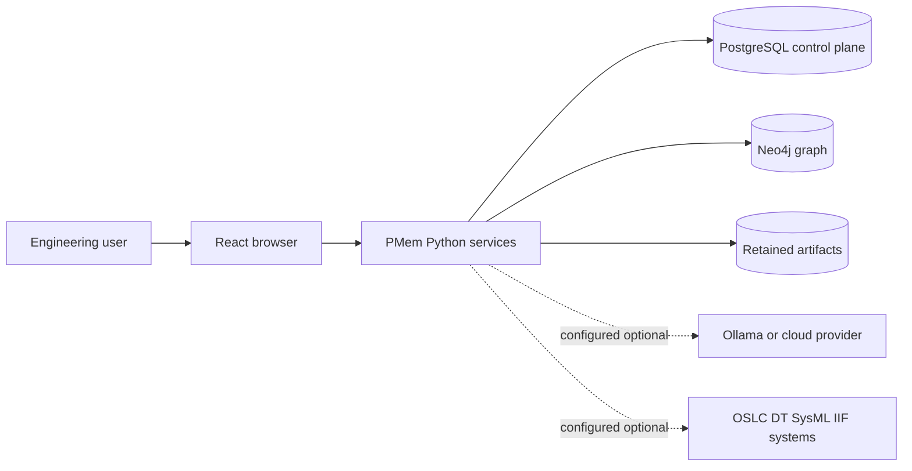
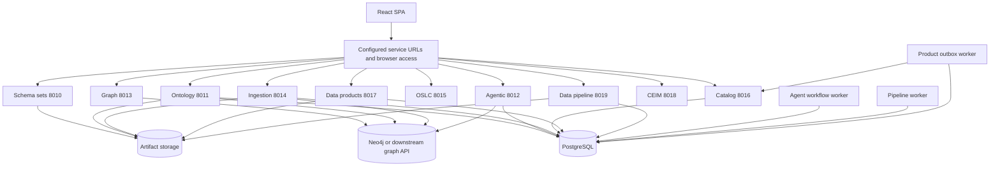
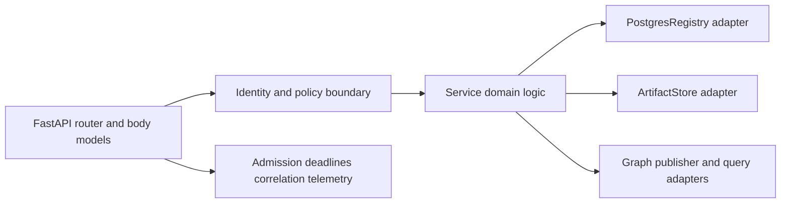
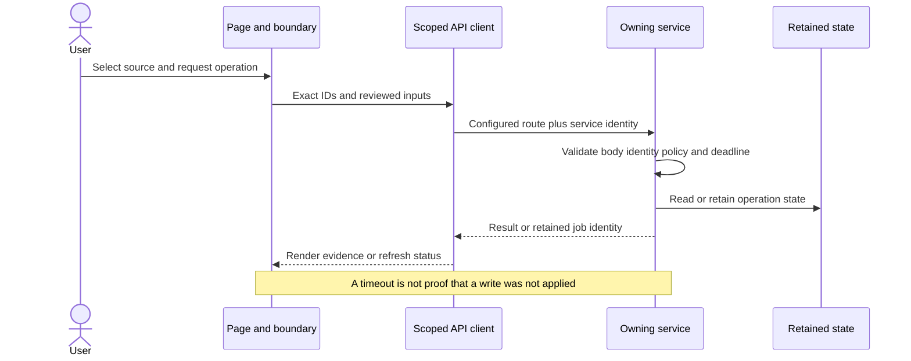
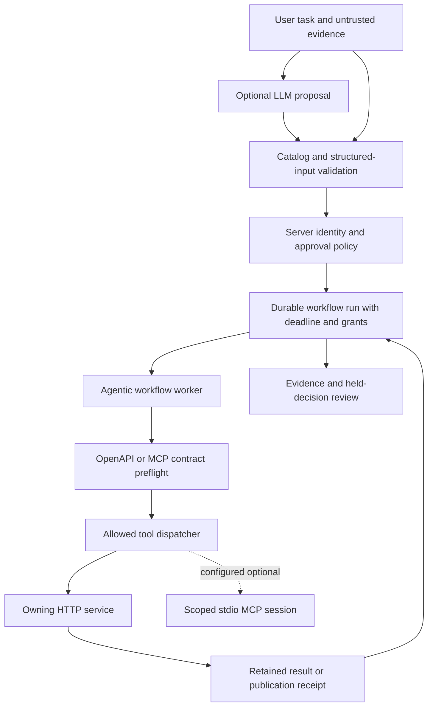
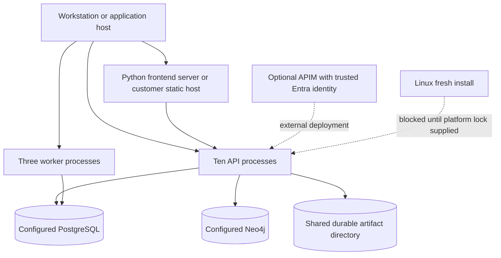
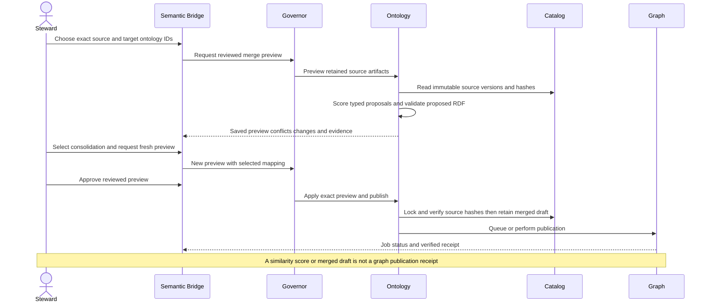

# PMem enterprise full-stack and agentic audit — 2026-10-20

Subsequent corrections and verification are recorded in [the remediation report](enterprise-remediation-2026-10-20.md). Findings below describe the original audit baseline; they are not all still outstanding in source.

**Release assessment: not ready to certify.** Confirmed functional defects, an affected dependency, a missing Linux release input and failing regression suites remain. This is an evidence-based repository-wide discovery and risk review, not a claim that every runtime control, deployment variant or external integration has passed acceptance testing.

The audit follows the supplied phases 0–10. No technology is assumed from the prompt. Existing pending installation-policy changes were preserved. This audit adds evidence and reports; it does not silently upgrade dependencies, publish ontologies, approve mappings, reset databases, or deploy the source to the running application.

## Audit basis and coverage

- Source: `pmem-publish` worktree. Earlier remote commits and local worktree history differ; the inventory records per-file SHA-256 rather than claiming a clean HEAD.
- 1,400 first-party source/configuration/document files inventoried; 769 Python files parsed into 6,943 symbol records and 484 decorated route declarations, with no Python syntax errors. Route declarations include legacy and optional code and are not the deployed route count.
- 1,548 paths excluded from semantic source review: principally reference/data assets and generated/temporary/build/upload paths. `excluded-paths.json` records them. Ignored credentials, repository history and binaries were not scanned for secrets.
- 220 frontend JS/TS modules parsed with no syntax errors; 805 imports, 469 configured-tag interactive JSX sites and 786 API-like call candidates enumerated. These are structural inventories, not proof that all generated controls are connected or accessible.
- Ten service applications imported without lifespan execution and generated 388 service-local OpenAPI path entries in total. All 48 effective OpenAPI tools match a method/path in those contracts. This does not execute each handler or prove request-body compatibility in every workflow.
- Seventeen live navigation pages were opened through the UI. Additional read-only ReqIF filtering and Where Used searching were exercised. Code Network was captured during lazy loading; not every form, submenu, export or responsive layout was exercised. Live pages differ from pending source in catalog and agent-review features.
- Frontend full suite: **486 passed, 3 failed, 489 tests in 90 result files**. Vitest reports 103 nested suites; this is distinct from file count.
- Production frontend build completed successfully with Vite 7.3.6; `frontend-build.log` retains the output. A successful build does not resolve the failed regression tests.
- Selected isolated backend suite (19 files): **115 passed, 21 failed, 15 subtests passed**. Tests used fixture credentials, unavailable database/graph endpoints or mocks; failures are retained, not suppressed.
- Installed shared environment: `pip check` reports no broken requirements. This does not mean packages are vulnerability-free or isolated service environments match the shared one.
- No destructive live tests, model-spend tests, database migrations, engine installation, credential rotation, backup restore or production rollback were performed.

Evidence bundle: `outputs/enterprise-audit-2026-10-20` in the shared workspace, including `inventory.json`, `excluded-paths.json`, `symbols.json`, `routes.json`, `frontend_controls.json`, `frontend_calls.json`, `openapi-contracts.json`, `agent-tool-openapi-matrix.json`, `service-ownership.json`, `capability-journeys.csv`, `findings.json`, test logs/results and live UI snapshots. Do not confuse inventory coverage with semantic or behavioral coverage.

## Phase 0 — repository, versions and ownership

| Subproject | Verified role | Ownership/evidence |
|---|---|---|
| `frontend` | React/Vite SPA, browser service clients, Siemens IX/MUI/AG Grid/graph visualizations | `frontend/package.json`; `frontend/src/app/pageRegistry.js` |
| `backend` | Ten FastAPI services; three Python workers; shared platform, parsers, graph and governance modules | `infra/deployment/services.json`; service `app.py` files |
| `standalone/data_product_package` | Independent governed package library/CLI, minimum Python 3.10 | `pyproject.toml`; not an extra default HTTP service |
| `standalone/ontology_agentic_service` | IIF/workflow registry handoff and optional FastAPI adapter | README and `AgentsRegistry`; external IIF runtime not verified |
| `plugins/mbse_plugin` | Optional FastAPI MBSE plugin and tools, minimum Python 3.11 | `plugin.json`, `pyproject.toml`; Cameo MDK explicitly reference-only |
| `infra/windows`, `infra/linux`, `infra/deployment`, `infra/postgres` | Lifecycle, configuration, contracts, migrations and installation | Windows helpers, Linux shell scripts and 000–012 SQL migration files |
| `config`, `mapping`, `ontology`, `data` | Templates, mappings, semantic/reference assets | Application ownership is explicit in paths; human/team owners are not declared |
| `tools`, `scripts`, `deliverables`, `docs` | Maintenance, developer/support utilities and documentation | Not assumed to be supported runtime services |

No Node/Express/Nest backend, Docker/Compose/Kubernetes deployment, Redis or Celery runtime was discovered in the application deployment inventory. Node is used for frontend/development/build utilities. Their absence is not itself an architectural defect. Repository maintenance explicitly states validation is local rather than GitHub Actions; no evidence of an external enterprise pipeline was supplied.

| Technology | Declared/locked | Installed shared runtime / interpretation |
|---|---|---|
| Python | Supported customer runtime CPython 3.12 x64 | App virtual environment uses CPython 3.12; optional package minima do not override platform support |
| Node/npm | Node >=24.0.0; npm >=10.2.0; packageManager npm@10.8.2 | Windows runtime discovery accepts Node 24+; clean-machine install is separate acceptance |
| react | 18.3.1 in package lock | Lockfile evidence, not a browser runtime health assertion |
| react-dom | 18.3.1 in package lock | Lockfile evidence, not a browser runtime health assertion |
| vite | 7.3.6 in package lock | Lockfile evidence, not a browser runtime health assertion |
| vitest | 3.2.7 in package lock | Lockfile evidence, not a browser runtime health assertion |
| axios | 1.20.0 in package lock | Lockfile evidence, not a browser runtime health assertion |
| dompurify | 3.4.16 in package lock | Lockfile evidence, not a browser runtime health assertion |
| @siemens/ix-react | 5.2.0 in package lock | Lockfile evidence, not a browser runtime health assertion |
| @xyflow/react | 12.11.2 in package lock | Lockfile evidence, not a browser runtime health assertion |
| fastapi | 0.141.1 | 0.141.1 |
| pydantic | 2.13.5 | 2.13.5 |
| neo4j | 5.28.6 | 5.28.6 |
| psycopg | 3.3.6 | 3.3.6 |
| langchain | 0.3.27 | 0.3.27 |
| langchain-core | 0.3.76 | 0.3.76 |
| langgraph | 0.6.5 | 0.6.5 |
| semantica | 0.6.7 | 0.6.7 |
| rdflib | 7.6.0 | 7.6.0 |
| pyshacl | 0.40.1 | 0.40.1 |

PostgreSQL is the control plane, credential/registry/job/history store; Neo4j is the graph and optional memory plane; artifact storage retains source/evidence. Spark/JDK/Hadoop, OCR/model providers, OSLC remote providers, DT/IIF, SysML repositories and MCP servers are optional/configured integrations. Actual external versions/permissions/availability were not independently certified. Default effective catalog: **27 agents, 48 tools, 6 workflows**; one Semantica stdio server descriptor and no default MCP tool bindings. Its installed package contains `semantica/mcp_server/__main__.py`; presence does not establish successful protocol/runtime operation.

## Prioritized findings

P1 means release-priority correction or evidence gap; it does not mean every issue is an exploitable vulnerability. P2 covers significant functional/operational work; P3 covers bounded documentation/migration-path risk.

### F01 — P1 — Pinned and installed LangChain Core is within a critical advisory range

**Status:** Confirmed affected dependency; application exploitability not established.

**Evidence:** `backend/requirements-lock.txt:64`; `backend/requirements.txt:19`.

Installed runtime reports 0.3.76. Maintainer advisory GHSA-c67j-w6g6-q2cm includes versions below 0.3.81. Direct load/loads/astream_log/v1-event use was not found in the searched first-party paths.

**Correction:** Resolve a compatible patched dependency family against current advisories; regenerate every shared/isolated/platform lock with hashes; test legacy chat and supported provider adapters. Do not independently replace one lock line.

**Verification:** Clean isolated install, pip check, provider/model mocks, serialization regression and regenerated dependency advisory scan.

### F02 — P1 — PLMXML requirement filter excludes records whose source is a namespace

**Status:** Confirmed in source and live read-only UI.

**Evidence:** `backend/graph_service/context_router.py:103`; `frontend/src/Components/OntologyMapper.js:157`.

All graph sources displayed 106 requirements including http://www.plmxml.org/Schemas/PLMXMLSchema provenance. Selecting PLMXML returned zero. The filter compares lowercased coalesced source directly to plmxml; a populated namespace-valued source wins over source_format.

**Correction:** Separate provenance from normalized source-format classification. Filter by a canonical source kind while retaining the original namespace for display.

**Verification:** Fixture graph with namespace-valued source plus format, source-only legacy records, MBSE aliases and pagination; verify counts through the UI.

### F03 — P1 — 100 percent progress can incorrectly override awaiting-review state

**Status:** Reproduced against current source function.

**Evidence:** `frontend/src/workflows/importPresentation.js:81`; `frontend/src/Components/DataImportPipeline.js:1837`.

importJobState({status:ready_for_commit, progress:100},false) returns completed. Explicit ready_for_commit must not imply committed graph data. JSON reproduction is retained. This is a presentation/state-ordering defect; unauthorized graph writes or data corruption were not demonstrated.

**Correction:** Prioritize explicit review/committing/outcome states; require a terminal status or verified receipt for graph completion. Audit other progress===100 guards separately for document, ontology and instance workflows.

**Verification:** State-table regressions at 100 percent with ready_for_commit, committing, failed, unknown and completed; reconcile retained task and publication receipts.

### F04 — P1 — Default fresh Linux installation cannot install production dependencies

**Status:** Confirmed missing release input.

**Evidence:** `infra/linux/install-depo-linux.sh:25`.

The installer requires backend/requirements-linux-lock.txt and intentionally exits if absent. That file is absent from the inventoried checkout. Windows wheel hashes are not an acceptable substitute.

**Correction:** Publish and validate a Linux CPython 3.12 platform lock or label Linux fresh installation as unavailable until the release contains it.

**Verification:** Clean supported Linux image installation and repeatable upgrade/rollback test with the published hash-pinned lock.

### F05 — P1 — Complete frontend and selected backend regression runs are not green

**Status:** Confirmed test failures; not all failures are application defects.

**Evidence:** `frontend/src/App.test.js:94`; `backend/tests/test_schema_dependency_paths.py:11`; `backend/tests/test_agentic_security_configuration.py:23`; `backend/tests/test_orchestration_recovery_api.py:46`; `backend/tests/test_product_preview_authorization.py:25`.

Frontend: 486 passed, 3 failed out of 489 assertions in 90 result files. Backend selected run: 115 passed, 21 failed, 15 subtests passed. App assertions do not wait for the access boundary; extracted path-test functions omit ontology_upload_limit; agent tests omit new session/telemetry stores; recovery expects synchronous completion despite worker default; product fixture does not satisfy the current body contract. Triage evidence is retained, not silently reclassified as passing.

**Correction:** Repair fixtures against real contracts without weakening authorization or validation. Run clean-process suites and add contract change checks to release acceptance.

**Verification:** Green complete frontend suite and explicitly enumerated backend suites with isolated stores/worker execution and no production dependencies.

### F06 — P2 — Where Used gives no visible outcome for the tested unmatched search

**Status:** Confirmed live UX and source logic.

**Evidence:** `frontend/src/Components/WhereUsedView.js:262`; `frontend/src/Components/WhereUsedView.js:277`.

Induction search returned to an enabled Search button without a result or no-match message. Source computes nodes and localFallbackNodes using identical local expressions, so the server-no-match fallback branch cannot be reached as written. Search is explicitly limited to the loaded projection; absence does not prove no usage.

**Correction:** Render an explicit bounded-search empty state and result count; remove duplicate work or implement a real separately named server search contract.

**Verification:** Match/no-match/error cases with a bounded snapshot and keyboard submission; verify no-usage is never inferred from missing snapshot matches.

### F07 — P2 — Merge UI stages only one consolidation despite a multi-mapping backend contract

**Status:** Confirmed capability limitation, explicitly displayed as one pair.

**Evidence:** `frontend/src/Components/OntologyMapper.js:2245`; `backend/ontology_service/merge_service.py:105`.

Selecting another proposal replaces mergeEntitySource/mergeEntityTarget. Preview submits zero or one mapping; the backend accepts up to 200. A many-pair alignment review cannot be performed in one UI preview.

**Correction:** Provide a reviewed selection collection, conflict/duplicate-source checks, batch deselection and a fresh preview tied to the exact selection digest. Do not auto-approve high-scoring proposals.

**Verification:** Multiple reviewed pairs survive filtering/pagination and source switches invalidate approval; backend rejects chains, incompatible kinds and stale artifacts.

### F08 — P2 — MCP child startup diagnostics are discarded

**Status:** Confirmed optional-integration observability gap.

**Evidence:** `backend/agentic_service/mcp_transport.py:42`.

Configured stdio child stderr is sent to DEVNULL. The dispatcher returns generic failure guidance, so missing modules/permissions reported only on child stderr are unavailable. Default catalog has one stdio server descriptor but no MCP tool bindings; synthetic stdio tests do not establish Semantica/server compatibility.

**Correction:** Retain bounded redacted startup/error diagnostics with correlation IDs, a capped background drain and shutdown cleanup; never mix stderr into JSON-RPC stdout.

**Verification:** Controlled server emits excessive stderr, credentials and startup failure; logs remain bounded/redacted and no pipe deadlock occurs.

### F09 — P2 — Source selectors lack accessible names

**Status:** Confirmed JSX and live accessibility-tree evidence.

**Evidence:** `frontend/src/Components/OntologyMapper.js:156`; `frontend/src/Components/OntologyMapper.js:2795`.

ReqIF source filter and instance selector appear as unnamed comboboxes. Adjacent unassociated labels do not provide a reliable accessible name. The structural scan is not a full WCAG audit.

**Correction:** Use explicit label/htmlFor+id or aria-label; verify focus order, required-state guidance and loading/error announcements with keyboard and screen-reader checks.

**Verification:** Role/name queries for every selector and manual keyboard navigation at supported viewport sizes.

### F10 — P2 — Deployment parity remains unverified for the newest source/package

**Status:** Confirmed operational acceptance gap.

**Evidence:** `frontend/src/Components/IngestedDataInventory.js:26`; `frontend/src/Components/ontology/SemanticBridgeJobs.js:222`.

Live Data Catalog still displayed the older fresh-install message and no ingestion inventory. Live instance review remained under Advanced. These differ from the current audited source and package. Builds and source tests cannot certify the old running bundle.

**Correction:** Apply the reviewed package in the real target environment, verify build receipt/runtime routing, run end-user acceptance and reconcile retained graph/publication receipts. Pending process-policy guards also require target-Windows verification.

**Verification:** Fresh-install and upgrade runs, target policy/signing checks, source/build hashes and browser acceptance with no unsupported policy bypass claims.

### F11 — P3 — Legacy Cypher prompt encodes a specific demonstration domain

**Status:** Confirmed legacy-path constraint; not the supported companion path.

**Evidence:** `backend/chains/cypher.py:17`; `backend/agent/chat.py:836`; `backend/main.py:194`.

The template contains ds3dx motor and SysML Sugar Plant examples. Supported agentic companion uses its own grounded retrieval/local_llm path. Re-enabling legacy chat for different customer ontologies needs domain scoping rather than assuming examples fit.

**Correction:** Keep the migration-only host out of supported production; if enabled, derive schema/prompt examples from the explicitly selected ontology and use read-only query constraints.

**Verification:** Cross-domain AP242/QIF/Teamcenter queries with fixed graph fixtures and no invented labels/prefixes.

### F12 — P3 — README worker inventory understates the deployed worker count

**Status:** Confirmed documentation drift.

**Evidence:** `README.md:10`; `infra/deployment/services.json:19`.

README describes the outbox and pipeline worker while authoritative inventory also includes agentic-workflow-worker.

**Correction:** Update overview and supervisor runbooks from services.json; check their consistency in release tests.

**Verification:** All three worker identities and restart/recovery responsibilities are documented.

## Phase 1 — as-implemented architecture

Solid arrows below are supported by manifests, imports, clients or dispatch code. Dashed arrows are optional deployment connections, not verified live links. Frontend APIs do not require a Node service. APIM/Entra is an external deployment option, not an implemented local gateway server.

### 1. System context

### 2. Container and service architecture

### 3. Component boundaries

### 4. Frontend interaction

### 5. Agent and tool orchestration

### 6. Deployment topology

### 7. Critical merge and publication sequence

## Phase 2 — patterns with concrete consequences

| Pattern | Evidence | Assessment |
|---|---|---|
| Factory / middleware | `backend/depo_platform/service_runtime.py`, `qos.py` | Centralizes service contracts, correlation and bounded dependencies; runtime variants still require their own configuration tests |
| Strategy / adapter | `backend/core/llm_providers.py`, `agentic_service/local_llm.py` | Explicit provider configuration; no silent offline-to-cloud fallback intended. Model/API availability not verified live |
| Repository / unit of work | `backend/mesh_store.py`, `postgres_pool.py` | Registry abstractions, transaction paths and dedicated advisory-lock sessions; mock rollback tests pass, real isolation/load tests remain necessary |
| State machine / command | `durable_workflows.py`, `recovery.py`, `worker.py` | Retained deadlines, execution fencing, contiguous completed traces and uncertain-write reconciliation. Some tests still assume the old synchronous mode |
| Outbox | `data_product_service/worker.py`, product router | Durable registration retries separate package retention from catalog delivery; a package is not automatically a catalog entry |
| Observer | browser credential/product/ontology events | Keeps views in sync, but context changes must invalidate state and requests. Import progress precedence is a concrete state defect |
| Facade with mixed responsibilities | `OntologyMapper.js`, `DataImportPipeline.js`, agentic router | Shared screens coordinate several domains. Cross-task mapping and progress bugs demonstrate real coupling risk; splitting purely for naming/style is not recommended |
| Saga / reconciliation | retained workflow receipts, compensations and recovery | Compensating behavior exists for supported actions, not universal rollback of every graph or external write |
| Retry / deadlines | network timeout helpers, tool preflight, outbox, MCP transport | Bounded operations and uncertain writes are explicit. No claim of fleet-wide exactly-once external side effects |
| CQRS / event sourcing / abstract factory / circuit breaker | No complete pattern implementation established by this audit | Do not add these merely for consistency. PostgreSQL-backed workflows do not imply event sourcing, and absence of a named pattern is not a defect |

## Phases 3–5 — capabilities, pages, controls and contracts

The 17-row `capability-journeys.csv` maps page → component → journey → service → persistence → test evidence. Agent/tool and endpoint-level inventories provide the next layers. Business semantics requiring customer definitions are marked unverified rather than invented.

| Page/capability | Source entry | Current evidence / limit |
|---|---|---|
| Home | `frontend/src/Components/LandingPage.js` | UI navigation/read smoke; frontend suite |
| Import | `frontend/src/Components/DataImportPipeline.js` | unit/state tests; live read only in this audit |
| Data Flow | `frontend/src/pages/DataFlowPage.js` | frontend suite; mock transaction/recovery tests |
| Ontology Junction | `frontend/src/Components/OntologyMapper.js` | earlier junction tests plus current frontend suite; live reads |
| Data Catalog | `frontend/src/pages/DataProductsPage.js` | frontend suite; live bundle is older |
| Data Products | `frontend/src/pages/DataProductsPage.js` | preview authorization tests include a stale-fixture failure |
| Metadata Registry | `frontend/src/pages/MetadataRegistryPage.js` | frontend suite; one approved asset visible live |
| Graph Explorer | `frontend/src/pages/GraphExplorerPage.js` | frontend suite and read smoke; full graph totals not implied |
| Code Network | `frontend/src/pages/CodeAuditPage.js` | frontend suite; live lazy-loading observation only |
| Modeling | `frontend/src/pages/ModelWorkbenchPage.js` | frontend suite; live workspace empty |
| ReqIF | `frontend/src/pages/RequirementsPage.js` | live PLMXML filter failure; frontend tests do not cover namespace-valued source |
| QIF | `frontend/src/pages/QifPage.js` | live retained run; frontend suite; external mappings require review |
| Where Used | `frontend/src/Components/WhereUsedView.js` | live no-result feedback gap; source review |
| Data Quality | `frontend/src/pages/QualityPage.js` | frontend suite; live no retained runs |
| Recommendations | `frontend/src/Components/RecommendationsTab.js` | read navigation only; real model/business relevance unverified |
| Reports | `frontend/src/pages/ReportsPage.js` | frontend suite; live read rendering only |
| Admin | `frontend/src/pages/AdminPage.js` | frontend suite; destructive actions deliberately not executed |

Frontend navigation uses a hash route registry, aliases, lazy modules, error boundaries and a browser-access boundary. Unknown paths fall back to Graph Explorer rather than a dedicated not-found page; this behavior is implemented, not evidence of an authorization bypass. Three App test failures show access-boundary test drift rather than proof that real navigation is universally broken.

`frontend_controls.json` records configured-tag control sites and event presence; `frontend_imports.json` and `frontend_calls.json` record static connections. Generated tabs/widgets, keyboard behavior, dynamic handler semantics and per-control backend state are not fully established by parsing. No claim is made that all 469 sites passed end-user acceptance or WCAG review.

All ten OpenAPI applications import without lifespans. The route inventory includes request schemas, response contracts and operation IDs in `openapi-contracts.json`; the 48-row tool matrix verifies exact default tool paths. Matching routes alone does not verify all payloads, headers, policy identities or external systems. Selected backend tests exercise authentication rejection, prompt/citation boundaries, memory, transactions, deadlines, MCP sessions and workflow recovery. Full backend-suite coverage was not attempted because manual/live tests can mutate databases and optional dependencies are environment-specific.

## Phase 6 — agentic AI and LangGraph

- The supported `agentic_service` is a catalog-validated dispatcher and PostgreSQL-fenced workflow engine, not a single LangGraph graph. Tools are explicitly allowed per agent; structured inputs, downstream identities and approval contracts are checked outside the model.
- `catalog.json` plus `dt_bindings.py` and prompt policies yield 27 default agents and 48 tools. All six default workflow step bindings validate. The full prompts, IDs and tool lists are captured in `effective-agent-catalog.json`; descriptor presence is not a claim every task was run.
- Default execution mode is `worker` (`durable_workflows.py:execution_mode`). Queueing consumes the original deadline. Run recovery rejects changed definitions, uncertain writes and expired deadlines. Tests expecting immediate completion must explicitly model process mode or execute the worker.
- The supported Knowledge Companion retrieves bounded graph evidence and optionally summarizes through `local_llm.py`. Prompt policies treat task text, schema/tool descriptions and retrieved content as untrusted; validation checks tool IDs, inputs and citations. Successful generated text is not approval.
- LangGraph is verified in the legacy `backend/agent/chat.py` agent→ToolNode→agent loop. It compiles without a second in-memory checkpointer; explicit persisted conversation history is used. That legacy graph is not the supported agentic service's workflow implementation.
- Optional memory uses explicit tenant/project scope, fixed session ownership/expiry, query limits and retention. Shared API keys share a principal by design (`agentic_service/sessions.py:owner`); individual-user isolation requires individual identities. Dynamic tenant isolation across one shared deployment remains an acceptance question.
- Merge similarity is deterministic review evidence, not model confidence or calibrated semantic equivalence. Property kinds and context are used; human approval and saved semantic checks remain separate. The UI's single-pair constraint limits many-term review.
- Cloud/offline provider adapters exist for Ollama, Azure, OpenAI and Mistral. No real credential/model inference was exercised. API quota, provider availability, cost controls under load, and grounded-answer quality need separate acceptance data.

## Phase 7 — MCP and integrations

MCP is a custom bounded newline JSON-RPC stdio client, not evidence of an exposed application MCP HTTP server. Configuration includes a Semantica stdio descriptor; installed Semantica 0.6.7 contains its server package. Default agent tools are OpenAPI-bound, so automatic use of that server is not implied by descriptor discovery. Synthetic tests cover scoped session reuse, shutdown, pagination/progress and uncertain-call handling. Real Semantica protocol behavior, persistent KG path permissions and vendor tools were not exercised.

Optional IIF/DT, OSLC remote providers, SysML repositories, Spark and MBSE/Cameo clients require their external runtime and permissions. The plugin marks Cameo MDK as reference-only. The UI reports several such integrations unconfigured/empty; no successful external E2E operation is claimed.

## Phase 8 — persistence and data semantics

- Migrations 000–012 provide registry/runtime/metadata/credential/job structures and indexes. `depo_registry` uses namespace/key identity; chat/rate-limit/runtime tables and pagination/source indexes are present. Presence of SQL does not establish migration success on the user's target `E:` deployment.
- PostgreSQL pooling, separate lock sessions, transaction rollback tests and durable worker fences reduce replay/race risk. Real database fault injection, restore, lock contention, worker loss during commit and cross-process publication races remain acceptance checks.
- Artifact/catalog references, hashes and reviewed version identities are used for reproducibility and source-change detection. No automatic migration of existing graph meaning or ontology equivalence is established by an installer success message.
- Structural XSD analytics is a review plan. `xsd_analytics_plan.py` explicitly returns `business_analytics.status=requires_definition` with empty facts/dimensions/metrics. XML analytics can materialize structural data and explicit reviewed business views. A customer KPI warehouse is therefore **partially implemented/configuration-dependent**, not automatically created by graph import.
- Source-format classification must remain separate from source namespace/provenance (F02). Progress must remain separate from durable completion/receipt evidence (F03).
- Vector/chunking/retrieval code exists, but no clean reindex, embedding-model switch migration, tenant filter adversarial test against a real vector index, or business relevance benchmark was performed. Global model/embedding compatibility is not inferred from an available provider key.

## Phase 9 — security assessment

| Control / risk | Evidence and assessment |
|---|---|
| Authentication and approvals | Central/environment credentials, explicit write identities, gateway trust and scoped maintenance exist; selected denial tests pass. All routes were not penetration-tested |
| Prompt/tool trust | Allowlisted tools, protected prompts, structured proposals and citation checks exist. Prompt text is defense-in-depth; server authorization is the decisive boundary |
| SSRF/path traversal/uploads | Bounded upload/path helpers and operator-configured service URLs exist. Path-test extraction is broken and must be repaired before treating that test family as evidence |
| CORS/browser sessions | Exact-origin validation and local/manual browser modes exist. Target-domain CSRF/session/signing policy and browser edge-case acceptance remain unverified |
| Generated Cypher | Read-only query guards and deadline adapters exist in the legacy path. No destructive graph injection was attempted |
| Dependency advisories | F01 confirms an affected LangChain Core version. `pip check` is a compatibility check, not a vulnerability scan. No complete OSV/npm/transitive advisory assessment was performed |
| Secrets | A narrow scan of inventoried non-test text files under 1 MB found no private-key/provider-key/AWS-key pattern matches. This excludes ignored environments, binaries, history, low-entropy passwords and unknown secret formats; it is not a secret-free certification |
| Privacy / tenancy | Session ownership and configured memory scope exist. Shared-key principal behavior and deployment-wide namespace assumptions must be included in the enterprise tenancy design |
| Excessive autonomy | Governed write tools require server approval. Automated instance publication is an explicit policy-authorized action; optional recommendation text does not authorize publication |

Security references: [LangChain maintainer advisory](https://github.com/langchain-ai/langchain/security/advisories/GHSA-c67j-w6g6-q2cm), [related deserialization advisory](https://github.com/langchain-ai/langchain/security/advisories/GHSA-pjwx-r37v-7724), [OWASP prompt-injection prevention](https://cheatsheetseries.owasp.org/cheatsheets/LLM_Prompt_Injection_Prevention_Cheat_Sheet.html), [OWASP excessive agency](https://owasp.github.io/www-project-top-10-for-large-language-model-applications/2_0_vulns/LLM06_ExcessiveAgency.html). Advisory severity does not establish application exploitability without the affected execution path.

## Phase 10 — installation, deployment and operations

Windows installation was separately audited in `windows-installation-2026-10-20.md`. The newest direct-entry guards, configuration staging, environment-key clearing, native exit-code handling and documentation changes are in source/package; some remain unpushed/uninstalled. Historical targeted tests passed, but this report does not turn those results into a complete target-machine install test.

The supported customer launcher uses process-scoped execution policy. A script cannot repair policy before Windows loads that script; use the CMD/explicit PowerShell launcher if the entry script itself is blocked. Enforced organization policy and trusted-publisher/signing restrictions remain authoritative. Do not bypass process ownership guards or delete environments/databases to resume setup.

Startup order/readiness, dependency receipts, logs and migrations are implemented. The installer does not install database engines/create DBA roles or register every API as a Windows service. Database services are intentionally retained by normal app stop/restart. Linux dependency installation is blocked by the absent platform lock. No Windows clean-machine, Linux install, enterprise supervisor/APIM deployment, backup restore or rollback acceptance was completed in this audit.

## Remediation and verification sequence

1. Resolve F01 with maintained compatible patched dependencies and reproducible locks; establish a complete dependency-advisory gate.
2. Correct F02/F03 and add fixture-graph/state-table tests, then verify requirement filters and retained import/publication status in the UI.
3. Repair F05 test contracts without weakening security; obtain a green full frontend run and a documented, isolated backend test matrix.
4. Publish the Linux lock or narrow the supported release statement; document all three workers.
5. Address Where Used empty feedback, multi-pair merge review, source selector accessibility and bounded MCP diagnostics.
6. Deploy the reviewed package, verify build/source parity, then exercise every critical create/review/approve/publish/recover path and the target Windows policy behavior.
7. Complete external-model/integration, concurrency/load, tenant-isolation, database backup/restore and rollback acceptance. Require customer-defined ontology mapping/KPI truth sets before claiming semantic correctness.

## Unknowns and non-certifications

No evidence was supplied for the actual `E:\App\PMem` files or policy output, customer OS/engine versions, external IIF/DT/SysML/OSLC availability, APIM enforcement, model quota/quality, database restore, Linux artifact locks, production-scale latency, signed release chain or a customer semantic benchmark. Those are runtime/acceptance limits, not assumptions that the features work. Individual controls not exercised are explicitly unverified. The repository-wide inventories and diagrams satisfy discovery/reconstruction; **complete per-control and every-integration E2E coverage has not been achieved**.
