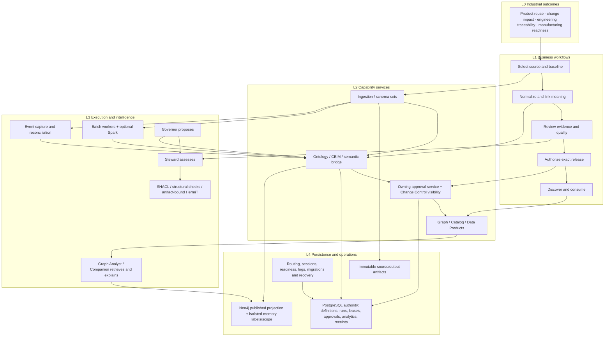

# Industrial ontology architecture and semantic pipeline review

Review date: 1 November 2026. Reviewed source: 0805ce9. Scope: industrial ontology platform, semantic integration, Lambda-style batch/speed/serving architecture, governance, analytics, agents, persistence, operations and workspace handoffs.

PMem is a functioning governed semantic platform with durable batch workers and bounded event reconciliation. It is not yet a complete continuous Lambda implementation. Its strongest foundations are immutable evidence, version-pinned analytics, controlled graph publication and separate approval/delivery states. Two reproduced speed-path defects must be closed before concurrent industrial-event feeds are enabled.

This review changes no application logic, prompts, credentials, customer data or publication state. The review and isolated reproduction scripts are new audit artifacts. No external LLM was invoked.

## Architecture assessment

| Capability | Current implementation | Assessment |
|---|---|---|
| Industrial source ingestion | Engineering parsers, retained uploads, REST and 13 profile-bound adapters, three existing native import paths | Implemented acquisition paths; vendor connectivity is conditional and acquisition is not semantic mapping |
| Raw evidence | Content-addressed retained artifacts with metadata and provenance | Appropriate single-deployment foundation; artifact availability is part of recovery |
| Batch execution | PostgreSQL job definitions, leases, heartbeats, fenced persistence, deadlines, approved replay and optional Spark runner | Substantial implementation; bounded jobs rather than a distributed lakehouse engine |
| Speed layer | Approved sources, immutable event envelope, lateness classification, CEIM reconciliation and approved publication | Partial; concurrent capture/reconciliation defects and no continuous source offsets |
| Canonical semantics | CEIM normalization, mapping packs, vocabulary, semantic bridge and exact retained identities | Implemented for supported engineering contracts; generic connector output lacks an automatic semantic successor |
| Ontology assurance | RDF parsing, structural/SHACL checks, artifact-bound offline OWLAPI/HermiT, embedded foundation | Distinct assurances correctly represented; a consistent ontology does not prove complete business data |
| Serving | Published Neo4j projections; PostgreSQL semantic records, ODS values, dimensions, facts, KPIs and product catalog | Implemented snapshot serving; a unified batch/speed merge policy is not established |
| Governance | Owning-service approvals, retained receipts, catalog outbox, central read-only change ledger | Strong local boundaries; central CR/CO execution is unfinished |
| Agentic intelligence | Governor proposals, Steward assessment, Graph Analyst/Companion retrieval, scoped memory and reviewed lessons | Implemented assistance; not unrestricted autonomous learning or automatic business approval |
| Industry analytics | Approved, dataset-pinned models with part/product/requirement/process dimensions, BOM links and reviewed unit conversion | Real capability; business revision/effectivity meaning still requires enforceable source selection |
| User experience | Six capability workspaces, common task controls, retained run links, named source selectors | Improved; event operations and end-to-end semantic pipeline progression are less visible |
| Operations | Ten API services, three workers, readiness/authentication checks and incremental Windows update | Appropriate to current topology; HA, restore and production load acceptance remain separate |

The old architecture document describes several now-present capabilities as missing. It should become a dated target/history document or be reconciled with the current implementation; it is not a reliable current-state inventory.

## End-to-end architecture and layers

L0 defines measurable business outcomes; L1 defines user-visible steps; L2 owns service contracts; L3 executes retained tasks and constrained agent/tool work; L4 owns durable state and operations. Each L1 step should show its source baseline, current stage, accountable reviewer, blocking evidence and authoritative receipt. An agent explanation is not a substitute for any of those records.

The batch and speed paths should share normalization, validation and canonical publication. Speed-derived results require an explicit provisional/reconciled/superseded state and a deterministic rule for which business revision wins. The serving layer should not combine two copies of an event merely because they came through different paths.

## Confirmed defects

### A1 High priority Event capture can accept conflicting duplicate IDs

Status: confirmed by executing the actual capture function with two threads and isolated stores.

Location: [backend/data_pipeline_service/speed_path.py:82](C:/Users/Admin/Documents/Codex/2026-10-18/in/pmem-publish/backend/data_pipeline_service/speed_path.py:82) and [backend/mesh_store.py:213](C:/Users/Admin/Documents/Codex/2026-10-18/in/pmem-publish/backend/mesh_store.py:213).

Root cause: capture performs `get(event_id)`, creates an artifact and then calls overwrite-capable `put`. Both requests can observe absence before either writes. The generic registry has atomic `create`, but this route does not use it.

Reproduction: start two requests with the same approved source and event ID, different records, and synchronize the initial missing-ID reads. Both calls succeed and return different accepted digests; only one event row remains. A later consumer can therefore refer to evidence different from an earlier successful response.

Impact: lost event intent and unreliable idempotency under retries, concurrent producers or multiple API processes.

Recommended correction: define source/event identity, insert atomically, and on conflict compare the retained digest. Identical retry returns the retained receipt; conflicting retry returns conflict. Make source registration atomic for the same reason. Retain any orphan-artifact cleanup under the normal retention policy.

Acceptance: conflicting duplicates yield one success and one conflict across threads and processes; equal duplicates converge on one receipt.

### A2 High priority Reconciliation can leave an unrecoverable partial event transition

Status: confirmed by a failure injection into the second event-state write.

Location: [backend/data_pipeline_service/speed_path.py:120](C:/Users/Admin/Documents/Codex/2026-10-18/in/pmem-publish/backend/data_pipeline_service/speed_path.py:120).

Root cause: the reconciliation is persisted separately from per-event updates, without one transaction, per-event fencing or an idempotent resume contract.

Reproduction: capture two events; reconcile them; fail the second event update. One reconciliation exists, event A is reconciled and B remains accepted. Retrying the same two-event batch fails its status precondition.

Impact: a retained reconciliation and its event states disagree; operators cannot safely use the ordinary same-request retry to finish the transition.

Recommended correction: stable reconciliation intent/digest, claimed event set, atomic PostgreSQL state transition, and receipt-based recovery. Artifact preparation may remain outside the database transaction; the retained database transition must commit consistently. Fence competing reconcilers.

Acceptance: fail before/after every persistence boundary, restart, retry the same intent and obtain one consistent reconciliation without another publication.

### A3 Medium priority Event listing loads all retained history before applying its limit

Status: confirmed implementation defect; production impact is volume-dependent and was not benchmarked.

Location: [backend/data_pipeline_service/speed_path.py:93](C:/Users/Admin/Documents/Codex/2026-10-18/in/pmem-publish/backend/data_pipeline_service/speed_path.py:93).

Root cause: `events.all()` fetches every value; Python sorts the collection and only then slices the requested page. A maximum response count does not bound database transfer, memory or sorting.

Reproduction: populate many event records and request limit 1; the implementation still retrieves all rows.

Correction: ordered SQL/keyset pagination with a namespace/time/key index; apply limits before decoding full records. Keep full event payloads out of list responses.

### A4 Medium priority An obsolete citation fixture fails the architecture test group

Status: confirmed regression-test defect, not evidence of a broken production citation validator.

Location: [backend/tests/test_orchestration_completion.py:325](C:/Users/Admin/Documents/Codex/2026-10-18/in/pmem-publish/backend/tests/test_orchestration_completion.py:325); current contract: [backend/agentic_service/prompt_security.py:62](C:/Users/Admin/Documents/Codex/2026-10-18/in/pmem-publish/backend/agentic_service/prompt_security.py:62).

Root cause: the fixture supplies `id`, while the validator accepts retained resource identities such as `resource_id`, `elementId`, IRI or source ID. It consequently fails before testing buffered output.

Reproduction: the unmodified architecture group has one failure. Replacing that fixture key with `resource_id` only in an in-memory copy makes the mocked streaming test pass. No repository test or prompt was changed.

Correction: update the valid fixture and add a separate negative case asserting rejection of uncitable evidence. Do not weaken the production validator to make the old test pass.

## Architecture gaps and risks

These are separate from the reproduced defects above.

| Priority | Classification | Evidence and business consequence | Recommended boundary |
|---|---|---|---|
| High | Confirmed capability gap | [backend/data_pipeline_service/connector_adapters.py:96](C:/Users/Admin/Documents/Codex/2026-10-18/in/pmem-publish/backend/data_pipeline_service/connector_adapters.py:96) uses a bounded Kafka read, no consumer group, no committed offsets and earliest reset. Repeated reads can revisit the same historical slice. This is not resumable continuous ingestion. | Keep it labelled snapshot acquisition. Add durable source/partition offsets and restart semantics only for an agreed streaming source and SLO. |
| High | Confirmed integration gap | [backend/data_pipeline_service/handlers.py:46](C:/Users/Admin/Documents/Codex/2026-10-18/in/pmem-publish/backend/data_pipeline_service/handlers.py:46) registers `connector-records-v1`; engineering normalization expects `source-ceim-batch-v1`. The registered handler set contains no standard connector-record-to-CEIM successor. | Add an explicit versioned mapping step and a small retained pipeline template: acquire, map, validate, review, publish, prepare analytics. Do not imply that registration alone supplies an industrial ontology mapping. |
| High | Confirmed governance limit | [backend/oslc_service/change_control.py:1](C:/Users/Admin/Documents/Codex/2026-10-18/in/pmem-publish/backend/oslc_service/change_control.py:1) is intentionally read-only, with native approvals in each service. A central view is not a single end-to-end change request/order. | Introduce one parent change identity and immutable links to native intents and receipts. Preserve native write authorities; centralize user navigation and aggregate release state. |
| High | Risk requiring domain acceptance | [backend/data_pipeline_service/analytics_models.py:14](C:/Users/Admin/Documents/Codex/2026-10-18/in/pmem-publish/backend/data_pipeline_service/analytics_models.py:14) accepts descriptive revision/effectivity text. [backend/data_pipeline_service/business_mart.py:38](C:/Users/Admin/Documents/Codex/2026-10-18/in/pmem-publish/backend/data_pipeline_service/business_mart.py:38) evaluates the selected dataset/model, rather than interpreting that text as executable temporal selection. Mixed revisions can be described too narrowly. | Pin an actual revision/BOM/effectivity selection in configuration and verify membership before computing approved measures. Keep unknown scope explicit. |
| Medium | Confirmed scale boundary | [backend/data_pipeline_service/semantic_datasets.py:15](C:/Users/Admin/Documents/Codex/2026-10-18/in/pmem-publish/backend/data_pipeline_service/semantic_datasets.py:15) caps snapshots at 25 MiB and 250,000 triples and parses into an in-memory graph. This is suitable for bounded partitions, not unrestricted lake-scale materialization. | Establish partition contracts and performance budgets. Parse/validate before opening long persistence transactions where possible; persist with COPY and ownership fences. Use an external object store or distributed engine only when the deployment needs it. |
| Medium | Semantic assurance limit | [backend/ontology_service/owl_dl.py:48](C:/Users/Admin/Documents/Codex/2026-10-18/in/pmem-publish/backend/ontology_service/owl_dl.py:48) explicitly covers retained RDF and embedded foundation, not every published instance. SHACL validation, ontology consistency and customer suitability are different evidence. | Bind each assurance to artifact, foundation, data baseline and rule versions. Never show a global green validity badge from a selected ontology-only check. |
| Medium | Lifecycle/recovery risk | Speed lateness is classified, but a business revision winner, batch/speed supersession policy and automatic approved retraction lifecycle are not established by that classification. | Define stale update handling, tombstone review, replay and authoritative baseline reconciliation before live feeds. |
| Medium | UX gap | The six primary workflows expose runs and approvals, but the event source/event/reconciliation APIs are not a comparable operator cockpit in Data Flow. | Show provisional events, late events, held retractions, reconciliation status and release receipt with plain language and actionable links. |
| Medium | Documentation drift | [docs/industrial-ontology-platform-architecture.md:28](C:/Users/Admin/Documents/Codex/2026-10-18/in/pmem-publish/docs/industrial-ontology-platform-architecture.md:28) still says canonical metadata, governance and GraphRAG layers are missing although current code implements substantial parts. | Maintain a dated implementation matrix and distinguish implemented, configured, accepted and planned. |
| Medium | Unverified operational risk | Current index availability is healthy; production latency, multi-host artifacts, backup restore and customer-origin acceptance were not established by this review. | Validate restore into disposable targets, query plans and p95 latency, source limits, restart recovery and public-origin sessions against the intended topology. |

## Storage responsibilities

| Store | Owns | Does not establish |
|---|---|---|
| PostgreSQL | Versioned definitions/configurations, runs/leases, approval evidence, event/offset state, source registry, analytics tables, outbox and publication receipts | Semantic graph truth solely from a status string; a successful job is not release approval |
| Neo4j | Published ontology and business-instance projection, relationships, traversals, graph-backed evidence and scoped optional agent memory | Authoritative workflow execution state or permission to publish |
| Artifact storage | Immutable source bytes, normalized/rejected partitions, mappings, validation/reasoner reports, retained product evidence | Independent governance approval or storage availability across nodes |
| LLM / transient context | Bounded explanation, planning and retrieval context | Durable facts, customer approval, credential authority or a second system of record |

PostgreSQL sharding or an additional gateway is not justified by the observed application footprint. Keep the current stores and service isolation; measure workload and recovery constraints before adding infrastructure. GraphQL, where exposed, is an access contract, not a replacement for transaction ownership or a semantic model.

## Agents and semantic assurance

- Governor coordinates a retained proposal and authorized execution. Steward assesses ambiguity, domain/range compatibility, matching evidence and current validation/reasoning scope. Neither gets approval merely from an LLM response.
- Graph Analyst and Recommendations should reuse the same source identities and policy evidence. Similarity is a matching score, not a calibrated probability of interchangeability.
- Companion should retrieve business instances and recorded paths, use vocabulary to explain them, and keep schema descriptions separate from business answers. Citation and scope guards are present; model quality was tested with mocks only.
- Conversation memory refines retrieval within its retained scope. Long-term reviewed lessons are version-scoped hints. [backend/agentic_service/learning_review.py:1](C:/Users/Admin/Documents/Codex/2026-10-18/in/pmem-publish/backend/agentic_service/learning_review.py:1) explicitly says lessons do not change models, scores or permissions. This is governed feedback reuse, not autonomous model training.
- SHACL checks declared conditions on a data graph. OWL-DL reasoning checks logical consequences/consistency for a stated ontology scope. Both can improve evidence but neither supplies missing part ownership, manufacturing readiness or KPI business meaning automatically.

## Executed verification

- Architecture/worker/lineage/semantic/reasoning/policy group: 109 passed, 1 failed, 7 subtests passed. Failure is A4. This includes actual embedded reasoner tests; it is not a production load benchmark.
- Companion/context/memory/change-control group: 65 passed.
- Existing speed-path happy-path and canonical-publication tests: 2 passed; their sequential idempotency coverage did not catch A1 or A2.
- Corrected-fixture in-memory probe: 1 passed using mocked model HTTP, without an LLM service.
- A1 concurrency reproduction: two successful responses, two distinct digests, one persisted event row.
- A2 partial-failure reproduction: one reconciliation, one reconciled event, one accepted event; ordinary same-batch retry rejected.
- Read-only PostgreSQL inspection: 26 application tables, 45 application indexes, 83 durable job runs, 2 retained product records and 4 catalog registry records. Registry record counts are not automatically user-visible published-product counts.
- Read-only Neo4j inspection: 75 indexes ONLINE and 5 constraints. No index effectiveness or query latency claim follows solely from availability.
- No database reset, customer deployment, graph publication, credential change or source account provisioning was performed.

Local evidence is in the workspace outputs: `industrial-architecture-review-tests.log`, `industrial-companion-review-tests.log`, `industrial-semantic-review-tests.log`, `industrial-citation-fixture-probe.log`, `industrial-speed-race-result.txt`, `industrial-speed-partial-result.txt` and `industrial-database-readonly-result.txt`. Reproduction scripts use temporary artifacts and in-memory registries, not customer data.

## Recommended implementation order

1. Close A1/A2 with atomic event identities and recoverable reconciliation; add concurrent and fault-boundary regression tests. Fix A3 and repair the obsolete fixture.
2. Define one versioned semantic pipeline template and the connector-to-CEIM mapping contract. Expose source, baseline, stage, blocker and receipt consistently across the existing pages.
3. Link native operations to one parent CR/CO record; show review, execution and delivery separately. Do not create a second approval engine.
4. Make revision, BOM and effectivity selection machine-verifiable before approving industry KPIs. Start with product portfolio, part classification, engineering traceability and manufacturing process context.
5. Enable a real continuous feed only with offset/replay/retraction semantics and an agreed latency/volume SLO. Retain batch reconciliation as the authority for correction.
6. Complete isolated restore, latency/load and customer-origin acceptance before a general production claim.

Release assessment: suitable foundations for controlled snapshot-based pilots. Not ready to claim a complete industrial continuous Lambda platform while the confirmed event defects and business acceptance boundaries remain open. No arbitrary readiness percentage is assigned.

## Standards used for comparison

- [Apache Spark Structured Streaming programming guide](https://spark.apache.org/docs/3.5.6/structured-streaming-programming-guide.html): event-time, watermarking, checkpoint and sink semantics. PMem's bounded snapshots must not inherit the engine's guarantees by association.
- [W3C SHACL Recommendation](https://www.w3.org/TR/shacl/): data-graph validation against shapes; distinct from universal business correctness.
- [W3C PROV-O Recommendation](https://www.w3.org/TR/prov-o/): a useful interchange representation for entity, activity and agent provenance. Existing lineage receipts should remain authoritative while optionally projecting interoperable provenance.

## Subsequent remediation

A1 now uses immutable atomic capture and conflict comparison, excluding transport approval fields from new evidence. A2 now stages a stable reconciliation and atomically compares/transitions the selected event records and receipt together; failed transactions roll back and the same intent can retry. A3 uses database-bounded pages with a captured-event index. A4's fixture uses a retained resource identity. Existing artifacts are preserved.

The source integration gap is narrowed by the explicit `connector-ceim-normalize` worker job and existing CEIM mapping/validation/publication boundary. This is a retained field-mapping contract, not an automatic mapping designer. Data Flow Event reviews, read-only Graph Analyst/Steward evidence tools and reconciliation-scoped Companion/history now expose the operational evidence. The existing memory service remains optional and advisory; unapproved events are not promoted into long-term business facts. The architecture document has been reconciled with actual capabilities.

Continuous offset-managed feeds, customer ordering/retraction policies, enforceable customer revision/effectivity semantics, a parent executable CR/CO and production operational acceptance remain open architecture/domain work. No new broker, database shard, agent or LLM gateway was added.

## Remediation verification

The broad backend regression cohort passed 150 tests plus 18 subtests. The frontend cohort passed 67 tests across six files. Four isolated PostgreSQL checks passed, including injected transactional rollback and retry; no application database reset was used. The final focused semantic/event cohort passed 15 tests, and the final Vite production build passed. Installation package validation passed, including discovery of migration 017. Existing bundle-size and React test deprecation warnings remain.

These results verify source changes and isolated persistence behavior. The revised source has not been deployed or browser-accepted against the running installation in this pass; customer acceptance and live model behavior are not claimed. No live LLM was invoked.
