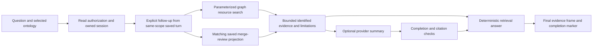

# Knowledge Companion / GraphRAG consistency and accuracy audit

Date: 2026-10-22. Scope: the production browser Companion, its agentic routes, owning-service retrieval, graph search/projection, retained mapping evidence, conversation memory, optional model summaries, streaming and restoration. Related legacy vector/Cypher and OSLC paths were inspected separately; they are not silently called by this chat interface.

## Conclusion

The Companion is bounded evidence retrieval with optional cited language-model interpretation. It is not a proof engine or an exhaustive ontology alignment service. The corrections below improve consistency and expose retrieval limits. A valid citation proves that an identifier was supplied to the model; it does **not** prove that the associated factual claim is entailed. No measured model accuracy percentage or customer-release certification is established by this audit.

## Actual request path

The UI routes chat to the agentic service, not the legacy `backend/agent/chat.py` pipeline. Neo4j keyword/ranked search is used for graph resources. This path does not automatically combine vector documents, OSLC remote results, arbitrary generated Cypher, or ontology inference. Those capabilities existing elsewhere in the repository do not establish their use in the Companion.

## Findings and corrections

| Finding | Correction | Practical effect |
|---|---|---|
| Definitions/descriptions were lost in graph projection | Search returns bounded allowlisted annotations, source identity, update time and publication revision | The answer can explain a resource using retained descriptive evidence rather than its label alone |
| Multi-query search released the publication barrier between reads | Hold the global projection barrier across ranked canonical/legacy reads and selected-edge retrieval | A guarded publication activation cannot interleave those search phases |
| Legacy reads could include staged/retained identities | Exclude `StagedOntologyResource` and `RetainedOntologyIdentity` | Unpublished staging identities are not presented as ordinary search matches |
| Any short question inherited previous text | Only explicit anaphoric follow-ups reuse an owned saved turn with exactly matching ontology context | A new `QIF mappings` question does not inherit a previous unrelated topic |
| Memory/restoration omitted ontology context and freshness | Persist scope and retrieval metadata; filter restored turns by scope; mark saved answers as not refreshed | Historical conversation text does not appear to be a freshly verified answer |
| Missing/duplicate identities or foreign-scope evidence could be accepted | Reject malformed identities, duplicates, foreign scope and oversized collections | Invalid retrieval cannot unlock an apparently grounded answer |
| Resource/edge selection limits were hidden | Return selection counts and truncation metadata and add a plain-language limit statement | A sample cannot be mistaken for whole-graph counts or evidence of absence |
| One valid citation could accompany an uncited extra paragraph | Require supplied citations for each paragraph/list item and retain buffering until completion | Unknown or missing citations block the model summary; deterministic evidence remains |
| Citation presence could imply semantic truth | Record that semantic entailment is unverified and label model interpretation for checking | The UI does not certify model factual correctness |
| Saved mappings were inaccessible when graph search was empty | Read the latest six matching bounded review projections through the authenticated Ontology service | Retained AP242–QIF review state remains answerable without inventing current graph publication |
| Provider labels/errors and optional model settings obscured retrieval | Show the actual provider, separate rate/authentication/timeout failures and preserve retrieval on configuration failure | Model failure does not erase available evidence |
| GraphQL argument-less fields could bypass the intended complexity response through a 500 | Treat absent arguments as an empty collection | Fan-out/cost rejection executes before resolvers |
| Legacy generated-Cypher guard removed comment markers before recognizing strings | Mask strings, quoted identifiers and comments in one pass; reject malformed syntax | Comment-like text inside a quoted value cannot hide later mutation clauses from the read-only check |

Internal agent IDs, saved-result IDs and raw prompt details remain outside ordinary chat messages. Diagnostic storage is retained. The Companion does not approve or publish domain mappings; session, conversation, telemetry and optional agent-memory records are still application writes.

## Retrieval boundaries and accuracy limits

- Graph search ranks at most 200 canonical/legacy resources for the request; the Companion selects at most eight resources and enough relationships to total twelve graph evidence items. Only edges whose endpoints were selected are retained. Mapping review evidence adds at most six records; the deterministic response shows up to three newest matching reviews.
- Retrieval records include an observation timestamp and a SHA-256 digest of the exact redacted evidence. Ranking ties use resource identity for stable selection on unchanged source data. These metadata support reproduction; they do not establish semantic truth.
- The application read credential controls graph access. Ontology selection filters results; it is not a substitute for per-tenant authorization. Owned conversation isolation is separate from domain-data authorization.
- Saved-review matching filters source names and the selected ontology scope before limiting. Proposal scores are heuristic similarity, not probabilities or semantic equivalence. A union with zero chosen consolidations is not a reviewed class/property alignment. Current publication must be checked using publication receipts.
- Search preserves asserted descriptions and graph relationships; it does not automatically run OWL inference, resolve inconsistent ontologies or validate arbitrary facts against source schemas. Legacy prefix aliases remain compatibility behavior; exact retained ontology IDs are preferred.
- Citation validation checks syntax and membership, including per-paragraph coverage. A false statement with a valid citation can still pass this check. Domain acceptance needs a curated question/answer set, negative questions, expected supporting identifiers and expert review, including property domains/ranges and lifecycle/viewpoint differences.
- Retrieved/source text remains untrusted. Credentials are redacted; model input is bounded; model text has no tool/write authority. These controls reduce risk but are not evidence of perfect prompt-injection resistance or semantic correctness.
- A global projection barrier covers guarded publication activation, not an atomic historical snapshot of every independently ingested legacy record. Source update/revision metadata assists diagnosis; no whole-system snapshot guarantee is claimed.
- Timed, size-bounded reads, prompt budgets and provider limits still apply. Missing evidence results in a bounded abstention with recovery steps. Restored answers may be stale even if their earlier citations were valid.

## Live observations and deployment boundary

The earlier live AP242–QIF question returned no graph evidence despite five saved PostgreSQL reviews. The revised read projection retrieved those five; its latest record has 198 proposals, 182 ambiguous and zero selected consolidations, with missing source registrations and no current publication verified by that historical record.

A direct read-only call of the revised graph search against the running Neo4j database succeeded on 2026-10-22 and returned zero resources for `product`. The Cypher executed successfully; annotation-rich or end-to-end model answer quality was not established by an empty result. No graph data was inserted, approved, deleted or published for this audit. Neo4j emitted warnings for optional legacy labels/properties absent from this database; these were not query failures.

The updated source and verified deployment package require installation in the normal Windows administrator session because this agent session cannot inspect the identities of the tracked running processes. Live UI acceptance must follow deployment and re-import/restoration of suitable source ontologies.

## Customer acceptance sequence

1. Import two known source versions, confirm namespaces/IRIs and verify publication receipts where graph retrieval is required.
2. Ask a known class-definition question and compare the displayed description and evidence identity with the retained artifact.
3. Ask a relationship question and check predicate direction, selected endpoints, ontology scope and declared/inferred status. Do not equate a textual property match with equivalence.
4. Ask AP242–QIF review questions; compare proposals, ambiguity, chosen consolidations and validation with the saved review. Check current publication separately.
5. Switch ontology and ask an independent short question. Then ask an explicit follow-up. Verify only same-scope prior user text refines retrieval.
6. Ask a deliberately unsupported question. Verify abstention/recovery guidance rather than a fabricated fact or a whole-graph absence claim.
7. Test model disabled, invalid configuration, authentication failure, HTTP 429, timeout, unknown citations, uncited paragraphs, interruption and incomplete stream completion. Available deterministic evidence must survive model failure.
8. Restore an owned conversation. Verify its historical label, scope isolation and absence of raw agent IDs/prompts. Repeat across different identities to verify ownership isolation.
9. Measure a domain-reviewed benchmark after deployment. Record exact expected evidence and known limitations; do not announce an accuracy percentage from unit-test counts.

## Automated verification

The focused audit suite passes 122 backend tests and five subtests; 18 frontend tests pass. The production Vite build passes. Coverage includes malformed evidence, wrong scope, missing/duplicate IDs, lost annotations, bounded selection disclosure, same-scope follow-ups, citation rejection, provider failure preservation, stream completion, historical restoration, publication-barrier lifetime, read-only Cypher masking and GraphQL complexity rejection. Two existing test-fixture defects were corrected to use current decorators and bounded streaming peer transport. Deprecation warnings remain in test dependencies. These checks establish tested behavior, not a percentage of domain-answer accuracy.
