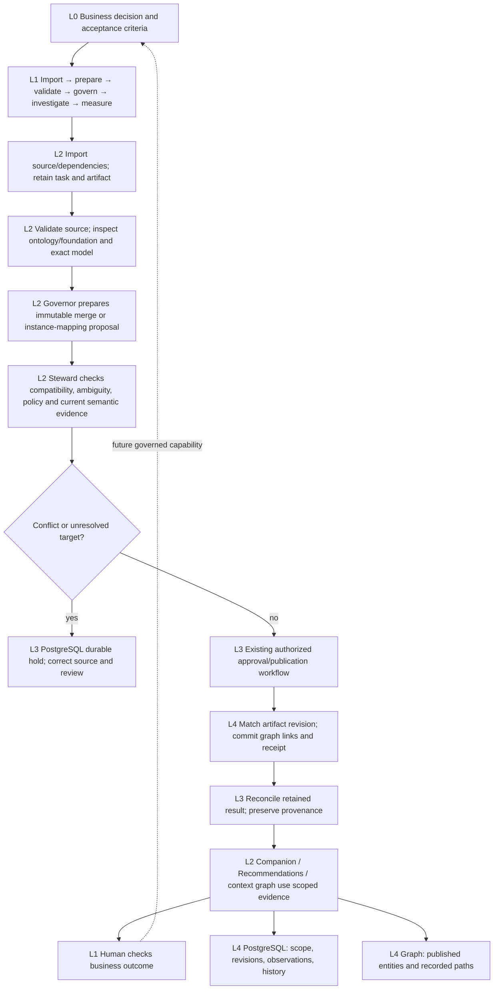

# L0–L4 remediation and storage ownership

Date: 2026-10-28. This follows the historical [layer audit](l0-l4-layer-review-2026-10-28.md) and [Governor/Steward audit](governor-steward-boundary-review-2026-10-28.md). Original reproductions and results remain historical evidence; this document records subsequent changes.

## Corrected contracts

| Finding / boundary | Implementation | Verification |
|---|---|---|
| GS-01: omitted unsatisfiable class | A bounded list must establish completeness by its total count. Missing membership in an incomplete list holds classification. Explicit checks accept up to 32 exact class IRIs and return satisfiable, unsatisfiable or unknown. Unknown classes never pass as satisfiable. | Actual HermiT run with 205 unsatisfiable classes, 200 returned IRIs, an omitted bad target, a satisfiable target and an absent target; boundary tests at 199/200/201/205. |
| GS-02: outage erases known conflict | PostgreSQL `semantic_bridge_holds_v1` retains the established assessment under ontology ID and model snapshot. An outage, new preview or restarted controller does not remove it. The final assessment and publication share the revision lock across controllers. Same-revision exact proofs can resolve incomplete sampling; they cannot override an established unsatisfiable target or inconsistent model. | Controller restart with a shared store, failed evidence read, new preview, blocked manual publication, exact-class proof recovery and a concurrent assessment/publication test. |
| AL-01: autonomous source selection | Run, product, product version and artifact IDs survive scope projection and the context envelope. Action inputs cannot switch pinned identities. Pipeline and catalog responses must return the requested identity; versioned catalog results are narrowed to the selected version. Owning-service run/product revisions are captured and rechecked during investigation, after model proposals and on resume. | Changed input and response identities rejected; changed retained record revision rejected; wrong catalog version rejected. |
| AL-02: conversational selection | Data Flow and product/catalog selection reaches chat props, request, history filtering and retained scope. Changing selection aborts the previous answer and resets conversation. Exact operational reads produce a small natural-language/table response; failure does not substitute unrelated graph search results. | Frontend request/reset/cancellation tests; backend same-scope memory and selected-record identity tests; no live model dependency. |
| AL-03: incomplete release | Semantic support, union checking and selected-record modules are mandatory release files. | Removal of each helper fails preflight. |
| TA-01 / TA-02 | Schema safety test expects the actual 12 indexes. Release fixture permits existing foundation folders. | Release/schema regressions pass. |
| Reasoning → graph revision | Mapping publication carries the reasoned artifact/foundation/evidence reference in its digest. Inside the graph write transaction, the current published ontology must match the artifact hash. Per-ontology publication exclusion prevents concurrent replacement. The graph receipt retains the binding and successful projection check. | Wrong/missing graph revision rejects the write; matching revision accepted by boundary test. Existing lost-response receipt reconciliation stays first. |

`target_iri` can be repeated on `GET /api/v1/ontologies/{id}/consistency`. This is an explicit reasoning operation, with the existing offline worker, execution limits and permissions. Example: `/api/v1/ontologies/{id}/consistency?target_iri=urn%3Aexample%3APart`. Evidence reads do not launch reasoning. A missing current proof remains unknown. Complete small legacy lists remain compatible when their count establishes completeness.

Known conflicts are retained independently of transient availability. Correcting model bytes or source identity requires a new review. Existing manual/unverified policy remains explicit: this update does not claim that every legacy graph-native mapping has passed OWL-DL. Where verified reasoning is supplied, its graph revision must match; reasoning alone never grants approval. Legacy projections without a verifiable artifact identity require reviewed republication before making this claim.

## PostgreSQL / graph / artifact ownership

| Concern | Authoritative store | Contract |
|---|---|---|
| Workflows, jobs, leases, approvals, policies, semantic holds, reasoning evidence, chat turns, record revisions and operational audit | PostgreSQL | Server-established owner and stable IDs. State transitions and durable receipts precede reported completion. Reconnection changes access, not ownership or retained outcomes. |
| Published ontology resources, business instances, relationships, approved mapping evidence and graph transaction receipts | Neo4j | Ontology/version plus resource identity; current publication artifact hash. Links and graph receipt commit together. Schema terms remain distinguishable from business-instance facts. |
| Source files, converted RDF, immutable product packages | Retained artifact storage | Digest and manifest references live with their owning service. Neither database substitutes for missing source bytes. |
| Approved mapping reuse | Existing optional memory capability | Only approved published mappings are reusable evidence. Current identity/type and policy checks still apply. History, model text and failed attempts do not become approved facts. |

No schema drop or bulk data movement is needed. New semantic holds use the existing indexed registry namespace/key primary key. Existing migrations, constraints and indexes remain authoritative. Ontology publication now records an artifact hash on its receipt; content-addressed existing receipts remain readable. This is incremental, preserving data and credentials.

Cross-store operations remain a recoverable workflow: PostgreSQL retained intent → owning-service action → graph transaction and receipt → PostgreSQL reconciliation. A lost response must first be reconciled against the receipt. There is no claim of an atomic transaction spanning PostgreSQL, files and Neo4j. Existing metadata outbox/delivery mechanisms are reused; no extra broker or duplicate workflow service was introduced.

## L0–L4 activity ownership

The Governor and Steward are roles within existing workflows, with deterministic guards and allowlisted tools. This does not imply two independent models debating every action. Read goals can plan and revise within budgets; they cannot approve writes. Actual model availability is separate from deterministic service readiness.

## Qualification and deferred architecture work

Follow-up: [Governed mapping feedback](../GOVERNED_LEARNING.md) now implements receipted human outcomes, reviewed lesson promotion/revocation and revision-scoped advisory reuse through the existing agents. This closes the mapping-review hint loop; general model training and autonomous policy promotion below remain outside that capability.

The fixes do not implement or claim autonomous model training. A complete measured-outcome → validated lesson → approved policy/model promotion loop still needs explicit outcome metrics, an evaluation set, rollback criteria and a separately reviewed implementation. Optional approved mapping reuse is the current capability; memory remains disabled in the local deployment configuration.

Other remaining qualification: customer-network/APIM and Windows ACL behavior, populated product end-to-end acceptance, large ontology load/resource profiling, verified disposable backup/restore, and live model quality/security evaluation. RDF preparation before the worker is not fully process-isolated. Existing tests and local startup checks do not establish a 100% customer-release guarantee.

Evidence: [backend regression report](l0-l4-remediation-2026-10-28/backend.xml) records **411 passing tests**, including the final concurrent assessment/publication case. The broader frontend run passed **89 tests in eight files**; after the final product-response identity guard and product-governor scope case, [affected UI report](l0-l4-remediation-2026-10-28/frontend.xml) records **42 passing tests in three files**. These runs overlap and must not be added as unique coverage. Existing RDFLib and React test deprecation warnings remain. No live LLM calls or customer data deletion were performed.

Local managed restart completed successfully; all ten API readiness checks returned 200. The [live receipt](l0-l4-remediation-2026-10-28/live.json) confirms exact selected-run identity/revision in a deterministic Companion response, matching installed/workspace backend fingerprints and 349 verified frontend build inputs. Startup also verified migrations 1–13, 12 PostgreSQL indexes, 22 constraints, required graph publication indexes/constraints and 17 unchanged credential profiles. Served frontend: `/assets/index-D0c21uoL.js`. These checks qualify the local deployment only.
