# Data lineage, catalog and graph projection audit

## Result and scope

The application has useful lineage building blocks, but it does not yet provide one verified end-to-end lineage contract. Content integrity, artifact usage identity, publication receipts, staged replacement and catalog delivery are separate mechanisms. A checksum proves content identity; it does not prove that a supplied source reference is valid or that a graph projection is semantically correct.

This audit inspected actual code, queried the running services/PostgreSQL read-only, executed existing regressions and reproduced contract/retention behavior in isolated fixtures. No live import, approval, product publication, graph write or deletion was performed. No LLM was called. Production code was not changed during this audit.

## Current live evidence

| Item | Observed |
| --- | --- |
| Ontology catalog registrations | 2 |
| Their current graph receipts | Both published/current; artifact SHA-256 equals publication ID |
| Published product catalog versions | 0; API returned HTTP 200 |
| Retained data-product package versions | 0; API returned HTTP 200 |
| Graph projection resources / relationships | 306,402 / 928,541 |
| Projection scopes in complete breakdown | 25, including independent CEIM/AP242 scopes |
| Recognized business-instance records | 55,554; not a count of unique physical parts across scopes |
| Metadata outbox | No rows observed |

The AP242 catalog artifact receipt reports 70,052 resources and 197,372 relationships. The PLMXML artifact receipt reports 6,202 resources and 18,979 relationships. Other scopes must be traced through their owning CEIM/pipeline publication records, not assumed to be extra catalog ontology versions or orphaned data. No full per-run reconciliation of those other scopes was performed here.

An empty published-product catalog therefore does not mean an empty graph. Conversely, visible graph data does not establish a published, governed data product. Current product/outbox delivery could not be positively exercised against an existing live package because none is present.

## Actual lineage and authority map

```mermaid
flowchart TD
  F[Source file] --> A[Content-addressed artifact SHA-256]
  A --> U[Distinct usage record and provenance per retention]
  A --> I[Import task or pipeline run]
  I --> V[Validation and retained derived artifacts]
  V --> O[Ontology catalog / exact artifact revision]
  O --> R[Review, approval and scoped reasoning]
  R --> P[Durable publication job]
  V --> C[Approved CEIM pipeline publication]
  P --> G[Graph projection and durable receipt]
  C --> G
  G --> B[Scoped business traversal / semantic mapping]
  V --> K[Approved product package and manifest]
  K --> Q[Durable catalog delivery retry]
  Q --> D[Published product catalog]
  M[PostgreSQL metadata asset revision] --> E[Event + outbox in one transaction]
  E --> N[Graph metadata projection + audit events]
```

The diagram shows separate paths, not a claim that every import automatically enters every path. Product creation/publication remains an explicit workflow.

- **Files:** `backend/artifact_store.py:117` retains a distinct `usage_id` and provenance for each usage, including identical bytes. Content is shared by hash; usage identity should not be replaced by the content hash.
- **PostgreSQL:** catalog metadata, lifecycle, immutable ontology releases, workflow checkpoints, publication job state, product manifests/delivery state and metadata audit events are authoritative service records.
- **Product packages:** `backend/data_product_service/packaging.py:65` copies immutable artifacts, hashes copied bytes, builds a manifest/ZIP and verifies package integrity. `router.py:278` persists the retained package and approval evidence before asynchronous catalog delivery.
- **Catalog delivery:** `backend/data_product_service/router.py:155` sends an idempotent version registration; `:183` retries pending delivery under bounded worker concurrency. The catalog serializes a product's versions and stores its version record/latest pointer atomically.
- **Metadata events:** `backend/depo_platform/metadata_repository.py:46` writes the asset revision, audit event and outbox intent in the same PostgreSQL transaction. `metadata_projection.py:5` delivers to the graph, uses stable event IDs, guards against stale revisions and acknowledges only after the graph call succeeds. This is retryable eventual consistency, not one transaction across databases.

## How RDF graph projections work

1. `backend/depo_platform/projection_preparation.py:9` builds deterministic rows from retained RDF. Resources include classes, properties, individuals, referenced vocabulary and blank nodes. They are not all business entities.
2. Literal properties retain values, datatypes and languages in `rdf_properties` (`:21`). Non-literal RDF predicates become graph relationships (`:64`). Known hierarchy/domain/range and CEIM business predicates receive dedicated relationship types; other predicates remain semantic relationships.
3. Identity is scoped by ontology ID and IRI. The same IRI in two ontology scopes is not silently collapsed into one business object. Blank-node canonicalization supports repeatable retries.
4. Small publication uses a bounded graph transaction. Large publication stages/checkpoints batches before activation. `backend/graph_service/publication_activation.py:11` verifies staged counts and resumes persisted resource/relationship offsets.
5. Activation uses publication ownership fencing and visibility barriers. Readers using `backend/depo_platform/graph_access.py` cannot treat a partially replaced projection as complete. These protections apply to application paths using that barrier, not arbitrary external database queries.
6. Obsolete scoped projection edges are removed. Externally referenced identities can be retained under `RetainedOntologyIdentity`, while disconnected stale identities can be removed. This preserves cross-links without presenting retired identities as current projection terms.
7. The final graph transaction makes previous receipts non-current and the new receipt published/current. Lost responses are reconciled against the receipt. PostgreSQL delivery state and graph commit are not atomic; an uncertain operation must be reconciled rather than blindly repeated.

OWL-DL consistency remains evidence about a specified ontology artifact/foundation revision. It is not proof of source lineage, business-instance completeness or consumer compatibility.

## Severity-ranked findings

### LC-01 — P1: no consumer-reference guard before shared artifact purge

**Status:** confirmed missing guard and isolated behavior; no live content loss observed.

**Location:** `backend/data_catalog_service/artifact_retention.py:103`, deletion dispatch at `:124`; `backend/artifact_store.py:162`.

**Root cause:** purge checks expiry, legal hold and operator reason, then removes the shared content/metadata. It does not consult active catalog releases, pending runs, package creation or other consumers of the same content address.

**Reproduction:** retain identical fixture bytes for two separate run usages; create a simulated published consumer reference; register one-day retention and advance the fixture clock two days; explicitly purge. Purge succeeds, the consumer reference remains, two usage files remain, and content resolution fails. All deletion was confined to temporary fixture files.

**Impact:** lineage references can remain while their source bytes are unavailable. Independent package copies/catalog mirrors may mitigate particular cases, but do not establish protection for every consumer.

**Recommended fix:** a service-owned artifact reference index with transactional pin/unpin rules. Before purge, preview dependants and block active/pending consumers or require an explicit reviewed archival/tombstone policy. Serialize retention decisions with new consumer registration. Preserve provenance/tombstone evidence and show content availability separately.

### LC-02 — P2: source and ontology lineage are accepted as unverified claims

**Status:** confirmed local contract gap. Full live publication with invented references was deliberately not attempted.

**Location:** `backend/depo_platform/request_bodies.py:225`; `backend/data_product_service/router.py:129`, preview echo at `:241`; `backend/data_product_service/packaging.py:113`.

**Root cause:** `sources` and `ontologies` use `list[Any]`. Product validation verifies artifacts and the semantic-release reference shape, but does not resolve source/run identities or validate ontology references. Packaging preserves supplied references without proving their relationship to packaged artifacts.

**Reproduction:** call the real `_validate` with otherwise valid fields, a valid-shaped approved semantic release, `sources=[42]` and a nonexistent ontology ID, isolating artifact resolution. It returns no validation errors. Separately, semantic release approval is resolved against its owning registry in the real publication path; that existing check does not resolve these source/ontology claims.

**Impact:** an authorized producer can package misleading/incomplete lineage even when the package bytes have correct hashes. Preview's `valid` must not be interpreted as verified end-to-end lineage.

**Recommended fix:** typed source references containing owner service, source/run ID, immutable artifact/usage ID and revision; resolve them before publication. Bind ontology ID, artifact digest, optional declared release and graph receipt when graph publication is claimed. Return distinct states for declared, resolved, current, unavailable and superseded evidence. Never require every source to have a graph publication when its workflow only promises retained evidence.

### LC-03 — P2: product business description is lost in catalog delivery

**Status:** confirmed executable reproduction.

**Location:** `backend/data_product_service/router.py:150`.

**Root cause:** `_catalog_payload` omits `description` from the delivered field allowlist, although the package manifest retains it and catalog `public_record` supports it.

**Reproduction:** pass a retained product record containing `description='Business description'` to `_catalog_payload`; the result has no top-level description.

**Impact:** consumers of the catalog's top-level description receive incomplete business context. The retained manifest may still contain it; not all current UI views display top-level descriptions, so this is not a claim that every screen loses the text.

**Recommended fix:** deliver the description consistently, test package-to-catalog round trips and define a reviewed migration/backfill strategy for existing immutable product versions.

### LC-04 — P2: three replacement regressions do not execute their intended assertions

**Status:** confirmed test-harness defect; not a runtime `hashlib` failure.

**Location:** `backend/tests/test_graph_publication_replacement.py:31`.

**Root cause:** the AST-extracted publisher runs in a manually assembled namespace that omits `hashlib`, although the real publisher imports it at module scope. Three tests fail with `NameError` before verifying their replacement expectations.

**Reproduction:** run that file with the current repository. The retry identity, obsolete-requirement-label and external-identity-preservation tests fail in the extracted harness.

**Impact:** these three regressions cannot currently be counted as passing evidence. Other staged/barrier/response-loss tests passed, but do not substitute for every omitted assertion.

**Recommended fix:** use the actual publisher with isolated driver/transaction dependencies rather than extracting a method into a partial namespace; rerun these assertions and add real disposable-store replacement qualification.

## Architectural gaps and limits, not asserted runtime defects

- There is no single service-owned lineage view joining source usage, run, ontology release, publication receipt, mapping publication and product version. The current catalog is a federation of retained imports/ontology registrations and published products, not a complete graph provenance registry.
- The 25 graph scopes and two catalog ontology registrations cannot be compared as one-for-one versions. Reconcile independent CEIM scopes through pipeline publication ownership before classifying anything as orphaned.
- Independent database/artifact backups do not establish one replayable cross-store recovery point. See [recovery qualification](recovery-qualification-2026-10-29.md).
- Current live product and metadata outboxes are empty. Delivery failure/retry behavior was exercised in isolated tests, not by injecting faults into live services.
- No claim is made that all graph consumers outside the application honor visibility barriers, or that all historical artifacts/run references have been reconciled.

## Executed checks and evidence

- Backend selection: **62 passed, 3 failed**. The three failures are LC-04; they are not hidden or counted as passing.
- Catalog/Data Products UI: **12 passed**; existing React test deprecation warning remains. These are component tests, not visual browser acceptance.
- Live API/PostgreSQL inventory and isolated contract reproductions: [live.json](lineage-catalog-projections-2026-10-29/live.json).
- Temporary-fixture retention reproduction: [retention.json](lineage-catalog-projections-2026-10-29/retention.json).
- Test results: [backend.xml](lineage-catalog-projections-2026-10-29/backend.xml), [frontend.xml](lineage-catalog-projections-2026-10-29/frontend.xml).

Recommended order: protect referenced evidence, enforce typed/resolved lineage, repair catalog context delivery, restore meaningful replacement regressions, then add a unified lineage/reconciliation view with freshness and availability states.
