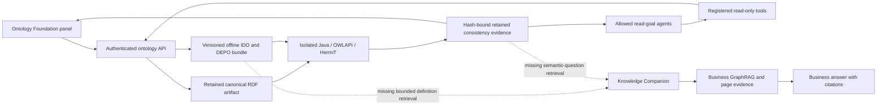

# Agents, services and Companion after embedded foundation / OWL-DL

Review date: 2026-10-28. Scope: the current working tree on `codex/windows-setup-audit-fixes`. This review adds isolated regression/reproduction tests; it does not change production prompts, services or deployed data. No live LLM calls were made.

## Outcome

The actual HermiT service boundary is implemented and can return authenticated, artifact-bound consistency evidence. Integration is incomplete: agent completion does not enforce the semantic disposition of cited evidence, foundation inspection does not expose term definitions, and the Knowledge Companion has no dedicated foundation/consistency retrieval path. These gaps prevent claiming that all agents and Companion answers now benefit from verified OWL-DL reasoning.

Embedding the IDO/DEPO reference is not an approved alignment of customer ontologies, standards certification, or validation of every published business instance. The retained-file consistency operation does not check the entire graph ABox. `consistency_verified: true` means that a consistency decision was established; the decision can be **inconsistent**. Consumers must inspect `status` and modeling-coherence findings.

## Execution and dependency map

The API paths are `/api/v1/ontologies/foundation` and `/api/v1/ontologies/{ontology_id}/consistency` (`backend/ontology_service/router.py:247`, `:254`). They require read identity; a check retains evidence and does not publish the graph. RDFLib parses RDF, Semantica provides the existing structural/SHACL/OWL-RL validation, and the isolated Java worker performs the separate OWL-DL check.

### Catalog coverage

| Agent | Foundation inspection | OWL-DL consistency tool |
|---|---|---|
| ontology-intake | Yes | No |
| ontology-structure-review | Yes | No |
| semantic-bridge-planner | Yes | No |
| ontology-export | No | No |
| ontology-orchestrator | Yes | No |
| context-analyst | Yes | No |
| ontology-governor | Yes | Yes |
| engineering-parser | No | No |
| graph-analyst | Yes | Yes |
| oslc-link-agent | No | No |
| schema-set-agent | No | No |
| data-product-governor | No | No |
| ceim-mapper | Yes | No |
| data-quality-monitor | No | No |
| ontology-steward | Yes | Yes |
| ontology-inference | Yes | Yes |

Availability is an allowlist, not evidence that an agent actually called the tool. The configured ontology review, validated bridge and union automation workflows do not invoke either new tool (`backend/agentic_service/catalog.json:715`, `:739`, `:763`). Existing publication checks remain distinct. Automatically requiring DL for every operation would be a separate behavior/policy change and could block ontologies with unresolved imports.

## Confirmed defects and integration gaps

| ID / severity | Source | Root cause and reproduction | Impact | Recommended correction |
|---|---|---|---|---|
| DL-01 / P1 confirmed guard defect | `backend/agentic_service/goal_runner.py:165` | Supply a completed observation from `ontology.consistency.check` with `status: unknown`, `reason: unresolved_imports`, and `consistency_verified: false`; propose `goal.complete` claiming verified consistency and cite that observation. `validate_action` accepts the proposal because it checks observation completion/truncation, not semantic disposition. | A model-generated summary can misstate a failed/unknown validation as success. Completion remains advisory and does not publish; no actual live-model hallucination was tested. | Derive a typed semantic verdict from cited, scope/hash-matching evidence and render it separately from generated prose. Reject unsupported success assertions or downgrade them deterministically. Never equate transport/tool completion with a consistency verdict. |
| DL-02 / P2 confirmed scope defect | `backend/agentic_service/goal_runner.py:136`, `:145`, `:156` | With empty goal scope/context and a plan, propose a consistency read for a model-chosen ontology ID. Selection guards run only when selected ontology IDs exist, so the action is accepted. A different ID is correctly rejected when scope is pinned. | An agent can check a source the user did not select. Read credentials are still required; this is not an authentication bypass. | Require explicit selected source context for this exact consistency operation; return a missing-input request when absent. Preserve legitimate unscoped discovery/search operations. |
| DL-03 / P2 confirmed semantic-context gap | `backend/ontology_service/foundation.py:35` | Call `foundation_summary()`. It returns manifest metadata and class IRIs, but no class labels/definitions or property semantics. | Agents instructed to use foundational semantics lack those definitions through their new tool. The embedded file existing on disk is insufficient for model context. | Add bounded term lookup with exact IRI, label, definition, relevant relationships, version/hash and citable IDs. Include annotation-property definitions where relevant; avoid injecting the full bundle into every request. |
| DL-04 / P2 confirmed Companion integration gap | `backend/agentic_service/companion_context.py:85`, `:91`; `backend/agentic_service/local_llm.py:137` | Ask about consistency with an ontology selected on the ontology page. The page-context helper returns `not_requested` with no service call. The Companion/context/memory pipeline contains no foundation or consistency tool retrieval, although its summary instructions describe these concepts. | The Companion cannot ground a semantic-status answer in the new check through this path. Business RAG evidence must not be presented as logical consistency evidence. | Route explicit semantic questions to bounded foundation terms and current retained consistency evidence. Bind evidence to selected artifact/foundation versions. Reuse retained evidence; request an explicit expensive check when absent rather than running one for every business question. |
| DL-05 / P2 confirmed repeated-work defect | `backend/ontology_service/owl_dl.py:110`, `:124`, `:126`, `:128` | Check the same RDF containing an unapproved import twice. Both results correctly remain unknown, but both reparse the artifact. The cache accepts only consistent/inconsistent/unsupported; catalog parsing is followed by another RDF parse. | Large customer models repeatedly consume parsing time and memory for an unchanged deterministic import failure. | Parse once and reuse deterministic unresolved-import evidence as **unknown**, keyed to artifact, foundation, worker and import policy/closure. Do not treat unknown as success or persist transient timeout/busy failures as successful cache hits. |
| DL-06 / P2 confirmed evidence-budget defect | `backend/agentic_service/goal_runner.py:64` | Pass a valid consistency result with 200 long classification rows through `bounded`. The >32 KB object becomes an excerpt wrapper; structured status, consistency flag and provenance hashes disappear. | A valid check becomes difficult to consume safely; the completion guard excludes truncated observations, potentially preventing completion. | Preserve a compact typed verdict/provenance envelope and separately bound classification details. Keep explicit truncation/completeness flags for omitted rows. |
| DL-07 / P3 confirmed prompt ambiguity | `backend/agentic_service/catalog.json:186` | Read the Steward prompt: the older blanket prohibition on claiming full OWL-DL proof coexists with appended instructions for executed HermiT evidence. | Instructions do not clearly distinguish reporting an actual scoped decision from overclaiming a structural check. Live-model impact is untested. | State that structural/SHACL/OWL-RL alone cannot establish DL consistency; allow reporting the exact executed decision with source/foundation binding and limitations. |

## Risks not established as live failures

1. **Retained semantic evidence after a foundation-only upgrade (P2 risk).** `backend/agentic_service/source_revisions.py:19`, `:40` capture/verify ontology digest and lifecycle status. The goal contract covers agent/tool/controller configuration, but does not explicitly pin foundation bytes and reasoner identity as resumable source revisions. A foundation-only change could leave an old semantic observation usable on resume. Its evidence still contains the old hashes; no publication bypass was demonstrated. Add semantic dependency revisions and test a real resume across a bundle change.
2. **Preparation time is not fully bounded by the JVM timeout (P2 risk).** RDF preparation precedes the subprocess budget. Very large or pathological retained RDF can consume time before the Java timeout starts. Move parsing/preparation into a bounded worker or enforce a total request budget. The existing size/triple limits remain valuable; exhaustion was not tested.
3. **Transient read retry limitation.** `goal_runner.py:158` prevents repeating an identical read even after a transient busy result. This prevents loops but may require a new goal to retry. Consider a small read-only transient retry budget tied to the overall deadline; do not replay writes.

## Verified boundaries

- Actual HermiT execution is isolated from the web-service process and bounded by Java heap, input/output limits, subprocess timeout and an independent JVM watchdog. Worker identity/hash is checked.
- Unapproved imports remain offline and unresolved. No automatic download, silent import removal, fabricated consistency result, or automatic equivalence is used.
- OWL2-DL profile failures are distinguished from inconsistency and unknown/unavailable results. Unsatisfiable named classes are a separate modeling-coherence finding.
- The consistency evidence/cache binds artifact, embedded foundation and worker/adapter identities. The selected-source guard works when an ontology scope is already supplied.
- Read-tool registration does not grant publication permissions. Existing workflow receipts, approval/publication rules and source-revision checks remain separate.
- The UI presents results and limitations without automatically materializing inferred graph facts. The Companion keeps schema descriptions distinct from business records and uses citation/output security controls; these controls do not substitute for the missing semantic-evidence connector.

## Executed validation

The broader backend run covered embedded DL, read-goal runner/routes, catalog controls, Companion boundary/context regressions and prompt-audit regressions: **172 passed, 2 expected failures**, 78.819 seconds, JUnit `outputs/semantic-agent-review-final.xml`. The two expected failures reproduce DL-01 and DL-02; they are unresolved defects, not passes.

The final focused audit run completed with **3 passed, 4 expected failures**, 24.34 seconds (`outputs/semantic-agent-review-confirm.xml`). Tests in `backend/tests/test_owl_dl_agent_integration_review.py` additionally document DL-05 and DL-06 as strict expected failures against the desired behavior. These focused cases overlap the broader run and must not be added to its count. The real FastAPI consistency check executes the local Java reasoner, verifies denied/allowed read identities through dependency overrides, retains hash-bound evidence in an in-memory registry, verifies a cache hit, and confirms no graph publication. This tests the actual route/engine with isolated authentication and persistence boundaries, not a live PostgreSQL credential/session chain. Adversarial agent proposals are stubs, not live LLM outputs.

Remaining qualification: live-model wording/tool choice, customer network/session reconnect behavior, real persistent-store resume across a foundation upgrade, and customer models with approved complete offline imports. Previously tested AP242 retained data has unresolved external imports, so its OWL-DL status remains unknown until an approved closure is available. This review does not justify dropping databases or changing publication policy.

## Remediation order

1. Fix semantic completion disposition and explicit consistency source selection; keep strict regression cases.
2. Preserve structured verdicts under token budgets and remove repeated RDF parsing.
3. Expose bounded foundation definitions and add an explicit Companion semantic-question/evidence path.
4. Bind resumable semantic observations to foundation/worker revisions and reconcile Steward wording.
5. Qualify representative customer ontologies, reconnect/resume and live-model responses before claiming customer release readiness.
