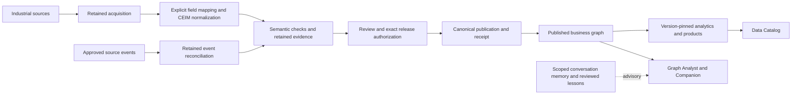

# Industrial ontology platform architecture

Current implementation review: 1 November 2026. PMem combines industrial source ingestion, governed semantic integration, durable batch execution, bounded event reconciliation, graph serving and snapshot analytics. Continuous streaming, customer effectivity semantics and a unified executable CR/CO lifecycle remain separate extensions.

## Business outcomes and layers

| Layer | Responsibility | Current capabilities |
|---|---|---|
| L0 Business outcomes | Product reuse, change impact, requirements and manufacturing context | Evidence-backed investigations; results depend on actual source coverage and baseline |
| L1 Workflows | Ingest, map, validate, review, authorize, publish and consume | Import, Data Flow, Ontology Junction, Change Control, Catalog, Products and Registry |
| L2 Services | Own domain contracts and write authority | Ten capability APIs and canonical publication boundary |
| L3 Execution and intelligence | Execute retained intents and explain evidence | Three durable workers, optional Spark, Governor, Steward, Graph Analyst and Companion |
| L4 Persistence and operations | Protect state, evidence, access and recovery | PostgreSQL, published Neo4j projections, immutable artifacts, scoped memory, migrations and managed lifecycle |

## Semantic integration and processing

File, XML and ontology imports retain their native workflows. REST and 13 additional connector adapters use server-configured source references and bounded worker acquisition. Generic connector records can enter the explicit `connector-ceim-normalize` job; this produces a proposal through the existing mapping pack and CEIM validator. Acquisition is not automatic business alignment.

The batch path retains immutable inputs/results, job definitions, ownership leases and approved replay. Spark is optional and distinct from API/worker health. The speed path captures and reconciles bounded events using the same semantic contract and canonical approval boundary. It is not a complete continuous Lambda speed layer: persistent source offsets, event supersession, approved retractions and a customer latency/volume SLO are prerequisites for that claim.

## Authority and storage

PostgreSQL owns definitions, configurations, runs, leases, source/event/reconciliation state, approval evidence, product delivery and analytics tables. Neo4j serves published ontology/instance projections and scoped optional graph memory. Artifact storage owns immutable source/output bytes and report evidence. There is no distributed transaction across all stores; publication receipts, fences and reconciliation make uncertain outcomes recoverable.

ODS values, entity dimensions, relationship/measure/KPI facts and versioned marts exist in PostgreSQL. Approved models pin a dataset and reviewed units. A descriptive revision/effectivity scope is not an executable temporal filter; the source baseline and model must establish its meaning. Graph presence and a completed job do not establish product approval.

## Agents and knowledge use

Governor coordinates proposals and authorized execution. Steward assesses retained mapping/reconciliation evidence and semantic checks. Graph Analyst investigates selected runs, events and business objects. Companion explains current cited evidence using vocabulary and a bounded operational context. None grants approval from model prose.

Memory is scoped by ownership and selected context. Conversation and tool history can support follow-up questions; approved semantic bridge lessons can advise review for the matching version. Memory does not replace current source evidence, create semantic equivalence or retrain the model automatically. RDF parsing, SHACL/structural checks and isolated artifact-bound HermiT reasoning provide distinct assurances.

## User experience and governance

The six workspaces share retained task controls and explicit state/receipt links. Change Control currently aggregates evidence read-only; native services retain execution authority. A parent CR/CO can link those intents in a future extension without duplicating approval engines. Data Flow Event reviews exposes current reconciliation scope to existing agents and Companion. Detailed raw payloads remain out of the conversational narrative.

## Acceptance boundaries

The event fixes require concurrent capture, transaction failure, safe retry, publication-receipt protection and session/context regression coverage. Optional connector SDKs and source accounts must be accepted in their deployment. Real restore validation, public-origin sessions, load/latency budgets and customer-specific KPI/baseline acceptance remain operational release requirements.

See [Semantic source preparation and event review](SEMANTIC-EVENT-WORKFLOW.md), [Workflow engine](WORKFLOW-ENGINE.md) and the dated [architecture audit](audits/industrial-ontology-lambda-review-2026-11-01.md) for implementation boundaries and evidence.
